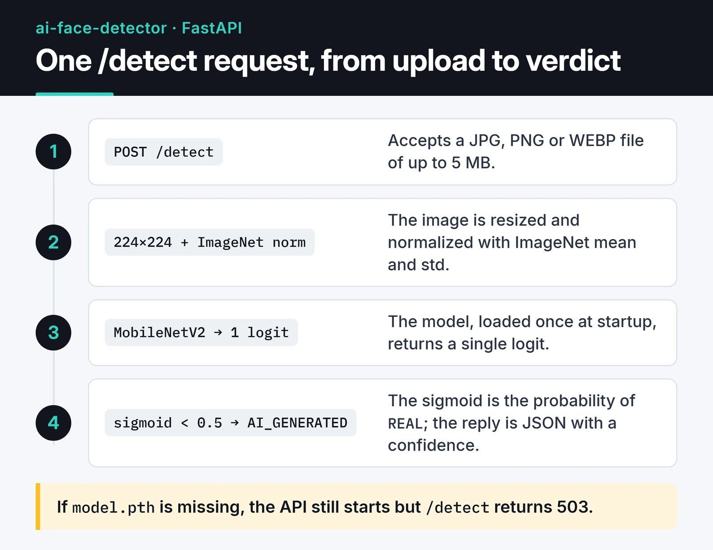

[AI Face Detector](https://github.com/furkankoykiran/ai-face-detector) is an open source project that predicts whether a face photo is real or AI-generated. It's a MobileNetV2 classifier trained with PyTorch, served through a FastAPI REST API, with a simple drag-and-drop page styled with Tailwind CSS. I built it in March 2026 and released it under the MIT license.

This post covers how I trained the model, how the API works, and, most importantly, what the model does and doesn't know.

## What it does and what it doesn't

For a single face image, the model returns one of two classes: `REAL` or `AI_GENERATED`. The real faces in the training data come from FFHQ and the fake ones from StyleGAN. That has three consequences worth stating up front:

- The model was trained to spot fully synthetic, StyleGAN-style faces. Images from diffusion models such as Stable Diffusion or Midjourney aren't in the training set. The repo description mentions them, but there's no measured accuracy on those generators.
- Face swaps in video, the classic deepfake, are out of scope. The model looks at one still image.
- A classifier's output is a probability. Don't use it as sole evidence for identity verification or fact-checking.

The banner at the top of the repo README names diffusion models next to GANs. The limit above still applies: the only measured results are on StyleGAN faces.

## Architecture

The card below follows one request: the uploaded file is validated, resized to 224×224 and normalized, passed through the model, and returned as JSON.



The model is loaded once at startup in FastAPI's `lifespan` handler. If `model.pth` is missing, the API still starts but `/detect` returns 503, and `/health` reports whether the model is loaded.

## Dataset

I trained on the [140k Real and Fake Faces](https://www.kaggle.com/datasets/xhlulu/140k-real-and-fake-faces) dataset from Kaggle: 70,000 real faces from FFHQ and 70,000 StyleGAN faces, all 256×256. The provided split is 100,000 training, 20,000 validation and 20,000 test images. With balanced classes, the model can't score well just by leaning towards one class.

## The model: transfer learning with MobileNetV2

Instead of training a CNN from scratch, I started from MobileNetV2 pretrained on ImageNet, froze the feature extractor, and replaced and trained only the final classifier. At about 3.5 million parameters it runs quickly on a CPU, and the weights file is around 14 MB.

The core of the model setup in `training/train.py`:

```python
import torch.nn as nn
from torchvision import models
from torchvision.models import MobileNet_V2_Weights

def create_model() -> nn.Module:
    model = models.mobilenet_v2(weights=MobileNet_V2_Weights.IMAGENET1K_V1)

    for param in model.features.parameters():
        param.requires_grad = False  # frozen backbone, only the head trains

    in_features = model.classifier[1].in_features  # 1280
    model.classifier = nn.Sequential(
        nn.Dropout(p=0.3),
        nn.Linear(in_features, 1),  # one logit: 0 = AI, 1 = REAL
    )
    return model
```

The rest of the training setup:

- `BCEWithLogitsLoss` with `Adam` (learning rate 0.001, weight decay 1e-4).
- `ReduceLROnPlateau` divides the learning rate by 10 after 3 epochs without validation-loss improvement. Early stopping kicks in after 5. At most 15 epochs.
- Inputs are resized to 224×224 and normalized with ImageNet mean and standard deviation. The only augmentation is a random horizontal flip; I removed heavier transforms from the script to keep training fast.
- On Kaggle I used two T4 GPUs with `DataParallel`, mixed precision (`torch.amp`) and a batch size of 256. The script detects whether it runs on Kaggle, Colab or locally.

## Results

The README reports these numbers on the dataset's test split (20,000 images):

| Metric | Value |
| :--- | :--- |
| Accuracy | 94.5% |
| Precision | 94.2% |
| Recall | 94.8% |
| F1 | 0.945 |
| AUC-ROC | 0.978 |
| Inference (CPU / GPU) | ~45 ms / ~8 ms |

Keep in mind that the test set comes from the same distribution as the training set: the same StyleGAN, the same resolution, the same crops. I'd expect accuracy to drop on photos from another generator, or on images that were compressed or resized along the way. Building a separate test set to measure that is on my list.

## The API

The endpoint that matters is `POST /detect`. It accepts a JPG, PNG or WEBP file up to 5 MB:

```bash
curl -X POST "http://localhost:8000/detect" -F "file=@face.jpg"
```

```json
{
  "status": "success",
  "result": "AI_GENERATED",
  "confidence": 0.98,
  "probabilities": { "AI_GENERATED": 0.98, "REAL": 0.02 },
  "inference_time_ms": 45.2,
  "image_size": "512x512"
}
```

The model outputs a single logit. After the sigmoid, the value is the probability of `REAL`. Anything below 0.5 is returned as `AI_GENERATED`, and `confidence` is the probability of whichever class won.

## Running it locally

```bash
git clone https://github.com/furkankoykiran/ai-face-detector.git
cd ai-face-detector
python -m venv .venv && source .venv/bin/activate
pip install -r requirements.txt
```

The trained weights aren't in the repo. You can download them from the [Kaggle model page](https://www.kaggle.com/models/furkankoykiran/ai-face-detector-mobilenetv2), or open a GPU notebook on Kaggle, attach the dataset and run `training/train.py`. According to the README, training on two T4s takes about 43 minutes. Put the resulting `model.pth` in the project root and start the API:

```bash
uvicorn app.main:app --reload --port 8000
```

Swagger UI is at `http://localhost:8000/docs`. Serve the web page with a small server rather than opening the file directly, because the API's CORS list includes `http://localhost:3000` but not `file://`:

```bash
python -m http.server 3000 --directory static
```

The quickest way to try the model without installing anything is the [demo notebook on Kaggle](https://www.kaggle.com/code/furkankoykiran/ai-face-detector-model-demo). It attaches the trained model and the 140k dataset as inputs and runs on two T4 GPUs.


## Known rough edges

Rereading the repo, I found three things to fix:

- `app/model_loader.py` still uses the old `pretrained=True` argument, which torchvision deprecated in 0.13. Since we load our own weights anyway, there's no reason to download the ImageNet weights on every startup.
- Training on two GPUs with `DataParallel` saves `state_dict` keys with a `module.` prefix. The API doesn't strip it, so it can't load such a file.
- `requirements.txt` pins early-2024 versions (torch 2.1, FastAPI 0.109).

For the first two, the loader should look like this:

```python
import torch
import torch.nn as nn
from torchvision import models

def create_model() -> nn.Module:
    model = models.mobilenet_v2(weights=None)  # weights come from our file
    in_features = model.classifier[1].in_features
    model.classifier = nn.Sequential(nn.Dropout(p=0.3), nn.Linear(in_features, 1))
    return model

def load_model(path: str, device: torch.device) -> nn.Module:
    state = torch.load(path, map_location=device, weights_only=True)
    state = {k.removeprefix("module."): v for k, v in state.items()}
    model = create_model()
    model.load_state_dict(state)
    return model.to(device).eval()
```

`weights_only=True` has been the default since PyTorch 2.6. It stops a `.pth` file from an unknown source from executing code on load, so I prefer to spell it out.

## What's next

The code is [on GitHub](https://github.com/furkankoykiran/ai-face-detector), and there's a summary on [my portfolio](https://furkankoykiran.com.tr/en/projects/ai-face-detector/). Next up: fix the rough edges above and build a separate test set of faces from diffusion models. If the model holds up there, it will be fair to widen the claim in the README.

If you're interested in the API side, [REST API development with FastAPI](/en/posts/python-fastapi-rest-api/) goes deeper into Pydantic v2 and async. For preprocessing, see [image processing with Pillow and OpenCV](/en/posts/python-image-processing-pillow-opencv/), and for shipping the service, [containerizing a Python app with Docker](/en/posts/docker-python-app-containerization/).
