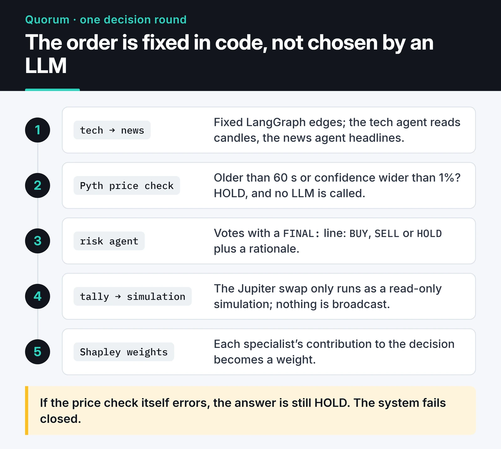

Most articles on AI-powered trading show the same picture: someone trains an LSTM, the predicted line sits almost perfectly on top of the real price, and the reader walks away convinced the model prints money. That chart is usually an illusion.

I've tried two different approaches. The first is classic machine learning: engineer features from price data and predict the direction of the next candle. The second is newer: [Quorum](https://furkankoykiran.com.tr/en/projects/quorum/), a hackathon project where several LLM agents debate a trade and vote on it. This post covers what I learned from both, with the code and the numbers I measured.

## Why those beautiful LSTM charts mislead

Ask a model to predict the price itself, say tomorrow's close, and it quickly learns the easiest answer: tomorrow will look a lot like today. The predicted line trails the real one by a single candle, looks great on a chart and has a low average error. The one thing you need to place a trade, the direction, isn't in it.

So I now target returns or direction instead of price, and I measure success against a dumb baseline that always predicts the majority class, not as raw accuracy.

## A simple model with walk-forward validation

The code below derives a handful of features from hourly candles and trains a gradient boosting classifier to predict whether the next candle closes higher. A random `train_test_split` is a mistake on time series, because the model gets to train on the future. `TimeSeriesSplit` trains each fold on the past only and tests on the period right after it.

```python {title="model.py"}
import pandas as pd
from sklearn.ensemble import HistGradientBoostingClassifier
from sklearn.model_selection import TimeSeriesSplit


def make_features(df: pd.DataFrame) -> pd.DataFrame:
    close = df["close"]
    ret = close.pct_change()
    delta = close.diff()
    gain = delta.clip(lower=0).rolling(14).mean()
    loss = (-delta.clip(upper=0)).rolling(14).mean()
    feats = pd.DataFrame({
        "ret_1": ret,
        "ret_6": close.pct_change(6),
        "ret_24": close.pct_change(24),
        "vol_24": ret.rolling(24).std(),
        "rsi_14": 100 - 100 / (1 + gain / loss),
        "vol_ratio": df["volume"] / df["volume"].rolling(24).mean(),
    })
    # Target: does the next candle close above this one?
    feats["target"] = (close.shift(-1) > close).astype(int)
    return feats.iloc[:-1].dropna()  # the last candle's target isn't known yet


def walk_forward(data: pd.DataFrame, n_splits: int = 5) -> list[float]:
    """Per fold: model accuracy minus the majority-class baseline."""
    X, y = data.drop(columns="target"), data["target"]
    edges = []
    for train_idx, test_idx in TimeSeriesSplit(n_splits=n_splits, gap=24).split(X):
        model = HistGradientBoostingClassifier(max_iter=200, learning_rate=0.05)
        model.fit(X.iloc[train_idx], y.iloc[train_idx])
        acc = (model.predict(X.iloc[test_idx]) == y.iloc[test_idx]).mean()
        baseline = max(y.iloc[test_idx].mean(), 1 - y.iloc[test_idx].mean())
        edges.append(round(float(acc - baseline), 4))
    return edges
```

`gap=24` leaves 24 candles between train and test. Some features use 24-candle windows, so without the gap the last training rows and the first test rows would share data.

Running this on the random-walk data from my [pandas post](/en/posts/pandas-crypto-market-analysis/), resampled to hourly candles, gave the expected result: across five folds, the model's edge over the baseline ranged from about +0.008 to -0.020. Zero, or slightly negative. There's nothing to learn in a random series, and the model learned nothing.

## The best leakage test I know

That result sounds boring, but it makes a very handy test. I added a single column that accidentally contains the future, the next candle's return, and the model jumped to 48 to 50 points above the baseline in every fold. It got almost every prediction right. In the output below, the first line is the clean data, the second the leaky data, and the third the first 50,000 minute candles of the same series:


So my rule is: whenever I write a new feature or data pipeline, I run it on random data first. If it shows a meaningful edge on noise, part of whatever success I see on real data is very likely leakage.

In real projects leakage is rarely that obvious. The ones I see most:

- Fitting a scaler (`StandardScaler` and friends) on the whole dataset before splitting. The test period's statistics leak into training.
- Features built with `rolling(..., center=True)` or `shift(-n)`. Both look ahead.
- Using a value you can't know before the candle closes (its close, its volume) to decide within that candle.
- Training only on coins that are still listed today.

Even when a model shows a small edge on real data, you're not done. A 51% hit rate usually turns negative after fees and slippage, so I always judge a model together with a cost-aware backtest. I cover that side in my post on [automated trading systems in Python](/en/posts/building-automated-trading-systems-python/).

If you run Freqtrade rather than your own stack, its FreqAI module handles feature generation, sliding-window retraining and backtest integration out of the box. The leakage risks are the same there; the tool doesn't think for you.

## A committee of LLM agents: Quorum

I built Quorum for the SWARM Hackathon. The idea: no single model decides everything. Separate agents cover technical analysis, news and risk; each argues about the trade in plain English and then votes. The agents are built with LangGraph. The tech agent reads candles through [freqtrade-mcp](/en/posts/freqtrade-mcp-server/), the news agent reads headlines through [OmniWire-MCP](/en/posts/omniwire-mcp-news-server/), and execution targets Solana through a Squads V4 multisig and Jupiter.



After the vote, a Shapley agent estimates each specialist's contribution to the decision as a weight. The goal is to split realized profit between the operators who run the agents according to those weights.

Where the project stands: the multisig and vault transactions ran on Solana devnet, and the Jupiter swap was exercised on a mainnet fork and through read-only simulation. The continuous runner never broadcasts a transaction, and the mainnet cutover on the roadmap was not completed. Quorum makes no return claims; it's an architecture experiment.

The lessons hold regardless of which model you use.

### Let code own the control flow

At the start, a supervisor LLM decided which agent spoke next. With some model and gateway combinations it didn't reliably follow "consult all three agents." I ended up hard-coding the order with fixed LangGraph edges (tech → news → risk → tally). In a trading system, the model shouldn't decide which step is skippable.

### Model output must be structured and verifiable

Every agent ends its reply with a `FINAL: {"agent": ..., "vote": ..., "rationale": ...}` line, parsed with a regex and JSON. If the vote isn't `BUY`, `SELL` or `HOLD`, or the rationale is empty, that turn doesn't count. There's no "it probably meant buy."

### Risk checks live in code, not in the prompt

Before the risk agent runs, the Pyth price feed is checked. If the price is older than 60 seconds or its confidence interval is wider than 1% of the price, the decision is HOLD and the LLM is never called. If the check itself errors, the answer is still HOLD: the system fails closed. A prompt saying "please don't suggest risky trades" is no substitute.

### LLMs aren't forecasters

Agents are good at summarizing headlines, turning technical data into a readable rationale and explaining a decision. Knowing where price goes next isn't on that list. Every debate round is also several model calls, so cost and latency rule this approach out for anything that needs decisions in seconds. That's why Quorum's loop runs on an interval of minutes.

## How I'd build it today

If it were my own money, the order would be: a simple strategy with explicit rules that survives a cost-aware backtest and an untouched hold-out period; strict position sizing and a daily loss limit on top; machine learning at most as a filter, for example to stay flat during extreme volatility. I'd use LLM agents for monitoring, explanation and reporting, not in the middle of the decision loop.

None of this is financial advice. A model that looks good on historical data won't necessarily make money going forward, and crypto markets change regime quickly. Don't trade money you can't afford to lose.

Quorum's code and architecture notes are [on GitHub](https://github.com/furkankoykiran/Quorum). If you try your own experiment, run the `walk_forward` function above on random data first. If the result isn't close to zero, find the leak before you touch real data.
