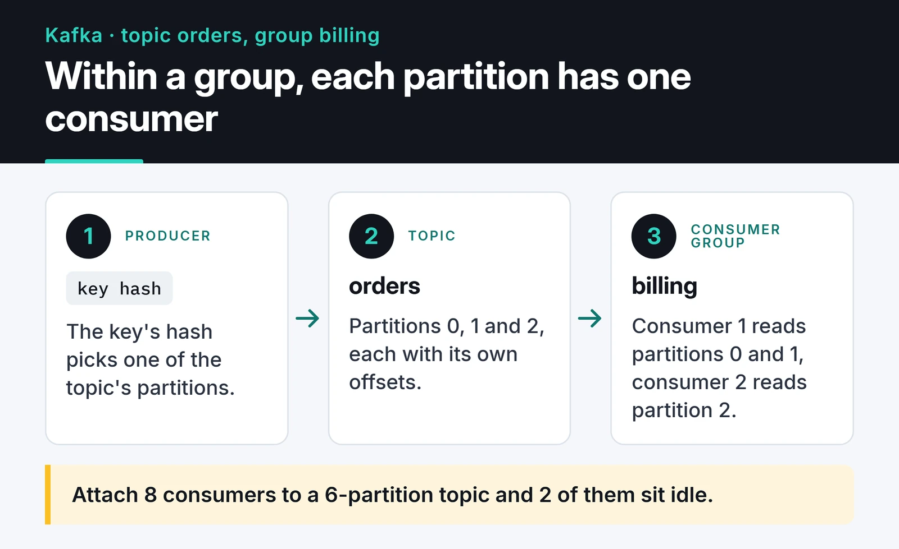

Apache Kafka event streaming is a different model from a classic message queue. Kafka is an ordered, distributed log that doesn't delete messages once they're read. Used well, that gives you replay, many independent consumers and very high throughput. Used badly, it gives you consumers stuck in rebalance loops and lost messages.

This post covers what a Kafka 4 cluster looks like in KRaft mode without ZooKeeper, how to pick a partition count, and how to write a producer and consumer in Python with `confluent-kafka` that don't lose data.

## How Kafka differs from RabbitMQ

RabbitMQ is a smart broker: it routes messages into queues and deletes them when the consumer acks. A Kafka broker does something simpler. It appends messages to a topic's partitions in order and keeps them until retention expires. Each consumer group tracks how far it has read (its offset) on its own.

What that means in practice:

- Many consumer groups can read the same topic without knowing about each other. Billing, analytics and the search indexer can all consume order events separately.
- After fixing a bug, you can rewind a group's offset and reprocess history.
- Ordering is only guaranteed within a partition. If a user's events must stay in order, send them with the same key so they land on the same partition.

For "someone do this job and be done" work queues, RabbitMQ is less hassle; I wrote about it in my [RabbitMQ post](/en/posts/rabbitmq-message-queue/). I pick Kafka for event streams, multiple consumers and replay.

## KRaft: ZooKeeper is gone

For years Kafka needed a separate ZooKeeper cluster to store cluster metadata. In KRaft mode, Kafka's own controllers handle that with Raft consensus. Kafka 4.0 removed ZooKeeper support entirely. If you still run a ZooKeeper-based cluster, migrate to KRaft on the 3.x line first (3.9 is the bridge release) and upgrade to 4.x after; a ZooKeeper cluster can't be upgraded to 4.0 directly.

In production, the recommendation is three (or five) dedicated controller nodes plus separate brokers. For development, a single node can be both controller and broker, and that's exactly what the official Docker image does by default:

```yaml
# compose.yaml
services:
  kafka:
    image: apache/kafka:4.1.0
    container_name: kafka
    ports:
      - "9092:9092"
```

```bash
docker compose up -d
docker exec -it kafka /opt/kafka/bin/kafka-topics.sh \
  --bootstrap-server localhost:9092 \
  --create --topic orders --partitions 6 --replication-factor 1
```

On your own installation, each node sets `process.roles` (`controller`, `broker` or both), and the storage directory has to be formatted with a cluster ID using `kafka-storage.sh format` before the first start. ZooKeeper setups had no such step, which is why it's the one people skip the first time.

## Choosing a partition count

Partitions are Kafka's unit of parallelism. Within a consumer group, only one consumer reads a given partition at a time. Attach 8 consumers to a 6-partition topic and 2 of them sit idle.



A rough calculation:

```text
partitions ≥ target throughput / throughput of one consumer
```

If 1,000 messages arrive per second and one consumer can handle 100 per second (because it writes to a database), you need at least 10 partitions. Leave some headroom for growth, but don't create thousands: every partition costs files, memory and leader elections.

You can add partitions later but you can't remove them. Adding them also changes which partition a key maps to, so old and new messages for the same key can end up on different partitions. If you rely on per-key ordering, be generous up front.

## A producer that doesn't lose data

For Python I use `confluent-kafka`, built on librdkafka (written in C) and fast. The settings that matter for reliability:

- `acks=all`: a write only counts as successful once all in-sync replicas have it, not just the leader.
- `enable.idempotence=True`: retries after a network error don't write duplicates, and order within a partition is preserved. The Java client enables it by default; librdkafka doesn't, so set it explicitly.
- On the broker side, replication factor 3 with `min.insync.replicas=2`. Losing one broker then neither stops writes nor leaves data with a single copy.

```python
import json

from confluent_kafka import Producer

producer = Producer(
    {
        "bootstrap.servers": "localhost:9092",
        "acks": "all",
        "enable.idempotence": True,
        "linger.ms": 10,  # batch small messages for up to 10 ms
        "compression.type": "zstd",
    }
)


def on_delivery(err, msg) -> None:
    if err is not None:
        print(f"delivery failed: {err}")
    else:
        print(f"{msg.topic()}[{msg.partition()}] offset={msg.offset()}")


order = {"id": 42, "user_id": 7, "total": 199.9}
producer.produce(
    "orders",
    key=str(order["user_id"]),  # same user, same partition
    value=json.dumps(order).encode(),
    on_delivery=on_delivery,
)
producer.poll(0)    # serve delivery callbacks
producer.flush(10)  # send what's queued before shutting down
```

`produce` is asynchronous: it puts the message in a local queue and returns immediately. You learn the outcome in the callback, so logging or retrying failures there is your job. The producer is heavy and thread-safe; create one per application, not one per request.

Keep messages small. The broker's default limit is about 1 MB. Send a pointer to object storage instead of an image or a large file.

## Consumers: commit after the work is done

With the default `enable.auto.commit=true`, offsets are committed periodically in the background. You receive a message, its offset gets committed, the process crashes mid-task: that message never comes back. I turn auto-commit off and commit after processing. That gives at-least-once delivery. After a crash a message may be processed twice, so make processing idempotent, for example with a unique constraint on the order ID.

```python
import json

from confluent_kafka import Consumer, KafkaException

consumer = Consumer(
    {
        "bootstrap.servers": "localhost:9092",
        "group.id": "billing",
        "enable.auto.commit": False,
        "auto.offset.reset": "earliest",
        "partition.assignment.strategy": "cooperative-sticky",
        "group.instance.id": "billing-1",  # static membership; unique per instance
    }
)
consumer.subscribe(["orders"])


def process(order: dict) -> None:
    print("billed:", order["id"])


try:
    while True:
        msg = consumer.poll(1.0)
        if msg is None:
            continue
        if msg.error():
            raise KafkaException(msg.error())
        process(json.loads(msg.value()))
        consumer.commit(message=msg, asynchronous=False)
finally:
    consumer.close()
```

A synchronous commit after every message is simple but slow. When you need throughput, committing every few hundred messages or every few seconds is a common middle ground, at the cost of more reprocessing after a crash. For an asyncio service, `aiokafka` offers the same model with `async/await`.

## Rebalance storms

When a consumer joins or leaves a group, partitions are reassigned. Under the old "eager" protocol, the whole group stops reading while that happens. The most common trigger: a consumer that doesn't call `poll` again within `max.poll.interval.ms` (5 minutes by default) is considered dead and kicked out. One slow database write can push the whole group into a rebalance loop.

What I set:

1. `partition.assignment.strategy=cooperative-sticky`: during a rebalance only the partitions that need to move are released, and the rest keep being consumed.
2. Static membership through `group.instance.id`: a consumer that restarts during a deploy and returns within `session.timeout.ms` triggers no rebalance at all.
3. Keep the work done per `poll` loop small enough to stay under `max.poll.interval.ms`. The Java client has `max.poll.records` for this. `confluent-kafka`'s `poll` returns one message anyway; if you batch with `consume(num_messages=...)`, keep the number low.

Kafka 4.0 also made the new consumer group protocol (KIP-848) generally available. The broker does the assignment, and rebalances are incremental without stopping the group. Clients opt in with `group.protocol=consumer`, and recent librdkafka releases support it. It's worth trying on a new project.

## Log compaction

Normally, old segments are deleted when retention expires. On a topic with `cleanup.policy=compact`, Kafka keeps at least the latest value for every key. If `user:123` gets "Alice" and later "Alicia", only "Alicia" survives compaction. The topic then behaves like the changelog of a key-value table: a new service can rebuild the current state by reading the topic from the start. To delete a key, send a message with a null value (a tombstone) for it.

## Keep unclean leader election off

When a partition's leader dies, Kafka elects a new one from the in-sync replicas. With `unclean.leader.election.enable=true`, if no in-sync replica is left, Kafka promotes a replica that had fallen behind: the partition stays available, but every message that replica missed is gone. The default is `false`, and for orders, payments and similar data it should stay that way. You can turn it on per topic for logs or metrics where availability matters more than completeness.

## Monitoring

Running Kafka without monitoring means hearing about problems from users. I collect JMX metrics with the Prometheus JMX exporter and consumer lag with a tool like kafka-exporter or Burrow, then graph them in Grafana; the general setup is in my [Prometheus and Grafana post](/en/posts/prometheus-grafana-monitoring/). The metrics I alert on:

- Consumer lag: how far behind a group is. If it keeps growing, consumers can't keep up. Scale out or speed up processing.
- `UnderReplicatedPartitions`: above zero means a broker is lagging or down, and data has fewer copies than it should.
- `OfflinePartitionsCount`: partitions with no leader. Should be zero.
- `ActiveControllerCount`: summed across controllers, it should be exactly 1.

## Where to go next

Start the single-node Kafka from the compose file above, run the producer, then start the consumer in two terminals with different `group.instance.id` values and watch how partitions are shared. If your events come from external systems, my [webhook handler post](/en/posts/webhook-handler-event-driven-architecture/) covers that side, and if you feed a search index from Kafka, see my [Elasticsearch post](/en/posts/elasticsearch-full-text-search/). For the full list of settings, the [Kafka documentation](https://kafka.apache.org/documentation/) and the [confluent-kafka Python docs](https://docs.confluent.io/platform/current/clients/confluent-kafka-python/html/index.html) are the references to trust.
