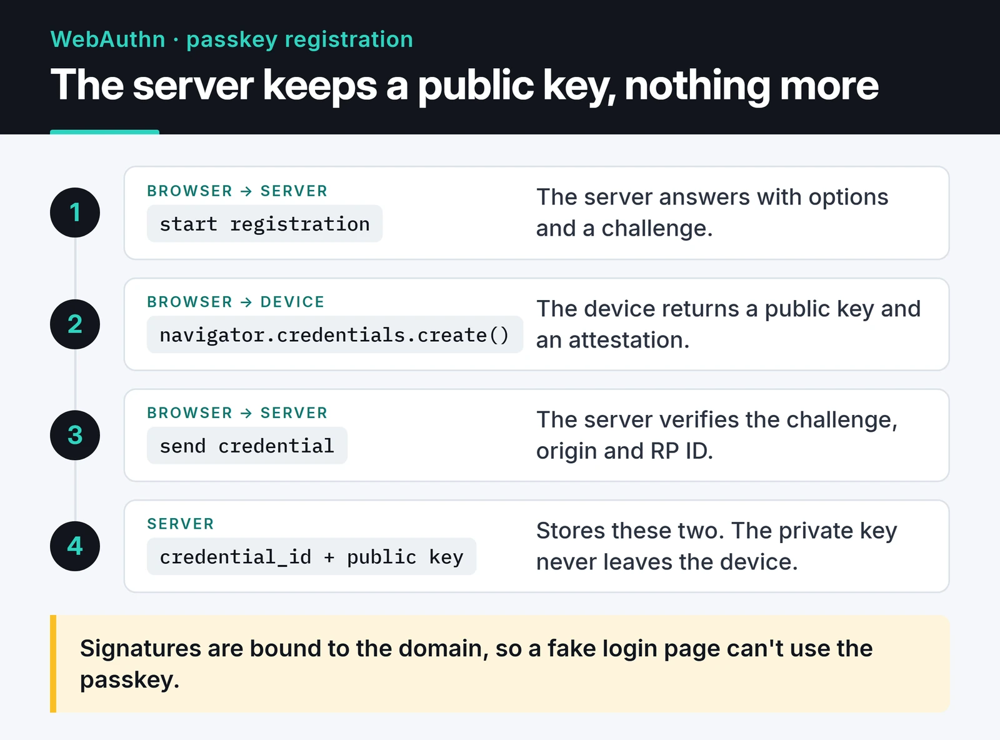

Most articles on API authentication push one method: "use JWTs" or "never use JWTs". I think the right answer depends on who is calling the API. This post sorts API authentication strategies by caller: API keys, JWTs and their pitfalls, OAuth 2.1, passkeys and mTLS between services. At the end I show how I wire them into FastAPI.

First, two terms. Authentication answers "who is this?", authorization answers "may they do this?". A large share of real-world API vulnerabilities come from skipping the second one: the user is authenticated correctly, but nobody checks whether the record they asked for is theirs.

## Who is calling, and what to use

| Caller | What I use |
|---|---|
| Your own web app in a browser | Server-side session + `HttpOnly` cookie; passkeys at login |
| Mobile app or SPA with an external identity provider | OAuth 2.1 Authorization Code + PKCE, OIDC |
| Third-party app acting for a user | OAuth 2.1 with scopes |
| Developer calling the API from scripts | API key |
| Your own services calling each other | OAuth client credentials or mTLS |

## API keys: never store them in plain text

I still see API keys stored as plain text in the database. If that database dump leaks, every customer's key leaks with it. I treat keys like passwords:

1. Generate them from a strong random source with a recognizable prefix.
2. Show them to the user once.
3. Store only a hash.

```python
import hashlib
import secrets

PREFIX = "fk_live_"


def new_api_key() -> tuple[str, str]:
    key = PREFIX + secrets.token_urlsafe(32)
    return key, hash_api_key(key)  # key to the user, hash to the database


def hash_api_key(key: str) -> str:
    return hashlib.sha256(key.encode()).hexdigest()
```

Argon2 often gets recommended here. That's right for passwords and unnecessary for API keys. Argon2 and bcrypt exist to slow down brute force against short, guessable passwords. A random 256-bit key can't be brute-forced anyway, and you verify the key on every request, so a deliberately slow hash adds tens of milliseconds to each one. SHA-256 is the right tool, and it lets you look the key up through an index on the hash. If you want an extra layer, HMAC the key with a server-side secret, so someone holding only the database can't test guesses against the hashes.

The prefix has a job too. Secret scanners such as GitHub's can recognize the pattern when a key lands in a repository by mistake. Scopes (read-only, for example), expiry dates and a UI where users rotate and revoke their own keys round it out.

## JWT pitfalls and strict validation

Most JWT horror stories are really about missing validation. The pitfalls I watch for:

- `alg: none`: the attacker sets the header algorithm to `none` and strips the signature. Libraries that trusted the token's own header used to accept it.
- Algorithm confusion: the server expects RS256, the attacker signs with HS256 using the server's public key as the HMAC secret. Allow both algorithms for the same key and you're exposed.
- No `aud` or `iss` check: a valid token issued for another service works against yours.
- Long-lived access tokens: they can't be revoked, so a stolen one keeps working for days.
- Sensitive data in the payload: JWTs are signed, not encrypted by default. Anyone can base64-decode the payload.

My recipe against all of them: pin the algorithm, require `aud`, `iss` and `exp`, and keep access tokens at 5 to 15 minutes. Verifying a token signed by an identity provider with PyJWT looks like this:

```python
import jwt
from jwt import PyJWKClient

ISSUER = "https://auth.example.com/"
AUDIENCE = "https://api.example.com"
# The real URL is the jwks_uri from ISSUER + ".well-known/openid-configuration"
jwks_client = PyJWKClient("https://auth.example.com/.well-known/jwks.json")


def verify_access_token(token: str) -> dict:
    signing_key = jwks_client.get_signing_key_from_jwt(token)
    return jwt.decode(
        token,
        signing_key.key,
        algorithms=["RS256"],
        audience=AUDIENCE,
        issuer=ISSUER,
        options={"require": ["exp", "iat", "sub", "aud", "iss"]},
        leeway=30,
    )
```

Many older tutorials use `python-jose`. That library went largely unmaintained for a long stretch, and the FastAPI docs switched to PyJWT, so I use PyJWT too.

Where the browser keeps the token matters too. A token in `localStorage` is readable by any XSS bug on the page. For your own web app, a session ID in an `HttpOnly` cookie is usually both safer and simpler.

PASETO is sometimes pitched as "the new standard" replacing JWT, which overstates things. Its design is genuinely safer: it doesn't let developers pick algorithms, `v4.public` signs with Ed25519 and `v4.local` encrypts the payload. But the ecosystem is small, and almost no identity provider issues PASETO tokens. A strictly validated JWT, as above, is enough for most projects.

## Sessions or tokens?

| | Server-side session (Redis) | Short-lived JWT + refresh token |
|---|---|---|
| Revocation | Instant, delete the record | Access token valid until expiry; refresh token revocable |
| Per request | One Redis read | Signature check only |
| Best fit | Your own web app | Multiple services, mobile, external identity provider |

"JWTs can't be revoked" is a common claim, and it's too blunt. Keep access tokens short and store refresh tokens server-side, and "log out everywhere" means deleting the refresh tokens. The worst case is a stolen access token working for a few more minutes. If that's unacceptable, what you need is a session.

## OAuth 2.1 and OpenID Connect

OAuth is an authorization protocol: "may this app access my photos on my behalf?" OpenID Connect adds identity on top: "who just signed in?"

The OAuth 2.1 draft (draft-ietf-oauth-v2-1) consolidates years of security lessons into one document, in line with the OAuth 2.0 Security Best Current Practice published as RFC 9700. What changes in practice:

- PKCE is required for every client using the Authorization Code flow, not just mobile apps.
- The implicit flow and the password grant (where users type their password into the client app) are gone.
- Redirect URIs are matched exactly, no wildcards.
- For public clients like browsers and mobile apps, refresh tokens are either rotated on every use or bound to the client.

There are two standard ways to bind a token to its client: DPoP (RFC 9449) and certificate-bound tokens over mTLS (RFC 8705). With either, a stolen token is useless without the owner's private key.

Don't write your own authorization server; it's like writing your own crypto library. Use Keycloak, Ory Hydra or a managed service like Auth0, and let your API just validate tokens as shown above.

## Passkeys: passwordless and phishing-resistant

The biggest change in user login over the last few years is passkeys. They're built on WebAuthn: the server stores only a public key, and the private key never leaves the device. Signatures are bound to the domain, so a fake login page can't use the user's passkey. That shuts down most password leaks, credential stuffing and phishing attacks at once.



In Python I use the `webauthn` library (py_webauthn). The server side of registration is two functions:

```python
from webauthn import generate_registration_options, options_to_json, verify_registration_response
from webauthn.helpers.structs import (
    AuthenticatorSelectionCriteria,
    ResidentKeyRequirement,
    UserVerificationRequirement,
)

RP_ID = "example.com"
ORIGIN = "https://example.com"


def start_registration(user_id: bytes, email: str) -> tuple[str, bytes]:
    options = generate_registration_options(
        rp_id=RP_ID,
        rp_name="Example",
        user_id=user_id,
        user_name=email,
        authenticator_selection=AuthenticatorSelectionCriteria(
            resident_key=ResidentKeyRequirement.REQUIRED,
            user_verification=UserVerificationRequirement.PREFERRED,
        ),
    )
    # keep the challenge in the user's session; send the JSON to the browser
    return options_to_json(options), options.challenge


def finish_registration(credential_json: str, expected_challenge: bytes):
    verified = verify_registration_response(
        credential=credential_json,
        expected_challenge=expected_challenge,
        expected_rp_id=RP_ID,
        expected_origin=ORIGIN,
    )
    return verified.credential_id, verified.credential_public_key, verified.sign_count
```

Login has the same shape with `generate_authentication_options` and `verify_authentication_response`. Before making passkeys the only way in, plan account recovery: a second passkey or an email-verified fallback.

## Service to service: mTLS

If internal services trust each other without checking identity, an attacker who gets in once can reach everything. With mTLS both sides present and verify certificates. It's more practical at the reverse proxy or in a service mesh (Istio, Linkerd) than in application code; a mesh issues and rotates certificates for you.

If you set it up by hand, don't skip two things in the OpenSSL commands: a `subjectAltName` (modern clients don't fall back to the CN) and a marker for whether a certificate is for a server or a client:

```bash
# Internal CA
openssl req -x509 -newkey ec -pkeyopt ec_paramgen_curve:P-256 -nodes \
  -keyout ca.key -out ca.crt -days 365 -subj "/CN=internal-ca"

# Server certificate
openssl req -newkey ec -pkeyopt ec_paramgen_curve:P-256 -nodes \
  -keyout server.key -out server.csr -subj "/CN=api.internal"
printf "subjectAltName=DNS:api.internal\nextendedKeyUsage=serverAuth\n" > server.ext
openssl x509 -req -in server.csr -CA ca.crt -CAkey ca.key -CAcreateserial \
  -out server.crt -days 90 -extfile server.ext

# Client certificate (the calling service)
openssl req -newkey ec -pkeyopt ec_paramgen_curve:P-256 -nodes \
  -keyout client.key -out client.csr -subj "/CN=billing-service"
printf "extendedKeyUsage=clientAuth\n" > client.ext
openssl x509 -req -in client.csr -CA ca.crt -CAkey ca.key -CAcreateserial \
  -out client.crt -days 90 -extfile client.ext
```

```nginx
server {
    listen 443 ssl;
    server_name api.internal;

    ssl_certificate         /etc/nginx/certs/server.crt;
    ssl_certificate_key     /etc/nginx/certs/server.key;
    ssl_client_certificate  /etc/nginx/certs/ca.crt;
    ssl_verify_client       on;
    ssl_verify_depth        1;

    location / {
        proxy_pass http://127.0.0.1:8000;
        proxy_set_header X-Client-DN $ssl_client_s_dn;
    }
}
```

A client without a valid certificate is rejected during the TLS handshake: the TCP connection opens, and TLS refuses it. The `X-Client-DN` header tells the app which service is calling, and since `proxy_set_header` overwrites any header of the same name sent by the client, the app can trust it. Test with `curl --cert client.crt --key client.key --cacert ca.crt https://api.internal/`.

## Auth in FastAPI with dependencies

A common mistake is validating tokens in an `@app.middleware("http")` and raising `HTTPException` there. That doesn't work: an `HTTPException` raised inside middleware never reaches FastAPI's exception handlers, so the client gets a 500 instead of a 401. Returning 403 for an invalid token is also wrong; that should be 401. 403 is for a known identity without permission.

Written as dependencies, both problems go away and the permission check shows up in the endpoint signature:

```python
from typing import Annotated

from fastapi import Depends, FastAPI, HTTPException, status
from fastapi.security import HTTPAuthorizationCredentials, HTTPBearer

app = FastAPI()
bearer = HTTPBearer(auto_error=False)


def current_claims(
    creds: Annotated[HTTPAuthorizationCredentials | None, Depends(bearer)],
) -> dict:
    unauthorized = HTTPException(
        status.HTTP_401_UNAUTHORIZED, "Invalid or missing token", headers={"WWW-Authenticate": "Bearer"}
    )
    if creds is None:
        raise unauthorized
    try:
        return verify_access_token(creds.credentials)
    except jwt.PyJWTError:
        raise unauthorized


def require_scope(scope: str):
    def checker(claims: Annotated[dict, Depends(current_claims)]) -> dict:
        if scope not in claims.get("scope", "").split():
            raise HTTPException(status.HTTP_403_FORBIDDEN, "Insufficient scope")
        return claims

    return checker


@app.delete("/products/{product_id}", status_code=204)
def delete_product(product_id: int, claims: Annotated[dict, Depends(require_scope("products:write"))]):
    ...
```

The dependencies are plain `def` on purpose. `PyJWKClient` fetches and caches keys over synchronous HTTP; as a `def`, FastAPI runs it in the thread pool and the event loop stays free.

Last, audit logging: write who did what to which resource and when as structured JSON, and ship it to a log system outside the application server. It's the first thing you'll want after an incident.

## What's next

My default for a new project: sessions and passkeys for the web UI, scoped API keys for external developers, and mTLS or client credentials between services. Put the limiter from [API rate limiting in Python](/en/posts/python-rate-limiting-api-throttling/) on your login endpoint to slow brute force, and see [Redis caching and session management](/en/posts/redis-caching-session-management/) for storing sessions. For reference: [RFC 8725 (JWT best practices)](https://www.rfc-editor.org/rfc/rfc8725), [RFC 9700 (OAuth 2.0 security BCP)](https://www.rfc-editor.org/rfc/rfc9700) and [passkeys.dev](https://passkeys.dev/).
