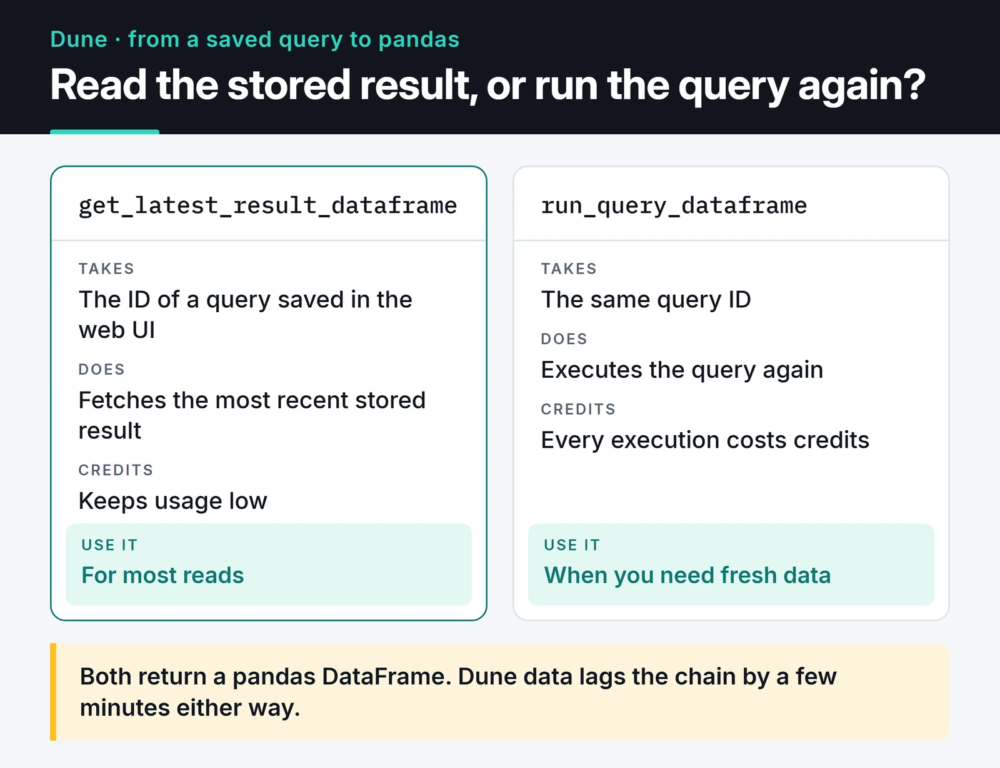

Blockchain data is public, but it isn't ready for analysis. A block holds hex-encoded logs, calls that need an ABI to decode, and amounts whose decimals change from token to token. Most of the work in blockchain data analysis with Python is getting that data into a shape you can query.

This post compares the four approaches I used in my Web3 projects: listening to live events over RPC, writing a small indexer, The Graph, and Dune. The examples follow USDC transfers, and I ran the code on mainnet with web3.py 7 and SQLAlchemy 2.

## Which tool, when

My short answer:

- If I need to react the moment something happens (alerts, bots), a WebSocket subscription over RPC.
- If I want to explore one contract's history with my own schema and queries, a small indexer.
- If a popular protocol's pre-indexed data (Uniswap, Aave) is enough, The Graph.
- For quick, chain-wide exploration in SQL, Dune.

None of them fully replaces the others. A sequence I use a lot: test a hypothesis on Dune, then collect the same data with my own indexer in the shape the bot needs.

## Listening to live events

web3.py 7's `WebSocketProvider` supports log subscriptions through `eth_subscribe`. This script listens for `Transfer` events on the USDC contract and posts to Telegram for any transfer above 1 million USDC:

```python {title="whale_alert.py"}
import asyncio
import html
import os

from telegram import Bot
from web3 import AsyncWeb3, WebSocketProvider

USDC = AsyncWeb3.to_checksum_address("0xa0b86991c6218b36c1d19d4a2e9eb0ce3606eb48")
TRANSFER_ABI = [{
    "name": "Transfer", "type": "event", "anonymous": False, "inputs": [
        {"name": "from", "type": "address", "indexed": True},
        {"name": "to", "type": "address", "indexed": True},
        {"name": "value", "type": "uint256", "indexed": False}],
}]
THRESHOLD = 1_000_000 * 10**6  # 1 million USDC (6 decimals)


async def notify(text: str) -> None:
    token = os.environ.get("TELEGRAM_BOT_TOKEN")
    if not token:
        print(text)
        return
    async with Bot(token) as bot:
        await bot.send_message(chat_id=os.environ["TELEGRAM_CHAT_ID"], text=text, parse_mode="HTML")


async def main() -> None:
    async with AsyncWeb3(WebSocketProvider(os.environ["ETH_WS_URL"])) as w3:
        usdc = w3.eth.contract(address=USDC, abi=TRANSFER_ABI)
        topic = w3.keccak(text="Transfer(address,address,uint256)").to_0x_hex()
        await w3.eth.subscribe("logs", {"address": USDC, "topics": [topic]})

        async for message in w3.socket.process_subscriptions():
            event = usdc.events.Transfer().process_log(message["result"])
            value = event["args"]["value"]
            if value < THRESHOLD:
                continue
            tx = event["transactionHash"].to_0x_hex()
            await notify(
                f"<b>Large USDC transfer</b>\n"
                f"{value / 10**6:,.0f} USDC\n"
                f"{html.escape(event['args']['from'])} → {html.escape(event['args']['to'])}\n"
                f'<a href="https://etherscan.io/tx/{tx}">Etherscan</a>'
            )


if __name__ == "__main__":
    asyncio.run(main())
```

`pip install "web3>=7" python-telegram-bot` is all it needs. Without `TELEGRAM_BOT_TOKEN` it prints to the console, which makes testing easy. With a lower threshold, the first transfers showed up within seconds.

Some practical notes:

- Filter on the node side (`address` and `topics`). It's much cheaper than pulling every log and filtering in Python.
- Always scale by the token's decimals. A transaction's ETH `value` field isn't enough, because most large movements are ERC-20 transfers or internal calls inside contracts, and they never show up in that field.
- I use HTML in the Telegram message and escape addresses with `html.escape`. In Markdown mode, characters like underscores can break the message.
- When the connection drops, so does the subscription. A live alert needs to store the last processed block and backfill the gap with `get_logs` after reconnecting.

A large transfer isn't a signal on its own. Moves between an exchange's own wallets, bridges, and mints or burns (sender or recipient is the zero address) all land in this feed. A useful alert needs address labels.

## Writing a small indexer of your own

When I want to query one contract's history, I write a small indexer that stores its logs in a database. With SQLAlchemy 2's typed models:

```python {title="indexer.py"}
from sqlalchemy import BigInteger, Integer, String, UniqueConstraint, create_engine, func, select
from sqlalchemy.dialects.sqlite import insert
from sqlalchemy.orm import DeclarativeBase, Mapped, Session, mapped_column
from web3 import Web3

RPC = "https://ethereum-rpc.publicnode.com"
USDC = Web3.to_checksum_address("0xa0b86991c6218b36c1d19d4a2e9eb0ce3606eb48")
TRANSFER_ABI = [{
    "name": "Transfer", "type": "event", "anonymous": False, "inputs": [
        {"name": "from", "type": "address", "indexed": True},
        {"name": "to", "type": "address", "indexed": True},
        {"name": "value", "type": "uint256", "indexed": False}],
}]


class Base(DeclarativeBase):
    pass


class Transfer(Base):
    __tablename__ = "transfers"
    __table_args__ = (UniqueConstraint("tx_hash", "log_index"),)

    id: Mapped[int] = mapped_column(Integer, primary_key=True)
    block_number: Mapped[int] = mapped_column(BigInteger, index=True)
    tx_hash: Mapped[str] = mapped_column(String(66))
    log_index: Mapped[int] = mapped_column(Integer)
    sender: Mapped[str] = mapped_column(String(42), index=True)
    recipient: Mapped[str] = mapped_column(String(42), index=True)
    value: Mapped[str] = mapped_column(String(78))  # uint256 doesn't fit in a float


def index_range(w3: Web3, session: Session, start: int, end: int, step: int = 500) -> int:
    token = w3.eth.contract(address=USDC, abi=TRANSFER_ABI)
    processed = 0
    for frm in range(start, end + 1, step):
        to = min(frm + step - 1, end)
        logs = token.events.Transfer.get_logs(from_block=frm, to_block=to)
        rows = [{
            "block_number": log["blockNumber"],
            "tx_hash": log["transactionHash"].to_0x_hex(),
            "log_index": log["logIndex"],
            "sender": log["args"]["from"],
            "recipient": log["args"]["to"],
            "value": str(log["args"]["value"]),
        } for log in logs]
        if rows:
            # Skip logs we've already stored (re-runs, reorgs)
            stmt = insert(Transfer).values(rows).on_conflict_do_nothing()
            session.execute(stmt)
            session.commit()
            processed += len(rows)
    return processed


if __name__ == "__main__":
    w3 = Web3(Web3.HTTPProvider(RPC))
    engine = create_engine("sqlite:///transfers.db")
    Base.metadata.create_all(engine)

    latest = w3.eth.block_number - 12  # leave the newest blocks as a reorg margin
    with Session(engine) as session:
        print("logs processed:", index_range(w3, session, latest - 20, latest))
        top = session.execute(
            select(Transfer.sender, func.count().label("n"))
            .group_by(Transfer.sender)
            .order_by(func.count().desc())
            .limit(5)
        ).all()
        for sender, n in top:
            print(sender, n)
```

Running it over the last 20 blocks stored more than 1,800 transfers, which says a lot about how busy USDC is.

Three decisions in the model matter:

- `value` is not a `Float`. A `uint256` doesn't fit in a 64-bit float and gets rounded. Store it as a string in SQLite, or as `NUMERIC(78, 0)` in Postgres.
- `(tx_hash, log_index)` is unique, so reprocessing a range or restarting after a crash doesn't duplicate rows.
- The newest 12 blocks are skipped. Reorgs are rare under proof of stake but not impossible, and data from unfinalized blocks can change. The stricter option is to index only up to the `"finalized"` block tag.

The limit of this approach is scale. Indexing the whole chain this way takes weeks and hammers your RPC provider. At that point, bulk extraction tools like [cryo](https://github.com/paradigmxyz/cryo), your own Reth node, or ready-made datasets make more sense. I cover the SQLAlchemy side in more depth in my [MySQL and SQLAlchemy post](/en/posts/mysql-sqlalchemy-database-management/).

## The Graph: pre-indexed protocol data

The Graph indexes protocol events into schemas called subgraphs and serves them over GraphQL. The free hosted service shut down in 2024; queries now go through the decentralized network's gateway with an API key from Subgraph Studio, which comes with a free monthly query allowance.

```python {title="top_pools.py"}
import os

import httpx

API_KEY = os.environ["GRAPH_API_KEY"]
SUBGRAPH_ID = os.environ["UNISWAP_V3_SUBGRAPH_ID"]  # ID from Graph Explorer
URL = f"https://gateway.thegraph.com/api/{API_KEY}/subgraphs/id/{SUBGRAPH_ID}"

QUERY = """
{
  pools(first: 5, orderBy: volumeUSD, orderDirection: desc) {
    id
    feeTier
    volumeUSD
    token0 { symbol }
    token1 { symbol }
  }
}
"""

resp = httpx.post(URL, json={"query": QUERY}, timeout=30)
resp.raise_for_status()
data = resp.json()
if "errors" in data:
    raise RuntimeError(data["errors"])

for pool in data["data"]["pools"]:
    pair = f'{pool["token0"]["symbol"]}/{pool["token1"]["symbol"]}'
    print(pair, int(pool["feeTier"]) / 10_000, "%", f'{float(pool["volumeUSD"]):,.0f} USD')
```

GraphQL can return HTTP 200 even when the query fails, so I check the `errors` field separately. In the Uniswap V3 subgraph, `volumeUSD` is a pool's all-time volume; daily volume lives in entities like `poolDayDatas`. Reading the subgraph's schema in Graph Explorer before you use it is the easiest way to avoid misreading a field.

## Dune: quick exploration in SQL

Dune lets you query decoded chain data in SQL, which makes it the fastest way to test an idea. Community dashboards are a good starting point. My path from a saved query to a DataFrame looks like this:



Once a query is saved in the web UI, I pull its results into Python with the official `dune-client` package:

```python
from dune_client.client import DuneClient

dune = DuneClient.from_env()          # reads DUNE_API_KEY
df = dune.get_latest_result_dataframe(1234567)  # your query ID
print(df.head())
```

Install it with `pip install dune-client pandas`. `get_latest_result_dataframe` fetches the most recent stored result without re-running the query, which keeps credit usage low. When you need fresh data, `run_query_dataframe` executes it, and every execution costs credits. Dune data lags the chain by a few minutes, so it suits analysis and reporting, not live bots.

Once you have a DataFrame, the rest is regular pandas. I show how I keep pandas fast on larger datasets in the [crypto market analysis with pandas post](/en/posts/pandas-crypto-market-analysis/).

## Looking at MEV data

You won't find mempool-watching sandwich bot code here. I don't want to publish a step-by-step bot for skimming other people's trades, and most snippets that circulate don't work anyway: you can't get a signed transaction's raw bytes from `get_transaction` that way.

Analyzing MEV is useful, though. Looking at transaction order inside a block and finding patterns where one address buys right before a victim and sells right after is how you measure what sandwiches cost users. Rather than writing that from scratch, start with the community tables on Dune and the published data from MEV analytics platforms. For protecting users, see the slippage and private RPC section in my [DEX aggregator post](/en/posts/dex-aggregator-web3-routing/).

## Where to go next

The web3.py patterns underneath this code are covered in detail in the [web3.py v7 guide](/en/posts/web3py-ethereum-interaction/). If you want to start your own indexer, begin with one contract and a few thousand blocks, and grow the schema as you need it. The data here is for learning; a large transfer is not enough to base a trade on, and none of these examples are investment advice.
