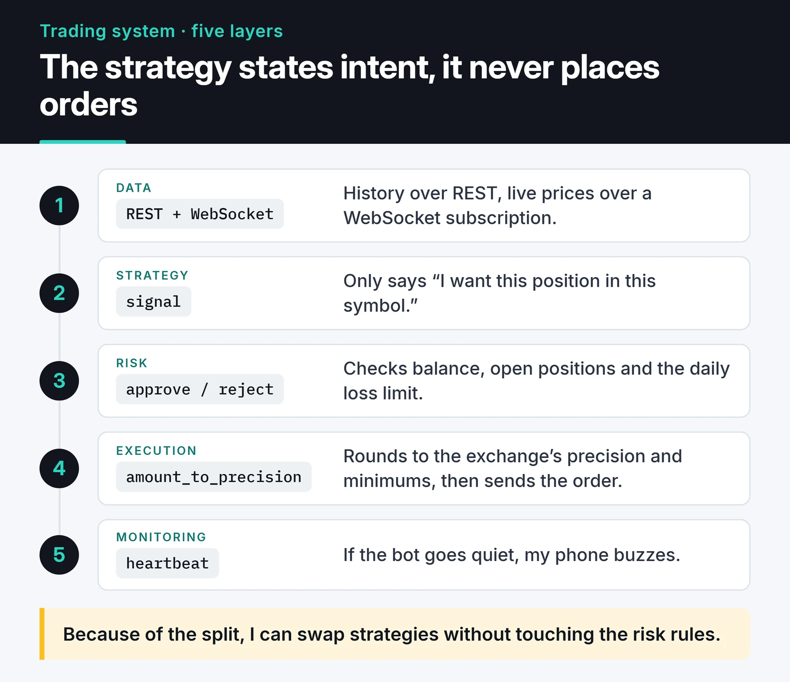

This is the structure I use when building an automated trading system in Python: CCXT for market data and orders, a separate risk layer, a backtest that counts costs, and rules for running it live.

The strategy is where I spend the least time. Most of the work goes into keeping the data feed alive, making orders conform to the exchange's rules, and making sure the system can stop itself when something goes wrong. The code below was tested with CCXT 4.5 and Python 3.12.

## The layers

I split the system into five parts that can be tested on their own:



The strategy never talks to the exchange. It only says "I want this position in this symbol." The risk layer approves or rejects that based on balance, open positions and the daily loss limit. Because of that split, I can swap strategies without touching the risk rules.

## Why CCXT

My first Binance bots used `python-binance`. I've moved to CCXT. It speaks to well over a hundred exchanges through one interface, has first-class async support, and the WebSocket side (formerly CCXT Pro) now ships in the main package. Moving off Binance is often a one-line change.

The cost is that a unified API can't expose every exchange quirk, so you sometimes drop down into the `params` dict for exchange-specific options. I'd rather pay that than lock the codebase to one venue.

## History over REST, live data over WebSocket

REST is fine for historical candles. For live prices, polling REST every second adds latency and burns through your rate limit. A WebSocket subscription is the better tool:

```python {title="stream.py"}
import asyncio

import ccxt.async_support as ccxt
import ccxt.pro as ccxtpro


async def stream(symbol: str) -> None:
    exchange = ccxtpro.binance()
    delay = 1
    try:
        while True:
            try:
                ticker = await exchange.watch_ticker(symbol)
                book = await exchange.watch_order_book(symbol, limit=10)
                delay = 1
                spread = book["asks"][0][0] - book["bids"][0][0]
                print(symbol, ticker["last"], f"spread={spread:.2f}")
            except ccxt.NetworkError as exc:
                print(f"Connection error: {exc}; retrying in {delay}s")
                await asyncio.sleep(delay)
                delay = min(delay * 2, 60)  # exponential backoff, capped at 60s
    finally:
        await exchange.close()


asyncio.run(stream("BTC/USDT"))
```

Two details matter here. The first is exponential backoff: reconnect a hundred times a second after a drop and the exchange may block your IP for a while. The second is `watch_order_book`. I used to rebuild the order book by hand from a snapshot plus diff messages. Getting that right, sequence checks included, is easy to mess up, and CCXT already does it. I don't write my own order book sync anymore.

For several symbols I start one task per symbol and gather them with `asyncio.gather`. Each task catches its own errors so one bad symbol doesn't take the others down.

## Orders: precision, minimums, testnet

Amounts and prices must match the exchange's step sizes; an order for 0.0123456789 BTC will be rejected. CCXT handles the rounding:

```python
import ccxt.async_support as ccxt


async def place_limit_buy(exchange: ccxt.Exchange, symbol: str, qty: float, price: float):
    market = exchange.market(symbol)
    amount = exchange.amount_to_precision(symbol, qty)
    px = exchange.price_to_precision(symbol, price)

    min_cost = market["limits"]["cost"]["min"] or 0
    if float(amount) * float(px) < min_cost:
        raise ValueError(f"Order too small: minimum is {min_cost} USDT")

    return await exchange.create_order(symbol, "limit", "buy", amount, px)


async def main():
    exchange = ccxt.binance({
        "apiKey": "...",        # testnet key, read it from the environment
        "secret": "...",
        "enableRateLimit": True,
    })
    exchange.set_sandbox_mode(True)  # Binance spot testnet
    try:
        await exchange.load_markets()
        order = await place_limit_buy(exchange, "BTC/USDT", 0.0123456789, 50_000)
        print(order["id"], order["status"])
    finally:
        await exchange.close()
```

`set_sandbox_mode(True)` points the same code at the exchange's test network. I try new order logic there first, then with very small real amounts. Testnet liquidity and prices look nothing like the real market, so it's good for testing the order flow and useless for judging a strategy.

Market or limit? Market orders fill immediately, but you pay taker fees and eat slippage on a thin book. Limit orders are cheaper and may never fill, so you need logic that tracks unfilled orders and cancels or reprices them. Even a simple "best bid plus one tick" rule is a crude first version of that logic.

## Risk: position sizing and a kill switch

Strategies rarely kill a bot. Uncontrolled position size does. My rule is fixed-fractional risk: never lose more than 1% of equity on a single trade.

```python
def position_size(equity: float, risk_pct: float, entry: float, stop: float) -> float:
    """Size such that hitting the stop loses equity * risk_pct."""
    risk_amount = equity * risk_pct
    return risk_amount / abs(entry - stop)


# 10,000 USDT equity, 1% risk, entry 80,000, stop 78,400
print(position_size(10_000, 0.01, 80_000, 78_400))  # 0.0625 BTC
```

0.0625 BTC at 80,000 is about a 5,000 dollar position. If price hits the stop, the loss is 100 dollars, 1% of equity. Move the stop further away and the position shrinks automatically.

On top of that I add two system-level rules:

- If the daily loss passes a threshold, the bot stops opening positions and notifies me.
- After a run of consecutive API errors (maintenance, rate limits, a revoked key), the bot pauses itself.

Whether stops live on the exchange or in the bot's memory is a trade-off. An exchange-side stop still fires if your bot crashes. An in-memory stop is more flexible but does nothing while the bot is down. I keep the critical ones on the exchange.

## Backtesting: if it ignores costs, it's fiction

Here's a minimal pandas backtest of a moving-average crossover that does account for fees and slippage:

```python
import pandas as pd


def backtest(df: pd.DataFrame, fee: float = 0.001, slippage: float = 0.0005) -> pd.DataFrame:
    fast = df["close"].rolling(50).mean()
    slow = df["close"].rolling(200).mean()
    signal = (fast > slow).astype(int)

    # The signal forms at the candle close; the position opens on the next candle
    position = signal.shift(1, fill_value=0)
    ret = df["close"].pct_change().fillna(0)
    turnover = position.diff().abs().fillna(0)

    strat_ret = position * ret - turnover * (fee + slippage)
    out = pd.DataFrame({
        "strategy": (1 + strat_ret).cumprod(),
        "buy_hold": (1 + ret).cumprod(),
    })
    out["drawdown"] = out["strategy"] / out["strategy"].cummax() - 1
    return out
```

The most important line is `signal.shift(1)`. Without it, the backtest assumes you traded at the close of the very candle that produced the signal, a price you only know once that candle is over.

To try the function on real data, Binance's public candles are enough; no API key needed:

```python {title="run_backtest.py"}
import ccxt
import pandas as pd

from backtest import backtest  # the function above, saved as backtest.py

exchange = ccxt.binance()
rows = exchange.fetch_ohlcv("BTC/USDT", "1d", limit=1000)
df = pd.DataFrame(rows, columns=["ts", "open", "high", "low", "close", "volume"])
df.index = pd.to_datetime(df["ts"], unit="ms")

out = backtest(df)
print(out.tail(3).round(3).to_string())
print(f"max drawdown: {out['drawdown'].min():.1%}")
```

Running it on the last 1,000 daily BTC/USDT candles gave me this:


Over the same period buy and hold roughly doubled, the crossover didn't even break even, and at its worst it was down 39.7%. The position changed only 5 times in a thousand days, which is far too few trades to call the strategy good or bad. That is exactly the last question on the list below.

Before I believe any backtest, I go through these questions:

- Are fees, slippage and, for perpetuals, funding included?
- Did I tune parameters and evaluate on the same data? Then the result is almost certainly inflated. Hold out a period you never touch until the end.
- Did I only test coins that are still listed today? Leaving out delisted ones (survivorship bias) flatters every result.
- Does the strategy only make money in one regime, say a strong bull run?
- Are there enough trades to mean anything? Twelve trades in three years prove nothing.

This code is there to show the mechanics, not to be your research tool. For serious work, Freqtrade's backtesting and hyperopt, or libraries like vectorbt, handle fills, fees and timing far more carefully.

## Off-the-shelf bot or your own?

Writing my own bots taught me a lot, but for anything that trades real money I'd rather build on a mature framework like Freqtrade than start from zero. It comes with backtesting, hyperopt, order management, Telegram control and a REST API, and strategies are plain Python classes. Most of my own code sits around it instead. With [freqtrade-mcp](https://furkankoykiran.com.tr/en/projects/freqtrade-mcp/) I exposed Freqtrade's REST API to AI agents like Claude; the [freqtrade-mcp post](/en/posts/freqtrade-mcp-server/) explains how it works.

Writing your own still makes sense for a market Freqtrade doesn't support, an unusual data source, or simply to learn.

## Deployment and monitoring

The bot runs on a small VPS as a Docker container or systemd service, never on my desktop. The setup from my post on [containerizing Python apps with Docker](/en/posts/docker-python-app-containerization/) applies here unchanged. A few rules:

- API keys come from environment variables or a secrets manager, never from the image or the repo. Withdrawals are disabled on the key and it's IP-restricted.
- Logs are structured JSON. The signal, the risk decision and the exchange response go into the same record so I can later see why an order was placed or rejected.
- The bot sends a heartbeat to a monitoring service. If it goes quiet, my phone buzzes. I use Telegram for that; the code is in my [Telegram trading bot post](/en/posts/python-telegram-trading-bot/).
- On restart, the bot reads open positions and orders from the exchange, not from its own memory.

## Risk and next steps

None of this is financial advice. Crypto is extremely volatile, and with leverage an account can be wiped out in minutes. Most strategies that look good in a backtest do worse live. Automation removes emotion, but it will also repeat a bad rule tirelessly. Don't trade money you can't afford to lose.

The pandas side of the data is covered in [fast crypto analysis in pandas](/en/posts/pandas-crypto-market-analysis/), and my experiments with machine learning and LLM agents for signals are in [AI-powered trading strategies](/en/posts/ai-powered-trading-strategies/). For the current API, the [CCXT documentation](https://docs.ccxt.com/) is the reference.

To start, run `run_backtest.py` with your own symbol and timeframe, then set `fee` and `slippage` to zero and see how much the result moves.
