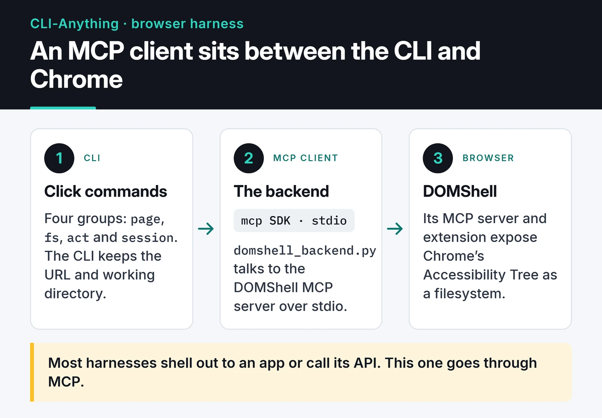

In March 2026 I sent a pull request that added browser automation to [CLI-Anything](https://github.com/HKUDS/CLI-Anything). [PR #118](https://github.com/HKUDS/CLI-Anything/pull/118) became the project's first harness that talks to an MCP server instead of calling an application directly. This post covers how the harness is built, what came up in review, and the bugs that only showed up after it was merged.

CLI-Anything's premise is that if you wrap software in a clean command-line interface, AI agents can drive it. The repo has "harnesses" for GIMP, Blender, LibreOffice and dozens of other tools. Browsers were missing.

## Issue #90: browsing a page like a filesystem

On March 16, [@apireno](https://github.com/apireno), the author of [DOMShell](https://github.com/apireno/DOMShell), opened [issue #90](https://github.com/HKUDS/CLI-Anything/issues/90). DOMShell is a Chrome extension plus MCP server that exposes Chrome's Accessibility Tree as a virtual filesystem, so an agent moves through a page with `ls`, `cd`, `grep` and `click`. In apireno's benchmarks with Claude, this cut API calls by half compared with screenshot-based browsing. That number is his; I didn't measure it myself.

The Accessibility Tree is the simplified tree the browser derives from the DOM for screen readers. Each node has a role such as button, link or textbox, and the CSS classes and wrapper `div`s are gone. That makes it less brittle than CSS selectors when a site's markup changes, and the page → section → element hierarchy maps cleanly onto directories.

In the issue thread, [@omerarslan0](https://github.com/omerarslan0) sketched an integration: DOMShell's MCP server as the backend, command groups like `page` on the CLI side, and state (URL, working directory) kept by the CLI. apireno asked to keep the filesystem-style commands rather than switch to selectors, and recommended the official `mcp` Python SDK over stdio. I built on that discussion and opened the PR on March 21.

## How the harness is built

Most harnesses shell out to an application or call its API. This one puts an MCP client in the middle:



There are four command groups:

- `page`: open, reload, back, forward, info
- `fs`: ls, cd, cat, grep, pwd
- `act`: click, type
- `session`: status, daemon-start, daemon-stop

In use:

```bash
cli-anything-browser page open https://example.com
cli-anything-browser fs ls /
cli-anything-browser fs grep "Login"
cli-anything-browser act click /main/button[0]
cli-anything-browser --json fs ls /
```

Every one-shot command starts a fresh session. Stateful flows, like `cd` followed by a bare `ls`, belong in the REPL, which opens when you run `cli-anything-browser` with no arguments.

### The MCP call in Python

When I wrote the PR, DOMShell exposed one MCP tool per command (`domshell_ls`, `domshell_click` and so on). DOMShell 2.0 collapsed those into a single `domshell_execute` tool, and the harness was updated for it. A minimal client for DOMShell 2.x looks like this:

```python
import asyncio
import os

from mcp import ClientSession, StdioServerParameters
from mcp.client.stdio import stdio_client

params = StdioServerParameters(
    command="npx",
    args=[
        "-p", "@apireno/domshell", "domshell-proxy",
        "--port", os.environ.get("DOMSHELL_PORT", "3001"),
        "--token", os.environ["DOMSHELL_TOKEN"],
    ],
)


async def main() -> None:
    async with stdio_client(params) as (read, write):
        async with ClientSession(read, write) as session:
            await session.initialize()
            result = await session.call_tool(
                "domshell_execute", {"command": "ls", "group_id": "new"}
            )
            print(result.content[0].text)


asyncio.run(main())
```

`domshell-proxy` is a stdio bridge to a DOMShell server that is already running, and `DOMSHELL_TOKEN` is the token that server prints at startup. `group_id: "new"` asks DOMShell 2.x for an isolated tab group for the agent. None of this was in my original PR, and the section after the review explains why.

### A sync CLI on top of an async SDK

The MCP Python SDK is fully async and Click commands are sync, so each command opens a short session inside `asyncio.run()` and closes it. The cost is spawning an `npx` subprocess on every command. To avoid that during interactive use I added a daemon mode: while the REPL runs, one MCP connection stays open and every command reuses it. It only works inside a single process. Separate CLI invocations don't share it, and the README says so.

## Tests

Two layers. The 31 unit tests in `test_core.py` mock MCP responses and cover path resolution and session state, with no Chrome needed. The end-to-end tests in `test_full_e2e.py` drive a real Chrome with the DOMShell extension and only run when you ask for them:

```bash
pytest cli_anything/browser/tests/test_core.py -v
DOMSHELL_E2E=1 pytest cli_anything/browser/tests/test_full_e2e.py -v
```

The `DOMSHELL_E2E` gate came out of a Copilot comment. Before it, pytest could try to run `npx` during test collection.

## Review

Copilot reviewed the PR twice, with 10 comments and then 9. The ones that mattered most:

- A context manager leak in daemon mode. `_start_daemon()` called `__aenter__` on `stdio_client(...)` without keeping a reference, and `_stop_daemon()` called `__aexit__` on a brand-new client, so the original subprocess never shut down. I now keep the reference in a module-level `_daemon_client_context`.
- `page back` and `page forward` replayed navigation from a local history list, which is always empty in one-shot mode. They now call DOMShell's own back and forward tools.
- The REPL split quoted arguments. `act type /path "Hello, World!"` now goes through `shlex.split()`.
- `act type` echoed the typed text, which leaves passwords in terminal scrollback. It no longer does.
- `fs cd` only updates the working directory when the backend reports success.

omerarslan0 listed 8 issues in his first review, all of which earlier commits had already fixed. I replied with the commit for each one, and he checked and approved. [@yuh-yang](https://github.com/yuh-yang) asked me to fix the contributor field in `registry.json`, then approved and merged on March 22. Final size: 15 commits, 21 files, 3,095 lines added:

 I also added an "MCP Backend Pattern" section to `cli-anything-plugin/HARNESS.md` so the next MCP integration has something to follow.

## What broke after the merge

I learned the most from this PR after it was merged. Right after the merge, apireno tested the harness against a real DOMShell server. All 31 unit tests passed and 9 of 10 end-to-end tests passed, but several commands failed when he used them by hand:

1. In one-shot mode every command started a new `npx @apireno/domshell` process, which tried to bind ports 9876 and 3001. If another client such as Claude Desktop was already running DOMShell, every command failed.
2. I was sending the wrong parameter names to some tools (`ls`, `cat`, `click`).
3. DOMShell didn't support `--version`, which my availability check relied on. apireno fixed that on the DOMShell side.

apireno fixed the port and parameter problems in [PR #135](https://github.com/HKUDS/CLI-Anything/pull/135), merged on March 24, which moved the connection to the `domshell-proxy` bridge with token auth. My unit tests passed because they mocked a server interface that didn't match the real one. Pulling the tool schemas from the server with `list_tools` and building the mocks from them would have caught this before review.

## Security hardening in PR #156

After I shared the contribution on LinkedIn, Ilhan Goktas pointed out several attack surfaces: SSRF through arbitrary navigation, prompt injection hidden in ARIA labels, and escaping the virtual filesystem. I followed up with [PR #156](https://github.com/HKUDS/CLI-Anything/pull/156), which omerarslan0 merged on April 7.

It added:

- URL validation that blocks `file://`, `javascript:`, `data:` and `vbscript:` schemes
- Optional blocking of private network addresses, switched on with an environment variable
- A basic sanitizer for known prompt injection patterns in page content
- 42 security tests, plus security notes for agents in `SKILL.md`

The sanitizer catches obvious patterns and nothing more. If you give an agent a browser, treat every piece of page text as untrusted input.

## Where the code went next

I wrote the harness, and most of the code that runs now has been through other hands since. apireno did the DOMShell 2.0 migration and the fixes after it, and other contributors followed. That's normal for open source, and it's a good reason to write code that's easy for the next person to change.

What I took away from this PR:

- When you wrap an MCP server, run at least one end-to-end test against the real server before asking for a merge.
- When you bridge an async SDK into a sync CLI, keep the connection lifecycle in one place. That's where the leaks come from. I go deeper into the asyncio side in my [asyncio guide](/en/posts/python-asyncio-concurrent-processing/).
- Answer review comments with the commit hash for each fix. It makes the reviewer's job much easier.

## Where to go next

The code is in [browser/agent-harness](https://github.com/HKUDS/CLI-Anything/tree/main/browser/agent-harness). For an MCP server I built from scratch, read the [freqtrade-mcp post](/en/posts/freqtrade-mcp-server/). For another open source contribution, with a very different codebase, see [my Keploy contribution](/en/posts/my-open-source-contribution-keploy/).
