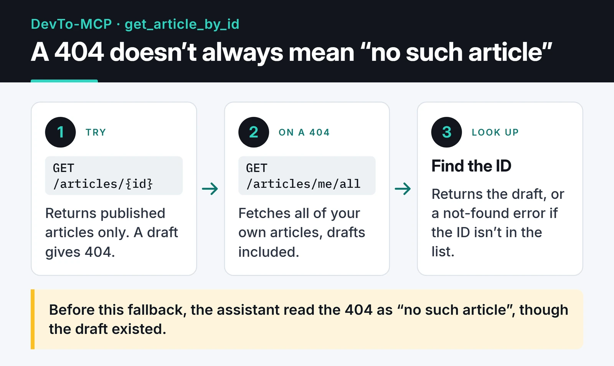

DevTo-MCP is an MCP server that turns the Forem API, the platform behind DEV Community (dev.to), into tools. Connect it to Claude Desktop, Cursor or any other MCP client and the assistant can search DEV, list your own posts, and create or update drafts. It's written in TypeScript and published on npm as `@furkankoykiran/devto-mcp`.

Project page: [DevTo-MCP](https://furkankoykiran.com.tr/en/projects/devto-mcp/) · Source: [GitHub](https://github.com/furkankoykiran/DevTo-MCP)

This post covers how the server is put together, the choices in its API client, a feature I switched off, and a lesson about npm package names.

## Why an MCP server for DEV

I cross-post some of my writing to DEV. Writing a draft in my editor, pasting it into the browser, typing tags one by one, then going back to the site to check comments got tedious. I wanted to tell my assistant "open this markdown as a draft on DEV" or "list this week's popular TypeScript posts."

MCP has three roles. The host is the app running the assistant, such as Claude Desktop. The MCP client inside the host speaks JSON-RPC 2.0 to a server. DevTo-MCP is the server: it advertises its tools, and when the client calls one it hits the Forem API and returns the result.

## Layout and tools

```text
src/
├── index.ts            # reads DEVTO_API_KEY, starts over stdio
├── server.ts           # registers the tool groups
├── services/
│   └── api-client.ts   # Forem API client
├── tools/              # articles, comments, users, tags, organizations,
│                       # reading-list, followers
└── types/
```

The first release shipped 17 tools; 16 are enabled today. For articles there are `get_articles`, `get_article_by_id`, `create_article`, `update_article` and `get_my_articles`. The rest are read tools for comments, users, organizations, tags, reading lists and followers. The Forem API has no endpoint for writing comments, so the comment tools are read-only.

## Validating inputs with Zod

The model generates tool arguments itself, and sometimes gets them wrong. DEV allows at most four tags per article; a model can easily send five. So every tool's parameters are a Zod schema:

```ts
server.tool(
  "create_article",
  "Create a new article on DEV Community. Set published to false to save as draft.",
  {
    title: z.string().describe("Title of the article"),
    body_markdown: z.string().optional().describe("Article content in markdown format"),
    published: z.boolean().optional().describe("Whether to publish immediately (false = draft)"),
    tags: z.array(z.string()).max(4).optional().describe("List of tags (max 4)"),
    series: z.string().optional().describe("Article series name"),
    canonical_url: z.string().url().optional().describe("Original URL if cross-posting"),
    description: z.string().optional().describe("Short description for the article"),
    main_image: z.string().url().optional().describe("Main cover image URL"),
    organization_id: z.number().int().optional().describe("Organization ID to publish under"),
  },
  async (params) => { /* ... */ },
);
```

The SDK turns this into JSON Schema for the model and validates incoming arguments against it. A fifth tag or a malformed `canonical_url` never reaches the API; the model gets a readable error and usually fixes it on the next try.

API responses don't go through Zod. The client reads `response.json()` and casts it with `as T`; there's no runtime check. If Forem returns a field in an unexpected shape, TypeScript won't notice. Since what goes back to the assistant is JSON text anyway, this doesn't crash anything in practice, but the response types are compile-time only.

## The API client: timeouts, retries and Retry-After

`api-client.ts` is a bit more than a `fetch` wrapper:

- Every request is cut off after 30 seconds with `AbortSignal.timeout(30_000)`.
- On 429, 5xx and network errors it retries up to 3 times, waiting 1, 2 and 4 seconds.
- If the server sends `Retry-After`, it waits that long instead.
- On failure it puts the `x-ratelimit-*` headers and `x-request-id` into the error message, so both the assistant and I can see what went wrong.

```ts
private getRetryDelay(attempt: number, response?: Response): number {
  const retryAfter = response?.headers.get("retry-after");
  if (retryAfter) {
    const seconds = Number(retryAfter);
    if (!isNaN(seconds) && seconds > 0) return seconds * 1_000;
  }
  return INITIAL_BACKOFF_MS * Math.pow(2, attempt); // 1s, 2s, 4s
}

private isRetryable(status: number): boolean {
  return status === 429 || (status >= 500 && status < 600);
}
```

The client doesn't watch `x-ratelimit-remaining` to slow down before the limit. It only reads that header for error messages and reacts to rate limits after a 429.

There's also a risk I should have thought through: the retry loop runs for POST and PUT as well. If `create_article` succeeds on the server but the response comes back as a 502, the client sends it again and you can end up with two copies of the same draft on DEV. Non-idempotent requests should only be retried when they provably never reached the server, or not at all.

## The feature I switched off: reactions

The initial release had tools for leaving reactions (likes, unicorns and so on) on articles. During testing they started returning 401 even with a valid API key, and some calls reported success while nothing showed up on the site.

An assistant that says "done" when nothing happened is worse than a missing tool. On February 18 I took the reaction tools out of registration:

```ts
// registerReactionTools(server, client); // Disabled due to API 401 issues
```

The code is still in the repo for anyone who wants to track down the cause.

## Drafts and the 404

`get_article_by_id` uses `/articles/{id}`, which only returns published articles and gives 404 for drafts. The assistant read that as "no such article," even though it existed.

On a 404, the tool now fetches all of the user's own articles, drafts included, from `/articles/me/all` and looks for the ID there. The flow is on the card, the code below it:




```ts
} catch (error: unknown) {
  const is404 =
    typeof error === "object" && error !== null && "status" in error &&
    (error as { status?: number }).status === 404;

  if (is404) {
    try {
      const allArticles = await client.get<Article[]>("/articles/me/all", { per_page: 1000 });
      const article = allArticles.find((a) => a.id === params.id);
      if (article) {
        return { content: [{ type: "text", text: JSON.stringify(article, null, 2) }] };
      }
    } catch (fallbackError) {
      console.error("Fallback lookup failed:", fallbackError);
    }
  }
  // ...
}
```

Note the `console.error`. In a stdio server, stdout carries the JSON-RPC messages, and any log line written there corrupts the protocol. Logs belong on stderr.

The fallback misses articles beyond the first 1,000, which is fine for someone with a few dozen posts like me.

## Publishing, and a lesson about package names

### How the workflow evolved

The first workflow was manual (`workflow_dispatch`) with a dry-run option. With v1.0.2 I switched the trigger to published releases:

```yaml
on:
  release:
    types: [published]

permissions:
  contents: read
  id-token: write

jobs:
  publish:
    runs-on: ubuntu-latest
    environment: production
    steps:
      # checkout, setup-node (Node 22), npm ci, lint, typecheck, test, build
      - run: npm publish --provenance --access public
        env:
          NODE_AUTH_TOKEN: ${{ secrets.NPM_TOKEN }}
```

This workflow doesn't use OIDC trusted publishing. `environment: production` has been in it since its first committed version, and publishing authenticates with an `NPM_TOKEN` secret; `id-token: write` is there for the provenance signature. The npm 10 that ships with Node 22 can't do trusted publishing anyway; that needs npm 11.5.1 or later.

The `environment` line can still matter. If you define a secret on an environment instead of the repository, a job that doesn't name that environment sees an empty secret. And npm often answers unauthorized publishes with 404 rather than 403, so the error points you nowhere near the cause.

When I merged PR #1 with the reactions and draft changes, I expected a new release to go out on its own. It didn't: the trigger was a release, not a merge, and I hadn't bumped the version in `package.json`. Those changes shipped in v1.0.3 in March.

### Moving to a scoped name

In February the package was published unscoped, as `devto-mcp`. In March I renamed it to `@furkankoykiran/devto-mcp` so it could also go to GitHub Packages, which requires scoped names.

That had a consequence I didn't expect. The unscoped `devto-mcp` name now belongs to a different project on npm, with a different maintainer, a different repository, and 0.x releases. The `npx -y devto-mcp` command in my DEV challenge article now runs that package instead of mine. An MCP server receives your API key through its environment, so a wrong package name here is a security problem.

Two rules came out of it: publish personal packages under a scope from day one and don't rename them later, and update every `npx` command in docs and posts the moment a package name changes. The latest README commit in the repo does exactly that.

## Installing it

You need Node.js 18 or later and a DEV API key, which you can create under Settings → Extensions → "DEV Community API Keys". Add this to Claude Desktop's `claude_desktop_config.json`:

```json
{
  "mcpServers": {
    "devto": {
      "command": "npx",
      "args": ["-y", "@furkankoykiran/devto-mcp"],
      "env": {
        "DEVTO_API_KEY": "your-key"
      }
    }
  }
}
```

The file lives in `~/Library/Application Support/Claude/` on macOS and `%APPDATA%\Claude\` on Windows. After restarting Claude, try prompts like:

- "Summarize this week's most popular TypeScript articles."
- "Create this markdown file as a draft on my DEV account, tagged mcp and typescript."
- "List the comments on my latest article and pull out the questions that still need an answer."

## Next steps

On my list: closing the POST retry risk above, moving the tools to the SDK's newer `registerTool()` API, and finding the cause of the reactions 401. The first real job I gave DevTo-MCP, having an assistant write and publish a challenge entry on DEV, is in [the Gemini challenge post](/en/posts/mcp-gemini-challenge-experience/). Other servers in this series: [OmniWire-MCP](/en/posts/omniwire-mcp-news-server/) and [freqtrade-mcp](/en/posts/freqtrade-mcp-server/).
