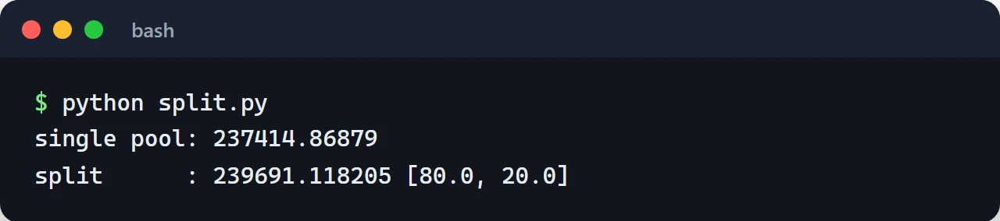

The same token pair trades at different depths on Uniswap V2 and V3, SushiSwap, Curve and dozens of other venues. A DEX aggregator asks all of them for a price and finds the route that gives the user the most output. 1inch, 0x, CoW Swap and Velora (formerly ParaSwap) are the well-known ones.

I never ran an aggregator in production. I ran into the problem while writing my [flash loan arbitrage bot](/en/posts/flash-loan-arbitrage-bot-python/), which also had to quote several DEXs, compare profit after gas and talk to routers, and got some of that wrong. This post builds the pieces of an aggregator one at a time. I ran all the code against Ethereum mainnet or a mainnet fork.

## Collecting quotes

The outline of this post: collect quotes, pick a route after gas, and let the swap contract check the result against `minAmountOut`.

Every source exposes quotes differently. Uniswap V2 and its forks (SushiSwap and others) have a `getAmountsOut` view function on the router. Uniswap V3 has a separate `QuoterV2` contract. It isn't `view`: it simulates the swap internally and reverts to return the result, so you call it with `eth_call` rather than as a transaction. In ethers v6 that's `staticCall`.

```javascript {title="quotes.mjs"}
import { Contract, JsonRpcProvider, formatUnits, parseEther } from "ethers";

const provider = new JsonRpcProvider(process.env.RPC_URL ?? "https://ethereum-rpc.publicnode.com");

const WETH = "0xC02aaA39b223FE8D0A0e5C4F27eAD9083C756Cc2";
const USDC = "0xA0b86991c6218b36c1d19D4a2e9Eb0cE3606eB48";

const V2_ABI = ["function getAmountsOut(uint256 amountIn, address[] path) view returns (uint256[])"];
const QUOTER_ABI = [
  "function quoteExactInputSingle((address tokenIn, address tokenOut, uint256 amountIn, uint24 fee, uint160 sqrtPriceLimitX96)) returns (uint256 amountOut, uint160 sqrtPriceX96After, uint32 initializedTicksCrossed, uint256 gasEstimate)",
];

const uniV2 = new Contract("0x7a250d5630B4cF539739dF2C5dAcb4c659F2488D", V2_ABI, provider);
const sushi = new Contract("0xd9e1cE17f2641f24aE83637ab66a2cca9C378B9F", V2_ABI, provider);
const quoterV3 = new Contract("0x61fFE014bA17989E743c5F6cB21bF9697530B21e", QUOTER_ABI, provider);

function v2Source(name, router) {
  return async (amountIn) => {
    const amounts = await router.getAmountsOut(amountIn, [WETH, USDC]);
    return { name, amountOut: amounts[1], gas: 120_000n };
  };
}

function v3Source(fee) {
  return async (amountIn) => {
    // QuoterV2 is not view; run it as an eth_call via staticCall
    const [amountOut, , , gasEstimate] = await quoterV3.quoteExactInputSingle.staticCall({
      tokenIn: WETH, tokenOut: USDC, amountIn, fee, sqrtPriceLimitX96: 0n,
    });
    return { name: `Uniswap V3 ${fee / 10_000}%`, amountOut, gas: gasEstimate };
  };
}

const sources = [
  v2Source("Uniswap V2", uniV2),
  v2Source("SushiSwap", sushi),
  v3Source(500),
  v3Source(3000),
];

export async function bestQuote(amountIn) {
  const results = await Promise.allSettled(sources.map((quote) => quote(amountIn)));
  const quotes = results.filter((r) => r.status === "fulfilled").map((r) => r.value);

  // Convert gas cost to USDC and subtract it from the output
  const { gasPrice } = await provider.getFeeData();
  const usdcPerEth = quotes.reduce((m, q) => (q.amountOut > m ? q.amountOut : m), 0n) * 10n ** 18n / amountIn;
  for (const q of quotes) {
    const gasCostUsdc = (q.gas * gasPrice * usdcPerEth) / 10n ** 18n;
    q.netOut = q.amountOut - gasCostUsdc;
  }
  return quotes.sort((a, b) => (b.netOut > a.netOut ? 1 : -1));
}

for (const q of await bestQuote(parseEther("10"))) {
  console.log(q.name.padEnd(18), formatUnits(q.amountOut, 6), "USDC (after gas", formatUnits(q.netOut, 6) + ")");
}
```

A few choices worth pointing out. I use `Promise.allSettled` instead of `Promise.all`, because one failing source (no pool, an RPC timeout) shouldn't kill the whole quote. V2 gas is a fixed estimate; V3 uses the `gasEstimate` the quoter returns. And quotes are ranked on output after gas, not raw output. When gas is expensive, a small edge between two pools may not pay for an extra hop.

In one run for 10 WETH, the ranking was: Uniswap V3's 0.05% pool about 24,063 USDC, the 0.3% pool 23,967, Uniswap V2 23,911, and SushiSwap 20,386. SushiSwap's V2 pool is now far too shallow for a trade this size; sending the order there would cost the user roughly 15%. That gap is the reason aggregators exist.

## Price impact and split routing

In constant-product (x * y = k) pools, a large trade moves the price against itself. Splitting the same amount across two pools means a smaller impact in each. The Uniswap V2 formula lets you model this in a few lines:

```python {title="split.py"}
def amount_out(amount_in: int, reserve_in: int, reserve_out: int, fee_bps: int = 30) -> int:
    """Uniswap V2 formula (x * y = k, fee taken from the input)."""
    amount_in_with_fee = amount_in * (10_000 - fee_bps)
    return amount_in_with_fee * reserve_out // (reserve_in * 10_000 + amount_in_with_fee)


def split_route(amount_in: int, pools: list[tuple[int, int]], parts: int = 20) -> list[int]:
    """Cut the amount into chunks and give each chunk to the pool with the best marginal output."""
    chunk = amount_in // parts
    alloc = [0] * len(pools)
    for i in range(parts):
        size = chunk if i < parts - 1 else amount_in - chunk * (parts - 1)
        gains = [
            amount_out(alloc[j] + size, *pools[j]) - amount_out(alloc[j], *pools[j])
            for j in range(len(pools))
        ]
        best = max(range(len(pools)), key=gains.__getitem__)
        alloc[best] += size
    return alloc


ETH = 10**18
USDC = 10**6
# (WETH reserve, USDC reserve): one deep pool, one shallow pool
pools = [(2_000 * ETH, 5_000_000 * USDC), (500 * ETH, 1_250_000 * USDC)]
amount = 100 * ETH

single = amount_out(amount, *pools[0])
alloc = split_route(amount, pools)
split = sum(amount_out(a, *p) for a, p in zip(alloc, pools))

print("single pool:", single / USDC)
print("split      :", split / USDC, [a / ETH for a in alloc])
```

Sending all 100 WETH to the deep pool returns 237,415 USDC. The algorithm splits 80/20 (the ratio of the pool depths) and gets 239,691 USDC. The difference is about 1%, which is real money on large trades.



Greedy splitting is simple and works well for V2 pools. Production aggregators do this across many more sources, with V3 tick math and multi-hop routes. Every split and every hop costs gas, so the objective has to be output after gas, not raw output.

Multi-hop routes (for example TOKEN -> WETH -> USDC) form a graph problem with tokens as nodes and pools as edges. In practice, capping the search at 2 or 3 hops is enough. Bellman-Ford often comes up here, but it's better suited to finding negative cycles, which is arbitrage detection. For routing, a bounded-depth search does the job.

## The swap contract

The route is computed off-chain and executed through a contract. The user approves the token, the contract pulls it, applies the splits, checks the result and sends it to the user.

Aggregators have a long history of exploits, and many came from one pattern: the contract would make an arbitrary call to an arbitrary address supplied by the caller, while holding users' approvals. Attackers shaped that call into `transferFrom(victim, attacker, ...)` and drained everyone who had approved it. That's why this contract only calls allowlisted routers, and only one specific function:

```solidity {title="src/SplitRouter.sol"}
// SPDX-License-Identifier: MIT
pragma solidity ^0.8.24;

import {IERC20} from "@openzeppelin/contracts/token/ERC20/IERC20.sol";
import {SafeERC20} from "@openzeppelin/contracts/token/ERC20/utils/SafeERC20.sol";
import {Ownable} from "@openzeppelin/contracts/access/Ownable.sol";
import {ReentrancyGuard} from "@openzeppelin/contracts/utils/ReentrancyGuard.sol";

interface IUniswapV2Router {
    function swapExactTokensForTokens(
        uint256 amountIn,
        uint256 amountOutMin,
        address[] calldata path,
        address to,
        uint256 deadline
    ) external returns (uint256[] memory amounts);
}

contract SplitRouter is Ownable, ReentrancyGuard {
    using SafeERC20 for IERC20;

    struct Split {
        address router;     // allowlisted V2-style routers only
        address[] path;     // path[0] = tokenIn, path[last] = tokenOut
        uint256 amountIn;
    }

    mapping(address => bool) public allowedRouter;

    error Expired();
    error RouterNotAllowed(address router);
    error BadPath();
    error BadSplitTotal();
    error InsufficientOutput(uint256 got, uint256 min);

    constructor(address owner_) Ownable(owner_) {}

    function setRouter(address router, bool allowed) external onlyOwner {
        allowedRouter[router] = allowed;
    }

    function swap(
        IERC20 tokenIn,
        IERC20 tokenOut,
        uint256 amountIn,
        uint256 minAmountOut,
        Split[] calldata splits,
        address recipient,
        uint256 deadline
    ) external nonReentrant returns (uint256 amountOut) {
        if (block.timestamp > deadline) revert Expired();

        uint256 total;
        for (uint256 i; i < splits.length; ++i) total += splits[i].amountIn;
        if (total != amountIn) revert BadSplitTotal();

        uint256 balanceBefore = tokenOut.balanceOf(address(this));
        tokenIn.safeTransferFrom(msg.sender, address(this), amountIn);

        for (uint256 i; i < splits.length; ++i) {
            Split calldata s = splits[i];
            if (!allowedRouter[s.router]) revert RouterNotAllowed(s.router);
            if (s.path[0] != address(tokenIn) || s.path[s.path.length - 1] != address(tokenOut)) {
                revert BadPath();
            }
            tokenIn.forceApprove(s.router, s.amountIn);
            IUniswapV2Router(s.router).swapExactTokensForTokens(
                s.amountIn, 0, s.path, address(this), deadline
            );
        }

        // Count only what arrived in this call, not any balance left over in the contract
        amountOut = tokenOut.balanceOf(address(this)) - balanceBefore;
        if (amountOut < minAmountOut) revert InsufficientOutput(amountOut, minAmountOut);

        tokenOut.safeTransfer(recipient, amountOut);
    }
}
```

What to look for in this contract:

- The output is the balance difference before and after the swaps. Sending the contract's whole `balanceOf(address(this))` is a common mistake: it hands any stray tokens in the contract to the next user.
- `SafeERC20` replaces raw `transfer` and `transferFrom`. Some tokens, USDT among them, don't return a `bool`, and raw calls revert on them.
- The splits must add up to `amountIn`, and an expired `deadline` is rejected.
- `minAmountOut` is what actually protects the user. The intermediate swaps have no minimum because the final check reverts the whole transaction.

I tested the contract on a mainnet fork with three cases: 1 WETH split 80/20 between Uniswap V2 and SushiSwap delivers USDC to the recipient and leaves nothing in the contract; a `minAmountOut` set too high reverts with `InsufficientOutput`; and a router that isn't allowlisted is rejected. It's still a teaching example. A real aggregator needs fee-on-transfer handling, direct ETH swaps and separate adapters for V3 and V4 pools.

Approvals matter on the user side too. Rather than asking users for unlimited approvals to every new router, signed, time-limited, amount-capped approvals through Uniswap's Permit2 are the better pattern today.

## Slippage, deadlines and MEV

The price at quote time and the price when the transaction lands can differ, and `minAmountOut` caps that difference:

```javascript
const slippageBps = 50n; // 0.5%
const minAmountOut = (quote.amountOut * (10_000n - slippageBps)) / 10_000n;
const deadline = BigInt(Math.floor(Date.now() / 1000) + 120); // 2 minutes
```

A loose tolerance invites sandwich attacks: a bot buys in front of you, pushes the price right up to your limit, and sells behind you. Keep the tolerance tight and send the transaction through a private RPC such as Flashbots Protect instead of the public mempool. Some aggregators, CoW Swap for example, tackle this differently by matching orders in batch auctions.

## The backend

You can collect quotes in the browser, but that exposes your RPC key and repeats the same queries for every user. I'd put it behind a service:

- Cache quotes per block number. Asking again for the same pair and amount within one block is wasted work.
- Use several RPC providers with rate limiting. Quoting means a lot of `eth_call`s, and one provider hits its limits fast.
- Keep the time between quote and submission short. A quote that's a few blocks old is often no longer valid.

If you're building a product, the 0x, 1inch or Velora APIs already do this with dozens of sources, adapters and MEV protection. Writing your own router makes sense for learning the mechanics or for a specific need they don't cover.

## Where to go next

The flip side of quoting and routing, hunting for price gaps to profit from, is in the [flash loan arbitrage post](/en/posts/flash-loan-arbitrage-bot-python/), and that project's code is [on GitHub](https://github.com/furkankoykiran/Flash-Loan-Arbitrage). Before writing a swap contract of your own, go through the [Solidity security guide](/en/posts/solidity-security-gas-optimization/); to drive these contracts from Python, see the [web3.py v7 post](/en/posts/web3py-ethereum-interaction/).
