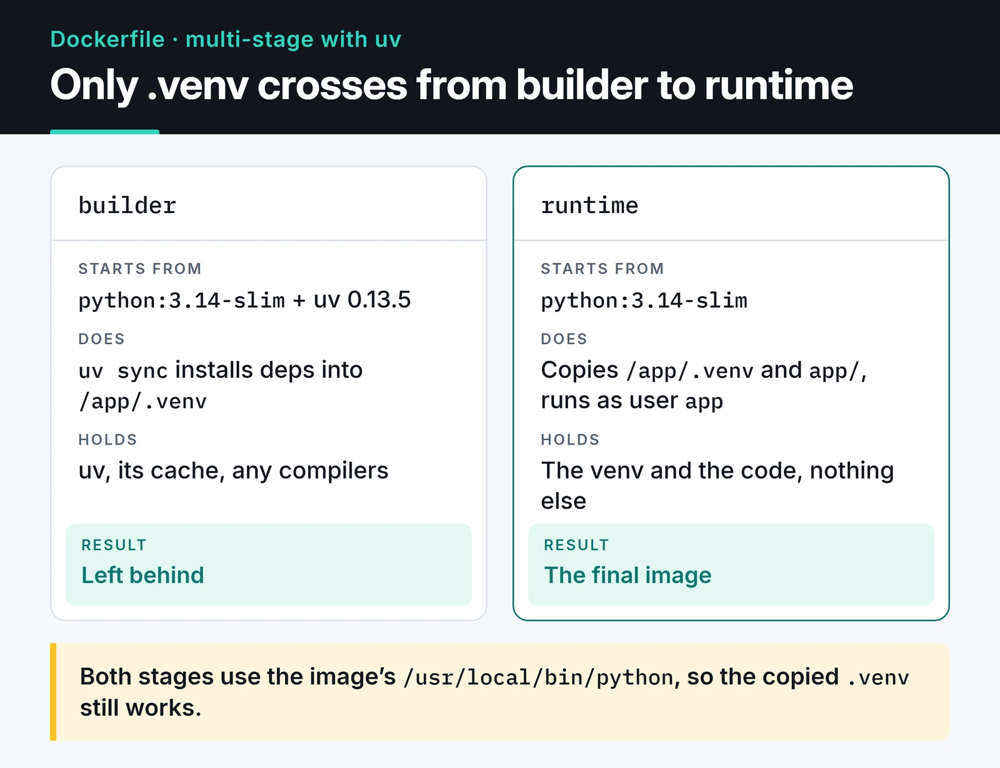

Dockerizing a Python app looks like a three-line job: `FROM python`, `COPY . .`, `pip install`. It works, too. The problems show up a few weeks later. The image is close to a gigabyte, every code change reinstalls every dependency, the process runs as root, and `docker stop` hangs for ten seconds before Docker kills the container.

This is the Dockerfile layout I use for my FastAPI services and bots. Dependencies come from [uv](https://docs.astral.sh/uv/), the image is built in two stages, and Docker Compose runs the whole thing locally. The examples use Python 3.14 and uv 0.13.

## Project layout

```text
.
├── app/
│   ├── __init__.py
│   └── main.py
├── pyproject.toml
├── uv.lock
├── .dockerignore
├── Dockerfile
└── compose.yaml
```

Commit `uv.lock`. The image installs from it, so your laptop and the container get exactly the same package versions.

`app/main.py` only needs a health endpoint for this post:

```python
from fastapi import FastAPI

app = FastAPI()


@app.get("/health")
async def health() -> dict[str, str]:
    return {"status": "ok"}
```

## Start with .dockerignore

The build context is everything `docker build` sends to BuildKit. Without a `.dockerignore`, that includes `.git`, your local `.venv` and, worst of all, `.env`. With a `COPY . .` in the Dockerfile, those files end up inside the image.

```text
.git
.venv
__pycache__/
*.pyc
.env
.env.*
.pytest_cache/
.mypy_cache/
Dockerfile
compose.yaml
```

The local `.venv` matters more than it looks. It holds packages built for your OS and is useless in a Linux image.

## Pick slim, skip Alpine

The full `python:3.14` image ships compilers and development headers and weighs around 1 GB. `python:3.14-slim` uses the same Debian base without most of that, so it is a fraction of the size.

Alpine is smaller still, but for Python it is usually a bad trade. It uses musl instead of glibc, and many packages on PyPI either have no musl wheels or have them published separately. When there is no wheel, pip or uv compiles from source: builds get slower and you need a compiler in the image. I start from `slim`.

## A multi-stage Dockerfile with uv

The builder stage installs dependencies into a virtual environment at `/app/.venv`. The final image gets that environment and the application code and nothing else. The uv binary, its cache and any compilers stay behind in the builder.

The card below compares the two stages: only `.venv` crosses from the builder to the runtime stage.



```dockerfile {title="Dockerfile"}
# syntax=docker/dockerfile:1

FROM python:3.14-slim AS builder

COPY --from=ghcr.io/astral-sh/uv:0.13.5 /uv /uvx /bin/

ENV UV_COMPILE_BYTECODE=1 \
    UV_LINK_MODE=copy \
    UV_PYTHON_DOWNLOADS=0

WORKDIR /app

RUN --mount=type=cache,target=/root/.cache/uv \
    --mount=type=bind,source=uv.lock,target=uv.lock \
    --mount=type=bind,source=pyproject.toml,target=pyproject.toml \
    uv sync --locked --no-install-project --no-dev


FROM python:3.14-slim AS runtime

RUN groupadd --system app \
 && useradd --system --gid app --home-dir /app --no-create-home app

WORKDIR /app

COPY --from=builder --chown=app:app /app/.venv /app/.venv
COPY --chown=app:app app/ ./app/

ENV PATH="/app/.venv/bin:$PATH" \
    PYTHONUNBUFFERED=1

USER app
EXPOSE 8000

HEALTHCHECK --interval=30s --timeout=3s --start-period=10s --retries=3 \
  CMD ["python", "-c", "import urllib.request; urllib.request.urlopen('http://127.0.0.1:8000/health', timeout=2)"]

CMD ["uvicorn", "app.main:app", "--host", "0.0.0.0", "--port", "8000"]
```

What each piece does:

- `COPY --from=ghcr.io/astral-sh/uv:0.13.5` pulls the uv binary out of the official image. I pin the version so two builds a week apart use the same uv.
- `UV_COMPILE_BYTECODE=1` writes `.pyc` files at install time, so the container doesn't do it on first start.
- `UV_LINK_MODE=copy` is needed because the cache mount lives on a different filesystem and uv can't hardlink from it. Without it you get a warning on every build.
- `UV_PYTHON_DOWNLOADS=0` keeps uv from downloading its own Python. Both stages use the image's `/usr/local/bin/python`, which is why the copied `.venv` still works in the runtime stage.
- `--mount=type=cache` keeps uv's cache between builds. Even when `uv.lock` changes, packages already downloaded aren't fetched again.
- The `--mount=type=bind` lines make `pyproject.toml` and `uv.lock` visible for that one command without copying them into a layer.
- `--locked` fails the build if the lockfile is out of date with `pyproject.toml`. You find out in CI that someone forgot to run `uv lock`.
- `--no-install-project` installs dependencies only. The code arrives through a separate `COPY`.

The cache mount and the `UV_LINK_MODE` setting follow the pattern from the Docker guide in the uv docs:


If a dependency builds from source (older `psycopg` or `cryptography` setups, for example), add `build-essential` and the matching `-dev` packages to the builder stage only. The runtime stage needs just the shared library, such as `libpq5`. Most popular packages ship wheels now, so I rarely need this.

## Why layer order matters

Docker caches each instruction as a layer and reuses it when the inputs haven't changed. With this layout, the dependency layer is rebuilt only when `uv.lock` or `pyproject.toml` changes. Edit one line in `app/main.py` and only the final `COPY` layer is rebuilt, which takes seconds.

Put `COPY . .` at the top, as the naive version does, and any file change invalidates the whole dependency install. On a project you build dozens of times a day, that adds up.

## Non-root user and signals

Processes in a container run as root by default. If your app has a remote code execution bug, the attacker is root inside the container. A system user plus `USER app` is the cheapest mitigation there is.

Write `CMD` in exec form (the JSON array). With the shell form, `CMD uvicorn app.main:app`, PID 1 is `/bin/sh`, and the SIGTERM from `docker stop` may never reach uvicorn. Docker waits ten seconds and sends SIGKILL. I go through this, along with the Kubernetes and systemd side, in my post on [graceful shutdown and signal handling](/en/posts/graceful-shutdown-signal-handling/).

## A healthcheck without curl

A line I see in a lot of Dockerfiles is `CMD curl -f http://localhost/health || exit 1`. The slim image has no `curl`, so that check fails forever and the container shows up as `unhealthy`. Instead of installing curl for one line, I use the Python that is already there. `urlopen` raises on a non-2xx response or a refused connection, the process exits non-zero, and Docker counts a failed check.

Kubernetes ignores the Dockerfile `HEALTHCHECK`. There you define the same endpoint as liveness and readiness probes, which I cover in the [Kubernetes post](/en/posts/kubernetes-container-orchestration/).

## Local development with Docker Compose

The app usually needs PostgreSQL, sometimes Redis. I don't install those on my machine; `compose.yaml` runs them. The `version: "3.8"` line at the top of old Compose files is obsolete. The current `docker compose` plugin ignores it and prints a warning, so I leave it out.

```yaml {title="compose.yaml"}
services:
  api:
    build: .
    ports:
      - "8000:8000"
    environment:
      DATABASE_URL: postgresql://app:${POSTGRES_PASSWORD}@db:5432/app
    depends_on:
      db:
        condition: service_healthy
    restart: unless-stopped
    stop_grace_period: 30s
    develop:
      watch:
        - action: sync
          path: ./app
          target: /app/app
        - action: rebuild
          path: uv.lock

  db:
    image: postgres:17-alpine
    environment:
      POSTGRES_USER: app
      POSTGRES_PASSWORD: ${POSTGRES_PASSWORD}
      POSTGRES_DB: app
    volumes:
      - pgdata:/var/lib/postgresql/data
    healthcheck:
      test: ["CMD-SHELL", "pg_isready -U app -d app"]
      interval: 5s
      timeout: 3s
      retries: 10

volumes:
  pgdata:
```

Three settings in this file do the real work:

1. `depends_on` with `condition: service_healthy` makes the API wait until Postgres accepts connections. A plain `depends_on: [db]` only waits for the container to start, which is earlier.
2. `POSTGRES_PASSWORD` comes from a `.env` file next to `compose.yaml`. The password stays out of the Compose file, and `.dockerignore` keeps it out of the image.
3. With `develop.watch`, `docker compose up --watch` syncs changes under `app/` into the running container and rebuilds the image when `uv.lock` changes. Pair it with a dev command that runs uvicorn with `--reload`.

## Build and tag in CI

I build images in CI and push them to a registry, tagged with the commit SHA. `latest` only means "whatever was pushed last". It can't tell you what is running in production or what to roll back to. With SHA tags, a rollback is redeploying the previous SHA.

The full GitHub Actions workflow, with `docker/build-push-action`, GHCR and the BuildKit cache stored in the Actions cache, is in my [GitHub Actions CI/CD post](/en/posts/github-actions-ci-cd-pipeline/).

## Checklist before production

- Does `.dockerignore` exclude `.env`, `.git` and `.venv`?
- Are the base image and the uv version pinned?
- Does the app run as a non-root user?
- Is `CMD` in exec form, and does the app handle SIGTERM?
- Do logs go to stdout instead of files? `PYTHONUNBUFFERED=1` stops Python from buffering them.
- Does the container have memory and CPU limits (`deploy.resources.limits` in Compose, `resources.limits` in Kubernetes)?
- Are images tagged by SHA?

## What's next

When I start a new project from this template, I usually change only the `CMD` line and the copied folder. For more options, uv's [Docker integration guide](https://docs.astral.sh/uv/guides/integration/docker/) is the reference, and running the same image on [Kubernetes](/en/posts/kubernetes-container-orchestration/) is the natural next step.
