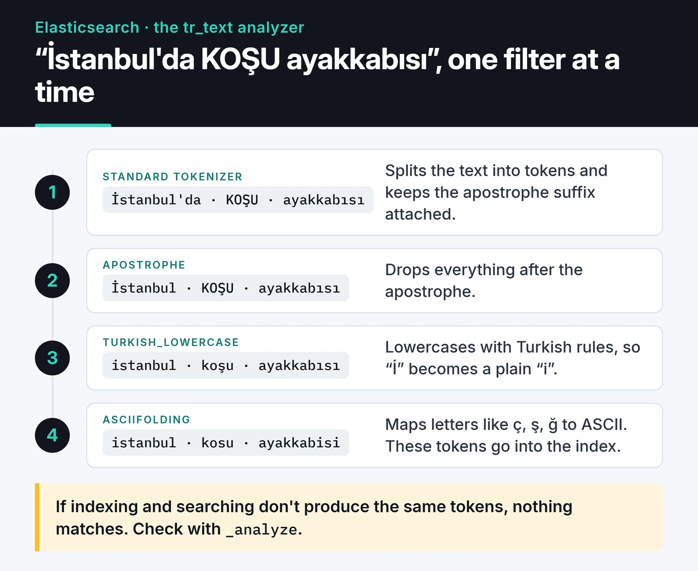
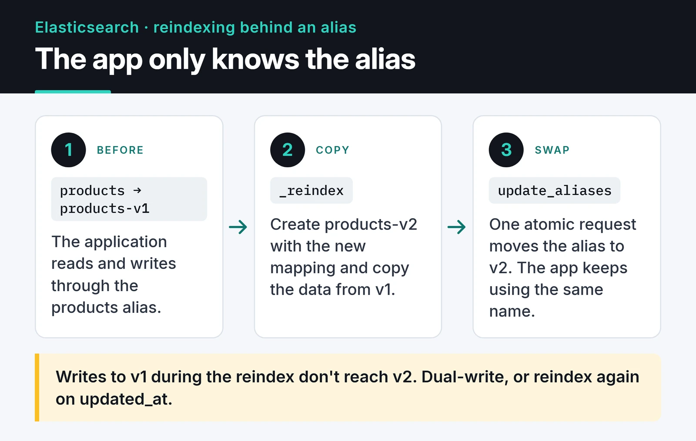

Elasticsearch full-text search is easy on day one. You start the Docker image, index a few JSON documents and search works. The trouble starts later: you need to change a mapping, the cluster turns yellow, or a user tries to jump to page 10,000.

These are the things I watch for when I run Elasticsearch as a search engine next to PostgreSQL. The examples target Elasticsearch 8/9 and the official `elasticsearch` Python client.

## Rule zero: Elasticsearch is not your source of truth

Elasticsearch is a search and analytics engine. It has no transactions, a new document becomes searchable after the refresh interval (one second by default), and changing a field's mapping means reindexing. I keep the real data in a database like PostgreSQL and sync it to Elasticsearch asynchronously, through a queue or CDC. If the index breaks, you rebuild it from the database. The reverse may not be possible.

| | PostgreSQL | Elasticsearch |
| :--- | :--- | :--- |
| Role | Source of truth | Search and analytics |
| Consistency | ACID | Near real time, eventual |
| Text search | `ILIKE '%x%'` is slow, `tsvector` is limited | Inverted index with relevance scoring |
| Schema change | `ALTER TABLE` | New index plus reindex |

If you sync through a message broker, my posts on [RabbitMQ](/en/posts/rabbitmq-message-queue/) and [Kafka](/en/posts/apache-kafka-event-streaming/) cover the two common options.

## Connecting from Python

Since Elasticsearch 8, security is on by default: TLS and authentication are required. Match the client's major version to the server: `elasticsearch>=8,<9` for an 8.x cluster, `elasticsearch>=9,<10` for 9.x. The 9.x client dropped the old `body=` parameter entirely, so every request uses keyword arguments.

```python
from elasticsearch import Elasticsearch

es = Elasticsearch(
    "https://localhost:9200",
    api_key="BASE64_API_KEY",
    ca_certs="http_ca.crt",
    request_timeout=10,
)
print(es.info()["version"]["number"])
```

Give the application a scoped API key instead of a username and password. In async code such as a FastAPI service, `AsyncElasticsearch` has the same API.

## Turn off dynamic mapping in production

When Elasticsearch sees an unknown field, it guesses the type. If the first document has `"status_code": 200`, the field becomes `long`. The day another service sends `"status_code": "404 Not Found"`, that document is rejected with a `mapper_parsing_exception`. There is a slower failure too: every new JSON key creates a new field and the mapping keeps growing.

I use `dynamic: strict` on production indices. An undefined field makes the write fail, so you find out right away.

```python
es.indices.create(
    index="products-v1",
    settings={
        "number_of_shards": 1,
        "number_of_replicas": 1,
        "analysis": {
            "analyzer": {
                "tr_text": {
                    "type": "custom",
                    "tokenizer": "standard",
                    "filter": ["apostrophe", "turkish_lowercase", "asciifolding"],
                }
            },
            "filter": {
                "turkish_lowercase": {"type": "lowercase", "language": "turkish"}
            },
        },
    },
    mappings={
        "dynamic": "strict",
        "properties": {
            "sku": {"type": "keyword"},
            "name": {
                "type": "text",
                "analyzer": "tr_text",
                "fields": {"raw": {"type": "keyword"}},
            },
            "description": {"type": "text", "analyzer": "tr_text"},
            "price": {"type": "scaled_float", "scaling_factor": 100},
            "created_at": {"type": "date"},
        },
    },
)
```

`keyword` is for exact matches, filters and sorting. `text` is analyzed into tokens. If you need both, define a multi-field like `name.raw` above.

## Analyzers decide what matches

The inverted index maps every term to the documents that contain it. That is where the speed comes from, but the analyzer decides the result: if indexing and searching don't split text into the same tokens, nothing matches.

My data is mostly Turkish, which is a good stress test for any analyzer:

1. The default `lowercase` filter turns the capital dotted "İ" into "i" plus a combining dot. A lowercase filter with `language: turkish` handles it correctly.
2. Turkish attaches suffixes with an apostrophe ("İstanbul'da" means "in Istanbul"). The standard tokenizer keeps it as one token; the `apostrophe` filter drops everything after the apostrophe.

The diagram below follows a sample string through the `tr_text` analyzer from the mapping, one step at a time:



`tr_text` fixes both problems, and `asciifolding` maps letters like "ç, ş, ğ" to ASCII so a user typing on an English keyboard still gets hits. For English content you would start from the built-in `english` analyzer instead. Every language has quirks like these, so check with `_analyze` before you trust an analyzer:

```python
tokens = es.indices.analyze(index="products-v1", analyzer="tr_text", text="İstanbul'da KOŞU ayakkabısı")
print([t["token"] for t in tokens["tokens"]])
# ['istanbul', 'kosu', 'ayakkabisi']
```

The built-in language analyzers also add stemming. On short text like product names, stemming can pull in unrelated results, so test it on real queries before turning it on.

For search I use `multi_match` across fields and boost the name:

```python
resp = es.search(
    index="products",
    query={
        "multi_match": {
            "query": "koşu ayakkabısı",
            "fields": ["name^3", "description"],
            "fuzziness": "AUTO",
        }
    },
    size=10,
)
for hit in resp["hits"]["hits"]:
    print(hit["_score"], hit["_source"]["name"])
```

## Zero-downtime reindexing with aliases

You can't change the type of an existing field. Switching a field from `text` to `keyword`, changing an analyzer or changing the shard count all mean creating a new index and copying the data. If the application talks to the physical index name, that's an outage.

The fix is to read and write through an alias. In the search above, `products` is an alias.



The steps:

```python
# 1. Create products-v2 with the new mapping (same create call as above)
# 2. Copy the data; run it as a background task on large indices
task = es.reindex(
    source={"index": "products-v1"},
    dest={"index": "products-v2"},
    wait_for_completion=False,
)
print(task["task"])  # poll with es.tasks.get(task_id=...)

# 3. When it's done, move the alias in one atomic request
es.indices.update_aliases(
    actions=[
        {"remove": {"index": "products-v1", "alias": "products"}},
        {"add": {"index": "products-v2", "alias": "products", "is_write_index": True}},
    ]
)
```

One catch: documents written to v1 while the reindex runs don't reach v2. Either dual-write during that window or run a second, smaller reindex filtered on an `updated_at` field. I find the second option simpler.

For time-series data like logs, skip manual aliases and use data streams with ILM. Elasticsearch then handles rollover for you.

## Sizing shards and the cluster

The shard count depends on data size. Elastic's current guidance is 10 to 50 GB per shard and fewer than 200 million documents. Tiny shards waste heap and file handles; huge ones take hours to move when a node dies. Since 8.x, new indices default to one primary shard, which is usually fine for a small catalog.

Keep at least one replica. On a single-node cluster, though, the replica has nowhere to go and the cluster stays yellow, so set `number_of_replicas: 0` in development.

Many older articles tell you to set `discovery.zen.minimum_master_nodes`. That setting was removed in Elasticsearch 7. The cluster now manages its voting configuration itself, and you only provide `cluster.initial_master_nodes` when bootstrapping a new cluster. Still run an odd number of master-eligible nodes (3 or 5): four voters tolerate no more failures than three.

As traffic grows, split roles. Master nodes manage cluster state, data nodes hold data and run queries, ingest nodes run pipelines before indexing. The main benefit: a heavy aggregation that chokes a data node doesn't take cluster management down with it.

## Deep pagination: use search_after, not from/size

A query with `from: 100000, size: 10` makes every shard collect and sort the top 100,010 hits. That's why Elasticsearch refuses to go past 10,000 results by default (`index.max_result_window`). To walk through everything, use a point in time (PIT) with `search_after`:

```python
pit = es.open_point_in_time(index="products", keep_alive="1m")
search_after = None

while True:
    resp = es.search(
        pit={"id": pit["id"], "keep_alive": "1m"},
        query={"match_all": {}},
        sort=[{"created_at": "asc"}],
        size=1000,
        search_after=search_after,
    )
    hits = resp["hits"]["hits"]
    if not hits:
        break
    for hit in hits:
        ...  # process the document
    search_after = hits[-1]["sort"]

es.close_point_in_time(id=pit["id"])
```

With a PIT, Elasticsearch adds an implicit `_shard_doc` tiebreaker to the sort, so documents with the same `created_at` aren't skipped. In a user interface, the best fix is not offering a "page 10,000" button at all.

## Yellow clusters and circuit breakers

A yellow cluster means all primaries are assigned but some replicas aren't. The two usual causes are a disk past the high watermark (90% by default) or no node available for the replica. Ask instead of guessing:

```python
print(es.cluster.allocation_explain())
```

A `circuit_breaking_exception` means a request wanted so much heap that Elasticsearch rejected it instead of running out of memory. The usual causes are aggregating on a `text` field with `fielddata: true`, or oversized `terms` aggregations. Aggregate on `keyword` fields.

## Pre-launch checklist

- Is swap disabled on the nodes, or `bootstrap.memory_lock: true` set?
- If you set the heap by hand, is it at most half the RAM and under about 31 GB? Since 8.x Elasticsearch sizes the heap automatically, and in most cases you should leave it alone.
- Have you blocked leading-wildcard queries (`*kiran`)? They scan the whole term dictionary. If you really need them, look at the `wildcard` field type.
- Is port 9200 kept off the public internet, with the app using a scoped API key?
- Are snapshots running on a schedule? Any S3-compatible store works; on your own servers, [MinIO](/en/posts/minio-object-storage/) does the job.

## Where to go next

Start a single-node Elasticsearch in Docker and run your own text through `_analyze` with the analyzer you plan to use. Getting the mapping, analyzer and alias right on day one saves most of the reindexing you'd otherwise do later. If you sync through an event stream, my [Kafka post](/en/posts/apache-kafka-event-streaming/) is a good next read. The [Python client docs](https://www.elastic.co/docs/reference/elasticsearch/clients/python) and the [analyzer reference](https://www.elastic.co/docs/reference/text-analysis/analyzer-reference) are the references I use.
