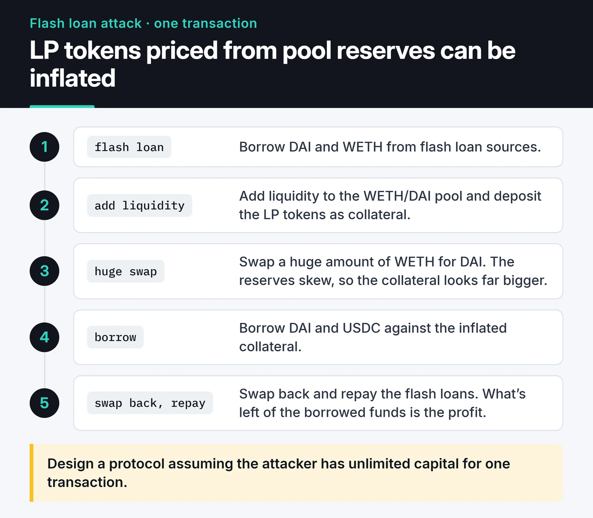

Flash loan arbitrage is the idea that hooks almost everyone who looks at DeFi: borrow without collateral, profit from a price gap between two exchanges, repay in the same transaction. I wrote a Python project around it called [Flash-Loan-Arbitrage](https://github.com/furkankoykiran/Flash-Loan-Arbitrage).

This post takes an honest look at that project: what the code does, what it can't do, how I'd build it today, and why the strategy is so hard in practice. The repo is a learning project and this is an engineering write-up, not investment advice.

## How a flash loan works

A protocol like Aave lends assets from its pool without collateral, on the condition that the loan plus a fee (the premium) comes back within the same transaction. If it doesn't, the EVM reverts the whole thing. It's as if the loan never happened, and all you lose is the gas.

In Aave V3 the flow is:

1. Your contract calls `Pool.flashLoanSimple(receiver, asset, amount, params, 0)`.
2. The pool transfers `amount` to your contract.
3. The pool calls `executeOperation(asset, amount, premium, initiator, params)` on your contract.
4. You do whatever you need inside that function: swaps, a liquidation, a debt migration.
5. Before it returns, your contract must approve `amount + premium` to the pool, which then pulls the funds back.

Governance sets the premium. On the Aave V3 pool on Ethereum, `FLASHLOAN_PREMIUM_TOTAL` is 5 basis points (0.05%). The 0.09% you often see quoted dates from Aave V2. Don't hardcode it; use the `premium` argument the callback gives you.

## What my Python bot did

The project is an async bot on web3.py 6, set up with Poetry. The modules split like this:

- `config.py`: reads `.env`, connects to the RPC with fallbacks, sets up the Telegram notifier.
- `token_discovery.py`: starts from known Uniswap V2 pairs and reads token info and reserves.
- `market_utils.py`: prices from CoinGecko, gas price, and a search for the "most profitable path" over DEX permutations.
- `contracts.py`: router and ERC-20 ABIs, sending trades through `swapExactTokensForTokens`.
- `notifications.py`: Telegram messages for opportunities, trade results and a status summary every five minutes.

The plumbing worked: the async loop, RPC failover, Telegram alerts and a clean shutdown on `SIGINT`. The problems sat in the part that was supposed to make money.

## What I see reading the code today

Rereading the whole repo, the first thing that stands out is that the README says "flash loan arbitrage" and the code doesn't do that.

### There is no flash loan

There isn't a single call to Aave or any other lender. The bot is written to swap, step by step, with token balances already in the wallet. In other words it's a non-atomic arbitrage attempt that puts your own capital at risk.

### `amountOutMin` is zero

The swap call is `swapExactTokensForTokens(amount, 0, ...)`, which means "I'll accept anything". Sent to the public mempool, that's a gift to sandwich bots: they buy in front of you, sell behind you, and keep the difference.

### Router addresses and ABIs don't match

The registry uses PancakeSwap's BNB Chain router address while the bot connects to Ethereum. Uniswap V3's `SwapRouter` address is called with the V2 router ABI. The liquidity check calls `getReserves` on routers, but that function lives on pair contracts. These calls fail and quietly return `False`, so the list of pairs to watch most likely ends up empty.

### The profit model can never show a profit

`calculate_path_profitability` never asks for a real quote. It multiplies the starting amount by `(1 - fee)` at each hop and subtracts gas, so the result is always below the starting amount and the "profitable" branch never runs. The CoinGecko call also passes a token address as the coin ID, which doesn't work either.

### What it adds up to

The irony is that the last two bugs keep the bot from ever sending a trade, which stops the first two from losing money. There are other dated bits: legacy `gasPrice` instead of EIP-1559 fees, unlimited (`2**256 - 1`) approvals, and web3.py 6's `rawTransaction`. As it stands it's a prototype, and my portfolio lists it as an early learning project.

## How I'd build it today

The work splits in two: an off-chain bot that looks for opportunities, and an on-chain contract that takes the loan, does the swaps, and reverts everything if there's no profit.

### On-chain: a contract that reverts without profit

The most important line is the final check. After both swaps, if the contract doesn't hold the loan plus premium plus the minimum profit you asked for, the transaction reverts. That's why the intermediate swaps have no minimum output: in an atomic transaction, the final check protects all of them.

```solidity {title="src/FlashArb.sol"}
// SPDX-License-Identifier: MIT
pragma solidity ^0.8.24;

import {IERC20} from "@openzeppelin/contracts/token/ERC20/IERC20.sol";
import {SafeERC20} from "@openzeppelin/contracts/token/ERC20/utils/SafeERC20.sol";
import {Ownable} from "@openzeppelin/contracts/access/Ownable.sol";

interface IPool {
    function flashLoanSimple(
        address receiverAddress,
        address asset,
        uint256 amount,
        bytes calldata params,
        uint16 referralCode
    ) external;
}

interface IUniswapV2Router {
    function swapExactTokensForTokens(
        uint256 amountIn,
        uint256 amountOutMin,
        address[] calldata path,
        address to,
        uint256 deadline
    ) external returns (uint256[] memory amounts);
}

contract FlashArb is Ownable {
    using SafeERC20 for IERC20;

    struct Route {
        address buyRouter;   // asset -> tokenOut
        address sellRouter;  // tokenOut -> asset
        address tokenOut;
        uint256 minProfit;   // minimum left over after repaying loan + premium
    }

    IPool public immutable POOL;

    error NotPool();
    error NotInitiator();
    error NoProfit(uint256 owed, uint256 received);

    constructor(IPool pool, address owner_) Ownable(owner_) {
        POOL = pool;
    }

    function start(address asset, uint256 amount, Route calldata route) external onlyOwner {
        POOL.flashLoanSimple(address(this), asset, amount, abi.encode(route), 0);
    }

    // Aave V3 calls this right after sending the loan
    function executeOperation(
        address asset,
        uint256 amount,
        uint256 premium,
        address initiator,
        bytes calldata params
    ) external returns (bool) {
        if (msg.sender != address(POOL)) revert NotPool();
        if (initiator != address(this)) revert NotInitiator();

        Route memory route = abi.decode(params, (Route));

        uint256 bought = _swap(route.buyRouter, asset, route.tokenOut, amount);
        uint256 received = _swap(route.sellRouter, route.tokenOut, asset, bought);

        uint256 owed = amount + premium;
        if (received < owed + route.minProfit) revert NoProfit(owed, received);

        IERC20(asset).forceApprove(address(POOL), owed);
        return true;
    }

    function withdraw(IERC20 token, address to) external onlyOwner {
        token.safeTransfer(to, token.balanceOf(address(this)));
    }

    function _swap(address router, address tokenIn, address tokenOut, uint256 amountIn)
        internal
        returns (uint256)
    {
        IERC20(tokenIn).forceApprove(router, amountIn);
        address[] memory path = new address[](2);
        path[0] = tokenIn;
        path[1] = tokenOut;
        // No minimum on the intermediate swap; the profit check reverts the whole tx
        uint256[] memory amounts = IUniswapV2Router(router).swapExactTokensForTokens(
            amountIn, 0, path, address(this), block.timestamp
        );
        return amounts[1];
    }
}
```

The security-critical lines:

- Without `msg.sender != address(POOL)`, anyone can call `executeOperation` directly and make the contract swap whatever tokens it holds.
- `initiator != address(this)` stops someone else from starting a flash loan with your contract as the receiver and making it pay the premium.
- `start` and `withdraw` are owner-only. Profit accumulates in the contract, and an unprotected `withdraw` hands it to anyone.
- Approvals use `forceApprove` for the exact amount; there are no unlimited approvals. I declared the two interfaces (`IPool`, `IUniswapV2Router`) myself, so the contract depends only on the functions it uses rather than on Aave's old `@aave/core-v3` npm package.

The contract targets the Aave V3 interface. If you build on Aave V4, check the current docs before using its flash loans.

### Testing on a mainnet fork

Testnet DEXs don't have realistic liquidity, so I test arbitrage code against a fork of mainnet:

```solidity {title="test/FlashArb.t.sol"}
// SPDX-License-Identifier: MIT
pragma solidity ^0.8.24;

import {Test} from "forge-std/Test.sol";
import {FlashArb, IPool} from "../src/FlashArb.sol";

contract FlashArbForkTest is Test {
    address constant AAVE_POOL = 0x87870Bca3F3fD6335C3F4ce8392D69350B4fA4E2;
    address constant WETH = 0xC02aaA39b223FE8D0A0e5C4F27eAD9083C756Cc2;
    address constant USDC = 0xA0b86991c6218b36c1d19D4a2e9Eb0cE3606eB48;
    address constant UNI_V2 = 0x7a250d5630B4cF539739dF2C5dAcb4c659F2488D;
    address constant SUSHI = 0xd9e1cE17f2641f24aE83637ab66a2cca9C378B9F;

    FlashArb arb;

    function setUp() public {
        vm.createSelectFork(vm.envString("MAINNET_RPC_URL"));
        arb = new FlashArb(IPool(AAVE_POOL), address(this));
    }

    function test_UnprofitableRouteReverts() public {
        FlashArb.Route memory route = FlashArb.Route({
            buyRouter: UNI_V2,
            sellRouter: SUSHI,
            tokenOut: USDC,
            minProfit: 0
        });
        // If prices are already in line, loan + premium can't be repaid and everything reverts
        vm.expectPartialRevert(FlashArb.NoProfit.selector);
        arb.start(WETH, 10 ether, route);
    }

    function test_OnlyPoolCanCallback() public {
        vm.expectRevert(FlashArb.NotPool.selector);
        arb.executeOperation(WETH, 1 ether, 0, address(arb), "");
    }
}
```

Run it with `MAINNET_RPC_URL=... forge test --match-contract FlashArbForkTest`. The first test shows that on an ordinary block, a 10 WETH round trip between Uniswap V2 and SushiSwap doesn't pay, and the transaction reverts with `NoProfit`. That's the result a bot like this sees most of the time.

### Off-chain: measuring the opportunity

On the bot side, I estimate profit by calling the routers' `getAmountsOut` through `eth_call` and subtracting the premium and gas. This script runs on web3.py 7:

```python {title="quote.py"}
from web3 import Web3

w3 = Web3(Web3.HTTPProvider("https://ethereum-rpc.publicnode.com"))

ROUTER_ABI = [{
    "name": "getAmountsOut", "type": "function", "stateMutability": "view",
    "inputs": [{"name": "amountIn", "type": "uint256"}, {"name": "path", "type": "address[]"}],
    "outputs": [{"name": "amounts", "type": "uint256[]"}],
}]
POOL_ABI = [{
    "name": "FLASHLOAN_PREMIUM_TOTAL", "type": "function", "stateMutability": "view",
    "inputs": [], "outputs": [{"name": "", "type": "uint128"}],
}]

WETH = Web3.to_checksum_address("0xC02aaA39b223FE8D0A0e5C4F27eAD9083C756Cc2")
USDC = Web3.to_checksum_address("0xA0b86991c6218b36c1d19D4a2e9Eb0cE3606eB48")
UNI_V2 = w3.eth.contract(address="0x7a250d5630B4cF539739dF2C5dAcb4c659F2488D", abi=ROUTER_ABI)
SUSHI = w3.eth.contract(address="0xd9e1cE17f2641f24aE83637ab66a2cca9C378B9F", abi=ROUTER_ABI)
AAVE_POOL = w3.eth.contract(address="0x87870Bca3F3fD6335C3F4ce8392D69350B4fA4E2", abi=POOL_ABI)


def round_trip(amount_in: int, buy, sell) -> int:
    usdc_out = buy.functions.getAmountsOut(amount_in, [WETH, USDC]).call()[-1]
    return sell.functions.getAmountsOut(usdc_out, [USDC, WETH]).call()[-1]


amount = w3.to_wei(10, "ether")
premium_bps = AAVE_POOL.functions.FLASHLOAN_PREMIUM_TOTAL().call()
premium = amount * premium_bps // 10_000
gas_cost = 350_000 * w3.eth.gas_price  # rough estimate

for name, buy, sell in [("Uni->Sushi", UNI_V2, SUSHI), ("Sushi->Uni", SUSHI, UNI_V2)]:
    back = round_trip(amount, buy, sell)
    net = back - amount - premium - gas_cost
    # from_wei rejects negative values, so divide by 1e18 instead
    print(f"{name}: got back {back / 1e18:.4f} WETH, net {net / 1e18:+.4f} WETH "
          f"(premium {premium_bps} bps)")
```

When I ran it, a 10 WETH round trip came back with about 8.44 WETH in both directions, a loss of more than 1.5 WETH. There's no real price gap here. Most of the loss is price impact: these V2 pools are no longer deep enough for a 10 WETH trade. A bot that only compares spot prices would have called this an opportunity.

A real system needs more than this estimate: quoters such as `QuoterV2` for Uniswap V3 and V4 pools, choosing the trade size that maximizes profit instead of a fixed 10 WETH, and simulating the full transaction with `eth_call` before sending it.

## Competition and risk in practice

Flash loan arbitrage is often sold as "capital-free arbitrage". Reality is harsher.

Simple price gaps between major DEXs are usually closed within the same block by professional searchers. They watch the mempool and the block builders, run their own nodes, measure latency in milliseconds, and pay most of the profit to builders to get included. A Python bot on a home connection is very unlikely to win that race.

A flash loan doesn't make the trade risk-free either:

- A profitable transaction sent to the public mempool can be copied and front-run, and you pay gas even when it fails. You need a private route such as Flashbots Protect, or bundles sent straight to builders, so a reverting transaction never lands on-chain.
- A logic bug in your contract exposes the profit sitting in it, or the approvals it has granted.
- Flash loans have mostly made headlines through exploits. The card below shows how a lending protocol that priced LP tokens from pool reserves was drained.



Today I see flash loans as a good tool for understanding atomic transactions and the oracle assumptions in DeFi protocols. I don't see them as free money. If you're building a protocol, design it assuming the attacker has unlimited capital for one transaction; I cover that under oracle manipulation in the [Solidity security guide](/en/posts/solidity-security-gas-optimization/).

## Where to go next

The full code is [on GitHub](https://github.com/furkankoykiran/Flash-Loan-Arbitrage) and the project summary is in [my portfolio](https://furkankoykiran.com.tr/en/projects/flash-loan-arbitrage/). The user-facing side of the same mechanics, routing for the best price, is in the [DEX aggregator post](/en/posts/dex-aggregator-web3-routing/), and the basics of talking to the chain from Python are in the [web3.py v7 guide](/en/posts/web3py-ethereum-interaction/). If you try anything in this space, start on a fork, then a testnet, and only then with small amounts you can afford to lose.
