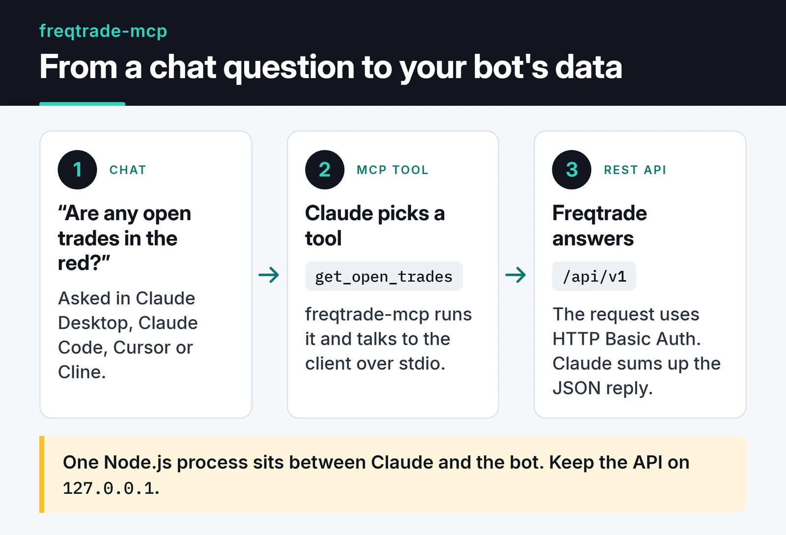

I run a Freqtrade bot. Like most people with a trading bot, I tell myself I don't check it all the time, and then I check it all the time: open FreqUI, click through tabs, look at one number, close the tab, open it again fifteen minutes later.

Claude was already open, and the bot already had a perfectly good REST API. So I wrote [freqtrade-mcp](https://github.com/furkankoykiran/freqtrade-mcp), a TypeScript MCP server that exposes Freqtrade's REST API as MCP tools. It works with Claude Desktop, Claude Code, Cursor, Cline and anything else that speaks the [Model Context Protocol](https://modelcontextprotocol.io). Version 1.0.0 went to npm on April 4, 2026.

## What it does

The questions I actually ask look like this:

> "Am I up this month?"
>
> "Are any open trades in the red?"
>
> "What do the last 50 BTC/USDT candles on the 4h look like?"

Claude maps each question to a tool, reads the JSON that comes back from Freqtrade and summarizes it, so I don't have to parse numbers at 11pm. The tools fall into six groups:

| Group | Tools |
|---|---|
| Account | `get_profit_stats`, `get_balance`, `get_performance` |
| Trades | `get_open_trades`, `get_trade`, `get_trade_history` |
| Market data | `get_market_data` |
| Pair lists | `get_whitelist`, `get_blacklist`, `add_to_blacklist`, `remove_from_blacklist` |
| Execution | `execute_trade`, `force_exit_trade` |
| Lifecycle | `start_bot`, `stop_bot`, `reload_config`, `get_bot_info`, `get_locks`, `delete_lock` |

That's 19 tools in the code. The README still says 15, which is on my list to fix.

A few practical notes:

- `get_market_data` uses Freqtrade's `/pair_candles` endpoint, which returns the candle data the bot has analyzed. In practice that means pairs the bot is tracking, not any pair on the exchange.
- `get_trade_history` and `get_market_data` return at most 500 rows.
- `get_bot_info` returns the bot version together with the time of the last strategy cycle. That answers "is the bot running, or has it been silently stuck?"

## Architecture

The server is a single Node.js process that talks stdio to the client and HTTP Basic Auth to Freqtrade under `/api/v1`:



The code has three layers:

- `src/client.ts` is a typed HTTP client for the Freqtrade API. It uses the `fetch` built into Node 18+, aborts each request after 10 seconds with an `AbortController`, and puts Freqtrade's `detail` field into the error message on non-2xx responses.
- `src/tools/*.ts` has one file per group, and each tool declares its parameters with a zod schema.
- `src/index.ts` builds the client from environment variables, registers the tools and connects a `StdioServerTransport`.

That keeps the repo small: the code under `src/`, a `.env.example`, and a `.github/` folder for CI and the npm release.

A complete tool is this short:

```typescript
server.tool(
  'get_trade',
  'Retrieve detailed information about a specific trade by its ID, including full history, fees, and profit/loss.',
  {
    trade_id: z.number().int().positive().describe('The numeric trade ID to look up.'),
  },
  async ({ trade_id }) => {
    try {
      const data = await client.getTrade(trade_id);
      return { content: [{ type: 'text', text: JSON.stringify(data, null, 2) }] };
    } catch (err) {
      return {
        content: [{ type: 'text', text: `Error fetching trade ${trade_id}: ${(err as Error).message}` }],
        isError: true,
      };
    }
  },
);
```

I return errors with `isError: true` instead of throwing them. The model sees "trade 42 not found", can tell the user something sensible, and the session stays up. The descriptions matter too, because they decide when the model picks a tool. For `execute_trade` I put natural-language examples like "buy 100 USDT of BTC" in the description, along with the parameters each one maps to.

If I started it today I'd change one thing: newer releases of the MCP TypeScript SDK recommend `registerTool()` over `server.tool()`. The server works fine on the 1.x SDK, but a new project should start with `registerTool()`.

## Setup

First, turn on Freqtrade's REST API, which is off by default. In `config.json`:

```json
"api_server": {
  "enabled": true,
  "listen_ip_address": "127.0.0.1",
  "listen_port": 8080,
  "verbosity": "error",
  "enable_openapi": false,
  "jwt_secret_key": "some-long-random-value",
  "username": "Freqtrader",
  "password": "YourStrongPassword"
}
```

Keep `listen_ip_address` at `127.0.0.1`. Exposing the API to the internet puts your bot and your exchange account behind a single password. The Freqtrade docs say the same:

")

Then add the server to Claude Desktop's `claude_desktop_config.json`:

```json
{
  "mcpServers": {
    "freqtrade": {
      "command": "npx",
      "args": ["-y", "@furkankoykiran/freqtrade-mcp"],
      "env": {
        "FREQTRADE_API_URL": "http://127.0.0.1:8080",
        "FREQTRADE_USERNAME": "Freqtrader",
        "FREQTRADE_PASSWORD": "YourStrongPassword"
      }
    }
  }
}
```

Restart Claude Desktop and the tools show up. With Claude Code it's one command:

```bash
claude mcp add freqtrade \
  -e FREQTRADE_API_URL=http://127.0.0.1:8080 \
  -e FREQTRADE_USERNAME=Freqtrader \
  -e FREQTRADE_PASSWORD=YourStrongPassword \
  -- npx -y @furkankoykiran/freqtrade-mcp
```

To poke at the tools before wiring them into a client, use the MCP Inspector: `npx @modelcontextprotocol/inspector npx -y @furkankoykiran/freqtrade-mcp`.

## Live trading caveats

`execute_trade` and `force_exit_trade` skip the strategy and call Freqtrade's `/forceenter` and `/forceexit` endpoints directly. The server has no confirmation step.

> [!WARNING]
> If the bot is live, these tools place a real order on a real exchange, and you can't take it back.

Things to know before you rely on it:

- Freqtrade only accepts `/forceenter` when the config has `force_entry_enable: true`. Without it, `execute_trade` returns an error. Turning that on should be a deliberate choice.
- `side: "short"` only makes sense for bots running in futures or margin mode. You can't short in spot mode.
- Try everything with `dry_run: true` first. Freqtrade simulates the orders, so you can see how the tools behave without risk.
- Claude Desktop and Claude Code ask for permission before tool calls. I never pick "always allow" for the tools that place orders.

## Where the code is

What I wanted was simple: check the bot without opening FreqUI. The REST API was already there; the MCP server moved it into the chat. I still wonder whether something changed while I wasn't looking, but now finding out takes one sentence.

The code is MIT licensed and [on GitHub](https://github.com/furkankoykiran/freqtrade-mcp), with a summary on my [project page](https://furkankoykiran.com.tr/en/projects/freqtrade-mcp/). Before you point it at your own bot, run it for a week with `dry_run: true` and compare what `get_profit_stats` and `get_open_trades` report with FreqUI. To see a different MCP integration, where I wrapped someone else's MCP server as a CLI, read [my CLI-Anything contribution](/en/posts/cli-anything-browser-automation-contribution/). If your Python services lean on async I/O the way trading bots do, the [asyncio guide](/en/posts/python-asyncio-concurrent-processing/) is a good next read.
