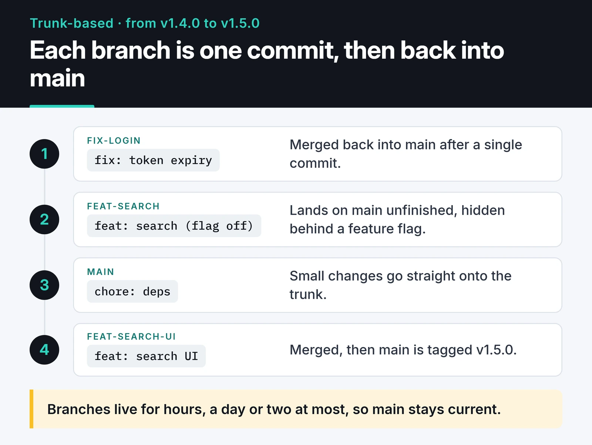
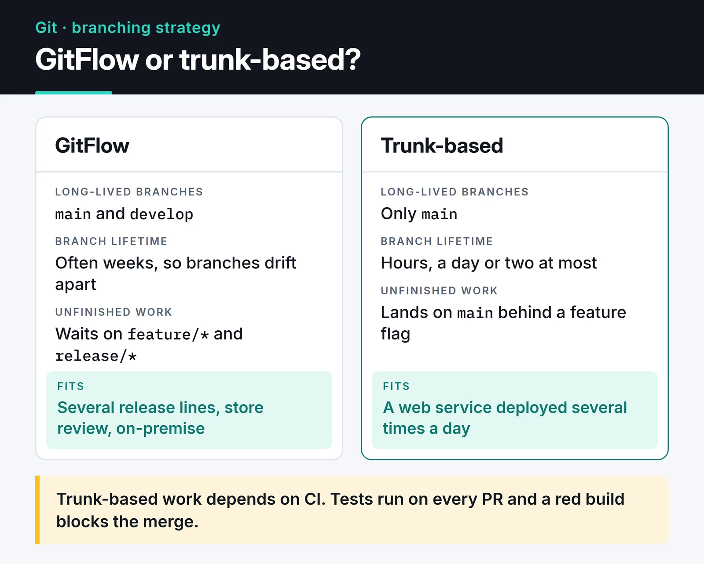

Choosing a Git branching strategy eats more time than you'd expect once a team grows. Everyone has seen the Friday evening where three feature branches get merged into `develop` and the result is hundreds of conflicts. In this post I compare GitFlow with trunk-based development, then move on to the tools that help whichever one you pick: merge strategy, commit message conventions, pre-commit hooks and `git bisect`.

The setup I use in my own projects and open source contributions is simple: short-lived branch, pull request, squash merge once CI is green. Here's why.

## GitFlow: when it still makes sense

GitFlow has two long-lived branches: `main` (or `master`) holds what's in production, `develop` holds the next release. Features are built on `feature/*` branches, a `release/*` branch is cut for each release, and urgent fixes go through `hotfix/*` into both `main` and `develop`.

The trouble is how long branches live. While you spend two weeks on `feature-x`, a teammate restructures the same module on `feature-y`. On merge day you both deal with two weeks of drift. Vincent Driessen, who described the model, added a note to [the original article](https://nvie.com/posts/a-successful-git-branching-model/) in 2020 recommending a simpler workflow for continuously delivered web apps.

GitFlow still fits some cases: libraries that support several release lines at once, mobile apps waiting on store review, on-premise software shipped to customers. For a web service deployed several times a day, I find it too much ceremony.

## Trunk-based development

One rule: everyone merges into the trunk (`main`) often, in small pieces. Branches exist, but they live for hours, a day or two at most.



Unfinished features go behind a feature flag. The code lands on `main` and even ships to production, but users don't see it while the flag is off. The simplest version is an environment variable:

```python
import os


def new_checkout_enabled(user_id: int) -> bool:
    if os.getenv("FEATURE_NEW_CHECKOUT") != "1":
        return False
    rollout = int(os.getenv("NEW_CHECKOUT_ROLLOUT_PERCENT", "0"))
    return user_id % 100 < rollout
```

That's enough for a small team. Once you have many flags, move to a flag service or a standard like OpenFeature, otherwise stale flags pile up in the code and become their own kind of debt. Opening an issue to delete each flag when the feature is done is a good habit.

Trunk-based work depends on good CI. If everyone merges into `main` often, tests have to run on every PR and a red build has to block the merge.

The card below puts the two models side by side.



## Merge queues

Bigger teams hit a new problem: two PRs are green on their own but break `main` together, because each was tested without the other. GitHub's merge queue fixes that. When you hit merge, the PR joins a queue, GitHub builds a temporary branch on top of the current `main` plus the PRs ahead of it, runs the checks there and merges only if they pass.

That removes the "two green PRs broke main" class of failures. Flaky tests, or tests that don't run in CI, can still break `main`. To use the queue, your workflow has to listen for the `merge_group` event:

```yaml
on:
  pull_request:
  merge_group:
```

Forget this and the queue sits waiting for checks that never start.

## Merge, rebase or squash

```text
Before:            A---B---C            main
                        \
                         D---E          feature

Merge commit:      A---B---C-------M    main
                        \         /
                         D-------E

Rebase and merge:  A---B---C---D'--E'   main   (D' and E' are new commits)

Squash and merge:  A---B---C---S        main   (S holds D + E as one commit)
```

- Merge commit: the branch history stays as is, plus a merge commit on top. You can see who merged what and when, but the log gets busy.
- Rebase and merge: commits are replayed one by one on top of `main`, so history stays linear. Good when every commit on the branch is meaningful.
- Squash and merge: all commits on the branch become one.

I prefer squash. The "wip", "typo" and "fix test" commits never reach `main`, and every PR becomes one commit you can revert cleanly. The PR title becomes the commit message, so write it with care.

To keep your own branch current, rebase it, and when you need to force push, always use a lease:

```bash
git fetch origin
git rebase origin/main
git push --force-with-lease
```

`--force-with-lease` refuses to push if someone else pushed to the remote branch since you last fetched. Plain `--force` silently deletes their commits. If you work with stacked branches, `git rebase --update-refs` moves the intermediate branches along with yours.

## Conventional Commits and automated releases

When commit messages follow a format, tools can produce version numbers and changelogs for you. The [Conventional Commits](https://www.conventionalcommits.org/) format:

- `fix(payment): handle timeout` bumps the patch version (1.1.0 → 1.1.1).
- `feat(auth): add Google sign-in` bumps the minor version (1.1.0 → 1.2.0).
- `feat!: drop the v1 API`, or `BREAKING CHANGE:` in the body, bumps the major version (1.1.0 → 2.0.0).

semantic-release and release-please read these messages and generate the version, tag and changelog. With squash merges, the PR title is what has to follow the format.

## Let tools enforce the rules

Leaving "your commit message doesn't follow the format" comments in code review wastes everyone's time. Check it at commit time with [pre-commit](https://pre-commit.com/):

```yaml
# .pre-commit-config.yaml
default_install_hook_types: [pre-commit, commit-msg]
repos:
  - repo: https://github.com/pre-commit/pre-commit-hooks
    rev: v6.0.0
    hooks:
      - id: trailing-whitespace
      - id: end-of-file-fixer
      - id: check-yaml
      - id: check-added-large-files
  - repo: https://github.com/astral-sh/ruff-pre-commit
    rev: v0.17.2
    hooks:
      - id: ruff-check
        args: [--fix]
      - id: ruff-format
  - repo: https://github.com/gitleaks/gitleaks
    rev: v8.30.1
    hooks:
      - id: gitleaks
  - repo: https://github.com/compilerla/conventional-pre-commit
    rev: v4.4.0
    hooks:
      - id: conventional-pre-commit
        stages: [commit-msg]
```

Running `pre-commit install` once sets up both the regular hooks and the commit message check. Bump versions now and then with `pre-commit autoupdate`. Run the same checks in CI too, because `git commit --no-verify` skips hooks. In JavaScript projects, Husky and commitlint do the same job. The file above is in pre-commit's own format, not a Husky config.

If you manage Python dependencies with lock files, the same "let tools enforce it" idea applies there; my [Poetry vs uv post](/en/posts/poetry-python-project-management/) covers checking lock freshness in CI.

## git bisect: finding the commit that broke it

"It worked yesterday" and there are a hundred commits in between. Instead of checking them one by one, `git bisect` runs a binary search; even with 1,000 commits you're done in about 10 steps. Give it a test command and it drives the steps itself:

```bash
git bisect start
git bisect bad HEAD
git bisect good v1.4.0
git bisect run pytest tests/test_checkout.py -x -q
git bisect reset
```

`git bisect run` treats exit code 0 as good and 1 to 127 (except 125) as bad. Exit code 125 means "can't test this commit, skip it".

## Common mistakes and how to recover

- Commits you think you lost with `git reset --hard` usually aren't gone. `git reflog` keeps every position HEAD has been at for a while; get one back with `git branch rescued <hash>`.
- If `.git` has grown to gigabytes, someone probably committed a database dump or a video. Remove it from history with [git-filter-repo](https://github.com/newren/git-filter-repo), after which everyone needs a fresh clone.
- If you pushed an API key, revoke it and issue a new one first; cleaning history comes second. Treat any pushed secret as copied. Turn on GitHub secret scanning and push protection, and let the gitleaks hook above be your first line of defense locally.
- Block direct pushes and force pushes to `main` with branch protection or rulesets. Code gets in through a PR with green CI, nothing else.
- When a lock file (`poetry.lock`, `uv.lock`) conflicts, don't merge it by hand. Take the version from `main` and regenerate the lock.

## Monorepo or polyrepo?

In short: a monorepo lets you change the backend, frontend and a shared library in one commit, but at scale it needs tools like Nx, Turborepo or Bazel and a CI that only tests what changed. In a polyrepo setup every service deploys independently, but rolling a fix in a shared library out to fifty repos becomes a project of its own. For a five-person team either works; let team size and how often services change together decide.

## Tools that make Git nicer

- [delta](https://github.com/dandavison/delta) adds syntax highlighting and side-by-side views to `git diff`.
- [lazygit](https://github.com/jesseduffield/lazygit) is a terminal UI for Git. Staging hunks and interactive rebases are much faster with it.
- `git switch` and `git restore` split the two jobs of `git checkout` into commands that are harder to misuse.

If your CI runs on GitHub Actions, my [CI/CD pipeline post](/en/posts/github-actions-ci-cd-pipeline/) goes deeper into that side.

## What's next

If your team still works with long-lived branches, don't change everything in a day. Put a limit on branch age (two days, say), switch to squash merges and commit a pre-commit config. Feature flags and merge queues come much easier once those habits stick.
