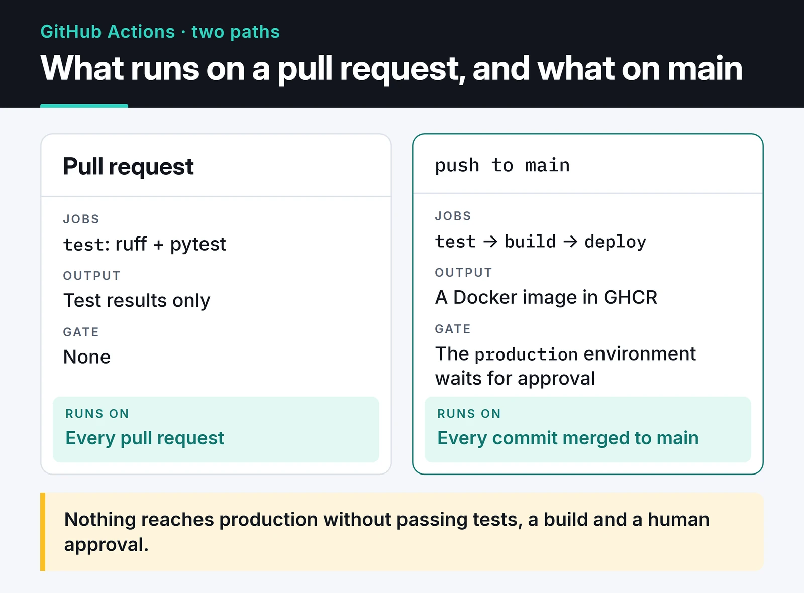

A working GitHub Actions CI/CD pipeline takes five minutes to write. Keeping it fast, cheap and safe a few months later is the hard part. Copy-pasted YAML multiplies across repos, tokens run with write access everywhere, and a stuck job burns six hours of minutes before anyone notices.

This is the pipeline I set up for Python projects: tests on every pull request, a Docker image from `main`, and a production deploy that waits for approval. After that I cover reusable workflows for sharing the logic across repos, OIDC for getting rid of static cloud keys, and the security settings people tend to skip.

## The shape of the pipeline

Pull requests only run tests. Every commit merged to `main` is tested, built into an image, and then waits for approval before going to production. The card shows both paths.



## A test workflow for every PR

```yaml {title=".github/workflows/ci.yml"}
name: CI

on:
  pull_request:
  push:
    branches: [main]

permissions:
  contents: read

concurrency:
  group: ${{ github.workflow }}-${{ github.ref }}
  cancel-in-progress: ${{ github.event_name == 'pull_request' }}

jobs:
  test:
    runs-on: ubuntu-latest
    timeout-minutes: 15
    strategy:
      fail-fast: false
      matrix:
        python-version: ["3.13", "3.14"]
    steps:
      - uses: actions/checkout@v7
      - uses: astral-sh/setup-uv@v10
        with:
          python-version: ${{ matrix.python-version }}
          enable-cache: true
      - run: uv sync --locked
      - run: uv run ruff check .
      - run: uv run pytest
```

Every line is there for a reason:

- `permissions: contents: read` limits the workflow's `GITHUB_TOKEN` to reading code. The org or repo default can be broader. Stating what each workflow needs keeps the blast radius small if a step is ever compromised.
- `concurrency` cancels the older run when you push twice to the same PR, so you don't pay for a result nobody will look at. I don't cancel on `main`, where I want a result for every commit.
- `timeout-minutes: 15` matters more than it looks. The default job timeout is 360 minutes; a hung test or network call can eat six hours.
- `enable-cache` in `setup-uv` stores uv's cache in the Actions cache. `uv sync --locked` fails if the lockfile is stale.

## Build the Docker image and push it to GHCR

Once tests pass, the image is built and pushed to GitHub Container Registry. It's a second job in the same file:

```yaml
  build:
    needs: test
    if: github.event_name == 'push' && github.ref == 'refs/heads/main'
    runs-on: ubuntu-latest
    timeout-minutes: 20
    permissions:
      contents: read
      packages: write
    outputs:
      image: ${{ steps.meta.outputs.tags }}
    steps:
      - uses: actions/checkout@v7
      - uses: docker/setup-buildx-action@v4
      - uses: docker/login-action@v4
        with:
          registry: ghcr.io
          username: ${{ github.actor }}
          password: ${{ secrets.GITHUB_TOKEN }}
      - id: meta
        uses: docker/metadata-action@v6
        with:
          images: ghcr.io/${{ github.repository }}
          tags: |
            type=sha,format=long
      - uses: docker/build-push-action@v7
        with:
          context: .
          push: true
          tags: ${{ steps.meta.outputs.tags }}
          labels: ${{ steps.meta.outputs.labels }}
          cache-from: type=gha
          cache-to: type=gha,mode=max
```

Only this job gets `packages: write`; the test job can't push images. `metadata-action` tags the image `sha-<commit>` and adds OCI labels such as the source repo and revision. Registry names must be lowercase, and `metadata-action` takes care of that if your repo name has capitals, which a hand-written `ghcr.io/${{ github.repository }}` tag doesn't. `type=gha` stores BuildKit's layer cache in the Actions cache, so with a cache-friendly Dockerfile the build takes seconds when dependencies haven't changed. The Dockerfile side is in my post on [dockerizing a Python app with uv](/en/posts/docker-python-app-containerization/).

## An approval-gated deploy

For projects where I don't want fully automatic production releases, I use GitHub Environments. In the repo settings I create a `production` environment with required reviewers. Any job bound to it waits until one of them approves:

```yaml
  deploy:
    needs: build
    runs-on: ubuntu-latest
    timeout-minutes: 10
    environment: production
    concurrency:
      group: deploy-production
      cancel-in-progress: false
    steps:
      - run: echo "Deploying ${{ needs.build.outputs.image }}"
      # SSH to the server, kubectl set image, an ECS update, etc.
```

Environments have a second benefit: environment secrets are only visible to jobs bound to that environment, so a PR workflow can't read the production database password. The job-level `concurrency` keeps two deploys from running at once without cancelling the queued one. If the target is a Kubernetes cluster, the deploy step is usually a `kubectl set image` or a GitOps commit; my [Kubernetes post](/en/posts/kubernetes-container-orchestration/) covers what the cluster side should look like.

## One pipeline, many repos: reusable workflows

With five services, the build job above ends up copied into five repos, and every change has to be made five times. Reusable workflows keep the logic in one repo that the others call:

```yaml {title="org/ci-workflows/.github/workflows/python-image.yml"}
name: Python image

on:
  workflow_call:
    inputs:
      python-version:
        type: string
        default: "3.14"

jobs:
  test:
    runs-on: ubuntu-latest
    timeout-minutes: 15
    permissions:
      contents: read
    steps:
      - uses: actions/checkout@v7
      - uses: astral-sh/setup-uv@v10
        with:
          python-version: ${{ inputs.python-version }}
          enable-cache: true
      - run: uv sync --locked
      - run: uv run pytest
```

The service repo's workflow shrinks to a few lines:

```yaml {title=".github/workflows/ci.yml"}
name: CI
on:
  pull_request:
  push:
    branches: [main]

jobs:
  pipeline:
    uses: org/ci-workflows/.github/workflows/python-image.yml@v1
    permissions:
      contents: read
    with:
      python-version: "3.14"
    secrets: inherit
```

Pin the called workflow to a tag (`@v1`) or a commit SHA. With `@main`, every change in the central repo hits every service immediately. `secrets: inherit` passes all of the caller's secrets along. It's convenient but broad; listing only the needed secrets under `secrets:` is tighter.

If you only want to share a few steps (install uv, sync, set up the cache), a composite action fits better. Reusable workflows share whole jobs; composite actions share steps inside a job.

## OIDC instead of static cloud keys

An `AWS_ACCESS_KEY_ID` in repo secrets is valid until someone rotates it, and if it leaks it works until someone notices. With OIDC, GitHub Actions gets short-lived credentials from the cloud provider on every run.

On the AWS side, I create an IAM role that trusts GitHub's OIDC provider (`token.actions.githubusercontent.com`). Restricting the `sub` claim in the trust policy is mandatory; without it, any repository on GitHub could assume the role:

```json
{
  "Condition": {
    "StringEquals": {
      "token.actions.githubusercontent.com:aud": "sts.amazonaws.com",
      "token.actions.githubusercontent.com:sub": "repo:my-org/my-service:environment:production"
    }
  }
}
```

The workflow needs the `id-token: write` permission and one step:

```yaml
  deploy:
    environment: production
    runs-on: ubuntu-latest
    permissions:
      id-token: write
      contents: read
    steps:
      - uses: aws-actions/configure-aws-credentials@v6
        with:
          role-to-assume: arn:aws:iam::123456789012:role/github-deploy
          aws-region: eu-central-1
      - run: aws sts get-caller-identity
```

When a job is bound to an environment, the `sub` claim looks like `repo:<org>/<repo>:environment:<name>`. Tying the role to the `production` environment makes the approval step part of the security chain. Google Cloud and Azure support the same flow under the name workload identity federation.

## Security settings people skip

- Pin third-party actions to a commit SHA. Tags can be moved. In March 2025 the tags of [`tj-actions/changed-files`](https://github.com/advisories/GHSA-mrrh-fwg8-r2c3) were pointed at a malicious commit, and workflows that used it by tag dumped their secrets into build logs. A pinned step looks like this:

  ```yaml
  - uses: astral-sh/setup-uv@07a047e608db84b3d8c06cd9a7c7dcc9c355c18e # v10.3.2
  ```

  To avoid tracking versions by hand, I add `package-ecosystem: github-actions` to Dependabot. It bumps the SHA and the version comment together.
- Don't interpolate user input into `run`. In `run: echo "${{ github.event.pull_request.title }}"`, the PR title becomes part of the shell script, and a title like `"; curl ... | sh; "` runs commands on your runner. Assign the value to an `env:` variable first and use `"$PR_TITLE"`.
- Be careful with `pull_request_target`. It runs with the target repo's secrets and write token even for PRs from forks. Checking out and running the PR's code under this trigger hands your secrets to outside code.
- Never use self-hosted runners on public repos. Anyone can open a PR and run code on your machine.

The tj-actions incident is recorded in the GitHub Advisory Database as CVE-2025-30066. Every version up to and including 45.0.7 is listed as affected, because the attacker moved the existing version tags to the malicious commit.


## Cost

Free minutes for private repos are limited by plan. What saves the most minutes: `concurrency` to cancel stale runs, `timeout-minutes` on every job, caching dependencies and Docker layers, and `paths-ignore` to skip tests on docs-only commits. When that's still not enough, a server you already have can become a runner. I did exactly that when I ran out of minutes, and wrote it up in my [self-hosted runner post](/en/posts/github-actions-self-hosted-runner/).

## Tie it to branch protection

The point of the pipeline is that untested code doesn't reach `main`. I add a repository ruleset for `main` with "Require status checks to pass" and select the `test` jobs as required checks. A red PR can't be merged, and force pushes are blocked.

## What's next

On a new project, I'd start with `ci.yml` alone and add the build and deploy jobs once the test job has run cleanly for a couple of weeks. A good first step today: pin the third-party actions in your existing workflows to SHAs and turn on Dependabot for them.

For the image itself, see [dockerizing a Python app with uv](/en/posts/docker-python-app-containerization/); for the cluster side, my [Kubernetes post](/en/posts/kubernetes-container-orchestration/). For syntax and security details, the [GitHub Actions documentation](https://docs.github.com/en/actions) is the reference.
