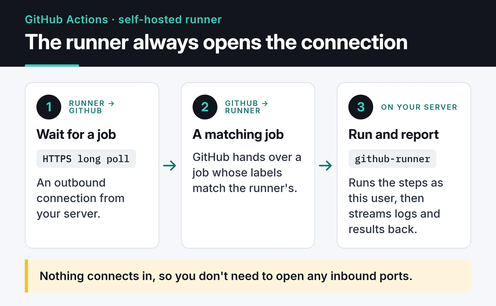

GitHub Actions gives private repositories a monthly quota of free minutes: 2,000 on the Free plan, 3,000 on Pro and Team. Run a multi-step CI pipeline on every push and every PR and the quota goes faster than you'd expect. Mine ran out in May 2026. Instead of paying for more minutes, I turned a Linux server I already had running into a self-hosted runner. This guide walks through the setup step by step: a dedicated user, checksum verification, a systemd service, labels, and the security cost of a runner that keeps its disk.

## Why a self-hosted runner

According to GitHub's [billing docs](https://docs.github.com/en/billing/concepts/product-billing/github-actions), jobs on self-hosted runners don't consume Actions minutes. Past the quota, a standard Linux runner costs $0.006 a minute. My server was on anyway, so the extra cost was CPU and disk.

There's a second benefit: the runner's disk persists between jobs. In my project the first run was slow because Poetry installed every dependency from scratch. After that, runs were noticeably faster because the virtualenv was still there. That persistence is also the biggest downside, which I'll come back to in the security section.

It helps to know how the runner talks to GitHub. It opens an outbound HTTPS connection and waits for work, so you don't need to open any inbound ports on the server:



## Create a dedicated user

Don't run the runner as root; `config.sh` refuses to anyway. Create a system user for it:

```bash
sudo useradd -r -m -d /opt/github-runner -s /bin/bash \
  -c "GitHub Actions Runner" github-runner
```

`-r` makes it a system account and `-m -d` creates its home at `/opt/github-runner`. The account has no password, so nobody can log in with one, and it has no sudo rights. I give it `/bin/bash` because the next steps run as this user.

## Download the runner and verify its hash

Do everything from here on as the runner user, so files get the right owner from the start:

```bash
sudo -iu github-runner
cd /opt/github-runner

VERSION=2.338.1
curl -fsSLO "https://github.com/actions/runner/releases/download/v${VERSION}/actions-runner-linux-x64-${VERSION}.tar.gz"

echo "08e9ccb3604d2462c24b5e33604dc30810296ca15cc65f23cffd4317eb144c37  actions-runner-linux-x64-${VERSION}.tar.gz" | sha256sum -c

tar xzf "actions-runner-linux-x64-${VERSION}.tar.gz"
```

The version and hash in the example belong to runner 2.338.1. Every release lists the hash for each package in its notes, right below the Linux x64 install commands:

")

Use the current version from the [releases page](https://github.com/actions/runner/releases) and the hash from that release. You're downloading a binary that will run code on your server; don't skip the checksum.

## Register the runner with your repository

Repository → Settings → Actions → Runners → New self-hosted runner shows a registration token. It's valid for one hour, so have the command ready before you generate it:

```bash
./config.sh \
  --url https://github.com/YOUR_USER/YOUR_REPO \
  --token YOUR_REGISTRATION_TOKEN \
  --name prod-server-01 \
  --labels prod \
  --unattended
```

The runner adds the `self-hosted`, `linux` and `x64` labels on its own, so `--labels` only needs your custom ones. `--unattended` skips the interactive prompts. On success you'll see something like:

```text
√ Connected to GitHub
√ Runner successfully added
√ Settings Saved
```

Then `exit` back to your own user.

## Install it as a systemd service

`svc.sh` in the runner folder generates a systemd unit. Run it as root and tell it which user the service runs as:

```bash
cd /opt/github-runner
sudo ./svc.sh install github-runner
sudo ./svc.sh start
sudo ./svc.sh status
```

Logs go to journald:

```bash
sudo journalctl -u 'actions.runner.*' -n 50 --no-pager
```

Look for `Listening for Jobs`. Once that line shows up, the runner is waiting for work, and it appears as "Idle" in the repository's Runners list.

## Point your workflows at it

Replace `runs-on` with the labels:

```yaml
jobs:
  lint:
    runs-on: [self-hosted, linux, prod]
    steps:
      - uses: actions/checkout@v7
      - run: poetry install --no-interaction
      - run: poetry run ruff check .
```

A job goes to a runner that has every label in the list. With several servers, labels like `prod` and `staging` let you choose where each job runs.

When I opened my first PR after the switch, the Actions page showed `Running job: Backend Lint (ruff)`. The job was running on the server in front of me, not on a VM spun up somewhere in Azure. The whole setup, from creating the user to updating the workflow files, took about 20 minutes.

## Security: the cost of a persistent runner

GitHub-hosted runners start every job on a fresh VM. A self-hosted runner doesn't. Anything one job leaves on disk is there for the next one. These are the rules I follow:

- Don't use self-hosted runners on public repositories. A pull request from a fork can change your workflow and run code on your server, and GitHub's [secure use guide](https://docs.github.com/en/actions/reference/security/secure-use) says as much. My runner only serves private repos.
- Lock the runner directory to the runner user: `sudo chown -R github-runner:github-runner /opt/github-runner` and `sudo chmod 700 /opt/github-runner`.
- Keep the runner user out of sudoers. If a job really needs a root command, write a narrow sudoers rule for that one command.
- Adding the runner user to the `docker` group is effectively giving it root. If jobs need Docker, make that choice knowingly or use rootless Docker.
- Avoid steps that write secrets to disk, and delete them at the end of the job if you must. The next job sees the same disk.
- If every job needs a clean start, register the runner with `--ephemeral`. It takes one job and then deregisters. The trade-off is that something has to register a new runner for each job, usually a script or Actions Runner Controller.

By default the runner downloads and installs new versions itself. Leave that on: GitHub stops sending jobs to runners that fall too far behind. OS patches are still your job.

To remove the runner, stop the service first, then delete the registration:

```bash
cd /opt/github-runner
sudo ./svc.sh stop
sudo ./svc.sh uninstall
sudo -u github-runner ./config.sh remove --token YOUR_REMOVAL_TOKEN
```

You get the removal token from the runner's menu on the Runners page.

## Which one when

| | GitHub-hosted | Self-hosted |
|---|---|---|
| Cost | Free within quota, then per minute | No Actions minutes, you pay for the server |
| Maintenance | None | Runner and OS updates |
| Speed | Setup and cache download every job | Fast after the first job thanks to local cache |
| Isolation | Fresh VM every job | Jobs share the same disk |
| Network | GitHub's network | Your network, easy access to internal services |

If you're under the quota, GitHub-hosted runners are the right default. If you regularly blow through it and have a server sitting idle, a self-hosted runner makes sense as long as you follow the security rules above.

## Where to go next

My [awesome-trending-repos post](/en/posts/awesome-trending-repos-web/) shows a cron-driven Actions workflow that deploys to GitHub Pages, and the [GitLab to GitHub migration story](/en/posts/gitlab-github-jekyll-migration/) compares GitHub Actions with GitLab CI from the time I had to use both. For the official steps, [GitHub's guide to adding self-hosted runners](https://docs.github.com/en/actions/how-tos/manage-runners/self-hosted-runners/add-runners) is the most current source.
