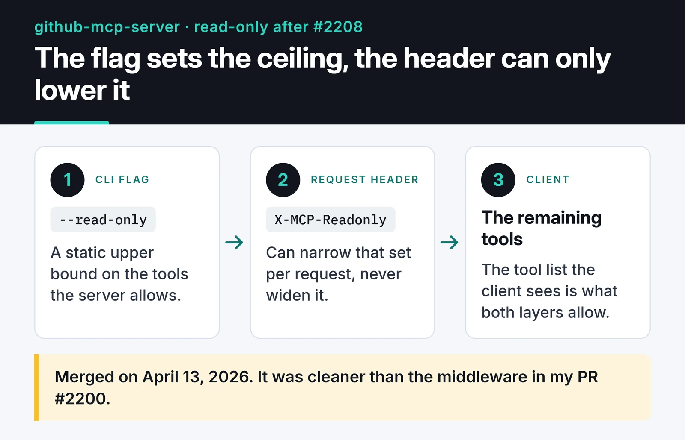

`github/github-mcp-server` is GitHub's official MCP server, the Go project that lets assistants like Copilot and Claude call the GitHub API as tools. I opened two pull requests against it. Neither was merged. This post covers what I built, how the codebase changed under me while I was locked out of my account, and why the second PR was closed. If you're about to send your first PR to a large project, the unmerged ones teach you at least as much as the merged ones.

## The missing tool: create_discussion

In November 2025 I was reading the Discussions toolset and noticed a gap. It had `list_discussions`, `get_discussion`, `get_discussion_comments` and `list_discussion_categories`, but nothing that creates a discussion. An assistant could read threads and had no way to start one.

On December 1, 2025 I opened issue [#1517](https://github.com/github/github-mcp-server/issues/1517) and a few hours later PR [#1519](https://github.com/github/github-mcp-server/pull/1519). No maintainer replied on the issue, and the only review the PR got was Copilot's automated one. In other words, I started the work without a maintainer's go-ahead.

On the GraphQL side the tool takes two steps. The `createDiscussion` mutation needs the repository's node ID, so the tool resolves the ID from owner and name first and sends the mutation second.

The lookup helper:

```go
func getDiscussionRepositoryID(ctx context.Context, client *githubv4.Client, owner, repo string) (githubv4.ID, error) {
	var q struct {
		Repository struct {
			ID githubv4.ID
		} `graphql:"repository(owner: $owner, name: $repo)"`
	}
	vars := map[string]any{
		"owner": githubv4.String(owner),
		"repo":  githubv4.String(repo),
	}
	if err := client.Query(ctx, &q, vars); err != nil {
		return "", err
	}
	return q.Repository.ID, nil
}
```

Then the mutation runs and the tool returns the new discussion's ID, number and URL. If `repo` is omitted, it falls back to the org's `.github` repository, which is where GitHub hosts organization-level discussions.

```go
input := githubv4.CreateDiscussionInput{
	RepositoryID: repoID,
	CategoryID:   githubv4.ID(categoryID),
	Title:        githubv4.String(title),
	Body:         githubv4.String(body),
}
if err := client.Mutate(ctx, &mutation, input, nil); err != nil {
	return utils.NewToolResultError(fmt.Sprintf("failed to create discussion: %v", err)), nil, nil
}
```

The tests mock GraphQL responses with `githubv4mock` and add the tool's JSON schema to the project's `toolsnaps` snapshot system. They cover a successful create, an org-level create, missing parameters, and unknown repositories or categories.

## Two months away

A few days after I opened the PR, GitHub suspended my account. As far as I could tell it was flagged because of suspicious traffic on a shared network I was using. I filed an appeal and waited about two months. During that time my PR, my repos and my profile were invisible to everyone else.

When the account came back, the PR said "This branch has conflicts that must be resolved." The conflicts weren't the real problem. Between the day I opened the PR and the day I returned, 204 commits had landed on `main`, touching roughly 300 files. The way tools are defined had been rewritten.

## The architecture that changed without me

In December every tool returned an `mcp.Tool` plus a separate handler, and the GraphQL client was passed in as a parameter:

```go
func CreateDiscussion(getGQLClient GetGQLClientFn, t translations.TranslationHelperFunc) (mcp.Tool, mcp.ToolHandlerFor[map[string]any, any])
```

By February, every tool was built with a `NewTool()` factory and returned an `inventory.ServerTool`:

```go
func CreateDiscussion(t translations.TranslationHelperFunc) inventory.ServerTool {
	return NewTool(
		ToolsetMetadataDiscussions,
		mcp.Tool{ /* name, description, schema */ },
		[]scopes.Scope{scopes.Repo},
		func(ctx context.Context, deps ToolDependencies, _ *mcp.CallToolRequest, args map[string]any) (*mcp.CallToolResult, any, error) {
			client, err := deps.GetGQLClient(ctx)
			// ...
		},
	)
}
```

A tool now declares its own toolset through metadata, receives clients through `ToolDependencies`, and lists the OAuth scopes it needs (`scopes.Repo` here), so the server can filter the tool list by what the token is allowed to do. That's a new contract more than a refactor, and every tool in the repo had been migrated to it.

## Rewriting instead of rebasing

I could rebase my old commits onto the new `main` and resolve conflicts one by one. That meant forcing a function with the old signature into the new contract by hand, and I'd end up rewriting most lines anyway.

Or I could reset the branch to upstream and write the tool again with the new pattern. The PR wasn't merged and nobody depended on its history, so I went with the reset:

```bash
git fetch upstream
git checkout feature/add-create-discussion-tool
git reset --hard upstream/main
# rewrite create_discussion with NewTool(), update the tests
go build ./...
UPDATE_TOOLSNAPS=true go test ./pkg/github/ -run Test_CreateDiscussion
git push origin feature/add-create-discussion-tool --force-with-lease
```

Use `--force-with-lease` for this. A plain `--force` silently overwrites any commit on the remote branch you haven't seen; `--force-with-lease` refuses the push in that case.

The rewrite went faster than I expected because the repo now had dozens of tools written in the new style. I opened `ListDiscussionCategories` and followed the same skeleton. The tests used the newer helpers: a type assertion on `tool.InputSchema.(*jsonschema.Schema)`, `githubv4mock.DataResponse` for fake responses, and `toolsnaps.Test` for the schema snapshot.

The final version is one commit, three files (`discussions.go`, `discussions_test.go` and `create_discussion.snap`) and 336 added lines. I force-pushed on February 4, 2026 and left a comment telling the maintainer the PR had been rebuilt on current `main` and was ready for review.

## Where #1519 stands

#1519 is open and hasn't had a human review yet. #1517 is open too, and `main` has no `create_discussion` tool. The PR header shows the single commit and the 336 added lines:


Meanwhile the team added `discussion_comment_write` for comments, so they are working on the Discussions write side on their own schedule.

I don't take that personally. Plenty of outside PRs are waiting in that repo, and the team treats write tools, scopes and security as one design problem. Adding a new write tool is a product decision for them, and whether my code is correct is only part of it.

## The second PR: read-only mode, closed

In March 2026 I tried something smaller. Issue [#2156](https://github.com/github/github-mcp-server/issues/2156) reported that `--read-only` did nothing in HTTP mode, leaving write tools like `create_pull_request` available. PR [#2200](https://github.com/github/github-mcp-server/pull/2200) passed the flag into the HTTP server config and added a middleware that applied it to every request.

The maintainer replied within minutes that this was intended. In HTTP mode users enable read-only per request with the `X-MCP-Readonly` header, the same way the hosted remote server works, and the team hadn't decided whether to allow a global setting. I argued for consistency with stdio mode and for multi-tenant deployments.

The maintainer then fixed it in a PR of their own, [#2208](https://github.com/github/github-mcp-server/pull/2208): CLI flags became a static upper bound, and headers can only narrow it. It was merged on April 13, 2026. The diagram below shows the two layers.


 They asked whether that solved my case. I confirmed it did and that it was cleaner than my middleware, and #2200 was closed unmerged on April 15.

I count that as a good outcome. The bug was real and the Docker scenario from the issue works now; someone else wrote the fix.

## What I took from both

On a busy project a PR can outlive the code it was written against. When I came back after two months, every line I had written targeted an old contract. Diffing a waiting PR against upstream every week or two beats discovering the drift all at once.

Write tools are much harder to land than read tools. Letting an assistant open discussions on someone's behalf raises questions about permissions, spam and abuse. Next time I'll wait for an explicit yes from a maintainer on the issue before writing code.

A "this is a design decision" reply is also a result. Reading the maintainer's reasoning on #2200 showed me my middleware sat at the wrong layer, and the fix landed where it belongs, in the server configuration.

## Where the PRs are

Other contributions in this series: [a lookaround prototype for Google's RE2](/en/posts/re2-lookaround-proof-of-concept/), [my Go work on Keploy](/en/posts/my-open-source-contribution-keploy/) and [browser automation for CLI-Anything](/en/posts/cli-anything-browser-automation-contribution/). The current state of #1519 is on [the PR page](https://github.com/github/github-mcp-server/pull/1519). If you need a write tool for Discussions, a +1 reaction on [#1517](https://github.com/github/github-mcp-server/issues/1517) will help the team prioritize it more than anything I can add.
