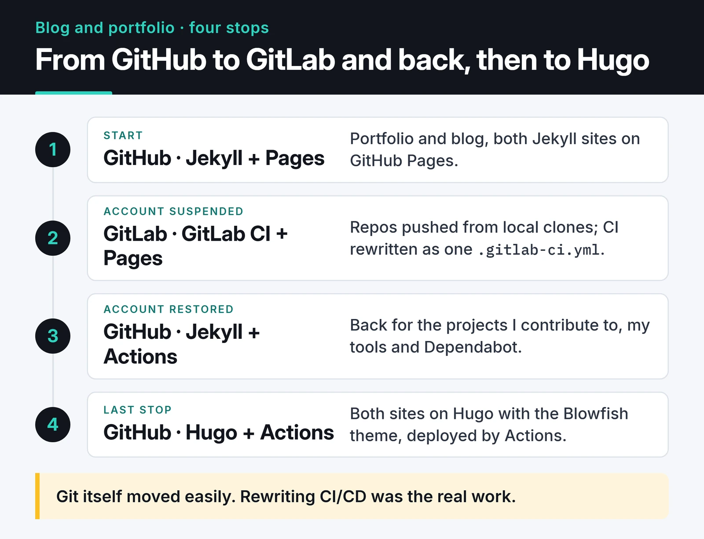

One morning I found my GitHub account suspended. My open source projects, my portfolio site and my Jekyll blog were suddenly out of reach. It turned out to be a simple mistake and the account came back, but while it was down I moved every repository to GitLab and started publishing the sites from there. Here is that migration, the differences I noticed between GitLab CI and GitHub Actions, and how I set up my infrastructure afterwards.



## The original setup

At the time I had two sites, both Jekyll on GitHub Pages:

- The portfolio (`furkankoykiran.com.tr`) lived in the `<username>.github.io` repository with a minimal Jekyll theme. Settings were in `_config.yml`, content was Markdown, and the domain sat on Cloudflare.
- The blog (`blog.furkankoykiran.com.tr`) lived in its own repository with the Chirpy theme. The theme's `tools/init.sh` script cleaned the repo up for personal use.

One thing that tripped me up when testing locally with `bundle exec jekyll s`: if `url` and `baseurl` in `_config.yml` don't match the local address, CSS and JS return 404. The page loads, just without any styling.

## The GitLab stop

With GitHub closed, I moved the repositories to GitLab. Git itself was easy because I had local clones. The real work was rewriting CI/CD, since GitHub Actions workflows don't run on GitLab.

On GitLab everything lives in one `.gitlab-ci.yml` at the repository root. Here's the config that publishes a Jekyll site to GitLab Pages, written with today's syntax:

```yaml
image: ruby:3.3

cache:
  key:
    files:
      - Gemfile.lock
  paths:
    - vendor/bundle

pages:
  stage: deploy
  script:
    - bundle config set --local path vendor/bundle
    - bundle install
    - bundle exec jekyll build -d public
  artifacts:
    paths:
      - public
  rules:
    - if: $CI_COMMIT_BRANCH == $CI_DEFAULT_BRANCH
```

Some things to watch:

- GitLab Pages expects the output in an artifact folder named `public`. Jekyll writes to `_site` by default, hence `-d public`.
- Keying the cache on `Gemfile.lock` means gems are only downloaded again when the lock file changes.
- My file back then used `only: [master]`. GitLab now treats `only` as legacy and recommends `rules`.

The GitHub Actions equivalent is shorter thanks to `ruby/setup-ruby`:

```yaml
name: Deploy Jekyll site

on:
  push:
    branches: [main]

permissions:
  contents: read
  pages: write
  id-token: write

jobs:
  build:
    runs-on: ubuntu-latest
    steps:
      - uses: actions/checkout@v7
      - uses: ruby/setup-ruby@v1
        with:
          ruby-version: '3.3'
          bundler-cache: true
      - run: bundle exec jekyll build
        env:
          JEKYLL_ENV: production
      - uses: actions/upload-pages-artifact@v5

  deploy:
    needs: build
    runs-on: ubuntu-latest
    environment:
      name: github-pages
      url: ${{ steps.deployment.outputs.page_url }}
    steps:
      - id: deployment
        uses: actions/deploy-pages@v5
```

`bundler-cache: true` replaces the `bundle install` and cache steps with one line, and `upload-pages-artifact` uploads `_site` by default, so Jekyll's output path can stay as it is. Older Jekyll guides still show `actions/setup-ruby@v1` with `cache: 'bundler'`. That action was archived long ago, and the `ruby/setup-ruby` README documents `bundler-cache` instead:

")

## Differences I noticed

I used both platforms on real projects, if only for a short while. These are the differences that showed up in daily use rather than on feature pages:

| | GitLab CI/CD | GitHub Actions |
|---|---|---|
| Configuration | One `.gitlab-ci.yml` with stages and jobs | Several workflow files, jobs triggered by events |
| Reusable pieces | A CI/CD Catalog exists but is small; you mostly write scripts | Huge Marketplace with an action for most tasks |
| Caching | You define the paths and key yourself with `cache:` | One line in the `setup-*` actions |
| Your own runners | Docker and Kubernetes executors out of the box | Possible, but the security is on you |
| Artifacts | Very visible which job produced what | Less prominent, but enough for Pages |

I liked how GitLab keeps everything in one place, and how easy it makes running your own runners. For a team that wants to self-host the whole toolchain, I'd recommend it without hesitation. For personal projects, GitHub's ready-made actions get me done faster. I later set up my own runner on the GitHub side as well, which I wrote about in the [self-hosted runner guide](/en/posts/github-actions-self-hosted-runner/).

## Why I went back to GitHub

Once the account was restored I moved everything back. The reasons were practical:

- Nearly every open source project I contribute to is on GitHub. Issues, pull requests and reviews happen there.
- My editor and tools integrate with GitHub directly.
- Dependabot opening PRs for dependency updates on its own cuts down my maintenance work. GitLab has dependency scanning too, but GitHub's flow suited me better.

## Habits I kept

The real gain was being ready for the next outage, wherever my code lives:

- Important repositories have a copy on another platform. To do it by hand:

  ```bash
  git clone --mirror git@github.com:YOUR_USER/YOUR_REPO.git
  cd YOUR_REPO.git
  git push --mirror git@gitlab.com:YOUR_USER/YOUR_REPO.git
  ```

  `--mirror` carries every branch and tag. GitLab's push mirroring can automate it.
- The build is a single command or script, and the CI file only calls it. When the platform changes, you only rewrite that thin layer.
- I don't rely on the cloud alone. A local copy from a regular `git clone --mirror` is what helps when nothing else works.
- The domain lives with a DNS provider (Cloudflare), separate from the code host. Pointing the sites at GitLab Pages meant changing a few DNS records.

## Last stop: Hugo

In the end I moved both the blog and the portfolio from Jekyll to [Hugo](https://gohugo.io/). Both use the Blowfish theme and deploy to GitHub Pages through GitHub Actions. Turkish posts kept their `/posts/<slug>/` URLs, English posts moved under `/en/`, and old addresses redirect to the new ones. The whole build is now one `hugo --gc --minify` command, which is the cleanest version of the "single build command" habit above.

## What to try next

If you don't have a backup and mirror plan, mirror one repository somewhere else today and try restoring from it. To simplify the branches you'd be mirroring, see [Git workflow and branching strategies](/en/posts/git-workflow-branching-strategies/). For a project that publishes to GitHub Pages on a schedule, see the [awesome-trending-repos post](/en/posts/awesome-trending-repos-web/).
