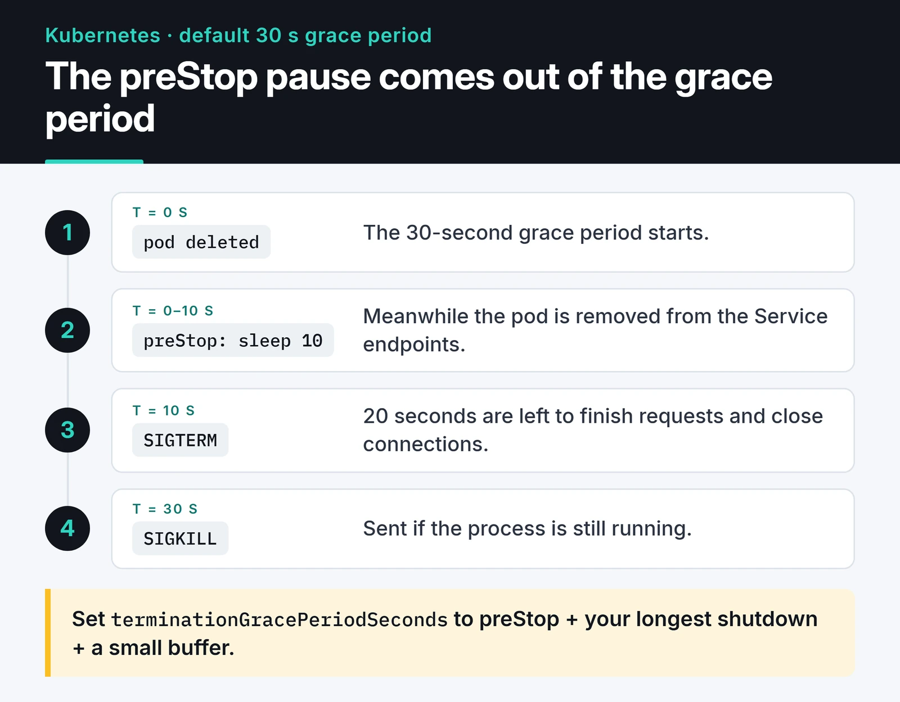

Every time you redeploy a Python service, the old process dies one way or another. Graceful shutdown means it dies on its own terms: it learns it's about to be stopped, stops taking new work, finishes what it has, closes its connections and exits. A service that skips this produces half-finished requests, partially written files and 502s for users during every deploy.

This post covers how signals work, how I handle SIGTERM in plain Python and in asyncio, where Docker and Kubernetes get in the way, and how I run Python services under systemd on servers where I don't use containers. The examples target Python 3.11 and later; catching the builtin `TimeoutError` from asyncio needs 3.11.

## Three signals

Linux tells a process to stop by sending it a signal. The ones that matter:

- SIGINT (2) is Ctrl+C in a terminal. Python turns it into a `KeyboardInterrupt` by default.
- SIGTERM (15) is the default stop signal for Docker, Kubernetes and systemd. It can be caught. Python has no built-in handler for it, so without one your process dies on the spot.
- SIGKILL (9) can't be caught. The kernel ends the process immediately; not even `finally` blocks run.

Every orchestrator follows the same sequence: send SIGTERM, wait (10 seconds in Docker, 30 in Kubernetes, 90 by default in systemd), then send SIGKILL if the process is still around. Your app's job is to exit cleanly inside that window.

## SIGTERM in a plain Python loop

This is the pattern I use for workers that consume a queue or poll for data:

```python {title="worker.py"}
import logging
import signal
import threading

logging.basicConfig(level=logging.INFO)
stop = threading.Event()


def request_stop(signum: int, frame: object) -> None:
    logging.info("Got %s, stopping after the current batch", signal.Signals(signum).name)
    stop.set()


signal.signal(signal.SIGTERM, request_stop)
signal.signal(signal.SIGINT, request_stop)


def process_batch() -> None:
    ...  # one unit of work that must not be cut in half


while not stop.is_set():
    process_batch()
    stop.wait(5)  # wakes up immediately if a signal arrives

logging.info("Closing resources")
# db.close(), producer.flush(), etc.
```

The handler only sets a flag. The actual shutdown happens in the main loop once the current batch is done, so a signal that arrives mid-write doesn't cut the write in half. That's also why I use `stop.wait(5)` instead of `time.sleep(5)`: if the signal lands during the pause, the loop exits right away.

I ran this exact script on Ubuntu 22.04 under WSL with Python 3.10 and sent SIGTERM two seconds after starting it. The output below shows both log lines and the time `wait` measured: the process exited cleanly in 0.025 seconds instead of sitting out the five-second pause.


One condition: a single `process_batch()` call has to finish within the orchestrator's grace period. If a batch can take two minutes, either raise the grace period or make the work safe to interrupt and retry.

## With asyncio

In asyncio apps, hook the signal into the event loop. `loop.add_signal_handler` runs the callback inside the loop at a safe point (Unix only):

```python {title="async_worker.py"}
import asyncio
import signal


async def process_batch() -> None:
    await asyncio.sleep(1)  # the real work


async def worker(stop: asyncio.Event) -> None:
    while not stop.is_set():
        await process_batch()
        try:
            await asyncio.wait_for(stop.wait(), timeout=5)
        except TimeoutError:
            pass


async def main() -> None:
    stop = asyncio.Event()
    loop = asyncio.get_running_loop()
    for sig in (signal.SIGTERM, signal.SIGINT):
        loop.add_signal_handler(sig, stop.set)

    task = asyncio.create_task(worker(stop))
    await stop.wait()
    # Give the worker time to finish its batch, then cancel it
    try:
        await asyncio.wait_for(task, timeout=20)
    except TimeoutError:
        pass  # wait_for already cancelled the task
    # await pool.close(), await client.aclose(), etc.


asyncio.run(main())
```

## FastAPI and uvicorn

In a web service you don't own the loop; uvicorn handles the signal. On SIGTERM it stops accepting connections, waits for in-flight requests, and then runs the shutdown half of your FastAPI lifespan:

```python
from contextlib import asynccontextmanager

from fastapi import FastAPI


@asynccontextmanager
async def lifespan(app: FastAPI):
    app.state.pool = await create_pool()
    yield
    await app.state.pool.close()


app = FastAPI(lifespan=lifespan)
```

uvicorn's `--timeout-graceful-shutdown` caps how long it waits for in-flight requests. I keep it shorter than the orchestrator's grace period so the lifespan cleanup gets to run before SIGKILL. With gunicorn, the equivalent is `--graceful-timeout`.

## The PID 1 trap in Docker

The first process in a container is PID 1, and Linux treats PID 1 specially: signals it has no handler for are ignored instead of triggering the default action. Two consequences:

1. With the shell form in a Dockerfile (`CMD python app.py`), PID 1 is `/bin/sh`, which doesn't forward SIGTERM to Python. `docker stop` waits ten seconds and sends SIGKILL.
2. Even with the exec form (`CMD ["python", "app.py"]`), Python is PID 1, and without a SIGTERM handler the signal is ignored. A script that would die instantly outside a container hangs for ten seconds inside one.

The fixes:

- Always write `CMD` and `ENTRYPOINT` in exec form. If you have an entrypoint script, end it with `exec "$@"` so Python replaces the shell.
- Install a SIGTERM handler as above, or use a server that already handles it (uvicorn, gunicorn).
- If the app spawns child processes, add a tiny init. `init: true` in Compose or `--init` with `docker run` makes Docker run tini as PID 1, which forwards signals and reaps zombies.
- Tune the wait with `stop_grace_period: 30s` in Compose.

The rest of the Dockerfile is in my post on [dockerizing a Python app with uv](/en/posts/docker-python-app-containerization/).

## Kubernetes: the SIGTERM versus endpoint removal race

When Kubernetes deletes a pod, two things happen at once. The kubelet starts terminating the pod (the `preStop` hook first if there is one, then SIGTERM). In parallel, the control plane removes the pod from the Service's EndpointSlices, and that change has to propagate to kube-proxy and to ingress or gateway controllers. Propagation can take a few seconds. If your app gets SIGTERM and stops accepting connections in that gap, requests still routed to it fail.

The fix is a short pause before SIGTERM. The classic workaround runs `/bin/sleep` in a `preStop` exec hook, which needs a `sleep` binary in the image; distroless images don't have one. The native `sleep` action, GA since Kubernetes 1.34, removes that requirement:

```yaml
spec:
  terminationGracePeriodSeconds: 45
  containers:
    - name: api
      image: ghcr.io/example/api:1a2b3c4
      lifecycle:
        preStop:
          sleep:
            seconds: 10
```

The diagram below shows the timing with the default 30-second grace period.



Watch the arithmetic: `terminationGracePeriodSeconds` includes the preStop time. With the default 30 seconds and a 10-second preStop, your app has 20 seconds to shut down. I set the grace period to the preStop time plus the app's longest shutdown plus a small buffer. Probes, resource limits and the other production settings are in my [Kubernetes post](/en/posts/kubernetes-container-orchestration/).

## Long-running workers

Queue workers like Celery are a different case. On SIGTERM, Celery does a warm shutdown: it takes no new tasks and waits for the running ones. If a task takes ten minutes and the pod's grace period is 30 seconds, SIGKILL cuts it off.

You have two options. Raise `terminationGracePeriodSeconds` on worker pods to cover your longest task, or make tasks survive interruption: with `acks_late=True`, a task is acknowledged only after it finishes, so if the worker dies the task goes back to the queue and runs again. The second option requires idempotent tasks, but it doesn't slow down your deploys.

## No containers: running a Python service under systemd

I don't put everything in containers. For a bot or a data collector on a single VPS, systemd is often enough and simpler. A process started with `nohup python main.py &` doesn't come back after a reboot, nobody notices when it crashes, and its logs pile up in a file. systemd fixes all three.

```ini {title="/etc/systemd/system/collector.service"}
[Unit]
Description=Price collector
After=network-online.target
Wants=network-online.target

[Service]
Type=notify
User=collector
Group=collector
WorkingDirectory=/opt/collector
ExecStart=/opt/collector/.venv/bin/python -m collector
EnvironmentFile=/etc/collector/env

Restart=on-failure
RestartSec=5
WatchdogSec=60
TimeoutStopSec=30
KillMode=mixed

NoNewPrivileges=yes
ProtectSystem=strict
ProtectHome=yes
PrivateTmp=yes
StateDirectory=collector
RestrictAddressFamilies=AF_INET AF_INET6 AF_UNIX

[Install]
WantedBy=multi-user.target
```

For shutdown, the relevant lines: systemd sends SIGTERM by default when stopping, and SIGKILL after `TimeoutStopSec=30`. `KillMode=mixed` sends SIGTERM only to the main process and SIGKILL to the whole group when time runs out, so the main process can shut its children down in its own order. The SIGTERM handlers above work unchanged here.

The hardening lines narrow what the service can do. `ProtectSystem=strict` makes the whole filesystem read-only; the only writable place is `/var/lib/collector`, which systemd creates because of `StateDirectory=collector`. Keep `AF_UNIX` in `RestrictAddressFamilies`. With only `AF_INET AF_INET6`, the service can't send `READY=1` to systemd, and a `Type=notify` start times out. `systemd-analyze security collector.service` scores how locked down a unit is and lists what's missing.

### Type=notify and the watchdog

`Type=notify` tells systemd when the service is ready, not just when the process started. The app sends `READY=1` once it's up. `WatchdogSec=60` expects a `WATCHDOG=1` at least every 60 seconds. If it doesn't arrive, systemd considers the process hung, kills it, and `Restart=on-failure` brings it back. A process stuck in a deadlock looks alive to everything else, so this is one of the few ways to catch it.

You don't need a library. The protocol is one datagram to the Unix socket named in `NOTIFY_SOCKET`:

```python {title="collector/notify.py"}
import os
import socket


def sd_notify(message: str) -> None:
    address = os.environ.get("NOTIFY_SOCKET")
    if not address:
        return  # not running under systemd
    if address.startswith("@"):
        address = "\0" + address[1:]  # abstract namespace socket
    with socket.socket(socket.AF_UNIX, socket.SOCK_DGRAM) as sock:
        sock.connect(address)
        sock.sendall(message.encode())
```

Wired into the worker loop:

```python
sd_notify("READY=1")
while not stop.is_set():
    process_batch()
    sd_notify("WATCHDOG=1")
    stop.wait(5)
sd_notify("STOPPING=1")
```

Pinging at least twice per `WatchdogSec` leaves a comfortable margin. If one loop iteration can exceed 60 seconds, raise `WatchdogSec` to match.

### Logs

Write to stdout and systemd sends it to journald. No log files, no rotation config:

```bash
journalctl -u collector -f                 # follow live
journalctl -u collector -p err             # errors and worse
journalctl -u collector --since "1 hour ago"
journalctl -u collector -o json            # for log shippers
```

### systemd timers instead of cron

For scheduled jobs I use timers. Logs land in journald too, and runs can't overlap because a timer won't start a service that is already running. You need two files, `report.service` for what to run and `report.timer` for when:

```ini {title="/etc/systemd/system/report.timer"}
[Unit]
Description=Daily report

[Timer]
OnCalendar=*-*-* 03:00:00
RandomizedDelaySec=10min
Persistent=true

[Install]
WantedBy=timers.target
```

Unit files don't support trailing comments. A line like `RandomizedDelaySec=600 # spread load` makes the comment part of the value and the setting invalid; put comments on their own line starting with `#`. `Persistent=true` runs a missed job once at boot if the machine was off at 03:00. Enable it with `systemctl enable --now report.timer` and check upcoming runs with `systemctl list-timers`.

## Bonus: a stack trace from a hung process

When a process is stuck without using CPU, I want to know where it's waiting without killing it. `faulthandler` from the standard library does this in one line:

```python
import faulthandler
import signal

faulthandler.register(signal.SIGUSR1, all_threads=True)
```

Send `kill -USR1 <pid>` and every thread's stack trace goes to stderr, which means journald or the container logs. The process keeps running.

## Checklist before you ship

- Does the app catch SIGTERM, finish its current work and exit?
- Is its shutdown time shorter than the orchestrator's grace period?
- Is `CMD` in exec form, and does the entrypoint script use `exec`?
- On Kubernetes, is there a preStop pause, and does the grace period cover it?
- Can long tasks be interrupted and retried safely?
- Do systemd services set `TimeoutStopSec` and `Restart=`?

## What's next

Before your next deploy, add the `worker.py` pattern to one of your services and try it with `kill -TERM` as above. If the exit takes about as long as the grace period, a signal is getting lost somewhere.

To see from the outside whether users notice a restart, I use [Uptime Kuma](/en/posts/uptime-kuma-service-monitoring/). The image side is in [dockerizing a Python app with uv](/en/posts/docker-python-app-containerization/), and pod settings are in my [Kubernetes post](/en/posts/kubernetes-container-orchestration/). For every systemd option mentioned here, the [systemd.service](https://www.freedesktop.org/software/systemd/man/latest/systemd.service.html) and [systemd.exec](https://www.freedesktop.org/software/systemd/man/latest/systemd.exec.html) man pages are the reference.
