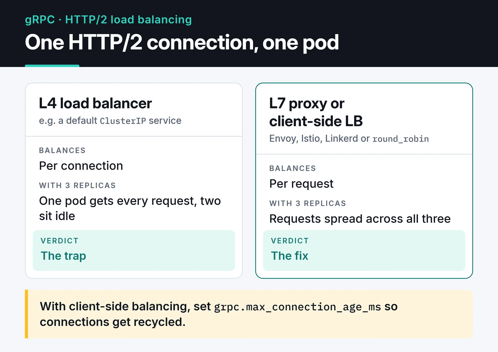

The pitch for gRPC high-performance APIs is short: binary Protobuf messages instead of JSON, HTTP/2 instead of HTTP/1.1, and typed code generated from a schema instead of a hand-written client. Between services, those three make a real difference. For an API that browsers call, REST is still usually the more practical choice.

In this post I write a service with the asyncio API of `grpcio` (`grpc.aio`), then cover what came up once it ran in production: deadlines, status codes, interceptors, schema evolution and load balancing. I ran the server and client examples with Python 3.12 and grpcio 1.84.

## When gRPC makes sense

REST/JSON has known costs for internal traffic: field names travel with every message, parsing text burns CPU, and only the documentation tells you whether a field is a string or an int. In gRPC the contract is a `.proto` file, and client and server code for every language is generated from it.

How I choose:

| | REST (JSON) | gRPC (Protobuf) |
| :--- | :--- | :--- |
| Payload | Text, human-readable | Binary, compact |
| Transport | Usually HTTP/1.1 | HTTP/2 |
| Contract | OpenAPI (optional) | `.proto` (required) |
| Streaming | Separately, via SSE or WebSocket | Four call types built in |
| Browser | Direct | Needs gRPC-Web or Connect |
| Debugging | `curl` | `grpcurl`, reflection |

I use gRPC for east-west traffic between services, especially when they're written in different languages or need streaming. For a public API, a backend the browser calls directly or a simple CRUD app, [REST with FastAPI](/en/posts/python-fastapi-rest-api/) has less friction.

## The contract: a .proto file

Everything in gRPC starts from one `.proto` file. `protoc` generates the message classes and stubs from it, and both server and client build on that generated code.

A small price service with one unary and one server-streaming method:

```protobuf
// proto/stocks.proto
syntax = "proto3";

package stocks.v1;

service StockService {
  rpc GetPrice(PriceRequest) returns (PriceReply);
  rpc StreamPrices(PriceRequest) returns (stream PriceReply);
}

message PriceRequest {
  string symbol = 1;
}

message PriceReply {
  string symbol = 1;
  double price = 2;
  int64 ts_ms = 3;
}
```

Generate the code:

```bash
pip install grpcio grpcio-tools
python -m grpc_tools.protoc -I proto --python_out=. --pyi_out=. --grpc_python_out=. proto/stocks.proto
```

That produces `stocks_pb2.py` (messages), `stocks_pb2.pyi` (type hints for your editor) and `stocks_pb2_grpc.py` (stub and servicer).

## An asyncio server

```python
# server.py
import asyncio
import random
import time

import grpc

import stocks_pb2
import stocks_pb2_grpc


def quote(symbol: str) -> float:
    return round(100 + random.uniform(-5, 5), 2)  # stand-in for a real feed


class StockService(stocks_pb2_grpc.StockServiceServicer):
    async def GetPrice(self, request, context):
        if not request.symbol:
            await context.abort(grpc.StatusCode.INVALID_ARGUMENT, "symbol is required")
        return stocks_pb2.PriceReply(
            symbol=request.symbol,
            price=quote(request.symbol),
            ts_ms=int(time.time() * 1000),
        )

    async def StreamPrices(self, request, context):
        # Streams until the client cancels or the deadline expires
        while True:
            yield stocks_pb2.PriceReply(
                symbol=request.symbol,
                price=quote(request.symbol),
                ts_ms=int(time.time() * 1000),
            )
            await asyncio.sleep(1)


async def serve() -> None:
    server = grpc.aio.server()
    stocks_pb2_grpc.add_StockServiceServicer_to_server(StockService(), server)
    server.add_insecure_port("[::]:50051")
    await server.start()
    await server.wait_for_termination()


if __name__ == "__main__":
    asyncio.run(serve())
```

The synchronous `grpc.server()` runs on a thread pool, and every open stream holds a thread. With `grpc.aio`, one process can carry thousands of streams on the event loop. The usual asyncio rule still applies: a blocking call in a handler, like a synchronous database driver, stalls the whole server.

## The client and deadlines

```python
# client.py
import asyncio

import grpc

import stocks_pb2
import stocks_pb2_grpc


async def main() -> None:
    async with grpc.aio.insecure_channel("localhost:50051") as channel:
        stub = stocks_pb2_grpc.StockServiceStub(channel)

        reply = await stub.GetPrice(stocks_pb2.PriceRequest(symbol="AAPL"), timeout=2)
        print(reply.symbol, reply.price)

        try:
            async for update in stub.StreamPrices(
                stocks_pb2.PriceRequest(symbol="AAPL"), timeout=5
            ):
                print("live:", update.price)
        except grpc.aio.AioRpcError as err:
            if err.code() != grpc.StatusCode.DEADLINE_EXCEEDED:
                raise


asyncio.run(main())
```

With the server running in one terminal and the client in another, this is what I got:


The unary `GetPrice` reply comes first, then the stream prints a price every second. At five seconds the deadline expires, and the client catches `DEADLINE_EXCEEDED` and exits cleanly.

`timeout` sets the gRPC deadline. There is none by default, so if the server hangs, the client waits forever. Put a deadline on every call. It's propagated to the server, which can check `context.time_remaining()`.

A channel is expensive because it owns an HTTP/2 connection. Create one per target and reuse it for the life of the app.

## Status codes and interceptors

gRPC has its own status codes instead of HTTP ones: `INVALID_ARGUMENT`, `NOT_FOUND`, `UNAVAILABLE`, `DEADLINE_EXCEEDED` and so on. I decide what the client retries from these codes: `UNAVAILABLE` is usually safe to retry, `INVALID_ARGUMENT` never is. If you want structured details with an error, such as a retry delay or per-field violations, the `grpcio-status` package supports the `google.rpc.Status` model.

For cross-cutting work like logging, auth and metrics, use an interceptor instead of repeating code in every method. A simple token check for the asyncio server:

```python
class AuthInterceptor(grpc.aio.ServerInterceptor):
    def __init__(self, token: str) -> None:
        self._expected = ("authorization", f"Bearer {token}")

        async def deny(request, context):
            await context.abort(grpc.StatusCode.UNAUTHENTICATED, "invalid token")

        self._deny = grpc.unary_unary_rpc_method_handler(deny)

    async def intercept_service(self, continuation, handler_call_details):
        if self._expected in (handler_call_details.invocation_metadata or ()):
            return await continuation(handler_call_details)
        return self._deny


server = grpc.aio.server(interceptors=[AuthInterceptor("s3cret")])
```

The client sends the token as metadata: `await stub.GetPrice(req, metadata=[("authorization", "Bearer s3cret")], timeout=2)`. This example rejects with a unary handler; to protect streaming methods, return a handler that matches the method type. I cover the token side in my [API authentication post](/en/posts/api-authentication-strategies/). In production, use `add_secure_port` with TLS instead of `add_insecure_port`. A bearer token over a plaintext channel protects nothing.

## Schema evolution: field numbers are forever

On the wire, Protobuf sends field numbers, not names. So:

- Adding a field is safe. Old clients ignore fields they don't know.
- Changing a field's number or type breaks compatibility.
- When you delete a field, lock its number and name with `reserved`. Protobuf doesn't do this for you, and if someone later reuses the number for a different field, old clients will misread the data.

```protobuf
message PriceReply {
  reserved 4;
  reserved "currency";
  string symbol = 1;
  double price = 2;
  int64 ts_ms = 3;
}
```

Renaming a field is fine for the binary format, but Protobuf's JSON mapping uses field names, so a gateway that converts to JSON will break. For a truly breaking change, I create a new package (`package stocks.v2;`) and run both versions side by side for a while.

## The HTTP/2 load balancing trap

Of all the gRPC pitfalls, this is the one I'd warn you about first. HTTP/2 multiplexes many requests over one TCP connection. A connection-level L4 load balancer, including a default Kubernetes `ClusterIP` service, pins that one connection to one pod, and every request from that client goes there. You run three replicas; one is on fire while two sit idle.



There are two fixes:

1. An L7 proxy that balances per request: Envoy, a service mesh such as Istio or Linkerd, or an ingress with gRPC support.
2. Client-side load balancing. In Kubernetes, a headless service returns all pod IPs from DNS, and the gRPC client connects to each and spreads requests across them:

```python
channel = grpc.aio.insecure_channel(
    "dns:///stocks-headless.default.svc.cluster.local:50051",
    options=[("grpc.lb_policy_name", "round_robin")],
)
```

With the second option the client has to re-resolve DNS when pods change. Setting `grpc.max_connection_age_ms` on the server forces connections to be recycled periodically, which helps. I cover the Kubernetes side in my [Kubernetes post](/en/posts/kubernetes-container-orchestration/).

## Debugging and health checks

REST's best feature is that you can poke anything with `curl`. The gRPC equivalent is `grpcurl`, and with server reflection enabled it can list and call methods without the `.proto` file. The `grpcio-reflection` and `grpcio-health-checking` packages add reflection and the standard health service that Kubernetes probes can call. I'd set up both from the start.

Browsers can't call gRPC directly because browser APIs don't expose HTTP/2 frames and trailers. If you must, use gRPC-Web through a proxy, or the Connect protocol, which speaks both gRPC and JSON. For pushing live data to a browser, [WebSockets](/en/posts/websocket-real-time-communication/) are a more natural fit.

## Where to go next

Put the `.proto`, server and client from this post in one folder and run them. Then add `grpcio-reflection` to the server and explore it with `grpcurl -plaintext localhost:50051 list`. The official [gRPC Python docs](https://grpc.io/docs/languages/python/) and the [asyncio API reference](https://grpc.github.io/grpc/python/grpc_asyncio.html) are the sources I trust.

If you also need to expose the service over REST, my [FastAPI post](/en/posts/python-fastapi-rest-api/) covers that side, and for moving events between services, see my [Kafka post](/en/posts/apache-kafka-event-streaming/).
