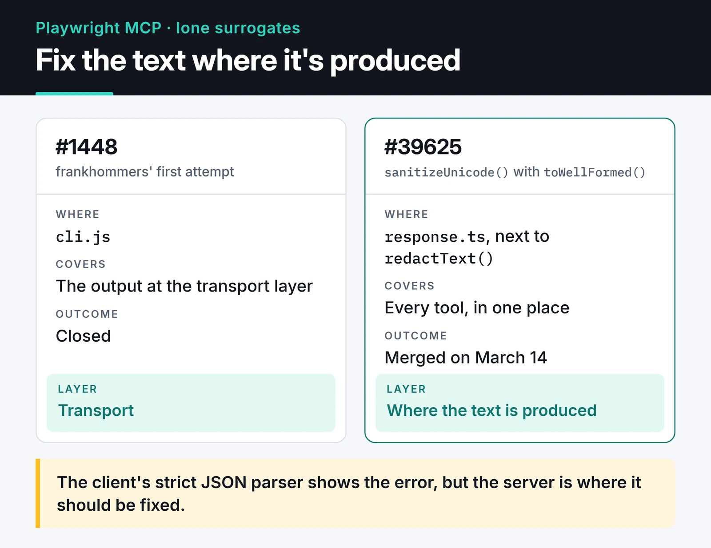

Once I started building my own MCP servers, I began reading the code of the bigger projects in the same ecosystem. This post covers five PRs I opened around the Model Context Protocol (MCP) and AI tooling. Both PRs to Playwright were merged. One PR to GitHub's MCP server is open, and the other was closed in favor of a better fix the maintainer wrote. A one-line fix in LobeHub is waiting for review. For each one: the bug, the fix, and what the review taught me.

## Five PRs and where they stand

Statuses and dates come from the PR records on GitHub.

| Project | PR | Topic | Status |
| :--- | :--- | :--- | :--- |
| microsoft/playwright | [#39401](https://github.com/microsoft/playwright/pull/39401) | Truncated `--cdp-header` values | Merged, March 10, 2026 |
| microsoft/playwright | [#39625](https://github.com/microsoft/playwright/pull/39625) | Malformed Unicode in MCP responses | Merged, March 14, 2026 |
| github/github-mcp-server | [#1519](https://github.com/github/github-mcp-server/pull/1519) | `create_discussion` tool | Open |
| github/github-mcp-server | [#2200](https://github.com/github/github-mcp-server/pull/2200) | `--read-only` in HTTP mode | Closed, superseded by #2208 |
| lobehub/lobehub | [#12818](https://github.com/lobehub/lobehub/pull/12818) | Model picker crash during onboarding | Open |

## Playwright MCP: header values with colons

When you connect Playwright MCP to a remote browser over CDP, you can pass headers with `--cdp-header` or the `PLAYWRIGHT_MCP_CDP_HEADERS` environment variable. The `headerParser` function split each value with `arg.split(':')` and destructured the first two parts, so `X-Custom: http://example.com` silently became `http`. Anything with a colon in the value got cut: URLs, `host:port` pairs, some tokens.

The fix is to split on the first colon only:

```ts
const colonIndex = arg.indexOf(':');
const name = colonIndex === -1 ? arg.trim() : arg.substring(0, colonIndex).trim();
const value = colonIndex === -1 ? '' : arg.substring(colonIndex + 1).trim();
```

The test sends `X-Forwarded-Proto: value:with:colons` plus an empty `X-Empty` header and checks what actually reaches the test server. It was merged on March 10.

## Playwright MCP: malformed Unicode in responses

### The problem

In [playwright-mcp#1447](https://github.com/microsoft/playwright-mcp/issues/1447), frankhommers reported that MCP responses from some pages failed with JSON errors. The cause was lone surrogates: half of a UTF-16 surrogate pair with no partner, for example an emoji cut in the middle.

```js
const s = `Hello ${String.fromCharCode(0xD800)}`;

s.isWellFormed();   // false
JSON.stringify(s);  // '"Hello \\ud800"' (no error, but the lone surrogate is still there)
s.toWellFormed();   // 'Hello �', displayed as "Hello �"
```

Modern `JSON.stringify` doesn't throw here. It escapes the character as `\ud800`. The failure shows up further down the chain, when a stricter JSON parser on the client side rejects the payload with errors along the lines of "invalid high surrogate". The client sees the error, but the server is where it should be fixed.

### Where the fix belongs

frankhommers' first attempt ([#1448](https://github.com/microsoft/playwright-mcp/pull/1448)) sanitized the output in `cli.js`, at the transport layer, and was closed. I looked at where the text is produced instead. In `packages/playwright-core/src/tools/backend/response.ts`, every response already went through `redactText()`, so adding the cleanup there covered every tool in one place. The diagram shows where each attempt sits in the chain:



The change itself is short:

```ts
text: sanitizeUnicode(redactText(text.join('\n'))),

// ...

function sanitizeUnicode(text: string): string {
  return text.toWellFormed();
}
```

`toWellFormed()` replaces lone surrogates with U+FFFD and leaves valid emoji and CJK text alone.

### What the review taught me

The PR's initial commit had a regex fallback for Node 18 and six tests. Pavel Feldman's review was short: it looked like an agent-generated blob that failed lint; the location was right, but I should assume Node 20 and hand-write the tests. He was right. I dropped the fallback, since `toWellFormed()` has been in Node since version 20, and cut the tests down to three that match the style of the existing MCP tests: a page with a lone surrogate, a page with valid emoji, and a `console.log` that prints a lone surrogate. Pavel Feldman merged it on March 14:


The maintainer spotted the generated code at first glance. The short version, written in the style of the project's tests, landed within days.

## GitHub MCP Server

### A create_discussion tool (#1519, open)

GitHub's official MCP server could read discussions but not create them. In December 2025 I opened a PR adding a `create_discussion` tool. It fetches the repository ID over GraphQL and then calls the `createDiscussion` mutation. If `repo` is omitted, the discussion is created at the organization level. The codebase moved to a new `NewTool()` pattern in the meantime, so I rewrote the tool during a rebase. The PR is open. I wrote up the full story in [a separate post](/en/posts/github-mcp-server-contribution/).

### --read-only in HTTP mode (#2200, closed)

In [#2156](https://github.com/github/github-mcp-server/issues/2156), a user ran the server in Docker with `http --read-only` and still saw write tools like `create_branch` and `create_pull_request`. The flag worked in stdio mode but was never passed to the HTTP server's config. My PR added it to `ServerConfig` and registered a middleware that marks every request context as read-only:

```go
func withGlobalReadonly(cfg *ServerConfig) func(http.Handler) http.Handler {
	return func(next http.Handler) http.Handler {
		return http.HandlerFunc(func(w http.ResponseWriter, r *http.Request) {
			if cfg.ReadOnly {
				ctx := ghcontext.WithReadonly(r.Context(), true)
				next.ServeHTTP(w, r.WithContext(ctx))
			} else {
				next.ServeHTTP(w, r)
			}
		})
	}
}
```

The maintainer, Sam Morrow, replied that this wasn't a bug but an open design decision. In HTTP mode, each user can enable read-only mode with an `x-mcp-readonly: true` header, the same way GitHub's hosted remote server works. I made the case for a server-level setting: consistency with stdio, clients that can't send custom headers, and the Docker setup from the issue.

Sam then opened his own PR. [#2208](https://github.com/github/github-mcp-server/pull/2208) treats the CLI flags as an upper bound, and per-request headers can only narrow it. That's a cleaner model than my middleware. I confirmed it fixed the Docker case. #2208 was merged on April 13, and my PR was closed.

My middleware never landed, and the behavior I asked for shipped with #2208. The PR taught me that a bug report is sometimes a design question, and arguing it through is part of the contribution.

## LobeHub: a one-line regression fix (#12818, open)

On LobeHub's onboarding page, opening the model picker crashed the app with React Error #185. I reported it in [#12817](https://github.com/lobehub/lobehub/issues/12817). Digging through history, I found the same crash had been fixed in January by [#11905](https://github.com/lobehub/lobehub/pull/11905), and the fix was lost during the base-ui migration: `showInfoTag` on `ModelItemRender` was back to `true`. My PR restores it:

```tsx
<ModelItemRender
  {...(option as ModelOption)}
  {...(option as ModelOption).abilities}
  showInfoTag={false}
/>
```

One maintainer commented that it "seems still buggy". I asked which scenario still failed and noted that the crash was gone in the Vercel preview and locally. There was no reply. Another user had mentioned in the issue that switching models from the top menu crashed too, so my one line may not cover every path. The PR is still open; the issue was closed later.

Around the same time I opened [#12805](https://github.com/lobehub/lobehub/issues/12805), asking for some of my MCP servers, DevTo-MCP and OmniWire-MCP among them, to be listed in the LobeHub marketplace. It was closed as not planned.

## What I took away

- Fix the problem where the data is produced, not where the error shows up. That's what got the Unicode PR merged.
- A short diff with hand-written tests gets reviewed faster.
- Ask before calling something a bug. The read-only flag was a design decision.
- Even a one-line fix needs evidence: reproduction steps, before and after screenshots, or a test.

## Where to go from here

My own MCP servers are [DevTo-MCP](https://furkankoykiran.com.tr/en/projects/devto-mcp/) and [OmniWire-MCP](https://furkankoykiran.com.tr/en/projects/omniwire-mcp/). The other PRs from the same weeks are in [security and API fixes](/en/posts/security-and-api-fixes/) and [SDK and CLI contributions](/en/posts/python-sdk-and-cli-contributions/), and there's a Go-focused one in [my Keploy contribution](/en/posts/my-open-source-contribution-keploy/). If you want to contribute to the MCP ecosystem yourself, Playwright's `tests/mcp` folder is a good place to start: the tests are short and adding a new one is easy.
