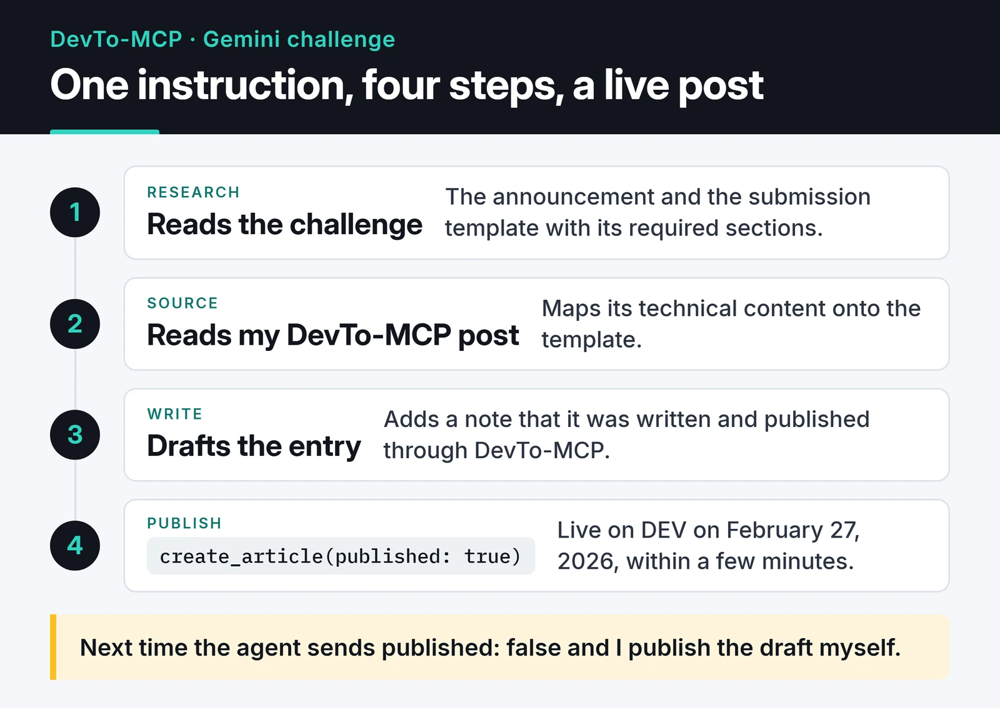

In February 2026 DEV Community ran the "Built with Google Gemini: Writing Challenge," presented by Major League Hacking (MLH). To enter, you published a post about something you'd built with Gemini. A few days earlier I had written an MCP server for the DEV API, so I decided to have an AI agent write my entry and publish it to DEV through that server.

This post covers that experiment: what the agent did, what went well, and the errors I only noticed later.

## The tool: DevTo-MCP

[DevTo-MCP](/en/posts/devto-mcp-server/) is my server that turns the Forem API into MCP tools. With it an assistant can search DEV, list my posts and create new ones with `create_article`. While testing it on February 18 I had created and updated a throwaway post titled "DevTo MCP Test Article [Automated]" on my account. The challenge was the first time I used it for real work.

Project page: [DevTo-MCP](https://furkankoykiran.com.tr/en/projects/devto-mcp/)

## The task I gave the agent

Without leaving my editor, I gave a Gemini-based agent roughly this instruction:

> Research the Built with Google Gemini challenge. Read the DevTo-MCP post on my blog. Write an English article about the process that follows the challenge template. When you're done, publish it on my DEV account.

The agent then:

1. Read the challenge announcement and submission template, which asked for sections like "What I Built with Google Gemini," "Demo" and what you learned.
2. Read my blog post about DevTo-MCP and mapped its technical content onto the template.
3. Wrote the article and added a closing note saying the post had been drafted and published autonomously through DevTo-MCP.
4. Called `create_article` with `published: true`.

The article [went live on DEV](https://dev.to/furkankoykiran/building-devto-mcp-bridging-forem-api-and-ai-assistants-with-google-gemini-4a58) on February 27, 2026, titled "Building DevTo-MCP: Bridging Forem API and AI Assistants with Google Gemini" and tagged `devchallenge`, `geminireflections`, `gemini` and `mcp`. The whole run took a few minutes.

Here is the whole chain, from one instruction to a published post:

## What went well

Mechanically, everything worked. The agent's `create_article` call went through on the first try. It read the template correctly, put the submission line where it belonged and used the challenge's tags.

This kind of chain is where an MCP server earns its keep: research, reading, writing and publishing tied together by one instruction. I stated the goal and the agent planned the steps in between.

## What slipped through

The DevTo-MCP write-up the agent used as its source made several claims the code doesn't back up. Since the agent built the challenge entry from that write-up, the same errors went into the entry:

- It says the API client reads `x-ratelimit-remaining` and slows down before hitting the limit. The client doesn't; it only uses the header in error messages.
- It says the npm release used OIDC trusted publishing, that a missing `environment: production` line caused 404s, and that Gemini spotted the missing line. The workflow in the repo has had that line since its first commit, and publishing uses an npm token.
- The install section uses `npx -y devto-mcp`. In March I moved the package to `@furkankoykiran/devto-mcp`, and the unscoped `devto-mcp` name now belongs to a different project on npm. Anyone running that command installs someone else's package and hands it their DEV API key.

The last one is the serious one. The command was right on the day the agent wrote it; the package name changed later. Code gets updated, but a published post stays as it was.

The agent also framed the article as my development story, with Gemini as a pair programmer at every step. The template invited that framing, and the agent didn't hesitate to draw connections the source didn't contain. Anything published under my name has to be something I can stand behind sentence by sentence, and that entry has sentences I can't.

## What I'll do differently

I won't let the agent publish. `create_article` has a `published: false` option: the agent creates a draft, and I read it in the DEV editor and publish it myself. The minutes saved by automation easily cover a few minutes of reading.

I'll verify the source first. The agent worked from a blog post, so every error in that post carried over. A model that rewrites a flawed source quickly and fluently makes the flaws more convincing.

The server can help too: default `create_article` to drafts and require an explicit confirmation parameter to publish. Not making a write tool's least reversible side effect its default is a rule I want to follow in every MCP server I design.

## Where this leaves me

The experiment showed that an agent can do a job end to end over MCP. It also showed that an agent with write access publishes whatever its source says. My next steps are switching DevTo-MCP's default to drafts and adding a correction note with the current install command to the DEV article.

The technical details of the server are in [the DevTo-MCP post](/en/posts/devto-mcp-server/), and another server from the same series is [OmniWire-MCP](/en/posts/omniwire-mcp-news-server/). The code is [on GitHub](https://github.com/furkankoykiran/DevTo-MCP).
