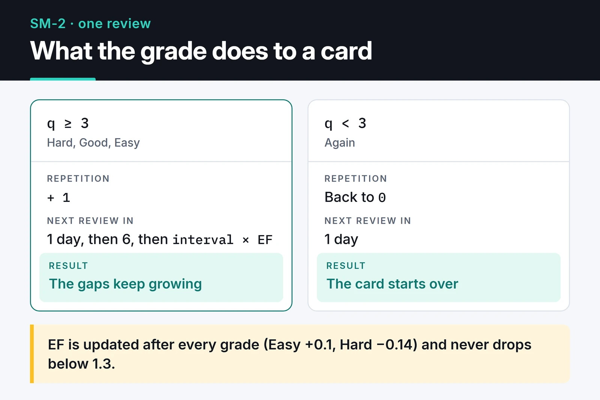

Memoryze is an open-source spaced repetition app I wrote for memorizing words and concepts. You build decks of flashcards, and the SM-2 algorithm decides when each card comes back. It's React, TypeScript, Supabase and Framer Motion, hosted on GitHub Pages.

[Try the app](https://furkankoykiran.com.tr/Memoryze/) · [Source code](https://github.com/furkankoykiran/Memoryze) · [Project page](https://furkankoykiran.com.tr/en/projects/memoryze/)

This post walks through how it works, the 3D card flip that ate most of my time, and two bugs I found when I reread the code.

")

## Why build my own

Duolingo feels too gamified to me and doesn't focus on the words I pick. Most of Quizlet's useful features are behind a paywall. Anki's scheduling is excellent, but the interface is dated and desktop-first. I wanted my own decks, a clean UI that opens in a browser, and a proper review algorithm underneath.

I wrote it on the night of February 5, 2026, in a session of roughly two hours. All 25 commits in the repo are from that night, and some of the bugs below come straight from that pace.

## Stack and architecture

- React 19 and TypeScript, built with Vite 7.
- Tailwind CSS 3 for a dark, glassy UI.
- Framer Motion 12 for animation.
- Supabase for the PostgreSQL database and email/password auth, password reset included.
- react-i18next for English and Turkish, picked from the browser language.
- React Router 7, deployed to GitHub Pages by a GitHub Actions workflow.

There's no backend of my own; the browser talks to Supabase directly. The data model is two tables: `decks`, and `cards`, which holds each card's front, back and review state.

GitHub Pages doesn't support SPA routing, so the workflow generates a `404.html` and the router uses `/Memoryze` as its `basename`. Opening a deep link like `/Memoryze/dashboard` then loads the app instead of a 404.

## SM-2: when cards come back

SM-2 is SuperMemo's algorithm from the late 1980s, and Anki's default scheduler is based on it. It tracks three numbers per card: how many times in a row you got it right (`repetition`), an ease factor (`ef`) and the interval in days (`interval`). The card below shows what a grade does, and the Memoryze code follows it:



```ts
export const calculateSM2 = ({ q, repetition, ef, interval }: SM2Input): SM2Output => {
  let newRepetition = repetition;
  let newInterval = interval;

  if (q >= 3) {
    if (repetition === 0) newInterval = 1;
    else if (repetition === 1) newInterval = 6;
    else newInterval = Math.round(interval * ef);
    newRepetition += 1;
  } else {
    newRepetition = 0;
    newInterval = 1;
  }

  // EF' = EF + (0.1 - (5 - q) * (0.08 + (5 - q) * 0.02)), floor of 1.3
  let newEf = ef + (0.1 - (5 - q) * (0.08 + (5 - q) * 0.02));
  if (newEf < 1.3) newEf = 1.3;

  const nextReviewDate = new Date();
  nextReviewDate.setDate(nextReviewDate.getDate() + newInterval);

  return { repetition: newRepetition, ef: newEf, interval: newInterval, nextReviewDate };
};
```

`q` is a grade from 0 to 5. The UI has four buttons: Again (0), Hard (3), Good (4) and Easy (5). A card you know comes back after 1 day, then 6, then each time after the previous interval multiplied by EF. Easy raises EF by 0.1 and Hard lowers it by 0.14, so intervals on hard cards grow more slowly.

The review screen loads up to 20 due cards ordered by `next_review`. Anything graded below 4 goes back to the end of the session queue, so a card you missed shows up again before the session ends.

## The 3D card flip

This took the most time. The last six commits of that night are all about this animation.

I started with the classic CSS approach: rotate the card with `rotateY(180deg)` and give both faces `backface-visibility: hidden`. It worked in desktop Chrome, but sometimes the back face rendered mirrored, sometimes it didn't render at all, and sometimes the front face stayed on top and swallowed clicks meant for the buttons on the back.

Next I tried swapping opacity at 90 degrees with Framer Motion's `useMotionValue` and `useTransform`. The opacity approach didn't hold up either, and two commits later I went back to a proper 3D structure. This is what the repo runs:

```tsx
<div style={{ perspective: "1000px" }}>
  <motion.div
    onClick={() => !isFlipped && setIsFlipped(true)}
    initial={false}
    animate={{ rotateY: isFlipped ? 180 : 0 }}
    transition={{ type: "spring", stiffness: 260, damping: 20 }}
    style={{ transformStyle: "preserve-3d" }}
    className="relative w-full min-h-[350px]"
  >
    <div
      className="absolute inset-0"
      style={{
        backfaceVisibility: "hidden",
        WebkitBackfaceVisibility: "hidden",
        zIndex: isFlipped ? 0 : 1,
      }}
    >
      {card.front}
    </div>
    <div
      className="absolute inset-0"
      style={{
        backfaceVisibility: "hidden",
        WebkitBackfaceVisibility: "hidden",
        transform: "rotateY(180deg)",
        zIndex: isFlipped ? 1 : 0,
      }}
    >
      {card.back}
    </div>
  </motion.div>
</div>
```

Four details make it work:

1. The rotation lives on the shared parent, and the parent has `transform-style: preserve-3d`. Without it the faces stay flat in their own plane and the back face can't be hidden.
2. The back face starts rotated by 180 degrees. When the parent turns 180 degrees, the two rotations cancel and the text reads normally. Missing this is what produced the mirrored text.
3. Safari needs the `WebkitBackfaceVisibility` prefix as well.
4. `zIndex` follows the flip state. The hidden face is still in the DOM and can still catch clicks, so whichever face is showing has to be on top.

## The Supabase key and RLS

The repo has a committed `.env` with the Supabase URL and the anon key. That looks like a leak, but the anon key ships inside the JavaScript bundle anyway; anyone can read it in DevTools. In a SPA, the real protection is row level security: a user should only see their own decks and the cards in them.

`cards` has no `user_id`; ownership comes through the deck. For this schema the policy has this shape:

```sql
alter table cards enable row level security;

create policy "own cards" on cards
  for all
  using (exists (
    select 1 from decks d
    where d.id = cards.deck_id and d.user_id = (select auth.uid())
  ))
  with check (exists (
    select 1 from decks d
    where d.id = cards.deck_id and d.user_id = (select auth.uid())
  ));
```

Wrapping `auth.uid()` in a `select` is an optimization Supabase recommends, because Postgres then evaluates it once per query instead of once per row.

Even so, it's cleaner to take `.env` out of the repo and pass the values to the build as GitHub Actions secrets. The anon key isn't secret, but keeping a `.env` in git makes it easy for someone to drop the service role key in there one day.

## Two bugs I found rereading the code

Reading the code again later, I found two problems.

The first is the Hard button. It sends grade 3, which SM-2 treats as a pass: `repetition` goes up and the interval grows. The UI, though, treats anything below 4 as a miss and requeues the card in the same session. So a card you mark Hard is pushed to tomorrow and also shown again tonight. Mark it Good the second time and `repetition` increments again, so the interval grows faster than it should. The fix is to use one pass threshold everywhere, or to skip the second database update for requeued cards.

The second is the end of a session. Requeuing updates state with `setCards`, but the check for "session complete" right after it still uses the old `cards.length`. Miss the last card and the session ends on the "complete" screen, even though the card was requeued. Computing the new length once and using it for both the state update and the check fixes it.

Both are typical of a two-hour sprint, and neither got caught that night because I wrote no tests. `calculateSM2` is a pure function, so a handful of Vitest cases would have caught the first one.

## What's next

Ideas on the list: shareable decks, pronunciation through the browser's Web Speech API, and a study heatmap like GitHub's contribution graph. First, though, I want to fix the two bugs above and add tests for SM-2. After that I may try replacing SM-2 with [FSRS](https://github.com/open-spaced-repetition/fsrs4anki), the newer scheduler that Anki also supports.

The code is MIT licensed and [on GitHub](https://github.com/furkankoykiran/Memoryze). Create a Supabase project, put your own URL and anon key in `.env`, and run `npm install && npm run dev`. Supabase's free plan has a low email sending limit, so turning off "Confirm email" during development makes sign-ups much less painful.

Another small React and Vite project of mine is [awesome-trending-repos](/en/posts/awesome-trending-repos-web/), and I wrote about building interfaces without a framework in [modern web UI without a framework](/en/posts/modern-web-ui-css-javascript/).
