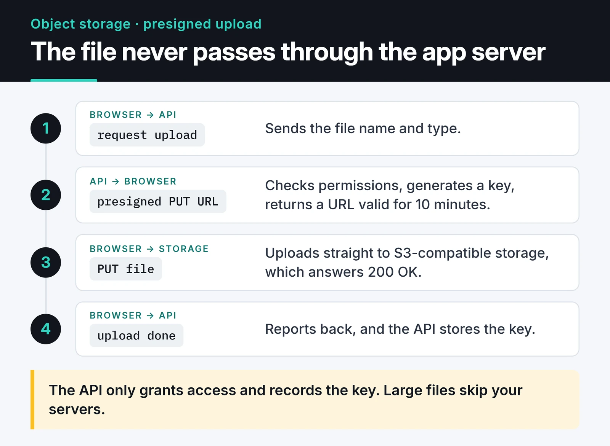

For a few years, MinIO was the shortest path to running S3 on your own server. That has changed: the open source community edition was wound down step by step, and its GitHub repository is now archived. This post covers why you should move files to object storage, how to work with the S3 API through boto3, concepts like erasure coding and object lock, and which software I'd pick for a new setup. The code doesn't depend on the storage backend, so it keeps working when you move off MinIO.

## The problem with files on the app server's disk

The classic upload flow: take the file from the form, save it as `/var/www/uploads/user_123.jpg`. On a single server that works. It breaks the day you add a second server behind a load balancer. A user uploads a photo to server 1, refreshes, lands on server 2 and gets a 404.

The fix is to make the app stateless. Files live in separate object storage, and the app only knows which file is where.

Object storage is flat. There are no real directories: each object sits in a bucket under a key, with metadata attached. A key like `photos/2026/a.jpg` looks like a path, but it's just a string.

## Direct uploads with presigned URLs

The main benefit is that large files never pass through your app servers. The app issues a short-lived signed URL, and the browser uploads to or downloads from storage directly. The diagram below shows the upload flow step by step.



Because the S3 API is the de facto standard, the code doesn't care which storage server sits behind it. This boto3 client works with AWS S3, MinIO, Garage, SeaweedFS, Ceph RGW and Cloudflare R2; only `endpoint_url` and the credentials change:

```python
import os

import boto3
from botocore.config import Config

s3 = boto3.client(
    "s3",
    endpoint_url=os.environ["S3_ENDPOINT"],  # e.g. http://localhost:9000
    aws_access_key_id=os.environ["S3_ACCESS_KEY"],
    aws_secret_access_key=os.environ["S3_SECRET_KEY"],
    region_name=os.environ.get("S3_REGION", "us-east-1"),
    config=Config(
        signature_version="s3v4",
        s3={"addressing_style": "path"},
        # boto3 1.36+ default checksums break uploads on some S3-compatible servers
        request_checksum_calculation="when_required",
        response_checksum_validation="when_required",
    ),
)


def upload_and_share(local_path: str, bucket: str, key: str) -> str:
    """Upload a file and return a download link valid for one hour."""
    s3.upload_file(local_path, bucket, key)  # switches to multipart for large files
    return s3.generate_presigned_url(
        "get_object", Params={"Bucket": bucket, "Key": key}, ExpiresIn=3600
    )


def presigned_upload_url(bucket: str, key: str, content_type: str) -> str:
    """URL the browser can PUT to directly, valid for 10 minutes."""
    return s3.generate_presigned_url(
        "put_object",
        Params={"Bucket": bucket, "Key": key, "ContentType": content_type},
        ExpiresIn=600,
    )
```

Keep credentials out of the code; read them from the environment or a secret manager. The checksum settings fix a real trap: the new default integrity checks that shipped with boto3 1.36 break uploads on S3-compatible servers that don't support them. If your provider does support them, drop those two lines.

For direct browser uploads, also add a CORS rule to the bucket. Without it the browser blocks the PUT.

## What happened to MinIO

The short timeline:

- In spring 2025, admin features were removed from the community edition's web console, leaving mostly an object browser.
- In October 2025, official Docker images and binaries stopped. The last community release, `RELEASE.2025-10-15T17-29-55Z`, shipped as source only.
- In December 2025 the repository went into maintenance mode: no new features, no PRs accepted.
- After that, the [minio/minio](https://github.com/minio/minio) repository was archived and became read-only.

On GitHub, the repository carries a "Public archive" badge next to its name; the license is still AGPLv3.


The company now focuses on its commercial product, AIStor. The code is still AGPLv3, so forking is allowed and community forks exist. What's gone is "pull the official image and run it": the `minio/minio` image from older `docker-compose.yml` files is no longer on Docker Hub.

A running deployment won't break tomorrow. The real risk is security: when the next vulnerability appears, no official fix will ship. So my advice is:

- Don't rip out an existing MinIO setup overnight, but keep it off the public internet and plan a migration.
- Don't start new projects on MinIO community.
- If you need commercial support and MinIO's feature set, read AIStor's license terms.

## What I'd pick today

All of these speak the S3 API, so the boto3 code above runs unchanged. The differences are in operations:

| Option | When |
|---|---|
| [Garage](https://garagehq.deuxfleurs.fr/) | Small to medium scale, a few nodes, possibly in different locations. Written in Rust and lightweight. |
| [SeaweedFS](https://github.com/seaweedfs/seaweedfs) | Lots of small files and high volume. Also offers a filer and FUSE besides S3. |
| Ceph RGW | You already run Ceph or you're at petabyte scale. The steepest learning curve of the lot. |
| Managed S3 (AWS S3, R2, Backblaze B2) | You don't want to run hardware. If your data may leave the country, this is the least work. |

When data has to stay in a specific jurisdiction (GDPR, financial or health data), self-hosting still makes sense, and Garage is the easiest one for a small team to start with. Its setup changes between versions, so I won't copy it here; the [official quick start](https://garagehq.deuxfleurs.fr/documentation/quick-start/) has the current steps.

## Erasure coding instead of RAID

This was the most useful concept I picked up from MinIO, and you'll meet it again in Ceph and SeaweedFS.

Erasure coding splits an object into data and parity shards and spreads them across drives (Reed-Solomon). In MinIO, a 4-drive set defaults to 2 parity shards: any two drives can fail completely and objects stay readable. Writes need more drives than reads, so with two drives lost in that set, reads continue but writes stop. Compared to RAID, protection works per object rather than per disk, and each shard is verified with a hash. When a drive silently corrupts data over time (bit rot), the bad shard is detected and rebuilt from parity.

Garage uses replication instead (typically three copies). It costs more disk but the model is simpler. Know this difference when you choose.

## Object lock and WORM

Finance, healthcare and legal work often come with rules like "this document must not be deleted or modified for 5 years". S3 object lock covers that (WORM: write once, read many). It has two modes:

- Governance: users with a special permission can override the lock.
- Compliance: nobody, root included, can delete the object or shorten the retention until it expires.

Object lock has to be enabled when the bucket is created; you can't add it later. With boto3:

```python
s3.create_bucket(Bucket="invoices", ObjectLockEnabledForBucket=True)
s3.put_object_lock_configuration(
    Bucket="invoices",
    ObjectLockConfiguration={
        "ObjectLockEnabled": "Enabled",
        "Rule": {"DefaultRetention": {"Mode": "COMPLIANCE", "Years": 5}},
    },
)
```

Try compliance mode on a test bucket before you turn it on in production. If you set the wrong retention, you can't undo it either. Also check that your storage supports object lock at all; not every S3-compatible server does.

## Lifecycle rules

Log and temp-file buckets that never clean themselves up will fill the disk. Lifecycle rules are part of the S3 API too:

```python
s3.put_bucket_lifecycle_configuration(
    Bucket="logs",
    LifecycleConfiguration={
        "Rules": [
            {
                "ID": "expire-30d",
                "Filter": {"Prefix": ""},
                "Status": "Enabled",
                "Expiration": {"Days": 30},
                "AbortIncompleteMultipartUpload": {"DaysAfterInitiation": 7},
            }
        ]
    },
)
```

People tend to forget the `AbortIncompleteMultipartUpload` line. Parts of abandoned multipart uploads are invisible in listings but still take up space.

## Encryption

S3 has three models for encryption at rest:

- SSE-S3: the storage server manages the keys.
- SSE-KMS: keys live in an external KMS such as Vault.
- SSE-C: the client sends the key with every request.

SSE-S3 looks like the easy option, but in MinIO even SSE-S3 needs a KMS connection (KES). On your own hardware, disk-level encryption (LUKS) plus TLS is often the most practical route.

## Common questions

### Can I use object storage like a database?

No. You can't search inside objects; you read them by key. Keep "which user owns which file" in your database.

### What hardware matters?

The bottleneck is usually disk and network, not CPU. NVMe drives behind a 1 Gbps NIC will saturate the network long before the drives.

### How do I monitor it?

Scrape the storage server's Prometheus metrics: disk usage, request latency, error counts. Tools like Thanos also use object storage as long-term metric storage, which I cover in my [Prometheus and Grafana post](/en/posts/prometheus-grafana-monitoring/).

## What's next

If your files still sit on the app server's disk, start by moving one upload flow to the S3 API with the boto3 code above. After that, swapping the storage behind it is as easy as changing `S3_ENDPOINT`.

For packaging the app side, see my [Docker for Python apps post](/en/posts/docker-python-app-containerization/). To watch the storage once it runs, the [Prometheus and Grafana post](/en/posts/prometheus-grafana-monitoring/) covers the setup.
