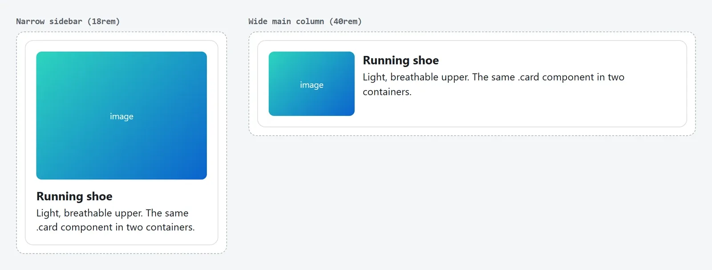

You don't need React or Vue in every project to build a modern web UI. CSS and HTML features that shipped in browsers over the last few years now cover a lot of what used to take JavaScript or a library. For a dashboard, a landing page or the admin panel of a backend service, plain HTML, modern CSS and a little vanilla JavaScript are often enough.

I'm not against frameworks; I built my [awesome-trending-repos site](/en/posts/awesome-trending-repos-web/) with React and Vite. This post is about what the browser gives you before you reach for one. Every CSS feature here works in current versions of Chrome, Firefox and Safari.

## Container queries: let components look at their own width

Media queries look at the viewport. A card component, though, sometimes sits in a wide main column and sometimes in a narrow sidebar, so the viewport width is the wrong question. With a container query, the component changes layout based on the width of the box it lives in:

```css
.card-wrap {
  container-type: inline-size;
}

.card {
  display: grid;
  gap: 0.75rem;
  padding: 1rem;
}

@container (min-width: 28rem) {
  .card {
    grid-template-columns: 8rem 1fr;
  }
}
```

The same `.card` now picks the right layout wherever you drop it. Here is the card CSS from this post rendered by Chrome in two containers of different widths:



The viewport is the same for both cards; only the container differs. That's why most component-level media queries become unnecessary.

## Nesting, cascade layers and theme variables

Nesting was the most used Sass feature, and CSS has it natively now. The same card with nesting, `@layer` and `light-dark()`:

```css
@layer reset, base, components;

:root {
  color-scheme: light dark;
  --bg: light-dark(#ffffff, #0f1115);
  --fg: light-dark(#1b1f24, #e6e8eb);
  --accent: light-dark(#0b63ce, #5aa2ff);
}

@layer base {
  body {
    background: var(--bg);
    color: var(--fg);
    font-family: system-ui, sans-serif;
  }
}

@layer components {
  .card {
    display: grid;
    gap: 0.75rem;
    padding: 1rem;
    border: 1px solid color-mix(in oklab, var(--fg) 15%, transparent);
    border-radius: 0.75rem;

    & h3 {
      margin: 0;
    }

    &:hover {
      border-color: var(--accent);
    }

    @container (min-width: 28rem) {
      grid-template-columns: 8rem 1fr;
    }
  }
}
```

Three things are going on:

- `color-scheme: light dark` with `light-dark()` picks the right color for the user's system theme, with no separate `prefers-color-scheme` block.
- `@layer` decides which styles win. A rule in the `components` layer beats a more specific selector in `base`. That ends most `!important` fights.
- `color-mix()` derives a translucent border color from the text color, so the design system doesn't need another variable.

## Selecting parents with :has()

`:has()` fills the gap that was known for years as "CSS has no parent selector". You can style an element based on what it contains:

```css
/* Cards with an image get a different layout */
.card:has(img) {
  grid-template-rows: auto 1fr;
}

/* Dim the submit button while the form has an invalid field the user touched */
form:has(:user-invalid) button[type="submit"] {
  opacity: 0.5;
}

/* The label of a checked checkbox */
label:has(input:checked) {
  font-weight: 600;
}
```

Each of these used to need an event listener toggling a class. And because `:user-invalid` only matches after the user has interacted with a field, the form doesn't greet people with red error boxes on page load.

## Interaction without JavaScript: dialog and popover

Modals and dropdown menus were two of the most common reasons to install a library. Both are in HTML now:

```html
<button popovertarget="user-menu">Account</button>
<div id="user-menu" popover>
  <a href="/profile">Profile</a>
  <a href="/logout">Log out</a>
</div>

<dialog id="confirm">
  <form method="dialog">
    <p>Are you sure you want to delete this?</p>
    <button value="cancel">Cancel</button>
    <button value="ok">Delete</button>
  </form>
</dialog>
<button onclick="document.getElementById('confirm').showModal()">Delete</button>
```

A popover closes on outside click and on `Esc`, and renders in the top layer, so there's no `z-index` to tune. A dialog opened with `showModal()` traps focus, makes the background inert and closes on `Esc`. Those are exactly the accessibility details that hand-rolled versions tend to forget.

## Islands: JavaScript only where it's needed

If most of a page is static content, there's no reason to turn the whole page into a JavaScript app. That's the "islands" idea behind tools like Astro: render HTML on the server and hydrate only the interactive parts. A simple version needs no build step:

```html
<div data-island="price-chart" data-symbol="BTCUSDT"></div>
```

```javascript
const io = new IntersectionObserver((entries) => {
  for (const entry of entries) {
    if (!entry.isIntersecting) continue;
    io.unobserve(entry.target);
    const el = entry.target;
    import(`./islands/${el.dataset.island}.js`).then((mod) => mod.mount(el));
  }
});

document.querySelectorAll("[data-island]").forEach((el) => io.observe(el));
```

Each island's code is fetched only when it scrolls into view. A chart at the bottom of the page costs no network or main-thread time until the user gets there. For an island that shows live data, feeding it from the server over [WebSockets](/en/posts/websocket-real-time-communication/) or SSE is a natural match.

## Web Components: framework-independent components

Components don't require a library either. Custom elements and Shadow DOM are browser standards and work inside any framework, which makes them a good fit for a UI kit shared across projects:

```javascript
class ProductCard extends HTMLElement {
  connectedCallback() {
    if (this.shadowRoot) return;
    const root = this.attachShadow({ mode: "open" });
    root.innerHTML = `
      <style>
        :host { display: block; container-type: inline-size; }
        .card { padding: 1rem; border: 1px solid #ccc; border-radius: 0.5rem; }
      </style>
      <div class="card">
        <h3></h3>
        <slot name="description"></slot>
      </div>`;
    // Don't interpolate the attribute into innerHTML; textContent can't inject markup
    root.querySelector("h3").textContent = this.getAttribute("name") ?? "";
  }
}

customElements.define("product-card", ProductCard);
```

```html
<product-card name="Running shoe">
  <p slot="description">Light, breathable upper.</p>
</product-card>
```

Putting a value that might come from a user into `innerHTML` through a template string is a very common security bug in framework-free code. Write the static template with `innerHTML` and the dynamic values with `textContent`.

## State: events and a tiny signal

On a medium-sized page you rarely need a global store for components to talk. The DOM's own event system is a pub/sub mechanism:

```javascript
document.addEventListener("click", (event) => {
  const button = event.target.closest("[data-action='add-to-cart']");
  if (!button) return;
  cart.push(button.dataset.sku);
  document.dispatchEvent(new CustomEvent("cart:updated", { detail: { count: cart.length } }));
});

document.addEventListener("cart:updated", (event) => {
  document.querySelector("#cart-count").textContent = event.detail.count;
});
```

The first listener uses event delegation: instead of attaching a listener to hundreds of buttons, one listener checks where the click came from. Buttons added later work automatically.

For a value read in many places, a small signal does the job:

```javascript
function signal(initial) {
  let value = initial;
  const subscribers = new Set();
  return {
    get: () => value,
    set(next) {
      value = next;
      subscribers.forEach((fn) => fn(value));
    },
    subscribe(fn) {
      subscribers.add(fn);
      fn(value);
      return () => subscribers.delete(fn);
    },
  };
}

const count = signal(0);
count.subscribe((v) => (document.querySelector("#cart-count").textContent = v));
count.set(3);
```

Solid, Preact Signals, Vue and Angular all build on this idea, and there's a TC39 proposal to standardize it. When your state outgrows something like this, that's a good sign it's time for a framework.

## Measure performance

Google's Core Web Vitals are LCP (when the largest content appears), INP (how fast the page responds to interactions) and CLS (layout shift). INP replaced FID in March 2024 and measures every interaction across the page's lifetime, not just the first click. Large JavaScript bundles hurt it most, because clicks wait while the main thread is busy.

Measure instead of guessing:

- Record a trace in the Chrome DevTools Performance panel. Long tasks (over 50 ms) and forced reflow warnings from interleaved DOM reads and writes are the first things to look at.
- For real-user data, the `web-vitals` library is a few KB and can send metrics to your own analytics endpoint.
- Run Lighthouse CI and axe-core on every PR, and fail the build when the performance score or accessibility checks drop below your threshold.

## Accessibility and the law

The European Accessibility Act has applied since June 2025 and makes accessibility a requirement for many digital products and services in the EU. Technically, most of it comes down to using basic HTML correctly:

- Use `header`, `nav`, `main` and `button` instead of `div` for everything. A click handler on a `div` means writing keyboard and screen reader support yourself.
- Give icon-only buttons an `aria-label`.
- Navigate the page with `Tab` only, no mouse. Is focus visible? Does the order make sense?

That's also why `dialog` and `popover` are worth using: focus handling and keyboard behavior come built in.

## So when do you need a framework?

My split: content-heavy pages, dashboards and small tools get plain HTML, modern CSS and islands. A multi-page app with heavy state and many people working in the same codebase gets a framework, because its structure and ecosystem pay for themselves there.

## Where to go next

Take a component in an existing project that uses media queries, switch it to a container query and drop it into columns of different widths; you'll see the difference right away. Track browser support on [MDN](https://developer.mozilla.org/en-US/docs/Web/CSS/CSS_containment/Container_queries) and [Baseline](https://web.dev/baseline). MDN shows the status as a badge at the top of each reference page:


If you want to feed live data into pages like these, my [WebSocket post](/en/posts/websocket-real-time-communication/) covers the server side, and my [awesome-trending-repos post](/en/posts/awesome-trending-repos-web/) shows a site built with a framework.
