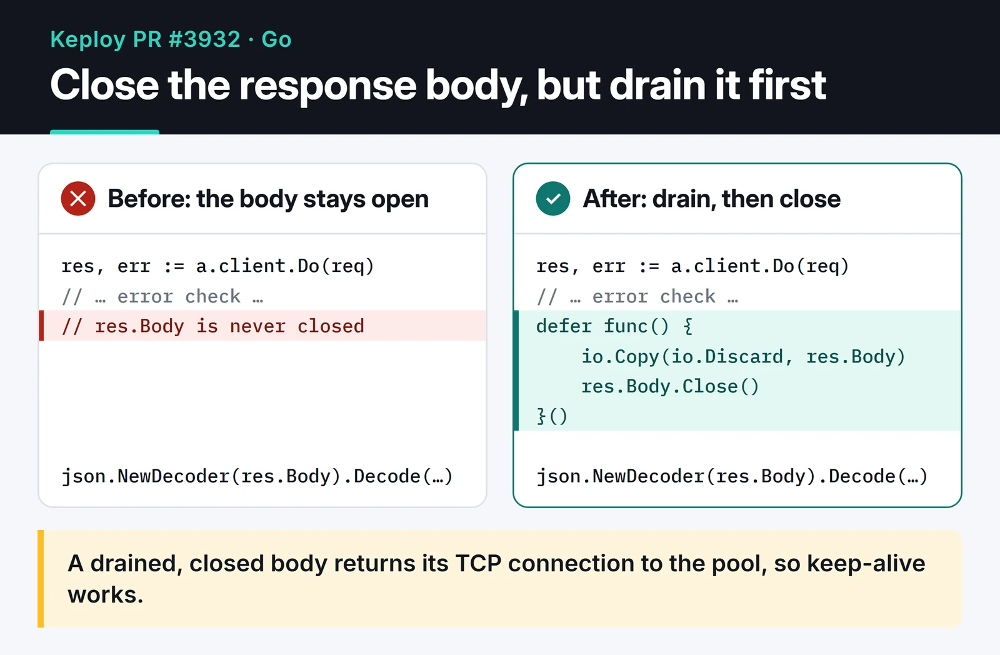

While following GitHub trending with [awesome-trending-repos](https://github.com/furkankoykiran/awesome-trending-repos), I came across [Keploy](https://github.com/keploy/keploy), an API testing tool written in Go. Its issue tracker had two resource management bugs, and I sent a PR for each. This post covers that Keploy contribution: using `defer` correctly in Go, and why an HTTP response body needs to be both drained and closed. Both PRs were merged on March 20, 2026. They were my first contributions to Keploy.

## What Keploy does

Keploy captures your application's real traffic with eBPF and turns it into API tests and mocks for external dependencies. When the tests run again, database and third-party calls are answered from those mocks.

The two bugs I fixed sit at the edges of this flow: one where Keploy detects the application's language, the other in the HTTP client Keploy uses to talk to its own agent.

## PR #3927: reading from a closed file

### The bug

Issue [#3821](https://github.com/keploy/keploy/issues/3821) pointed at `isGoBinary` in `utils/utils.go`. The function opened an ELF file, closed it right away, and then tried to read sections from the closed file:

```go
f, err := elf.Open(filePath)
if err != nil {
	logger.Debug(fmt.Sprintf("failed to open file %s", filePath), zap.Error(err))
	return false
}
if err := f.Close(); err != nil { // the file is closed here
	LogError(logger, err, "failed to close file", zap.String("file", filePath))
}

sections := []string{".go.buildinfo", ".gopclntab"}
for _, section := range sections {
	if sect := f.Section(section); sect != nil { // ...and used here
		fmt.Println(section)
		return true
	}
}
```

`DetectLanguage` relies on `isGoBinary`, so the bug sat right where Keploy decides whether an application is written in Go.

### The fix

I moved `Close()` into a `defer`. A deferred call runs when the function returns, whichever way it exits: an early `return`, the normal path, or a panic. I also removed a leftover debug `fmt.Println(section)`.

The PR's first commit used a plain `defer f.Close()`. Copilot's automated review pointed out that this swallows the error from `Close()`, while the rest of the file logs close errors, and that it would probably trip `golangci-lint`'s `errcheck`. The final version matches the other call sites:

```go
f, err := elf.Open(filePath)
if err != nil {
	logger.Debug(fmt.Sprintf("failed to open file %s", filePath), zap.Error(err))
	return false
}
defer func() {
	if err := f.Close(); err != nil {
		LogError(logger, err, "failed to close file", zap.String("file", filePath))
	}
}()

sections := []string{".go.buildinfo", ".gopclntab"}
for _, section := range sections {
	if sect := f.Section(section); sect != nil {
		return true
	}
}
return false
```

[PR #3927](https://github.com/keploy/keploy/pull/3927) was a +5/−4 change. AkashKumar7902 merged it on March 20.

## PR #3932: response bodies that were never closed

### The bug

Issue [#3854](https://github.com/keploy/keploy/issues/3854) pointed at `MockOutgoing` and `UpdateMockParams` in `pkg/platform/http/agent.go`. Both sent a request to the agent and never closed `res.Body`:

```go
res, err := a.client.Do(req)
if err != nil {
	return fmt.Errorf("failed to send request for mockOutgoing: %s", err.Error())
}
// res.Body is never closed

var mockResp models.AgentResp
err = json.NewDecoder(res.Body).Decode(&mockResp)
```

The `net/http` docs are explicit: the caller must close the body. An unclosed body holds on to its TCP connection, so the connection can't go back to the pool and every request opens a new one. In a long-running process that can end in exhausted file descriptors or ports.

### The fix: drain, then close

Side by side, the whole change is one deferred function:



```go
res, err := a.client.Do(req)
if err != nil {
	return fmt.Errorf("failed to send request for mockOutgoing: %s", err.Error())
}
defer func() {
	io.Copy(io.Discard, res.Body)
	if err := res.Body.Close(); err != nil {
		utils.LogError(a.logger, err, "failed to close response body for mockOutgoing")
	}
}()

var mockResp models.AgentResp
err = json.NewDecoder(res.Body).Decode(&mockResp)
```

The `io.Copy(io.Discard, res.Body)` line was the most useful thing I learned from this PR. The maintainer, AkashKumar7902, asked me to address the Copilot comments, and one of them explained it: `json.Decoder.Decode` doesn't promise to read the body to the end. If the body is closed before it reaches EOF, the `Transport` can't reuse the connection. Draining it first is what makes keep-alive actually work.

One caveat: if the body can be large, an unbounded `io.Copy` may pull megabytes you don't need. In that case, cap the drain:

```go
io.Copy(io.Discard, io.LimitReader(res.Body, 64<<10)) // at most 64 KiB
```

Keploy's agent responses are small, so the unbounded version was fine there. [PR #3932](https://github.com/keploy/keploy/pull/3932) was merged with two commits and 12 added lines.

## Rules I now follow with defer

Since these two PRs I stick to a few rules with `defer`.

Put the `defer` right after you acquire the resource and after the error check. If `os.Open` fails, `f` is nil, and a `defer f.Close()` placed before the check will panic.

Don't `defer` inside a loop. Deferred calls run when the function returns, not at the end of each iteration, so thousands of files can stay open. Move the loop body into its own function:

```go
func countLines(paths []string) (int, error) {
	total := 0
	for _, p := range paths {
		n, err := countFile(p) // the defer runs when countFile returns
		if err != nil {
			return 0, err
		}
		total += n
	}
	return total, nil
}

func countFile(path string) (int, error) {
	f, err := os.Open(path)
	if err != nil {
		return 0, err
	}
	defer f.Close()

	n := 0
	scanner := bufio.NewScanner(f)
	for scanner.Scan() {
		n++
	}
	return n, scanner.Err()
}
```

Multiple defers run in reverse order (LIFO). Their arguments are evaluated when the `defer` statement runs, not when the function returns, so use a closure if you need a variable's final value.

For a file you only read, the `Close()` error rarely matters. For a file you write, it does: that's where you learn buffered data didn't make it to disk. In that case, return the error from the function instead of only logging it.

## Where to go next

The two PRs added 17 lines in total, and I only learned the body-draining detail from the review comments. In your own Go code, grep for `client.Do` and check that every response body is drained and closed in a `defer`. For more, see the Go docs for [net/http Client.Do](https://pkg.go.dev/net/http#Client.Do) and the [CommonMistakes page on the Go wiki](https://go.dev/wiki/CommonMistakes).

The tool I found Keploy with, [awesome-trending-repos](https://furkankoykiran.com.tr/en/projects/awesome-trending-repos/), has [its own post](/en/posts/awesome-trending-repos-web/). My other open source work is in [MCP open source contributions](/en/posts/mcp-ai-open-source-contributions/) and [security and API fixes](/en/posts/security-and-api-fixes/).
