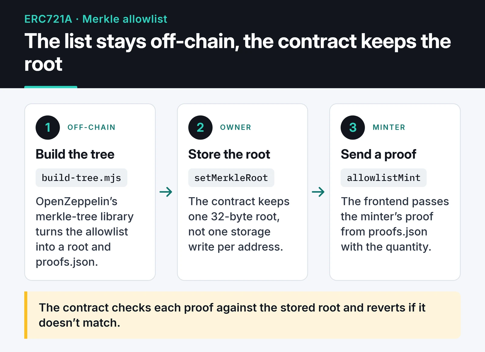

I wrote mint contracts for a few NFT collections while I was doing Web3 work. This post is how I would build NFT minting on Ethereum if I started from scratch today: ERC721A for batch mints, a Merkle tree for the allowlist, metadata on IPFS, Foundry tests and an ethers v6 mint button.

Everything here compiles against Solidity 0.8.x, OpenZeppelin Contracts 5 and ERC721A 4.x, and the tests pass. It is still a teaching example and has not been audited. If a collection is going to take real money, run it on a testnet first and get it reviewed.

## ERC721 or ERC721A?

OpenZeppelin's `ERC721` writes ownership to a separate storage slot for every token, so minting five tokens in one transaction means five storage writes. Add `ERC721Enumerable` on top and every mint and transfer also updates several index mappings, which gets expensive fast.

[ERC721A](https://github.com/chiru-labs/ERC721A), written by the Azuki team, only writes ownership for the first token of a batch. For the rest, `ownerOf` walks backwards until it finds an initialized slot. Minting five tokens costs only a little more than minting one.

That saving moves cost somewhere else:

- The first transfer of a token from the middle of a batch costs more than with plain ERC721, because the contract fills in the missing ownership slots at that point.
- `ownerOf` and related reads do more work for large batches. That's fine for off-chain reads, but watch out if another contract calls it in a loop.
- There are no enumerable helpers like `tokenOfOwnerByIndex`. Listing a wallet's tokens belongs in an indexer that reads `Transfer` events.

For a 10k PFP drop where most people mint between one and five tokens, ERC721A makes sense. For tokens minted one at a time and transferred often, OpenZeppelin's plain `ERC721` is simpler and good enough.

For reference, these are the pieces of the ERC-721 interface:

| Part | Functions and events |
|---|---|
| Ownership | `balanceOf`, `ownerOf` |
| Transfers | `transferFrom`, `safeTransferFrom` |
| Approvals | `approve`, `getApproved`, `setApprovalForAll`, `isApprovedForAll` |
| Events | `Transfer`, `Approval`, `ApprovalForAll` |
| `ERC721Metadata` (optional) | `name`, `symbol`, `tokenURI` |
| `ERC721Enumerable` (optional) | `totalSupply`, `tokenByIndex`, `tokenOfOwnerByIndex` |
| Receiving contracts | `IERC721Receiver.onERC721Received` |

## Metadata and IPFS

`tokenURI(1)` returns a JSON document, and marketplaces read the image and traits from it:

```json
{
  "name": "MyNFT #1",
  "description": "Example collection",
  "image": "ipfs://bafy.../1.png",
  "attributes": [{ "trait_type": "Background", "value": "Blue" }]
}
```

If the images and JSON live on your own server, the NFT goes blank the day that server goes away. That's why content-addressed storage on IPFS became the default. IPFS on its own does not keep files alive, though. Pin them with at least one pinning service, ideally more than one.

The layout can stay simple: upload `metadata/1`, `metadata/2` and so on as one folder and pass `ipfs://<CID>/` to the contract as the base URI.

If the collection has a delayed reveal, publish a provenance hash before the sale: one hash computed over all image hashes. Anyone can later check that the order wasn't shuffled after minting.

## The contract: ERC721A plus a Merkle allowlist

Writing thousands of addresses into a `mapping(address => bool)` costs one storage write per address. With a Merkle tree the contract stores a single 32-byte root, and each minter submits a proof that their address is in the tree.

The card below shows how the list turns into a root and a proofs file off-chain:



The contract:

```solidity {title="src/MyNFT.sol"}
// SPDX-License-Identifier: MIT
pragma solidity ^0.8.24;

import {ERC721A} from "erc721a/contracts/ERC721A.sol";
import {Ownable} from "@openzeppelin/contracts/access/Ownable.sol";
import {MerkleProof} from "@openzeppelin/contracts/utils/cryptography/MerkleProof.sol";

contract MyNFT is ERC721A, Ownable {
    uint256 public constant MAX_SUPPLY = 10_000;
    uint256 public constant MAX_PER_WALLET = 3;
    uint256 public constant PRICE = 0.01 ether;

    bytes32 public merkleRoot;
    string private baseURI;

    error SoldOut();
    error WrongPayment();
    error WalletLimit();
    error NotAllowlisted();
    error WithdrawFailed();

    constructor(address initialOwner, string memory baseURI_)
        ERC721A("MyNFT", "MNFT")
        Ownable(initialOwner)
    {
        baseURI = baseURI_;
    }

    function allowlistMint(uint256 quantity, bytes32[] calldata proof) external payable {
        if (_totalMinted() + quantity > MAX_SUPPLY) revert SoldOut();
        if (msg.value != PRICE * quantity) revert WrongPayment();
        if (_numberMinted(msg.sender) + quantity > MAX_PER_WALLET) revert WalletLimit();

        // Same double-hashed leaf format as @openzeppelin/merkle-tree
        bytes32 leaf = keccak256(bytes.concat(keccak256(abi.encode(msg.sender))));
        if (!MerkleProof.verifyCalldata(proof, merkleRoot, leaf)) revert NotAllowlisted();

        _mint(msg.sender, quantity);
    }

    function setMerkleRoot(bytes32 root) external onlyOwner {
        merkleRoot = root;
    }

    function withdraw(address payable to) external onlyOwner {
        (bool ok, ) = to.call{value: address(this).balance}("");
        if (!ok) revert WithdrawFailed();
    }

    function _baseURI() internal view override returns (string memory) {
        return baseURI;
    }

    function _startTokenId() internal pure override returns (uint256) {
        return 1;
    }
}
```

A few choices in the contract are worth explaining:

- In OpenZeppelin 5, the `Ownable` constructor takes the initial owner. Without `Ownable(initialOwner)` the contract won't compile. Pass a Safe multisig here rather than a personal hot wallet.
- The leaf is double hashed: `keccak256(bytes.concat(keccak256(abi.encode(msg.sender))))`. That matches what OpenZeppelin's `merkle-tree` library produces and rules out second-preimage tricks. The single-hash `keccak256(abi.encodePacked(msg.sender))` you still see in many examples gives neither guarantee, and it may not match a tree built in JavaScript.
- Payment is checked with `msg.value != PRICE * quantity`. With `>=`, any overpayment stays in the contract and the buyer never gets it back.
- The per-wallet cap uses ERC721A's `_numberMinted` counter. It does nothing against Sybils; in a public phase one person can open many wallets.
- Custom errors replace `require` strings. The bytecode gets smaller, reverts get cheaper, and tests can match on the selector.

I used `_mint` rather than `_safeMint`. `_safeMint` calls `onERC721Received` when the receiver is a contract, which hands control to external code in the middle of a mint. ERC721A's `_safeMint` has its own reentrancy check, so it's usable, but I prefer to keep the mint path boring.

## Building the Merkle tree

The tree is built off-chain with OpenZeppelin's [merkle-tree](https://github.com/OpenZeppelin/merkle-tree) library:

```javascript {title="scripts/build-tree.mjs"}
import fs from "node:fs";
import { StandardMerkleTree } from "@openzeppelin/merkle-tree";

const addresses = [
  "0x1111111111111111111111111111111111111111",
  "0x2222222222222222222222222222222222222222",
];

const tree = StandardMerkleTree.of(addresses.map((a) => [a]), ["address"]);
console.log("Merkle root:", tree.root);

// Precompute every proof so the frontend can just look it up
const proofs = {};
for (const [i, [address]] of tree.entries()) {
  proofs[address.toLowerCase()] = tree.getProof(i);
}
fs.writeFileSync("proofs.json", JSON.stringify({ root: tree.root, proofs }, null, 2));
```

`node scripts/build-tree.mjs` prints the root and writes `proofs.json`. The root goes into the contract through `setMerkleRoot`. I checked separately that this library's root matches the double-hashed leaf format on the Solidity side.

I ran it with two sample addresses. In a two-leaf tree each proof has a single element, the other address's leaf hash, and the Foundry test below builds the same structure by hand.

## Testing with Foundry

Fixing a contract after it's live is somewhere between painful and impossible, so tests come first. Set up a Foundry project:

```bash
forge init my-nft && cd my-nft
forge install chiru-labs/ERC721A OpenZeppelin/openzeppelin-contracts
```

Two remappings are enough:

```text {title="remappings.txt"}
erc721a/=lib/ERC721A/
@openzeppelin/contracts/=lib/openzeppelin-contracts/contracts/
```

The test uses a two-leaf tree. With two leaves, the root is the hash of the sorted pair, which is exactly what OpenZeppelin's `Hashes.commutativeKeccak256` computes, and Alice's proof is just Bob's leaf.

```solidity {title="test/MyNFT.t.sol"}
// SPDX-License-Identifier: MIT
pragma solidity ^0.8.24;

import {Test} from "forge-std/Test.sol";
import {Hashes} from "@openzeppelin/contracts/utils/cryptography/Hashes.sol";
import {MyNFT} from "../src/MyNFT.sol";

contract MyNFTTest is Test {
    MyNFT nft;
    address owner = makeAddr("owner");
    address alice = makeAddr("alice");
    address bob = makeAddr("bob");
    address mallory = makeAddr("mallory");

    function _leaf(address a) internal pure returns (bytes32) {
        return keccak256(bytes.concat(keccak256(abi.encode(a))));
    }

    function _aliceProof() internal view returns (bytes32[] memory proof) {
        proof = new bytes32[](1);
        proof[0] = _leaf(bob);
    }

    function setUp() public {
        nft = new MyNFT(owner, "ipfs://CID/");
        bytes32 root = Hashes.commutativeKeccak256(_leaf(alice), _leaf(bob));
        vm.prank(owner);
        nft.setMerkleRoot(root);
        vm.deal(alice, 1 ether);
        vm.deal(mallory, 1 ether);
    }

    function test_AllowlistedWalletCanMint() public {
        vm.prank(alice);
        nft.allowlistMint{value: 0.02 ether}(2, _aliceProof());

        assertEq(nft.balanceOf(alice), 2);
        assertEq(nft.ownerOf(1), alice);
        assertEq(nft.tokenURI(1), "ipfs://CID/1");
    }

    function test_RevertWhen_NotAllowlisted() public {
        bytes32[] memory proof = _aliceProof();
        vm.prank(mallory);
        vm.expectRevert(MyNFT.NotAllowlisted.selector);
        nft.allowlistMint{value: 0.01 ether}(1, proof);
    }

    function test_RevertWhen_WrongPayment() public {
        bytes32[] memory proof = _aliceProof();
        vm.prank(alice);
        vm.expectRevert(MyNFT.WrongPayment.selector);
        nft.allowlistMint{value: 0.005 ether}(1, proof);
    }

    function test_RevertWhen_OverWalletLimit() public {
        bytes32[] memory proof = _aliceProof();
        vm.startPrank(alice);
        nft.allowlistMint{value: 0.03 ether}(3, proof);
        vm.expectRevert(MyNFT.WalletLimit.selector);
        nft.allowlistMint{value: 0.01 ether}(1, proof);
        vm.stopPrank();
    }

    function test_OnlyOwnerCanWithdraw() public {
        vm.prank(alice);
        nft.allowlistMint{value: 0.01 ether}(1, _aliceProof());

        vm.prank(mallory);
        vm.expectRevert();
        nft.withdraw(payable(mallory));

        vm.prank(owner);
        nft.withdraw(payable(owner));
        assertEq(owner.balance, 0.01 ether);
    }
}
```

`forge test -vv` passes all five. `vm.prank` and `vm.expectRevert` only apply to the next external call, which is why I build the proof before those lines. If another call to the contract sneaks in between, the prank lands on the wrong call and the test passes or fails for the wrong reason.

These tests cover the happy path and the obvious failures. For a real drop I'd also test the supply cap, a failing `withdraw`, and the transitions between sale phases.

## Frontend: a mint button with ethers v6

Most mint examples online still use ethers v5 (`ethers.providers.Web3Provider`, `ethers.utils.parseEther`), and those APIs are gone in v6. The code below targets v6. Reading the proof from the prebuilt `proofs.json` is also simpler than rebuilding the tree in the browser:

```javascript {title="mint.js"}
import { BrowserProvider, Contract, parseEther } from "ethers";

const CONTRACT_ADDRESS = "0x..."; // address after deployment
const ABI = ["function allowlistMint(uint256 quantity, bytes32[] proof) payable"];
const SEPOLIA_CHAIN_ID = 11155111n;

export async function mint(quantity) {
  if (!window.ethereum) throw new Error("No wallet found in this browser");

  const provider = new BrowserProvider(window.ethereum);
  const { chainId } = await provider.getNetwork();
  if (chainId !== SEPOLIA_CHAIN_ID) throw new Error("Please switch to Sepolia");

  const signer = await provider.getSigner();
  const address = (await signer.getAddress()).toLowerCase();

  const { proofs } = await fetch("/proofs.json").then((r) => r.json());
  const proof = proofs[address];
  if (!proof) throw new Error("This address is not on the allowlist");

  const nft = new Contract(CONTRACT_ADDRESS, ABI, signer);
  const tx = await nft.allowlistMint(quantity, proof, {
    value: parseEther("0.01") * BigInt(quantity),
  });
  const receipt = await tx.wait();
  return receipt.hash;
}
```

In v6, `getSigner()` is async, amounts are native `BigInt`s, and the chain ID comes back as a `bigint` (`11155111n`). The proofs file can be public. A proof only says "this address is on the list", and nobody else can reuse it because the contract computes the leaf from `msg.sender`.

## Deploying to Sepolia first

Instead of a raw private key in `.env`, I use Foundry's encrypted keystore:

```bash
cast wallet import deployer --interactive

forge create src/MyNFT.sol:MyNFT \
  --rpc-url "$SEPOLIA_RPC_URL" \
  --account deployer \
  --broadcast \
  --verify \
  --constructor-args 0xYOUR_SAFE_ADDRESS "ipfs://CID/"
```

`--verify` needs `ETHERSCAN_API_KEY` in the environment. Since Foundry 1.0, `forge create` only simulates by default; `--broadcast` actually sends the transaction.

Before going to mainnet I go through this list:

- Is the owner a multisig or a single hot wallet?
- Has someone minted on the testnet with a real proof against the final `merkleRoot`?
- Is the metadata pinned in at least one pinning service, and does `tokenURI` return the right file?
- Is the gas cost acceptable for buyers? If not, an L2 such as Base, Arbitrum or Polygon PoS may fit better.

## Where to go next

Before extending this contract, look at the security side. My [Solidity security and gas optimization guide](/en/posts/solidity-security-gas-optimization/) covers reentrancy, access control and custom errors in more depth. To talk to the contract from Python, see the [web3.py v7 guide](/en/posts/web3py-ethereum-interaction/). If you're weighing a cheaper network, the [Polygon PoS architecture post](/en/posts/polygon-pos-architecture-layer2/) explains how it differs from Ethereum mainnet.
