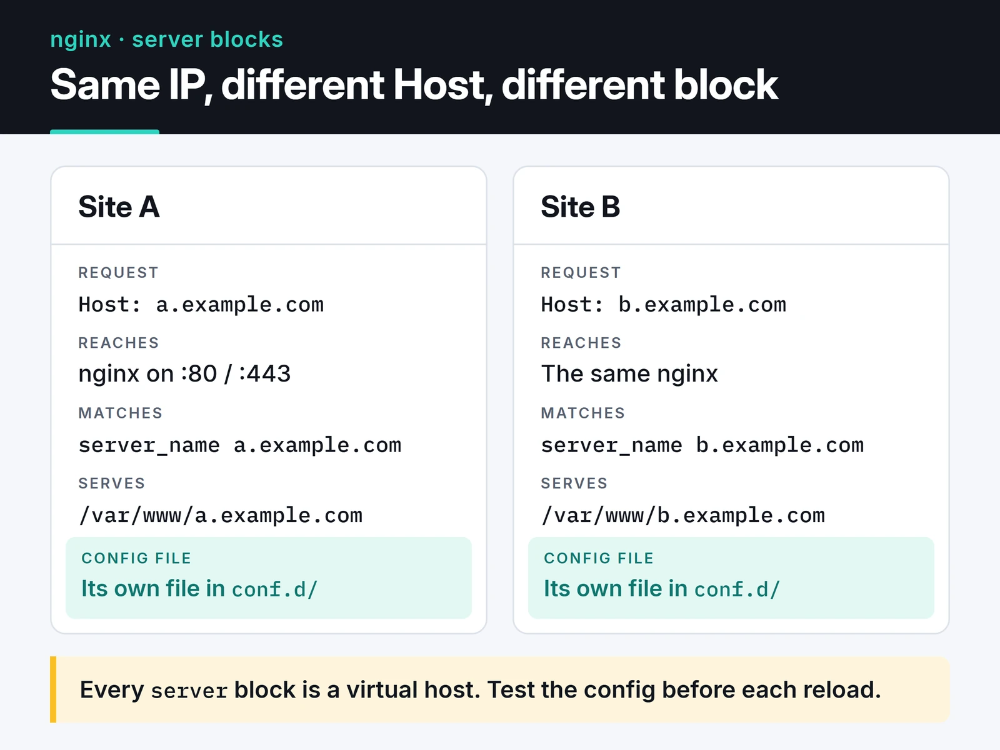

Most nginx installs are `apt install nginx` plus the default config. That's fine at low traffic. Once traffic grows or a backend slows down, the defaults become the bottleneck. This guide covers nginx load balancing, caching, rate limiting and hardening the way I set them up in front of my Python services.

The examples target nginx 1.30 (stable), which changed a few important defaults; I point those out where they matter. If you run mostly containers and want dynamic routing, my [Traefik v3 post](/en/posts/traefik-v3-reverse-proxy-ssl/) covers that side. I reach for nginx when I need static files, fine-grained caching or complex routing rules.

## Layout and server blocks

With the distro package, the main file is `/etc/nginx/nginx.conf`. I keep each site in its own file under `/etc/nginx/conf.d/`. Every `server` block is a virtual host that answers requests matching its `server_name`.

The diagram shows two requests to the same IP landing in different blocks based on their `Host` header.



After every change, test first and then reload:

```bash
sudo nginx -t && sudo systemctl reload nginx
```

`reload` starts new workers without dropping open connections. If you reload with a broken config, nginx keeps running the old one; a `restart` with a broken config leaves you with no nginx at all. Make `nginx -t` a habit.

## Workers

nginx is event-driven and doesn't spawn a thread per connection. A few worker processes each handle thousands of connections.

```nginx {title="/etc/nginx/nginx.conf"}
worker_processes auto;
worker_rlimit_nofile 65535;

events {
    worker_connections 8192;
}
```

`worker_processes auto` starts one worker per CPU core. `worker_connections` is the concurrent connection limit per worker. As a reverse proxy, every client connection opens a second one to the backend, so real capacity is roughly half that. `worker_rlimit_nofile` raises the file descriptor limit for workers; set it too low and you'll see "too many open files" under load. On Linux the best event method (epoll) is picked automatically, so `use epoll;` is unnecessary.

## Static files

Serving a React or Vue `dist` folder, images and CSS through a Python process wastes CPU. nginx does it in the kernel with `sendfile`.

```nginx
server {
    listen 80;
    server_name app.example.com;
    root /var/www/app/dist;

    location /assets/ {
        expires 1y;
        add_header Cache-Control "public, immutable";
    }

    location / {
        try_files $uri $uri/ /index.html;
    }
}
```

Files under `/assets/` have a content hash in their names (`main.3f9a1c.js`), so browsers can keep them for a year; a changed file gets a new name. `index.html` isn't cached and always points at the latest hashed files. The `try_files` line makes single-page app routes like `/profile` fall back to `index.html` instead of returning 404.

## Reverse proxy with the right headers

In a reverse proxy setup, TLS ends at nginx and the backends only see plain HTTP from nginx.

The backend needs the real client IP and scheme, so pass these headers along:

```nginx
location / {
    proxy_pass http://app_backend;
    proxy_set_header Host $host;
    proxy_set_header X-Real-IP $remote_addr;
    proxy_set_header X-Forwarded-For $proxy_add_x_forwarded_for;
    proxy_set_header X-Forwarded-Proto $scheme;
}
```

On the FastAPI/uvicorn side, run uvicorn with `--proxy-headers --forwarded-allow-ips` so it trusts those headers. Otherwise the app thinks every request comes from nginx.

A WebSocket route also needs the `Upgrade` and `Connection` headers:

```nginx
map $http_upgrade $connection_upgrade {
    default upgrade;
    ''      close;
}

server {
    # ...
    location /ws/ {
        proxy_pass http://app_backend;
        proxy_set_header Upgrade $http_upgrade;
        proxy_set_header Connection $connection_upgrade;
        proxy_read_timeout 1h;
    }
}
```

`proxy_read_timeout` defaults to 60 seconds, after which an idle WebSocket is closed. Raise it unless the app sends pings.

## Load balancing

```nginx
upstream app_backend {
    least_conn;
    server 10.0.0.11:8000 max_fails=3 fail_timeout=30s;
    server 10.0.0.12:8000 max_fails=3 fail_timeout=30s;
    server 10.0.0.13:8000 backup;
}
```

The default is round robin. The alternatives:

- `least_conn` sends each request to the server with the fewest active connections. When request times vary a lot (10 ms for some, 5 seconds for others), it balances better than round robin. It's my default for APIs.
- `ip_hash` pins each client IP to one server. It helps apps that keep sessions in memory, but if all your users sit behind one corporate NAT, they all land on one server. Shared session storage like Redis is the better fix.
- `hash $request_uri consistent` pins each URL to one server, which helps when backends have their own caches.

`max_fails=3 fail_timeout=30s` is passive health checking: a server that fails three requests within 30 seconds is taken out for 30 seconds. Open-source nginx has no active health checks (periodic probes to the backend); those are an NGINX Plus feature. A server marked `backup` only gets traffic when all the others are down.

Reusing backend connections (keepalive) removes the cost of a new TCP connection per request. It used to take three lines: `keepalive 32;` in the upstream, plus `proxy_http_version 1.1;` and `proxy_set_header Connection "";` in the location. Since nginx 1.29.7 all three are defaults: upstream keepalive is on, `proxy_http_version` defaults to 1.1, and the `Connection` header is no longer sent. On 1.30 you can drop those lines; on older versions you still need them.

## Micro-caching

If an API endpoint runs the same query on every request and one-second-old data is acceptable, holding the response in nginx for one second takes a lot of load off the backend. That's micro-caching.

```nginx
proxy_cache_path /var/cache/nginx/api levels=1:2 keys_zone=api_cache:10m
                 max_size=1g inactive=10m use_temp_path=off;

server {
    # ...
    location /api/news {
        proxy_pass http://app_backend;
        proxy_cache api_cache;
        proxy_cache_valid 200 1s;
        proxy_cache_lock on;
        proxy_cache_use_stale error timeout updating http_500 http_502 http_503 http_504;
        proxy_cache_background_update on;
        proxy_cache_bypass $http_authorization $cookie_session;
        proxy_no_cache $http_authorization $cookie_session;
        add_header X-Cache-Status $upstream_cache_status always;
    }
}
```

What each line buys you:

- Without `proxy_cache_lock on`, the 500 concurrent requests that arrive the moment the entry expires all go to the backend. With the lock, only the first one does and the rest wait for its result. The claim that "only one request per second reaches the backend" is true only with this line.
- `proxy_cache_use_stale` serves the last good response instead of an error when the backend fails or times out. With `updating`, the stale response is also served while the entry refreshes.
- `proxy_cache_background_update` does that refresh in the background, so no user waits for it.
- `proxy_cache_bypass` and `proxy_no_cache` keep authenticated requests out of the cache. Forget them and one user's personal response can be served to another. By default nginx doesn't cache responses that set cookies and only caches GET and HEAD, but I still spell this out for any endpoint that carries a session cookie or an `Authorization` header.
- `X-Cache-Status` shows `HIT`, `MISS`, `STALE` or `UPDATING`. Checking it with `curl -I` makes tuning much easier.

## Rate limiting

The `limit_req` module limits requests per IP with a leaky bucket. I use it as the first line of defense on brute-force targets like login:

```nginx
http {
    limit_req_zone $binary_remote_addr zone=login:10m rate=5r/s;
    limit_req_status 429;

    server {
        # ...
        location /auth/login {
            limit_req zone=login burst=10 nodelay;
            proxy_pass http://app_backend;
        }
    }
}
```

`rate=5r/s` allows an average of five requests per second per IP. `burst=10` tolerates a spike of up to ten extra requests, `nodelay` serves them without queuing, and anything beyond the burst gets a 429. `$binary_remote_addr` stores the IP in binary, 4 bytes for IPv4 and 16 for IPv6, so a 10 MB zone holds tens of thousands of addresses.

Behind Cloudflare or another proxy, `$remote_addr` is the proxy's IP and all users share one limit. Use `ngx_http_realip_module` to recover the client IP: list the proxy's ranges with `set_real_ip_from` and set `real_ip_header CF-Connecting-IP;`.

## TLS, HTTP/2 and HTTP/3

```nginx
server {
    listen 443 ssl;
    listen 443 quic reuseport;
    http2 on;
    http3 on;
    server_name app.example.com;

    ssl_certificate     /etc/letsencrypt/live/app.example.com/fullchain.pem;
    ssl_certificate_key /etc/letsencrypt/live/app.example.com/privkey.pem;
    ssl_protocols TLSv1.2 TLSv1.3;

    add_header Alt-Svc 'h3=":443"; ma=86400' always;
}

server {
    listen 80;
    server_name app.example.com;
    return 301 https://$host$request_uri;
}
```

The `listen 443 ssl http2;` form you see in older configs has been deprecated since nginx 1.25.1 in favor of a separate `http2 on;`. HTTP/3 needs a `quic` listener and `http3 on;`, and the `Alt-Svc` header tells browsers HTTP/3 is available. Open UDP 443 in the firewall too. `reuseport` can appear on only one `listen` line per address and port.

With Let's Encrypt certificates, skip the OCSP stapling settings. Let's Encrypt [has ended OCSP support](https://letsencrypt.org/2024/12/05/ending-ocsp/), and its certificates no longer include an OCSP URL. To make sure renewals actually happen, I watch certificate expiry from outside with [Uptime Kuma](/en/posts/uptime-kuma-service-monitoring/).

## Security headers and the add_header trap

```nginx
server_tokens off;

add_header Strict-Transport-Security "max-age=31536000; includeSubDomains" always;
add_header X-Content-Type-Options "nosniff" always;
add_header X-Frame-Options "SAMEORIGIN" always;
add_header Referrer-Policy "strict-origin-when-cross-origin" always;
add_header Content-Security-Policy "default-src 'self'" always;
```

Some notes:

- `server_tokens off` removes the nginx version from headers and error pages.
- I don't add the `X-XSS-Protection "1; mode=block"` line from older guides. Modern browsers removed that filter, and in older ones it could create security problems of its own. Real XSS protection comes from Content-Security-Policy. The CSP above is a strict starting point that you will need to widen for the resources your app loads.
- Think twice before adding `preload` to HSTS. Once the domain is in the browsers' preload list, any subdomain without HTTPS is unusable for months.
- Without `always`, headers aren't added to 4xx and 5xx responses.

The trap I hit most is inheritance. If a `location` block has even one `add_header`, it loses every `add_header` from the levels above. In the micro-caching example, the `X-Cache-Status` line silently drops the server-level security headers for that location. The old fix was repeating the headers in every block. The `add_header_inherit merge;` directive, added in nginx 1.29.3, makes a child block's headers add to the inherited ones instead. On 1.30 I set it once at the `http` level.

## Compression

```nginx
gzip on;
gzip_comp_level 5;
gzip_min_length 1024;
gzip_types text/css application/javascript application/json image/svg+xml text/plain;
```

`text/html` is always compressed, so it doesn't go in the list. Level 5 is a good balance; level 9 burns much more CPU for very little extra. Brotli compresses better but isn't in the nginx core: you need the third-party `ngx_brotli` module, built yourself or from your distro's package. For static assets, the cheapest option is generating `.gz` files at build time and serving them with `gzip_static on;`.

## Timeouts and body size

```nginx
client_max_body_size 10m;
client_body_timeout 15s;
client_header_timeout 15s;
keepalive_timeout 30s;
send_timeout 15s;
```

`client_max_body_size` defaults to 1 MB, so this is where "413 Request Entity Too Large" gets fixed for uploads. Short `client_*_timeout` values reduce the impact of Slowloris-style attacks, which open connections and trickle data to tie up workers. I don't shrink `large_client_header_buffers`, though. Some guides suggest `2 1k`, which rejects legitimate requests carrying long cookies or JWTs with "400 Request Header Too Large". The default `4 8k` is right for most apps.

## JSON access logs

Plain-text access logs are a pain to parse. In JSON, Loki, Elasticsearch or any log tool can read them directly:

```nginx
log_format json_combined escape=json
  '{'
    '"time":"$time_iso8601",'
    '"remote_addr":"$remote_addr",'
    '"method":"$request_method",'
    '"uri":"$request_uri",'
    '"status":$status,'
    '"bytes":$body_bytes_sent,'
    '"request_time":$request_time,'
    '"upstream_time":"$upstream_response_time",'
    '"cache":"$upstream_cache_status",'
    '"user_agent":"$http_user_agent"'
  '}';

access_log /var/log/nginx/access.json json_combined;
```

`$request_time` is the total time the request spent in nginx; `$upstream_response_time` is the backend's share. A big gap points at the network or a slow client, a small one at the backend. I quote `$upstream_response_time` because it's `-` for cache hits and holds comma-separated values when more than one backend was tried.

## Common errors

- 502 Bad Gateway: nginx couldn't connect to the backend. Is it running, on the port you think? With a Unix socket, can the nginx user access the socket file?
- 504 Gateway Timeout: the connection worked but no response arrived within `proxy_read_timeout`. Raising it helps, but the real problem is usually a slow query.
- 413 Request Entity Too Large: `client_max_body_size` is too small.
- A change seems to have no effect: `nginx -T` dumps the running config with all includes, which shows which `server` block a request actually lands in.

## Checklist

- Is every reload preceded by `nginx -t`?
- Are worker and file descriptor limits raised?
- Are static files served by nginx with long-lived caching?
- Do `X-Forwarded-*` headers reach the backend, and does the app trust them?
- Is `proxy_cache_lock` on, with authenticated requests kept out of the cache?
- Do login-style endpoints have `limit_req`, and is the real client IP recovered behind a proxy?
- Are you using `http2 on;` and current TLS protocols?
- Are security headers surviving in nested blocks (`add_header_inherit merge`)?
- Are logs in JSON with `request_time`?

## What's next

Dump your own config with `nginx -T` and walk through this list; the quickest wins are usually the `add_header` inheritance and a missing `proxy_cache_lock`. For application-level caching, see my [Redis caching post](/en/posts/redis-caching-session-management/). Defaults, and the version each directive arrived in, are in the [nginx documentation](https://nginx.org/en/docs/). If the backends behind nginx run on Kubernetes, my [Kubernetes post](/en/posts/kubernetes-container-orchestration/) covers the cluster side.
