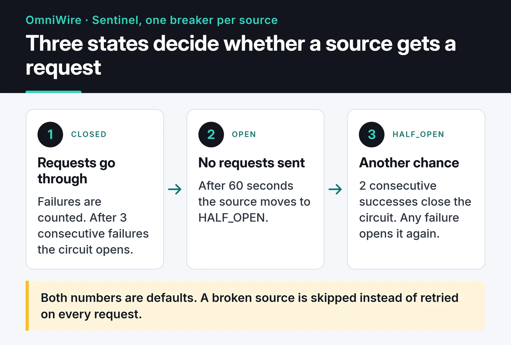

OmniWire-MCP is an MCP server that gives AI assistants news and content feeds as tools. It fetches RSS, Atom, JSON and HTML sources, normalizes them into one format, and lets an assistant like Claude answer "what happened in tech today?" with current data. It's written in TypeScript and published on npm as `@furkankoykiran/omniwire-mcp`.

This post covers three parts: the per-source circuit breaker that keeps one broken feed from slowing down the rest, the parser that tells formats apart, and the string of failures I hit publishing to npm. I also point out three gaps I found when I reread the code, each in its section.

Project page: [OmniWire-MCP](https://furkankoykiran.com.tr/en/projects/omniwire-mcp/) · Source: [GitHub](https://github.com/furkankoykiran/OmniWire-MCP)

## What the server exposes

It runs over stdio and registers four tools:

- `fetch-news` pulls items from enabled sources, optionally filtered by keyword or a single source, with a result limit.
- `check-health` reports each source's circuit state and failure counts.
- `refresh-config` reloads the source list from remote config.
- `reset-source` manually resets one source's circuit breaker.

`fetch-news` fetches all healthy sources in parallel with `Promise.allSettled`, merges the results, sorts them by date and returns the requested number. One failing source can't spoil the response; with `Promise.all`, a single rejection would throw away everything.

Sources come from the `RSS_FEEDS` environment variable. It can be a URL to a JSON file, in which case the server re-reads it every 60 seconds by default and you can add feeds without a restart. It can also be the JSON itself. If it's unset, the server starts with Hacker News, Wired and The Verge.

## A circuit breaker per source

News sources break all the time. One site drops its RSS feed, another returns 503 for a few minutes, a third hangs without answering. Retrying them on every request is slow and pointless.

So each source gets its own circuit breaker. In the codebase this layer is called Sentinel, and it's the standard three-state pattern shown in the diagram:



In CLOSED, requests go through and failures are counted. When the count hits the threshold (3 by default), the circuit opens and no requests are sent to that source. After the recovery timeout (60 seconds by default) it moves to HALF_OPEN and the source gets another chance: two successes close the circuit, a single failure opens it again.

The method that decides:

```ts
public canExecute(): boolean {
  const currentState = this.getState();

  if (currentState === CircuitState.CLOSED) return true;
  if (currentState === CircuitState.HALF_OPEN) return true;

  if (this.shouldAttemptRecovery()) {
    this.transitionTo(CircuitState.HALF_OPEN);
    return true;
  }
  return false;
}
```

`fetch-news` filters out open circuits with `canRequest()` before sending anything. If 5 of 20 sources are down, the assistant gets the other 15 without waiting on timeouts. Each request also has a 10-second timeout, so a source that never answers counts as a failure instead of hanging forever.

There's a gap here. The comment says "allow one test request" in HALF_OPEN, but the code returns `true` for every request in that state. If several `fetch-news` calls arrive at once, they all hit the half-open source. On a single-user stdio server that rarely matters, but the correct behavior is to track the in-flight probe with a flag and reject the others until it resolves.

## Detecting the content type

Sources come in every shape: RSS 2.0, Atom, JSON APIs, and HTML for sites without a feed. Each source config has a `type` field that defaults to `auto`, and in that case the parser guesses:

```ts
public detectContentType(content: string, contentTypeHeader?: string): ContentType {
  if (contentTypeHeader) {
    const lower = contentTypeHeader.toLowerCase();
    if (lower.includes('rss') || lower.includes('atom')) return ContentType.RSS;
    if (lower.includes('json')) return ContentType.JSON;
    if (lower.includes('html')) return ContentType.HTML;
    if (lower.includes('xml')) {
      return content.includes('<feed') ? ContentType.ATOM : ContentType.RSS;
    }
  }

  const trimmed = content.trim();
  if (trimmed.startsWith('<?xml') || trimmed.startsWith('<rss') || trimmed.startsWith('<feed')) {
    return trimmed.includes('<feed') ? ContentType.ATOM : ContentType.RSS;
  }
  if (trimmed.startsWith('[') || trimmed.startsWith('{')) return ContentType.JSON;
  if (trimmed.toLowerCase().startsWith('<!doctype') || trimmed.toLowerCase().startsWith('<html')) {
    return ContentType.HTML;
  }

  return ContentType.UNKNOWN;
}
```

This code misclassifies servers that send XML as `text/html`. The header is checked first, and any header containing `html` is classified as HTML without looking at the body. Sniffing only kicks in when the header is missing or unrecognized, like `application/octet-stream` or `text/plain`.

The fix is to reverse the order: look at the first bytes of the body first and fall back to the header only when the body is ambiguous. The first bytes of a body reliably show its format, while headers are sometimes wrong. Until then, setting `type: "rss"` in the source config works around it.

## One Zod schema for every item

All adapters produce the same shape:

```ts
export const NewsItemSchema = z.object({
  id: z.string(),
  title: z.string(),
  link: z.string().url(),
  description: z.string().optional(),
  content: z.string().optional(),
  author: z.string().optional(),
  publishedAt: z.date().optional(),
  categories: z.array(z.string()).default([]),
});

export type NewsItem = z.infer<typeof NewsItemSchema>;
```

With `z.infer` I don't write the TypeScript type separately, so the schema and the type can't drift apart.

The schema doesn't catch malformed items at runtime, though. The adapters only use it for the type and never call `parse` on what they produce, so an item with an invalid link still reaches the assistant. The fix is to run adapter output through the schema and drop what fails:

```ts
const items = candidates.flatMap((candidate) => {
  const parsed = NewsItemSchema.safeParse(candidate);
  if (!parsed.success) {
    logger.warn(`Dropped invalid item from ${source.id}: ${parsed.error.message}`);
    return [];
  }
  return [parsed.data];
});
```

Source configuration, on the other hand, really is validated with Zod. Malformed JSON in `RSS_FEEDS` doesn't crash the server; it logs the error and falls back to the default sources.

## Repository hygiene

It's a small project, but I set the repo up so other people could contribute. `main` is protected by an active ruleset, and changes go in through PRs. There's a `CONTRIBUTING.md`, `CODE_OF_CONDUCT.md`, `SECURITY.md`, and issue and PR templates. CI runs tests and lint, CodeQL scans for security issues, and `stale.yml` labels issues and PRs after 30 days of inactivity and closes them 5 days later.

Adding all of that on day one can feel like overkill. It's also the stuff nobody gets around to adding later, and the first thing a newcomer looks for.

## Publishing to npm: four failed runs

The goal was simple: create a release on GitHub, and a workflow runs the tests, builds, and publishes to npm. In practice I had one failed run before the first successful publish, and three more when I added GitHub Packages. The workflow history shows all of it:


A missing `environment: production` line wasn't the problem; this workflow never had one. Here's what actually happened.

### v1.0.2 failed, v1.0.3 worked

`package.json` had `"provenance": true`. npm provenance records which workflow built the package, signed, and to do that it needs an OIDC token from GitHub Actions. The workflow didn't grant that permission. On top of that, `files` only shipped `dist`, but nothing ran the build before publishing, so the package would have gone out empty. The fix:

```yaml
permissions:
  contents: read
  id-token: write

# in the publish-npm job
      - run: npm ci
      - run: npm run build
      - run: npm publish   # provenance still came from package.json here
        env:
          NODE_AUTH_TOKEN: ${{ secrets.npm_token }}
```

### v1.0.4 and v1.0.5: npm passed, GitHub Packages failed

In March I added a second job to also publish to GitHub Packages. Because `"provenance": true` lived in `publishConfig`, it applied to both registries, and provenance is only supported on npmjs.com. In v1.0.6 I removed it from `package.json` and passed `--provenance` only in the npm job, and both publishes went through.

Everything in `publishConfig` applies to every registry the package is published to. Keep registry-specific behavior in command-line flags.

### What I'd do today

Starting fresh today, I'd drop the token entirely. npm [trusted publishing](https://docs.npmjs.com/trusted-publishers) uses the GitHub Actions OIDC token directly and adds provenance automatically. You link the package to the repo and workflow file on npmjs.com, grant `id-token: write`, and use npm CLI 11.5.1 or later. The npm 10 that ships with Node 20 doesn't support it, so either move to Node 24 or run `npm install -g npm@latest` in the job. Then there's no `NPM_TOKEN` in the repo to expire or leak.

## Installing it

Node.js 18 or later is enough. For Claude Desktop, add this to `claude_desktop_config.json`:

```json
{
  "mcpServers": {
    "omniwire": {
      "command": "npx",
      "args": ["-y", "@furkankoykiran/omniwire-mcp"],
      "env": {
        "RSS_FEEDS": "https://example.com/my-feeds.json"
      }
    }
  }
}
```

Note the scoped package name. An unscoped `npx omniwire-mcp` doesn't work, because no package by that name exists. Leave out `RSS_FEEDS` to start with the three default sources.

There's no published Docker image; build it from the repo's Dockerfile:

```bash
git clone https://github.com/furkankoykiran/OmniWire-MCP.git
cd OmniWire-MCP
docker build -t omniwire-mcp .
docker run -i --rm -e RSS_FEEDS="https://example.com/my-feeds.json" omniwire-mcp
```

Keep `-i`: the server talks over stdio and exits when stdin closes.

## Next steps

First the three fixes above: a single probe in HALF_OPEN, sniffing the body before trusting the header, and validating items against the Zod schema. After that I want to move tool definitions from `server.tool()` to `registerTool()`, since the MCP TypeScript SDK is deprecating the old API, and change the Dockerfile's `npm ci --only=production` to `npm ci --omit=dev`. Longer term, writing items into a vector store would allow semantic questions like "what came out about X last month?"

Other servers in this series: [DevTo-MCP](/en/posts/devto-mcp-server/) for the DEV Community API, and [freqtrade-mcp](/en/posts/freqtrade-mcp-server/) for asking a trading bot questions through Claude. I also wrote about running CI on my own machine in [the self-hosted runner post](/en/posts/github-actions-self-hosted-runner/).
