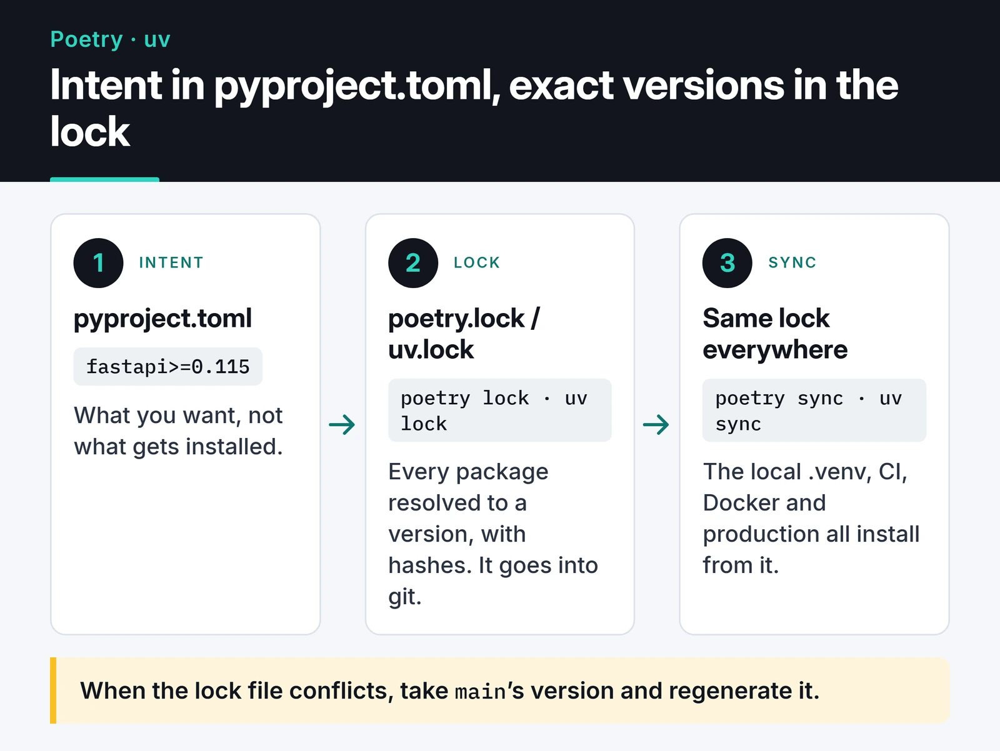

For a long time, Poetry was the standard answer for Python project management if you wanted out of the `requirements.txt` mess. Then uv, built by Astral, spread fast, and a large share of new projects now start with it. My own repos show the same shift: most of my older Telegram bots are managed with Poetry, my recent projects with uv. This post compares the two on lock files, Docker, CI and publishing. Both are good tools, and which one fits depends on the kind of project and on your team's habits.

## Why requirements.txt isn't enough

`pip freeze > requirements.txt` dumps whatever is in the current environment. It doesn't tell you why a package is there: did you add `urllib3`, or did `requests` pull it in? When you want to remove something, you can't tell what will break. A hand-written `requirements.txt` has the opposite problem: it pins only direct dependencies, so transitive ones can change on every install. That's where most "works on my machine" bugs come from.

Every modern tool makes the split shown below:



`pyproject.toml` holds your intent; the lock file holds how that intent resolved at a point in time. The lock file goes into git. Adding it to `.gitignore` because "it keeps conflicting" throws away the whole point; when it conflicts, take `main`'s version and regenerate it.

## The same project with both tools

Since Poetry 2.0, Poetry reads the standard `[project]` table (PEP 621) too, so the two tools' `pyproject.toml` files now look very similar. Starting a FastAPI service with uv:

```bash
uv init --app notification-service
cd notification-service
uv add fastapi "uvicorn[standard]" httpx
uv add --dev pytest ruff
uv run pytest
```

The resulting file:

```toml
[project]
name = "notification-service"
version = "0.1.0"
requires-python = ">=3.12"
dependencies = [
    "fastapi>=0.115",
    "httpx>=0.28",
    "uvicorn[standard]>=0.34",
]

[dependency-groups]
dev = [
    "pytest>=8.3",
    "ruff>=0.12",
]
```

(The lower bounds come from whatever versions were current when you ran `uv add`, so yours will differ.)

The same thing with Poetry:

```bash
mkdir notification-service && cd notification-service
poetry init --no-interaction
poetry add fastapi "uvicorn[standard]" httpx
poetry add --group dev pytest ruff
poetry run pytest
```

Poetry 2.x writes dependencies under `[project]` as well. For the dev group it supports both its own `[tool.poetry.group.dev.dependencies]` table and the PEP 735 `[dependency-groups]` format, which makes moving between the tools much easier than it used to be. For an application you won't publish, add `package-mode = false` under `[tool.poetry]`; otherwise Poetry tries to install the project itself as a package.

Poetry 2.0 also changed some old habits. These commands no longer work the way they used to:

- `poetry shell` left the core in Poetry 2.0. Use `eval $(poetry env activate)` instead, or prefix commands with `poetry run`.
- `poetry install --sync` became a separate `poetry sync` command. It removes packages that aren't in the lock file.
- `poetry export` no longer ships by default; add it with `poetry self add poetry-plugin-export`.

## Does the speed difference matter?

uv is written in Rust and uses a global cache with hard links. To see the difference, I installed the FastAPI project above (29 packages) with both tools: uv 0.11.8 and Poetry 2.3.0 on Windows 11, warm caches, `.venv` deleted before every run. Over three runs, `uv sync` took 3.5 to 5.5 seconds and `poetry sync` 13 to 34 seconds.

Your numbers will depend on the machine, disk and network. Measure with `time poetry sync` and `time uv sync` on your own project.

For local development the gap rarely matters. It adds up when every CI job builds an environment from scratch, or when you rebuild Docker images often.

## Side by side

| | Poetry 2.x | uv |
|---|---|---|
| Speed | Fine; resolution can get slow on big projects | Very fast |
| Installing Python itself | Experimental `poetry python` commands; most people pair it with pyenv | Built in: `uv python install 3.13` |
| Standards | `[project]` and PEP 735 groups supported | `[project]`, PEP 735, PEP 723 script metadata, `pylock.toml` export |
| Plugins | Mature plugin system (export, dynamic versioning, etc.) | No plugin system; most features are built in |
| Monorepos | No direct support | Workspaces |
| One-off tools | Via pipx | `uvx ruff check .` |
| Publishing | `poetry build`, `poetry publish` | `uv build`, `uv publish` (supports trusted publishing) |
| Governance | Community project with a long history | Developed by a company (Astral), releases very often |

The last row matters. uv moving fast means behavior can change between releases, so pin the uv version in CI. Poetry changes more slowly and is more predictable.

## Version constraints: `^`, `~` and `~=`

Inside `[project]`, only standard PEP 440 syntax is valid: `>=1.2`, `>=1.2,<2`, `~=1.2.3`. Poetry's `^` and `~` operators only work under `[tool.poetry.dependencies]`.

- `^1.2.3` (Poetry): `>=1.2.3,<2.0.0`
- `~1.2.3` (Poetry): `>=1.2.3,<1.3.0`
- `~=1.2.3` (PEP 440): `>=1.2.3,==1.2.*`, so also `<1.3.0`

My rule: in applications I set lower bounds and let the lock file do the rest. In libraries I avoid upper caps, because they cause needless conflicts in the projects that depend on yours. A package pinned with `==` is a temporary workaround; leave a comment saying why.

## Using them in Docker

The package manager itself shouldn't end up in the production image. With a multi-stage build I install the virtual environment in the first stage and copy only that. With uv:

```dockerfile
FROM python:3.13-slim AS builder
COPY --from=ghcr.io/astral-sh/uv:0.13.5 /uv /uvx /bin/
ENV UV_COMPILE_BYTECODE=1 UV_LINK_MODE=copy UV_PYTHON_DOWNLOADS=0
WORKDIR /app
COPY pyproject.toml uv.lock ./
RUN --mount=type=cache,target=/root/.cache/uv \
    uv sync --locked --no-dev --no-install-project
COPY . .

FROM python:3.13-slim
WORKDIR /app
COPY --from=builder /app /app
ENV PATH="/app/.venv/bin:$PATH"
# main.py defines: app = FastAPI()
CMD ["uvicorn", "main:app", "--host", "0.0.0.0", "--port", "8000"]
```

The same structure with Poetry:

```dockerfile
FROM python:3.13-slim AS builder
ENV POETRY_VIRTUALENVS_IN_PROJECT=1 POETRY_NO_INTERACTION=1
RUN pip install --no-cache-dir "poetry>=2.2,<3"
WORKDIR /app
COPY pyproject.toml poetry.lock ./
RUN poetry sync --only main --no-root
COPY . .

FROM python:3.13-slim
WORKDIR /app
COPY --from=builder /app /app
ENV PATH="/app/.venv/bin:$PATH"
# main.py defines: app = FastAPI()
CMD ["uvicorn", "main:app", "--host", "0.0.0.0", "--port", "8000"]
```

Both copy the dependency files before the source code, so changing your code reuses the cached dependency layer. Both stages must use the same base image, because paths inside `.venv` point at the interpreter's location.

## Guarding the lock file in CI

If someone edits `pyproject.toml` and forgets to update the lock, CI should fail. In uv, `--locked` does exactly that:

```yaml
# .github/workflows/test.yml
name: test
on: [push, pull_request]
jobs:
  test:
    runs-on: ubuntu-latest
    steps:
      - uses: actions/checkout@v7
      - uses: astral-sh/setup-uv@v10
        with:
          enable-cache: true
      - run: uv sync --locked
      - run: uv run pytest
```

The Poetry equivalent is `poetry check --lock` followed by `poetry sync`. For lock file conflicts and branching in general, see my [Git branching strategies post](/en/posts/git-workflow-branching-strategies/). Once the environment is reproducible, measuring where the time goes is the next step; my [Python profiling post](/en/posts/python-performance-profiling-optimization/) covers that.

## Publishing a library

Poetry's flow is well established:

```bash
poetry version patch     # 0.1.0 -> 0.1.1
poetry build             # wheel and sdist into dist/
poetry publish           # first: poetry config pypi-token.pypi <token>
```

The uv equivalent:

```bash
uv version --bump patch
uv build
uv publish               # no token needed with trusted publishing in GitHub Actions
```

If you publish to PyPI from GitHub Actions, use trusted publishing. It's safer than keeping a long-lived API token in a secret.

## Moving from Poetry to uv

If you want to try the switch, [migrate-to-uv](https://github.com/mkniewallner/migrate-to-uv) converts the `[tool.poetry]` section into standard tables:

```bash
uvx migrate-to-uv
uv lock
uv sync
```

Run your tests afterwards and compare the locked versions with the old ones. The resolvers differ, so some transitive dependencies may resolve to different versions.

## Which one to pick when

- Starting a new application or script: uv. It also manages Python versions, so one tool covers everything.
- A project that works fine on Poetry and relies on its plugins (dynamic versioning, export, private sources): don't migrate just because uv is popular. Poetry 2.x moved closer to the standards, so switching later is easy.
- Nobody on the team knows uv and CI time isn't a problem: staying with the tool you know is a reasonable call.

Whichever you choose, the parts that matter stay the same: the lock file is in git, CI respects the lock, and the production image doesn't contain the package manager. The [uv docs](https://docs.astral.sh/uv/) and [Poetry docs](https://python-poetry.org/docs/) cover the rest well. For container details, see my [Docker for Python apps post](/en/posts/docker-python-app-containerization/).
