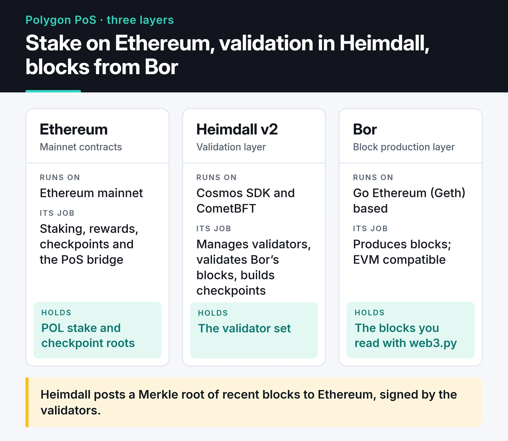
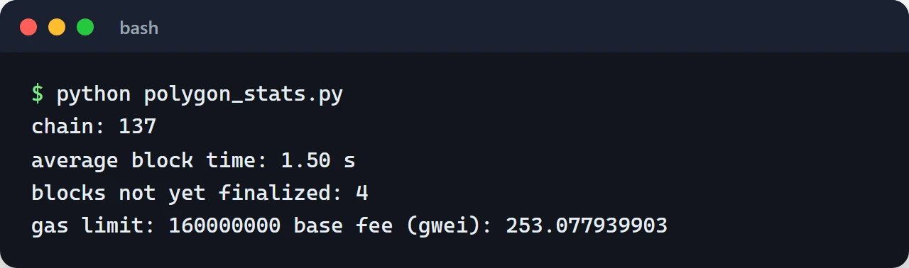

For a long time Polygon PoS was the first stop for projects that wanted something cheaper and faster than Ethereum mainnet. When I was doing Web3 work, I tried my contracts and bots on Polygon first. This post explains the Polygon PoS architecture, where it sits among Ethereum's Layer 2 scaling options, and what I watch for when building on it.

The ecosystem has moved quickly: POL replaced MATIC, Heimdall was rewritten, block production changed, and Polygon zkEVM Mainnet Beta shut down. Everything below describes the state after those changes.

## The big picture: what counts as Layer 2

Ethereum mainnet re-executes every transaction on thousands of nodes, which makes it expensive and slow. Scaling solutions execute transactions elsewhere and tie the result back to Ethereum somehow. The difference is how strong that tie is.

| Type | Examples | Where security comes from | Withdrawing to Ethereum |
| :--- | :--- | :--- | :--- |
| Optimistic rollup | Arbitrum One, OP Mainnet, Base | Transaction data on Ethereum; invalid state can be challenged with fraud proofs | Usually a 7-day challenge window |
| ZK rollup | zkSync Era, Starknet, Scroll, Linea | Transaction data on Ethereum; each batch verified with a validity proof | Once the proof is verified, on the order of hours |
| PoS chain + checkpoints | Polygon PoS | Its own validator set; periodic checkpoints to Ethereum | Wait for a checkpoint, usually an hour or more |

Polygon PoS is technically not a rollup. It doesn't post transaction data to Ethereum, and its validity isn't proven there. Its security rests mostly on the honesty of its own validators, and sources like L2BEAT don't classify it as a rollup. That isn't necessarily bad; it's a different trust model, and you should pick based on your application's risk profile.

The biggest change in rollup costs came with EIP-4844 "blobs" in the Dencun upgrade (March 2024). Rollups started posting data to this cheap, temporary space instead of calldata, and L2 fees dropped sharply. Older approaches such as state channels and Plasma are rarely used for general-purpose scaling today.

When I compare rollups, I look at L2BEAT's stages (Stage 0, 1, 2). They summarize how mature the proof system is and how much control a security council has over user funds.

## The three layers of Polygon PoS

Polygon PoS has three layers: contracts on Ethereum, Heimdall where the validators run, and Bor, which produces blocks. The card compares them.



### The Ethereum layer

Polygon is anchored in contracts on Ethereum mainnet. Validators stake POL there, rewards are paid there, checkpoints are stored there, and the PoS bridge's locking contracts live there.

### Heimdall v2: the validation layer

Heimdall manages the validator set and validates the blocks Bor produces. It was rewritten as Heimdall v2 and now runs on Cosmos SDK and CometBFT. For developers, the most visible result of v2 was finality dropping from roughly 1 to 2 minutes to around 5 seconds.

Heimdall also builds checkpoints: it puts the hashes of all blocks since the previous checkpoint into a Merkle tree and submits the root to Ethereum, signed by the validators. Those checkpoints are what you prove against when withdrawing from the PoS bridge to Ethereum.

### Bor: the block production layer

Bor is the Go Ethereum (Geth) based execution layer. It's EVM compatible, so contracts written for Ethereum run unchanged. The Rio upgrade changed how blocks are produced: for each span, Heimdall picks a single producer from a small pool elected by validators' stake-weighted votes.

When I ran the script in the next section, the average block time came out at 1.5 seconds and the `finalized` block was only a few blocks behind the head. Capacity keeps going up in steps: the Bhilai upgrade raised the block gas limit from 30 million to 45 million, and my measurement showed 160 million. These numbers keep changing, so read current values from the chain for your own application.

## Measuring finality yourself

One detail when connecting to Polygon from Python: Polygon block headers have an `extraData` field longer than 32 bytes, which web3.py rejects by default. Without `ExtraDataToPOAMiddleware` you get `ExtraDataLengthError`.

```python {title="polygon_stats.py"}
from web3 import Web3
from web3.middleware import ExtraDataToPOAMiddleware

w3 = Web3(Web3.HTTPProvider("https://polygon-bor-rpc.publicnode.com"))
w3.middleware_onion.inject(ExtraDataToPOAMiddleware, layer=0)

latest = w3.eth.get_block("latest")
finalized = w3.eth.get_block("finalized")
prev = w3.eth.get_block(latest["number"] - 100)

block_time = (latest["timestamp"] - prev["timestamp"]) / 100
print("chain:", w3.eth.chain_id)
print(f"average block time: {block_time:.2f} s")
print("blocks not yet finalized:", latest["number"] - finalized["number"])
print("gas limit:", latest["gasLimit"], "base fee (gwei):", w3.from_wei(latest["baseFeePerGas"], "gwei"))
```

A sample run with web3.py 7.16:



This answers a practical question for any app: when should a payment or deposit count as final? Polygon used to have reorgs, so exchanges and services waited hundreds of confirmations. Today the `finalized` tag is both faster and more correct. Withdrawals to Ethereum still have to wait for the checkpoint on the Ethereum side.

## The PoS bridge and state sync

When you move assets from Ethereum to Polygon (a deposit), the tokens are locked in the bridge contract on Ethereum. Heimdall validators see the event and relay it to Bor through state sync, and the matching token is minted on Polygon. That direction takes minutes.

In the other direction (a withdrawal), the token is burned on Polygon, you wait until the block with the burn is included in a checkpoint, and then you unlock on Ethereum by presenting a Merkle proof against that checkpoint. The wait depends on the checkpoint interval.

Bridges have been behind some of the most expensive exploits in crypto. In Ronin, attackers held a majority of the validator keys; other bridges lost funds to signature verification bugs. Read those post-mortems before you consider writing your own "lock and mint" bridge. Outside of a learning exercise, I don't recommend writing a bridge from scratch; the chain's official bridge or an established messaging protocol is the safer choice.

## POL, zkEVM and AggLayer

Three big changes in the Polygon ecosystem since 2024:

- The MATIC to POL migration started in September 2024. POL is now both the gas and the staking token on Polygon PoS, so update any code or UI that still says "MATIC". Chain IDs didn't change: mainnet is 137 and the Amoy testnet is 80002. The Mumbai testnet was shut down in 2024.
- Polygon zkEVM Mainnet Beta is gone. After Polygon announced the decision, the sequencer was stopped, and wallet balances were snapshotted and moved to Ethereum, where users can claim them. For a new project, "PoS or zkEVM?" is no longer a real question.
- AggLayer is an interoperability layer that aims to connect different chains through a shared bridge and proof layer. Chains built with Polygon's CDK plug into it. I haven't used it in production, so I won't go into detail.

## What I watch for when building on Polygon

The contracts are the same as on Ethereum, but a few practical things differ:

- Test on Amoy with test POL from a faucet. Deploying with Foundry works the same as on Ethereum; only the RPC URL and `--chain` change.
- Cheap gas is no excuse for wasteful code. The base fee can spike under load, and a function whose loop grows without bound hits the block gas limit on any chain. The rules in my [Solidity security and gas post](/en/posts/solidity-security-gas-optimization/) apply here too.
- Public RPCs are fine for experiments. A live app needs a paid provider or its own Bor node because of rate limits.
- Don't query event history straight from RPC over wide ranges. Blocks come fast, so the same time window holds far more blocks than on Ethereum. Read in chunks or use an indexer.

## Where to go next

The details of connecting to Polygon from Python are in the [web3.py v7 guide](/en/posts/web3py-ethereum-interaction/), and an example contract for launching an NFT collection on a cheaper chain is in the [ERC721A post](/en/posts/nft-minting-ethereum-guide/). For on-chain data work on top of all this, see [blockchain data analysis in Python](/en/posts/blockchain-data-analysis-python-tools/). For current technical values, [Polygon's official documentation](https://docs.polygon.technology/) is the best source.
