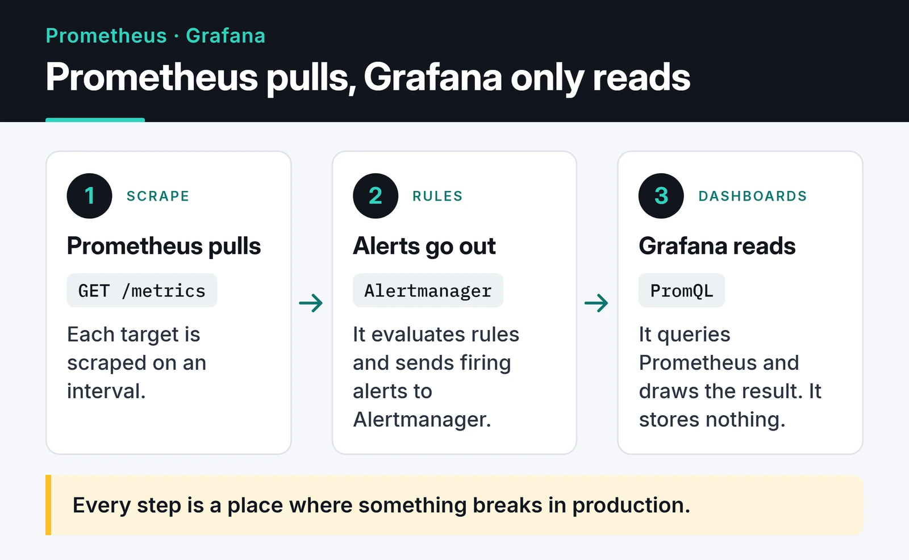

Getting Prometheus and Grafana monitoring running takes a Helm chart and ten minutes. The hard part comes later: deciding which metrics to collect, which labels you must never add, and who gets paged at 3 a.m. I'm skipping the install steps here. These are the rules, PromQL patterns and failure modes I keep coming back to when I monitor my own services.

## How the pieces fit together

Prometheus pulls. It scrapes each target's `/metrics` endpoint on an interval, evaluates rules, and sends firing alerts to Alertmanager. Grafana is only the visualization layer: it reads from Prometheus by running PromQL queries.



Every step above is a place where something breaks in production. The rest of this post roughly follows it.

## Trap number one: cardinality explosions

In Prometheus, every unique label combination is its own time series. `http_requests_total{method="GET", route="/users/:id", status="200"}` is one series. Put an unbounded value into a label (a user ID, the raw URL path, an email, a User-Agent string) and your series count grows with your user base. Prometheus keeps active series in memory, so eventually it gets OOM-killed. Adding RAM only buys time.

The rule: label values must come from a bounded set. Use the route template, never the raw path. In FastAPI the template is already sitting in the request scope:

```python
import time

from fastapi import FastAPI, Request
from prometheus_client import Counter, Histogram, make_asgi_app

REQUESTS = Counter(
    "http_requests_total", "HTTP requests", ["method", "route", "status"]
)
LATENCY = Histogram(
    "http_request_duration_seconds",
    "Request duration",
    ["method", "route"],
    buckets=(0.01, 0.025, 0.05, 0.1, 0.25, 0.5, 1, 2.5, 5),
)

app = FastAPI()
app.mount("/metrics", make_asgi_app())


@app.middleware("http")
async def prometheus_middleware(request: Request, call_next):
    start = time.perf_counter()
    response = await call_next(request)
    route = request.scope.get("route")
    path = route.path if route else "unmatched"  # /users/{user_id}, not 42
    REQUESTS.labels(request.method, path, str(response.status_code)).inc()
    LATENCY.labels(request.method, path).observe(time.perf_counter() - start)
    return response
```

The `unmatched` bucket matters too. Without it, a bot scanning for 404s creates a new series for every URL it tries.

When a Prometheus server is already bloated, the fastest way to find the culprit is **Status → TSDB Status** in the UI. The capture below comes from the Prometheus project's public demo server. Histogram `_bucket` series top the list, because every bucket boundary (`le`) is a series of its own.


You can get the same answer with a query:

```promql
topk(10, count by (__name__) ({__name__=~".+"}))
```

That query is expensive. Don't run it on a large server at peak time.

## What to watch: the four golden signals

The [four golden signals from the Google SRE book](https://sre.google/sre-book/monitoring-distributed-systems/) are a good default for every service. Get these right before you collect a hundred random metrics.

Traffic, the load on the system:

```promql
sum by (route) (rate(http_requests_total[5m]))
```

Error ratio. A 4xx is usually the client's fault, so alert on 5xx:

```promql
sum(rate(http_requests_total{status=~"5.."}[5m]))
  /
sum(rate(http_requests_total[5m]))
```

Latency. Averages hide your slowest requests. Look at P95 and P99; P99 is what your unhappiest 1% of users experience:

```promql
histogram_quantile(
  0.99,
  sum by (le, route) (rate(http_request_duration_seconds_bucket[5m]))
)
```

Saturation, how full your resources are. CPU is only part of it: connection pools, thread pools, disk I/O and queue depth belong here too, and that's where the sneakiest problems hide.

```promql
1 - avg by (instance) (rate(node_cpu_seconds_total{mode="idle"}[5m]))
```

## rate vs irate vs increase

All three work on counters and handle counter resets when a process restarts.

- `rate()` gives the per-second average increase over the window. Use it by default for dashboards and alerts.
- `irate()` only looks at the last two samples. It shows short spikes, but the graph turns into a saw blade. Keep it out of alerts.
- `increase()` is the total increase over the window. It answers "how many errors did we get in the last hour?"

Make the window at least four times the scrape interval. With a 30-second scrape interval, a `[1m]` window sometimes contains a single sample and `rate()` returns nothing.

If the same heavy expression runs in ten dashboard panels and three alerts, write a recording rule. Prometheus precomputes it and stores the result as a new series:

```yaml
groups:
  - name: api-recording
    rules:
      - record: route:http_requests:rate5m
        expr: sum by (route) (rate(http_requests_total[5m]))
```

## Alerting without burning out on-call

The most common mistake is alerting on everything: CPU at 80%, RAM at 70%, disk at 85%. After a hundred notifications a day, people treat all of them as noise, and the one "database down" alert gets lost.

The rules I follow:

- Alert on symptoms, not causes. CPU at 99% with 50 ms latency and no errors means users are fine. CPU at 10% with P99 over two seconds means they aren't.
- Page a human only when something needs action now. A disk that fills up in three days can be a Slack message or a ticket.
- Use `for:`. A spike seen in a single scrape shouldn't wake anyone.

```yaml
groups:
  - name: api-alerts
    rules:
      - alert: HighErrorRate
        expr: |
          sum(rate(http_requests_total{status=~"5.."}[5m]))
            / sum(rate(http_requests_total[5m])) > 0.05
        for: 10m
        labels:
          severity: page
        annotations:
          summary: "5xx ratio above 5% for 10 minutes"
```

Routing and inhibition in Alertmanager are the other half. When the database is down, you don't need fifty "can't connect" alerts from the services behind it:

```yaml
route:
  receiver: slack-warnings
  group_by: ["alertname", "cluster"]
  routes:
    - matchers: ['severity="page"']
      receiver: pagerduty
inhibit_rules:
  - source_matchers: ['alertname="DatabaseDown"']
    target_matchers: ['severity="warning"']
    equal: ["cluster"]
# receivers section (slack_configs, pagerduty_configs) omitted
```

Then there's the question of who monitors the monitoring. Define an always-firing `Watchdog` alert and send it to an external dead man's switch. If it stops arriving, Prometheus or Alertmanager is down.

## Service discovery on Kubernetes

Pods come and go, so hardcoding IPs is out. `kubernetes_sd_configs` watches the Kubernetes API and finds targets for you. You still don't want to scrape every pod in the cluster, so keep only the ones that opt in:

```yaml
scrape_configs:
  - job_name: kubernetes-pods
    kubernetes_sd_configs:
      - role: pod
    relabel_configs:
      - source_labels: [__meta_kubernetes_pod_annotation_prometheus_io_scrape]
        action: keep
        regex: "true"
```

The `prometheus.io/scrape` annotation is a community convention, not a built-in Prometheus feature; the relabel rule above is what gives it meaning. If you run the Prometheus Operator, you do the same thing with `ServiceMonitor` and `PodMonitor` resources, which is what most teams pick today.

## Exporters worth installing

Don't stop at `node_exporter`. The ones I find most useful:

- `blackbox_exporter` probes your service from the outside over HTTP, TCP, DNS or ICMP. It tells you whether the endpoint is reachable and how many days your TLS certificate has left.
- `postgres_exporter` exposes active connections, locks, cache hit ratio and dead tuples. Watching a database only as a process that uses CPU and RAM isn't enough.
- The JMX exporter for JVM services: heap usage and GC pause times.

For metrics inside your own app you don't need an exporter at all. The official client library for your language (such as `prometheus_client`) is enough.

## Long-term storage: Thanos, Mimir, VictoriaMetrics

Prometheus stores data on local disk and deletes it once retention runs out, usually after 15 to 30 days. On its own it can't answer "compare this week to the same week last year".

The setup I see most often is Thanos in sidecar mode. The sidecar runs next to Prometheus and uploads each two-hour TSDB block to S3-compatible object storage. If you want to self-host that storage, my [MinIO and object storage post](/en/posts/minio-object-storage/) covers it, including what changed with MinIO's community edition. Thanos gives you:

- Cheap, practically unlimited retention in object storage.
- One query layer across Prometheus servers in several clusters.
- Downsampling: old data kept at 5-minute or 1-hour resolution, so year-long queries stay fast.

Grafana Mimir and VictoriaMetrics solve the same problem through remote write. For a small single-server setup I find VictoriaMetrics easier to run; for large multi-cluster setups Thanos or Mimir are more common.

The Prometheus 3.x line brought a new UI, UTF-8 metric and label names, OTLP ingestion and native histograms. A service instrumented with the OpenTelemetry SDK can now push metrics straight into Prometheus. Flags change between releases, so check the [feature flags page](https://prometheus.io/docs/prometheus/latest/feature_flags/) for your version.

## Three problems you'll meet in the field

### "context deadline exceeded"

Prometheus can't get a response from `/metrics` within the scrape timeout. The usual cause is a metrics endpoint that runs a database query on every scrape. Metrics should be read from memory. Raising the timeout just hides the problem.

### Target is "down" but the service is up

Usually a NetworkPolicy or a security group. Test it by hand from inside the Prometheus pod. The official Prometheus image is busybox-based, so there's no `curl`, but `wget` works:

```bash
kubectl exec -it <prometheus-pod> -- wget -qO- http://my-app-service:8000/metrics
```

If you can't reach it from there, neither can Prometheus.

### Gaps in graphs

Either the Prometheus server is overloaded (CPU throttling) or scrapes take almost as long as the scrape interval. If `rate(prometheus_tsdb_head_samples_appended_total[5m])` is jumpy, it's time to scale Prometheus up or shard it.

## Grafana habits that pay off

- Variables: don't draw one panel per server. With `instance`, `cluster` or `service` variables, a single dashboard covers hundreds of targets.
- Annotations: mark deploys as vertical lines on your graphs. The answer to "why did CPU jump?" is often that line. Your CI can add one with a single call to the Grafana API.
- Data links: clicking an error spike should open your logs filtered to the same time range. This works much better when logs are structured JSON, which I cover in my [Python logging post](/en/posts/python-logging-best-practices/).
- Keep dashboards as JSON in git and load them through provisioning. A dashboard that only exists in the UI will get lost one day.

## Pre-production checklist

- Are `--storage.tsdb.retention.time` and `--storage.tsdb.retention.size` set for your disk? If the disk fills up, Prometheus stops.
- Does Alertmanager run at least two replicas with `--cluster.peer`?
- Do critical alerts page a phone while the rest go to a channel?
- Is the scrape interval sensible? 15 or 30 seconds is enough for most workloads.
- Is the Watchdog alert wired to something outside the cluster?
- For services that use queues, are queue depth and wait time monitored? My [Celery vs Arq post](/en/posts/celery-arq-async-task-queue/) lists the metrics I watch.

## What's next

To start, pick one service, add the middleware above, build one panel per golden signal and a single `HighErrorRate` alert. Tuning thresholds after a week of real alerts teaches you more than writing twenty alerts up front. The [Prometheus docs](https://prometheus.io/docs/) and the [Alertmanager configuration reference](https://prometheus.io/docs/alerting/latest/configuration/) are the places to go next.

If you want logs next to those metrics, the [Python logging post](/en/posts/python-logging-best-practices/) is a good next step. For self-hosted long-term storage, see the [MinIO post](/en/posts/minio-object-storage/).
