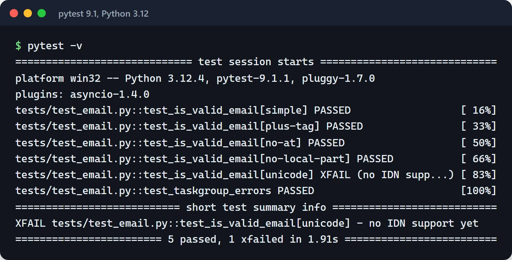

Every Python library and service I write is tested with pytest. This post collects the advanced pytest techniques I actually use: fixture scopes, parametrize, mocking, async tests, property-based testing with Hypothesis, and CI settings. Everything here targets pytest 8, and the parametrize and `RaisesGroup` examples also run on pytest 9.1.

A note before starting: `unittest` is fine. It's in the standard library and it works. But writing classes, remembering `self.assertEqual`, and jumping between `setUp` and `tearDown` makes tests feel like a chore. pytest does the same job with plain functions and plain `assert`, and on failure it shows both sides of the expression in detail. It also runs existing `unittest` tests unchanged, so you can migrate gradually.

## Configure the project up front

All the settings live in `pyproject.toml`:

```toml
[tool.pytest.ini_options]
minversion = "8.0"
testpaths = ["tests"]
addopts = ["-ra", "--strict-markers", "--strict-config"]
xfail_strict = true
markers = [
    "slow: long-running tests (run separately in CI)",
]
```

`--strict-markers` turns a typo like `@pytest.mark.slwo` into an error instead of silently ignoring it. `xfail_strict` fails tests marked `xfail` that start passing, so fixed bugs don't stay marked as broken. `-ra` prints a summary of why tests were skipped or failed at the end of the run.

## Fixtures and scope

A fixture prepares what a test needs and cleans up afterwards: setup before `yield`, teardown after. Scope decides how long the fixture lives: `function` (the default), `class`, `module`, `package` or `session`. This diagram from the pytest docs shows that wider-scoped fixtures are set up first:


The pattern I get the most out of: open expensive resources (a database engine, a Docker container) once at `session` scope, and give each test a cheap, isolated slice of it. With SQLAlchemy 2, running every test inside a transaction that gets rolled back looks like this:

```python
# tests/conftest.py
import os

import pytest
from sqlalchemy import create_engine
from sqlalchemy.orm import Session

from app.models import Base


@pytest.fixture(scope="session")
def engine():
    engine = create_engine(os.environ["TEST_DATABASE_URL"])
    Base.metadata.create_all(engine)
    yield engine
    Base.metadata.drop_all(engine)
    engine.dispose()


@pytest.fixture
def db_session(engine):
    with engine.connect() as connection:
        transaction = connection.begin()
        session = Session(bind=connection, join_transaction_mode="create_savepoint")
        yield session
        session.close()
        transaction.rollback()
```

With `join_transaction_mode="create_savepoint"`, the code under test can call `session.commit()` without breaking the outer transaction. When the test ends, everything is rolled back and the next test sees a clean database.

Fixtures in `conftest.py` are available to every test in that directory and below, with no import needed.

### Factory fixtures

Sometimes a test needs several objects of the same kind. Having the fixture return a function that builds them keeps things tidy:

```python
@pytest.fixture
def make_user(db_session):
    def _make(name: str = "furkan", is_admin: bool = False) -> User:
        user = User(name=name, is_admin=is_admin)
        db_session.add(user)
        db_session.flush()
        return user

    return _make


def test_admin_can_delete(make_user):
    admin = make_user("admin", is_admin=True)
    target = make_user("target")
    assert admin.can_delete(target)
```

### Built-in fixtures

Check pytest's built-ins before writing your own. The ones I use most:

```python
def test_writes_report(tmp_path, monkeypatch, caplog):
    monkeypatch.setenv("REPORT_DIR", str(tmp_path))
    write_report({"ok": True})
    assert (tmp_path / "report.json").exists()
    assert "report written" in caplog.text
```

`tmp_path` is a fresh temporary directory per test, `monkeypatch` changes environment variables and attributes and restores them afterwards, and `caplog` captures log output.

## One test, many cases with parametrize

When testing one function with different inputs, use `parametrize` instead of copy-paste. `pytest.param` gives each case a readable id and, if needed, a marker:

```python
import pytest


@pytest.mark.parametrize(
    ("email", "expected"),
    [
        pytest.param("test@example.com", True, id="simple"),
        pytest.param("user+tag@gmail.com", True, id="plus-tag"),
        pytest.param("plainaddress", False, id="no-at"),
        pytest.param("@example.com", False, id="no-local-part"),
        pytest.param("ü@exämple.com", True, id="unicode", marks=pytest.mark.xfail(reason="no IDN support yet")),
    ],
)
def test_is_valid_email(email, expected):
    assert is_valid_email(email) is expected
```

Failures show up as `test_is_valid_email[no-at]`, and `pytest -k unicode` runs a single case.

With a simple regex-based `is_valid_email`, the `RaisesGroup` test from further down and the `pyproject.toml` settings above, `pytest -v` prints this. The unicode case is an expected `XFAIL`, and `-ra` repeats the reason in the summary:



## Mocking: keep the outside world out

A unit test should not hit the internet. A test that really calls a payment API is slow, flaky and, in the worst case, expensive. The `mocker` fixture from `pytest-mock` wraps `unittest.mock` and undoes every patch automatically when the test ends:

```python
# app/payments.py
import httpx


def charge(amount: int) -> str:
    resp = httpx.post("https://api.payments.example/charge", json={"amount": amount}, timeout=10)
    resp.raise_for_status()
    return resp.json()["status"]


# tests/test_payments.py
from app.payments import charge


def test_charge_success(mocker):
    post = mocker.patch("app.payments.httpx.post", autospec=True)
    post.return_value.json.return_value = {"status": "success"}

    assert charge(100) == "success"
    post.assert_called_once_with(
        "https://api.payments.example/charge", json={"amount": 100}, timeout=10
    )
```

Patch where the name is used (`app.payments.httpx.post`), not where it's defined. `autospec=True` makes the fake match the real function's signature, so a call with wrong arguments fails the test.

If your HTTP client is `httpx`, mocking the network layer with `respx` is cleaner than patching functions. That's how the tests in [speedapi_lib](https://furkankoykiran.com.tr/en/projects/speedapi_lib/), a Python SDK I wrote, are set up: a fixture in `conftest.py` opens a `respx` router for the API's base URL, and each test defines its own responses:

```python
import httpx
import pytest
import respx

BASE_URL = "https://api.example.com"


@pytest.fixture
def mock_router():
    with respx.mock(base_url=BASE_URL, assert_all_called=False) as router:
        yield router


def test_get_balance(mock_router):
    mock_router.get("/balance").mock(return_value=httpx.Response(200, json={"amount": 10}))
    resp = httpx.get(f"{BASE_URL}/balance")
    assert resp.json() == {"amount": 10}
```

A request to a route you didn't mock raises an error, so no test can accidentally reach the real API.

## Testing async code

For async tests I use `pytest-asyncio`. Both [speedapi_lib](https://github.com/furkankoykiran/speedapi_lib) and [Quorum](https://github.com/furkankoykiran/Quorum) use the same configuration:

```toml
[tool.pytest.ini_options]
asyncio_mode = "auto"
asyncio_default_fixture_loop_scope = "function"
```

In `auto` mode every `async def test_...` runs without a marker, and async fixtures are declared with the regular `@pytest.fixture`. pytest-asyncio 1.0 removed the old `event_loop` fixture; if you need a wider loop, use `@pytest.mark.asyncio(loop_scope="module")`.

Mock async functions with `AsyncMock`. For TaskGroup, timeouts and the rest, see the [asyncio post](/en/posts/python-asyncio-concurrent-processing/).

## What changed in pytest 8

A few changes in the pytest 8 series worth knowing about:

- Since 8.4, an async test function with no plugin to run it fails outright instead of warning and being skipped. If you had async tests that were silently skipped, CI may go red.
- Also since 8.4, a test function that returns anything other than `None` fails. A test that returns a value has usually forgotten its `assert`.
- 8.4 added `pytest.RaisesGroup` for the `ExceptionGroup`s that TaskGroup raises:

```python
import asyncio

import pytest


async def test_taskgroup_errors():
    async def boom():
        raise ValueError("bad data")

    with pytest.RaisesGroup(ValueError, ValueError):
        async with asyncio.TaskGroup() as tg:
            tg.create_task(boom())
            tg.create_task(boom())
```

For a single exception, `pytest.raises(ValueError, match="bad")` is still the right tool. `match` takes a regex; use it to check the message too.

## Property-based testing with Hypothesis

Hand-written examples test the cases you thought of. Hypothesis asks you for a rule and then searches for input that breaks it: empty strings, zero, negative numbers, odd Unicode. When it finds a failure, it shrinks the input to the smallest example and shows you that.

The most useful rule is the round trip: serialize, deserialize, get the same thing back.

```python
import json

from hypothesis import given
from hypothesis import strategies as st


@given(st.dictionaries(st.text(), st.integers() | st.text() | st.none()))
def test_json_roundtrip(data):
    assert json.loads(json.dumps(data)) == data
```

If your code has pairs like `encode`/`decode` or `to_dict`/`from_dict`, this pattern catches real bugs in a few lines. For pricing code you can write rules like "the total is never negative" or "a discount never exceeds the price".

## Snapshot tests

Asserting a large JSON response or generated HTML line by line is tedious. `syrupy` stores the output in a file on the first run and compares against it afterwards:

```python
def test_report_output(snapshot):
    assert build_report(month="2025-09") == snapshot
```

When you change the output on purpose, `pytest --snapshot-update` rewrites the stored snapshots. The change shows up in the git diff, so it gets seen in review. The only real risk is someone running `--snapshot-update` without looking.

## Speed and coverage in CI

The plugins I use:

- `pytest-xdist`: `-n auto` spreads tests across one process per core. Hidden dependencies between tests show up here, which is a good thing.
- `pytest-cov`: `--cov=src --cov-report=term-missing` shows which lines are untested. I look at missing lines in critical files rather than chasing a percentage.
- `pytest-rerunfailures`: retries a flaky test with `@pytest.mark.flaky(reruns=2)`. Use it as a stopgap and go find the root cause (a race, a fixed `sleep`, test order).

The command I usually run in CI:

```bash
pytest -n auto --cov=src --cov-report=term-missing --durations=10
```

`--durations=10` lists the ten slowest tests. A unit test that takes seconds usually means a forgotten `sleep` or a real network call. The GitHub Actions side is covered in the [CI/CD post](/en/posts/github-actions-ci-cd-pipeline/).

## Habits I avoid

- Branching with `if` inside a test. If you need a branch, write two tests or parametrize.
- Tests that depend on each other. If `test_2` can't pass without `test_1`, things break as soon as tests run in random order (`pytest-randomly`) or in parallel.
- Waiting for something with `time.sleep()`. Poll for the condition in a short loop, or use an `Event` in async code.
- Mocking everything. Once you're mocking your own internal functions, the test checks implementation details rather than behavior.

## Where to start

Add the `pyproject.toml` settings above to an existing project and run `pytest -ra --durations=10`. You'll immediately see which tests are skipped and which are slow. Then find an `encode`/`decode` pair in your code and write one Hypothesis test for it.

Docs: [pytest](https://docs.pytest.org/), [pytest-asyncio](https://pytest-asyncio.readthedocs.io/), [Hypothesis](https://hypothesis.readthedocs.io/), [respx](https://lundberg.github.io/respx/), [syrupy](https://github.com/syrupy-project/syrupy).
