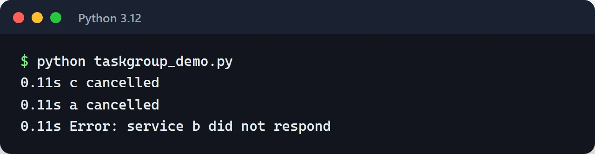
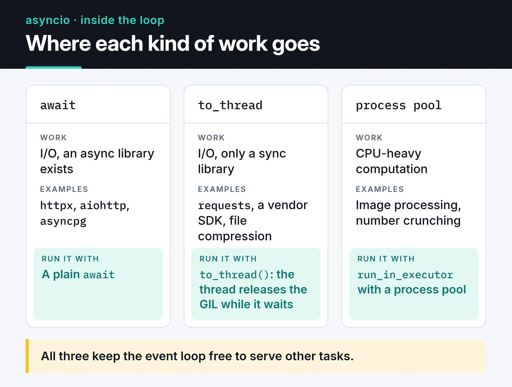

Most of my MCP servers and trading bots run on Python asyncio. They all do roughly the same thing: call a few APIs, wait for the responses, keep a WebSocket open on the side. Writing `async/await` is the easy part. The hard part is noticing the one blocking call that freezes the whole service, and making sure half-finished tasks get cleaned up when something fails.

This is how I use asyncio today: `TaskGroup`, `asyncio.timeout`, `Semaphore`, `to_thread`, and error handling with `except*`. The examples target Python 3.12 and later; most of them also run on 3.11.

## What asyncio is good at

asyncio is an event loop on a single thread. When a task hits `await` and waits on the network, the loop switches to another task. That gives you concurrency. It does not give you parallelism.

```text
Concurrent (asyncio, one thread):

  thread  | A A B A C C B A C B |   one task runs at a time,
                                    the loop switches at every await

Parallel (several cores):

  core 1  | A A A A |
  core 2  | B B B B |               tasks really run at the same time
  core 3  | C C C C |
          ------------------------> time
```

In practice, asyncio handles thousands of connections on one core when the work is I/O: HTTP calls, database queries, socket reads. For CPU-heavy work like image processing or number crunching it gains you nothing and blocks the loop. That needs a process pool, which I cover below.

## Start tasks with TaskGroup

For years the default was `asyncio.gather()`. Its problem: when one task fails, the others keep running in the background and nobody cancels them. `asyncio.TaskGroup`, added in Python 3.11, fixes this with structured concurrency. No task outlives the `async with` block.

```python
import asyncio


async def fetch(name: str, delay: float) -> str:
    await asyncio.sleep(delay)
    if name == "b":
        raise ValueError(f"service {name} did not respond")
    return f"{name} ok"


async def main() -> None:
    try:
        async with asyncio.TaskGroup() as tg:
            t1 = tg.create_task(fetch("a", 0.2))
            t2 = tg.create_task(fetch("b", 0.1))
            t3 = tg.create_task(fetch("c", 1.0))
    except* ValueError as eg:
        for exc in eg.exceptions:
            print("Error:", exc)
    else:
        print(t1.result(), t2.result(), t3.result())


asyncio.run(main())
```

As soon as `b` raises, the group cancels the remaining tasks, waits for them to finish, and raises everything in an `ExceptionGroup`. The one-second sleep in `c` is cut short.

To see the order, I added an `except CancelledError` to `fetch` that prints a timestamp. `b` fails at 0.1 seconds, `a` and `c` are cancelled right away, and only then does the error reach the caller:



`gather()` still has a place. I use it with `return_exceptions=True` when I want "run everything, collect whatever comes back, failures included". Anywhere a failure should cancel the rest, I use TaskGroup.

## Handling several failures with except*

Several tasks in a group can fail at once. `except*` splits the `ExceptionGroup` by type:

```python
try:
    async with asyncio.TaskGroup() as tg:
        tg.create_task(call_payment_api())
        tg.create_task(call_inventory_api())
except* TimeoutError as eg:
    log.warning("Timed out: %d tasks", len(eg.exceptions))
except* ConnectionError as eg:
    log.error("Connection errors: %s", eg.exceptions)
```

More than one `except*` branch can run for the same group. A plain `except Exception` also catches an `ExceptionGroup`, but then you have to unpack it yourself.

## Put a timeout on every external call

A socket that waits forever quietly kills a worker. Since Python 3.11 there is the `asyncio.timeout()` context manager, which reads better than `wait_for`:

```python
async def get_price(client, symbol: str) -> float:
    async with asyncio.timeout(5):
        resp = await client.get(f"/ticker/{symbol}")
        return float(resp.json()["price"])
```

When the deadline passes, the work inside the block is cancelled and a `TimeoutError` comes out. If you need to move the deadline at runtime, there is `asyncio.timeout_at()` and the context manager's `reschedule()` method.

## Cap concurrency with a Semaphore

asyncio produces requests so quickly that you will hit the other side's rate limit almost immediately if you are careless. I have done this to exchange APIs more than once. A `Semaphore` caps how many tasks can be inside a block at the same time:

```python
import asyncio
import httpx


async def fetch_all(urls: list[str], limit: int = 10) -> list[int]:
    sem = asyncio.Semaphore(limit)

    async with httpx.AsyncClient(timeout=10) as client:

        async def fetch(url: str) -> int:
            async with sem:
                resp = await client.get(url)
                return resp.status_code

        async with asyncio.TaskGroup() as tg:
            tasks = [tg.create_task(fetch(u)) for u in urls]

    return [t.result() for t in tasks]
```

Pass it a thousand URLs and at most ten requests are in flight. A semaphore limits concurrency, not requests per second. For a per-second limit you need something like a token bucket, which I wrote about in the [API rate limiting post](/en/posts/python-rate-limiting-api-throttling/).

## Don't block the event loop

The most common asyncio bug is running synchronous, blocking code inside the loop:

```python
import time


async def bad():
    time.sleep(5)  # the loop stops for 5 seconds, nobody gets a response
```

If you are stuck with a sync library (`requests`, a vendor SDK, file compression), push the call to a thread with `asyncio.to_thread()`:

```python
import asyncio
import requests


async def legacy_call() -> dict:
    resp = await asyncio.to_thread(requests.get, "https://httpbin.org/json", timeout=10)
    return resp.json()
```

That works for I/O because the thread releases the GIL while it waits. For CPU-bound work, use a `ProcessPoolExecutor`:

```python
import asyncio
from concurrent.futures import ProcessPoolExecutor


def crunch(n: int) -> int:
    return sum(i * i for i in range(n))


async def main() -> None:
    loop = asyncio.get_running_loop()
    with ProcessPoolExecutor() as pool:
        result = await loop.run_in_executor(pool, crunch, 10_000_000)
    print(result)


if __name__ == "__main__":
    asyncio.run(main())
```

On a new project, pick async libraries from the start: `httpx` or `aiohttp` for HTTP, `asyncpg` or SQLAlchemy's `AsyncSession` for PostgreSQL. The card below is the decision I make for any piece of work that has to run from inside the loop.



## Stream large data with async generators

When pulling millions of rows from a paginated API, process one page at a time with `async for` instead of loading everything:

```python
from collections.abc import AsyncIterator

import httpx


async def iter_pages(client: httpx.AsyncClient, url: str) -> AsyncIterator[list[dict]]:
    page = 1
    while True:
        resp = await client.get(url, params={"page": page})
        resp.raise_for_status()
        items = resp.json()
        if not items:
            return
        yield items
        page += 1


async def main() -> None:
    async with httpx.AsyncClient(timeout=10) as client:
        async for items in iter_pages(client, "https://api.example.com/trades"):
            print(len(items), "rows processed")
```

Only one page sits in memory at a time.

## What Python 3.12, 3.13 and 3.14 added

The asyncio changes from recent releases that I actually use:

- 3.12: `asyncio.eager_task_factory`. If a coroutine can finish without suspending (a cache hit, say), it completes synchronously and never touches the loop. Code that spawns many short tasks can get noticeably faster. Turn it on with `loop.set_task_factory(asyncio.eager_task_factory)`.
- 3.12: general asyncio speedups; creating tasks and calling `current_task()` got cheaper.
- 3.13: `asyncio.Queue.shutdown()`. Producer/consumer queues can be closed without pushing sentinel values.
- 3.13: `asyncio.as_completed()` works with `async for` and yields the original task objects.
- 3.14: `python -m asyncio ps <PID>` and `python -m asyncio pstree <PID>` attach to a running process and show which task is awaiting what. That used to need extra tools like `aiomonitor`.

## Finding the stall: debug mode

The quickest way to find what blocks the loop is debug mode:

```python
asyncio.run(main(), debug=True)
```

The `PYTHONASYNCIODEBUG=1` environment variable or `python -X dev` does the same. In debug mode every callback that runs longer than 100 ms gets logged (`Executing <Task ...> took 0.512 seconds`), and you get warnings for coroutines that were never awaited. Whatever function shows up in that line needs to move to `to_thread` or be rewritten with an async library.

For a one-line coroutine that calls `time.sleep(0.5)` under `debug=True`, Python 3.12 reported that the task took 0.500 seconds.

`cProfile` can mislead you on async code because it counts time spent waiting in `await` as time in the function. `py-spy` and `yappi` do better here; `py-spy` can even attach to a running process without restarting it.

## Swapping the loop: uvloop

`uvloop` is a drop-in event loop built on libuv. On Python 3.12 and later, the old `uvloop.install()` is replaced by:

```python
import uvloop

uvloop.run(main())
```

Uvicorn picks up uvloop automatically when installed as `uvicorn[standard]`. The gain shows up in network-heavy services; in most apps the bottleneck is the database, not the loop. Measure before switching. uvloop also doesn't run on Windows.

## Testing async code

I use `pytest-asyncio`. With `auto` mode in `pyproject.toml`, every async test function just runs:

```toml
[tool.pytest.ini_options]
asyncio_mode = "auto"
```

```python
from unittest.mock import AsyncMock


async def test_get_price():
    client = AsyncMock()
    client.get.return_value.json = lambda: {"price": "42.5"}
    assert await get_price(client, "BTCUSDT") == 42.5
```

Mock async functions with `AsyncMock`, not `MagicMock`, or the `await` line will fail. Fixtures, mocking and what changed in pytest 8 are in the [pytest post](/en/posts/pytest-advanced-testing-techniques/).

## Pre-production checklist

- Does every external call have a timeout (`asyncio.timeout` or the client's own)?
- Are the drivers really async, or is `requests` or a sync ORM being called inside the loop?
- Do you keep a reference to tasks started with `create_task()`? A task nobody references can be garbage-collected mid-flight. TaskGroup takes care of this for you.
- Are tasks cancelled cleanly on SIGTERM? See the [graceful shutdown post](/en/posts/graceful-shutdown-signal-handling/).
- Is work that must not be interrupted (writing a payment record, for example) wrapped in `asyncio.shield()`?
- Does logging block the loop? Under heavy logging, hand the writes to a thread with `logging.handlers.QueueHandler`.

## Where to go next

Search your code for `gather()` and decide what should happen when one task fails. If the rest should be cancelled, move it to a TaskGroup. Then run once with `debug=True` and fix whatever shows up as blocking. If you need background jobs rather than in-process concurrency, the [Celery and ARQ post](/en/posts/celery-arq-async-task-queue/) is a good next step.

Official references: the [asyncio docs](https://docs.python.org/3/library/asyncio.html) and [What's New in Python 3.14](https://docs.python.org/3/whatsnew/3.14.html).
