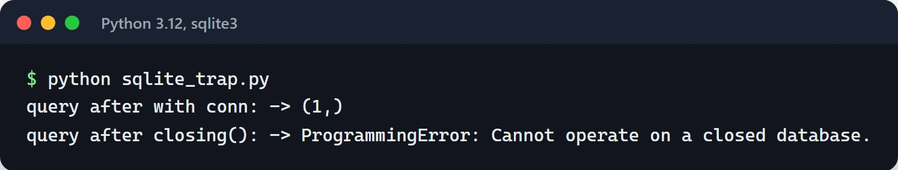

Everyone who writes Python knows `with open("file.txt") as f:`. The mechanism behind it, the Python context manager, isn't limited to files. Database transactions, locks, HTTP clients, temporary directories, timing: anything with a clear start and end can use it.

The point is that cleanup runs even when the block raises. Forgetting a `close()` or a `rollback()` is easy, and `with` guarantees it for you. This post shows how to write your own context managers, what `contextlib` already gives you, and how the async side works.

## What a with block actually does

This code:

```python
with manager as value:
    do_something(value)
```

is roughly equivalent to:

```python
value = manager.__enter__()
try:
    do_something(value)
except BaseException as exc:
    if not manager.__exit__(type(exc), exc, exc.__traceback__):
        raise
else:
    manager.__exit__(None, None, None)
```

`__enter__` sets up the resource and returns whatever gets bound by `as`. `__exit__` always runs. If something was raised, it receives the exception type, the exception and the traceback; otherwise all three are `None`. If `__exit__` returns `True`, the exception is swallowed; any other return value lets it propagate.

## A class-based context manager

Here's one for an SQLite transaction: commit on success, roll back on error, close the connection either way.

```python
import sqlite3


class Transaction:
    def __init__(self, path: str):
        self.path = path
        self.conn: sqlite3.Connection | None = None

    def __enter__(self) -> sqlite3.Cursor:
        self.conn = sqlite3.connect(self.path)
        return self.conn.cursor()

    def __exit__(self, exc_type, exc, tb) -> bool:
        try:
            if exc_type is None:
                self.conn.commit()
            else:
                self.conn.rollback()
        finally:
            self.conn.close()
        return False  # don't swallow the exception


with Transaction("app.db") as cur:
    cur.execute("CREATE TABLE IF NOT EXISTS users (name TEXT)")
    cur.execute("INSERT INTO users VALUES ('furkan')")
```

`close()` goes in `finally` because the rollback itself can fail, and the connection still shouldn't be left open.

### An sqlite3 gotcha

`sqlite3.Connection` is a context manager too, but it doesn't do what most people expect:

```python
conn = sqlite3.connect("app.db")
with conn:
    conn.execute("INSERT INTO users VALUES ('x')")
# The transaction is committed here, but the connection is STILL OPEN.
```

`with conn:` manages the transaction only; it doesn't close the connection. If you want that too, wrap it in `contextlib.closing`:

```python
from contextlib import closing

with closing(sqlite3.connect("app.db")) as conn:
    with conn:
        conn.execute("INSERT INTO users VALUES ('y')")
```

Running both side by side makes the difference obvious. After `with conn:` the connection still answers queries; after `closing()` the same query raises:



It pays to check in the docs exactly what a library's context manager closes.

## The shortcut: contextlib.contextmanager

Writing a class every time is overkill. The `@contextmanager` decorator turns a generator with a single `yield` into a context manager. Code before the `yield` acts as `__enter__`, code after it as `__exit__`:

```python
import sqlite3
from contextlib import contextmanager


@contextmanager
def transaction(path: str):
    conn = sqlite3.connect(path)
    try:
        yield conn
    except BaseException:
        conn.rollback()
        raise
    else:
        conn.commit()
    finally:
        conn.close()
```

An exception inside the `with` block is re-raised at the `yield` line. If the `yield` isn't inside a `try`, your cleanup never runs on error. That's the bug I see most often.

Context managers built with `@contextmanager` also work as decorators:

```python
import time
from contextlib import contextmanager


@contextmanager
def timer(label: str):
    start = time.perf_counter()
    try:
        yield
    finally:
        print(f"[{label}] {time.perf_counter() - start:.3f}s")


with timer("report"):
    build_report()


@timer("nightly job")
def nightly_job():
    ...
```

Used as a decorator, a fresh context manager is created on every call, so the function can be called as many times as you like.

## An unknown number of resources: ExitStack

When you only learn at runtime how many resources you'll open, nested `with` statements don't work. `ExitStack` handles it:

```python
from contextlib import ExitStack

paths = ["a.log", "b.log", "c.log"]

with ExitStack() as stack:
    files = [stack.enter_context(open(p, "a", encoding="utf-8")) for p in paths]
    for f in files:
        f.write("deploy finished\n")
# On exit, every opened file is closed in reverse order.
```

If opening the third file fails, the first two are still closed. `stack.callback(fn, *args)` registers cleanup that isn't a context manager.

Another useful pattern: undo everything if setup fails halfway, and take ownership of the resources if it succeeds.

```python
with ExitStack() as stack:
    db = stack.enter_context(open_db())
    cache = stack.enter_context(open_cache())
    resources = stack.pop_all()  # no error so far: take over the cleanup
# calling resources.close() is now your job
```

## async with

In async code, opening and closing connections needs `await` too. That's what `__aenter__`, `__aexit__` and `async with` are for, and `asynccontextmanager` is the shortcut:

```python
from contextlib import asynccontextmanager

import httpx


@asynccontextmanager
async def api_client(base_url: str):
    client = httpx.AsyncClient(base_url=base_url, timeout=10)
    try:
        yield client
    finally:
        await client.aclose()


async def main():
    async with api_client("https://api.example.com") as client:
        resp = await client.get("/health")
        print(resp.status_code)
```

Where I use this most is FastAPI's `lifespan` parameter, to open a connection pool at startup and close it at shutdown:

```python
from contextlib import asynccontextmanager

import httpx
from fastapi import FastAPI


@asynccontextmanager
async def lifespan(app: FastAPI):
    app.state.http = httpx.AsyncClient(timeout=10)
    yield
    await app.state.http.aclose()


app = FastAPI(lifespan=lifespan)
```

Connections that never get closed are one of the most common problems I run into in async services under load. Once the pool is exhausted, new requests queue up and everything slows down. Pool tuning is covered in the [connection pooling post](/en/posts/database-connection-pool-optimization/), and the FastAPI skeleton in the [FastAPI post](/en/posts/python-fastapi-rest-api/).

For opening a dynamic number of async resources there's `AsyncExitStack`, which works like `ExitStack`. asyncio's own `asyncio.timeout()` and `asyncio.TaskGroup` are async context managers as well; I cover them in the [asyncio post](/en/posts/python-asyncio-concurrent-processing/).

## What contextlib already gives you

Check the standard library before writing your own:

```python
import os
import threading
from contextlib import chdir, nullcontext, redirect_stdout, suppress
from io import StringIO

# Ignore one specific exception on purpose
with suppress(FileNotFoundError):
    os.remove("temp.tmp")

# Change the working directory temporarily (Python 3.11+)
with chdir("/tmp"):
    run_build()

# Capture print output
buffer = StringIO()
with redirect_stdout(buffer):
    legacy_function_that_prints()

# A "do nothing" context manager for the conditional case
use_lock = os.environ.get("THREADED") == "1"
lock = threading.Lock() if use_lock else nullcontext()
with lock:
    update_counter()
```

`suppress` swallows only the exception types you name and states the intent more clearly than `try/except: pass`. Prefer it to a broad `except Exception: pass`. `chdir` is not thread-safe, because the working directory belongs to the whole process.

Since Python 3.10 you can group several context managers in parentheses, one per line:

```python
with (
    open("input.csv", encoding="utf-8") as src,
    open("output.csv", "w", encoding="utf-8") as dst,
):
    dst.write(src.read())
```

## Locks

Locks are context managers too. Use `with` instead of `lock.acquire()` and `lock.release()`; otherwise an exception leaves the lock held and the program deadlocks:

```python
import threading

lock = threading.Lock()
shared_counter = 0

with lock:
    shared_counter += 1
```

In async code, `asyncio.Lock` works the same way with `async with`. When separate processes write to the same file, the `filelock` package does the job through a lock file:

```python
from filelock import FileLock

with FileLock("data.txt.lock", timeout=10):
    with open("data.txt", "a", encoding="utf-8") as f:
        f.write("safe line\n")
```

Without a `timeout`, a lock that's never released makes the process wait forever.

## Common mistakes

- An unconditional `return True` in `__exit__`. It silently discards every exception from the block. Return `True` only for exception types you mean to swallow.
- Leaving the `yield` outside `try/finally` in a `@contextmanager` function. Cleanup won't run on error.
- More than one `yield` in the generator. `@contextmanager` expects exactly one and raises `RuntimeError` on the second.
- Using the resource after the `with` block. By then the file is closed and the connection is back in the pool.
- Acquiring the resource in `__init__`. If the object is created but never entered, the resource leaks. Acquire it in `__enter__`.

You already use a version of the same idea in tests: pytest fixtures with `yield` split setup and teardown the same way. More in the [pytest post](/en/posts/pytest-advanced-testing-techniques/).

## Where to go from here

Search your code for repeated `try ... finally` blocks. If the same setup and teardown shows up in two or three places, move it into a `@contextmanager` function. If you're on FastAPI, replace `on_event("startup")` and `on_event("shutdown")` with `lifespan`.

Docs: [contextlib](https://docs.python.org/3/library/contextlib.html), [the with statement](https://docs.python.org/3/reference/compound_stmts.html#the-with-statement), [PEP 343](https://peps.python.org/pep-0343/).
