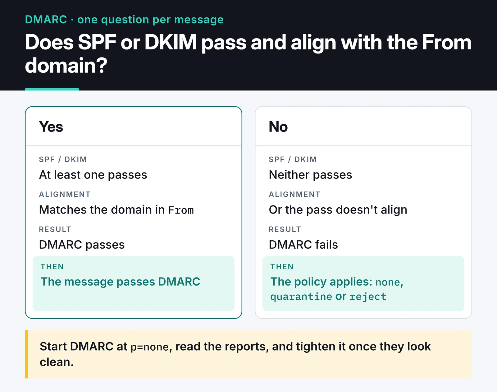

Python email automation looks like a five-line job: connect with `smtplib`, send the message. Getting reports, alerts and notifications to actually land in the inbox is a different problem. Where you keep credentials, how you build the message and what your domain's DNS records say matter at least as much as the code.

This is the setup I use in my own automations: building messages with `EmailMessage`, `smtplib` with an app password, `aiosmtplib` for sending many messages, Jinja2 templates, and SPF, DKIM and DMARC for deliverability.

## Build the message with EmailMessage

Older examples glue parts together by hand with `MIMEMultipart` and `MIMEText`. Since Python 3.6, `email.message.EmailMessage` does the same with far less code:

```python
from email.message import EmailMessage
from email.utils import formataddr, formatdate, make_msgid
from pathlib import Path


def build_message(to: str, subject: str, text: str, html: str, attachment: Path | None = None) -> EmailMessage:
    msg = EmailMessage()
    msg["From"] = formataddr(("Report Bot", "reports@example.com"))
    msg["To"] = to
    msg["Subject"] = subject
    msg["Date"] = formatdate(localtime=True)
    msg["Message-ID"] = make_msgid(domain="example.com")

    msg.set_content(text)                    # plain-text version
    msg.add_alternative(html, subtype="html")  # HTML version

    if attachment:
        msg.add_attachment(
            attachment.read_bytes(),
            maintype="application",
            subtype="pdf",
            filename=attachment.name,
        )
    return msg
```

Include both a plain-text and an HTML version. Clients that don't render HTML and some corporate filters look at the text part, and HTML-only messages score worse with spam filters. `EmailMessage` encodes non-ASCII subjects and display names for you.

## App passwords, not your real password

Don't put your actual Gmail or Outlook password in a script. Google has removed the "less secure apps" option that allowed password logins over SMTP. To send from a personal Gmail account with a script:

1. Turn on 2-Step Verification for the account.
2. Create an app password in your Google account settings. The 16-character password works only for this script and can be revoked any time.
3. Put it in an environment variable or a secrets manager, not in the code.

Microsoft 365 and Outlook.com are retiring Basic Auth for SMTP, so there you need OAuth2 (XOAUTH2) or the Microsoft Graph API. For a long-running service, OAuth2 is the sturdier choice on Gmail as well; app passwords are a practical middle ground for personal automations.

```python
import os
import smtplib
import ssl

SMTP_HOST = "smtp.gmail.com"
SMTP_USER = os.environ["SMTP_USER"]
SMTP_APP_PASSWORD = os.environ["SMTP_APP_PASSWORD"]


def send(msg) -> None:
    context = ssl.create_default_context()
    with smtplib.SMTP(SMTP_HOST, 587, timeout=30) as smtp:
        smtp.starttls(context=context)
        smtp.login(SMTP_USER, SMTP_APP_PASSWORD)
        smtp.send_message(msg)
```

`ssl.create_default_context()` verifies the certificate and hostname. If you call `starttls()` without a context, `smtplib` falls back to a default that doesn't verify certificates: the connection is encrypted, but nothing checks that the server really is Gmail. Always pass the context explicitly.

## Port 587 or 465?

- 587 (STARTTLS): the connection starts in plain text and upgrades with the `STARTTLS` command. Use `smtplib.SMTP` plus `starttls()`.
- 465 (implicit TLS): TLS from the first byte. Use `smtplib.SMTP_SSL`. RFC 8314 recommends this for message submission, so it is not a legacy port.
- 25: server-to-server relay. Cloud providers like AWS and Google Cloud block outbound port 25 by default; don't use it from your app.

Both 587 and 465 are secure. Use whichever your provider documents.

## Sending many messages: aiosmtplib

Opening a new connection per message is slow. For hundreds of notifications, reuse one connection. If your code already runs on asyncio, `aiosmtplib` sends without blocking the loop:

```python
import asyncio
import os

import aiosmtplib

SMTP_USER = os.environ["SMTP_USER"]
SMTP_APP_PASSWORD = os.environ["SMTP_APP_PASSWORD"]


async def send_batch(messages) -> None:
    async with aiosmtplib.SMTP(hostname="smtp.gmail.com", port=587, start_tls=True) as smtp:
        await smtp.login(SMTP_USER, SMTP_APP_PASSWORD)
        for msg in messages:
            try:
                await smtp.send_message(msg)
            except aiosmtplib.SMTPRecipientsRefused as exc:
                print("Refused:", exc.recipients)
            await asyncio.sleep(0.5)  # be gentle with the provider
```

One SMTP connection sends one message at a time, so the loop is sequential. If you need more throughput you can open a few connections and split the work, but check the provider's limits first. Personal Gmail accounts are capped at roughly 500 recipients a day, Google Workspace accounts at 2,000. Beyond that, use a transactional email service such as Amazon SES, Postmark or Mailgun instead of a mailbox.

For a one-off message there is a shortcut:

```python
await aiosmtplib.send(
    msg,
    hostname="smtp.gmail.com",
    port=587,
    start_tls=True,
    username=SMTP_USER,
    password=SMTP_APP_PASSWORD,
)
```

TaskGroup and timeouts on the asyncio side are covered in the [asyncio post](/en/posts/python-asyncio-concurrent-processing/).

## HTML templates with Jinja2

HTML embedded in Python strings gets out of hand quickly. I keep templates in separate files and render them with Jinja2:

```python
from jinja2 import Environment, FileSystemLoader, select_autoescape

env = Environment(loader=FileSystemLoader("templates"), autoescape=select_autoescape())


def render(name: str, **context) -> tuple[str, str]:
    html = env.get_template(f"{name}.html").render(**context)
    text = env.get_template(f"{name}.txt").render(**context)
    return text, html
```

Keep `autoescape` on. If an outside value like a username lands in the HTML unescaped, someone can inject markup or links into your message.

HTML support in email clients is far behind browsers. Gmail supports `<style>` blocks only partly, and desktop Outlook still renders with Word's engine. Don't rely on flexbox or grid. Table-based layout with inline CSS is the safe route. If you'd rather not write tables by hand, design in MJML, compile to HTML, and move CSS inline with a library like `css-inline`.

## Why mail doesn't reach the inbox

If the code runs cleanly and the message still lands in spam, the problem is most likely your domain's authentication. The receiving server checks three DNS records:

- SPF lists which servers may send mail for your domain, for example `v=spf1 include:_spf.google.com ~all`.
- DKIM: the sending server signs the message with a private key, and the receiver verifies it with the public key in DNS. It proves the message wasn't modified on the way.
- DMARC requires SPF or DKIM to pass *and* align with the domain in the `From` address, tells receivers what to do with failures (`p=none`, `quarantine`, `reject`), and includes an address for reports.

The chart below is DMARC's decision in one step:



Since February 2024, Gmail and Yahoo require senders of more than 5,000 messages a day to set up all three of SPF, DKIM and DMARC, support one-click unsubscribe, and keep spam complaints under 0.3 percent. Smaller senders still need at least SPF or DKIM. If you send from your own domain, start DMARC at `p=none`, read the reports, and tighten it once they look clean.

For marketing and bulk notification mail in that category, one-click unsubscribe headers are mandatory:

```python
msg["List-Unsubscribe"] = "<https://example.com/unsubscribe?token=abc123>, <mailto:unsubscribe@example.com>"
msg["List-Unsubscribe-Post"] = "List-Unsubscribe=One-Click"
```

The `List-Unsubscribe-Post` header (RFC 8058) is what makes Gmail's "Unsubscribe" button at the top of the message work. The token in the URL should be unguessable and tied to one recipient.

The quickest way to see whether a message passed authentication: open it in Gmail and choose "Show original". SPF, DKIM and DMARC results are listed at the top.

## Track bounces

Repeatedly sending to addresses that don't exist hurts your sender reputation. Remove addresses that hard bounce (`5xx`). Retry soft bounces (`4xx`, such as a full mailbox) a few times. Transactional services report bounces and spam complaints through webhooks, so the cleanest setup is an endpoint that receives those events, verifies their signature, and updates the recipient's status in your database.

## Test without touching real inboxes

Don't send to real addresses during development. Python 3.12 removed the `smtpd` module from the standard library; `aiosmtpd` replaces it. This runs a local server that prints every message to the terminal:

```bash
pip install aiosmtpd
python -m aiosmtpd -n -l localhost:1025
```

Point your code at `localhost:1025` (this server has no TLS or login, so skip those steps in development). When I sent it a message built with `build_message`, the text and HTML versions arrived as two parts under `multipart/alternative`.

If you want to see how the HTML renders, a catcher with a web UI like Mailpit starts with a single Docker command. In unit tests, mocking the SMTP class and asserting that `send_message` was called with the right message is enough; mocking and fixtures are in the [pytest post](/en/posts/pytest-advanced-testing-techniques/).

## Checklist

- Is the password in an environment variable, and is it an app password or OAuth2 rather than the real account password?
- Is the connection TLS with certificate verification?
- Does every message have both a text and an HTML part?
- Are SPF, DKIM and DMARC records set on the domain?
- Do bulk messages carry `List-Unsubscribe` and `List-Unsubscribe-Post`?
- Are hard-bounced addresses removed from the list?
- Is volume under the provider's daily limit?

## Next step

Send yourself a test message and check SPF, DKIM and DMARC with "Show original" in Gmail. If any of them isn't `PASS`, fix DNS before touching the code. If you're attaching PDF reports, I covered generating them in the [Python PDF processing post](/en/posts/python-pdf-processing/).

Docs: [email package](https://docs.python.org/3/library/email.html), [smtplib](https://docs.python.org/3/library/smtplib.html), [aiosmtplib](https://aiosmtplib.readthedocs.io/), [Google's sender guidelines](https://support.google.com/a/answer/81126).
