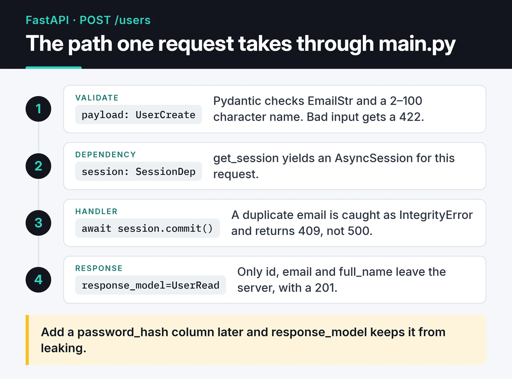

When I start a new Python service these days, I reach for FastAPI. This post is the skeleton I use for a FastAPI REST API: Pydantic v2 schemas, `Annotated` dependencies, an async SQLAlchemy session, tests and a small Docker image. Everything fits in one file, so you can paste it and run it.

The code follows FastAPI's current patterns: `lifespan` instead of `on_event`, Pydantic v2, and the `fastapi` CLI, which removes most of the reasons to put Gunicorn in front of Uvicorn.

## What FastAPI is built on

FastAPI itself is a thin layer. Starlette handles HTTP and ASGI, Pydantic handles validation and serialization, and Uvicorn runs the app. Pydantic v2's core (`pydantic-core`) is written in Rust, which made validation much faster than v1.

Most of the speed people talk about comes from async I/O. While one request waits on the database or another API, the event loop serves others. That only works if every library doing I/O is async, which is why the `def` vs `async def` question below matters more than any benchmark.

## Setup

I manage dependencies with uv. `fastapi[standard]` pulls in Uvicorn, the `fastapi` CLI and `email-validator`.

```bash
uv init users-api && cd users-api
uv add "fastapi[standard]" "sqlalchemy[asyncio]" aiosqlite
uv add --dev pytest
```

`uv run fastapi dev main.py` starts a dev server with auto-reload, and the Swagger UI is at `/docs`.

## A complete REST API in one file

Here is a small API that creates and fetches users. It uses SQLite so it runs anywhere; for PostgreSQL, change the URL to `postgresql+asyncpg://...` and install `asyncpg`.

```python {title="main.py"}
import os
from collections.abc import AsyncIterator
from contextlib import asynccontextmanager
from typing import Annotated

from fastapi import Depends, FastAPI, HTTPException, status
from pydantic import BaseModel, ConfigDict, EmailStr, Field
from sqlalchemy import String
from sqlalchemy.exc import IntegrityError
from sqlalchemy.ext.asyncio import AsyncSession, async_sessionmaker, create_async_engine
from sqlalchemy.orm import DeclarativeBase, Mapped, mapped_column

DATABASE_URL = os.getenv("DATABASE_URL", "sqlite+aiosqlite:///./app.db")

engine = create_async_engine(DATABASE_URL)
SessionLocal = async_sessionmaker(engine, expire_on_commit=False)


class Base(DeclarativeBase):
    pass


class User(Base):
    __tablename__ = "users"

    id: Mapped[int] = mapped_column(primary_key=True)
    email: Mapped[str] = mapped_column(String(255), unique=True)
    full_name: Mapped[str] = mapped_column(String(100))


class UserCreate(BaseModel):
    email: EmailStr
    full_name: str = Field(min_length=2, max_length=100)


class UserRead(BaseModel):
    model_config = ConfigDict(from_attributes=True)

    id: int
    email: EmailStr
    full_name: str


@asynccontextmanager
async def lifespan(app: FastAPI) -> AsyncIterator[None]:
    # Creating tables here keeps the demo self-contained; use Alembic in real projects.
    async with engine.begin() as conn:
        await conn.run_sync(Base.metadata.create_all)
    yield
    await engine.dispose()


app = FastAPI(title="Users API", lifespan=lifespan)


async def get_session() -> AsyncIterator[AsyncSession]:
    async with SessionLocal() as session:
        yield session


SessionDep = Annotated[AsyncSession, Depends(get_session)]


@app.post("/users", response_model=UserRead, status_code=status.HTTP_201_CREATED)
async def create_user(payload: UserCreate, session: SessionDep):
    user = User(**payload.model_dump())
    session.add(user)
    try:
        await session.commit()
    except IntegrityError:
        await session.rollback()
        raise HTTPException(status.HTTP_409_CONFLICT, "Email already registered")
    return user


@app.get("/users/{user_id}", response_model=UserRead)
async def get_user(user_id: int, session: SessionDep):
    user = await session.get(User, user_id)
    if user is None:
        raise HTTPException(status.HTTP_404_NOT_FOUND, "User not found")
    return user
```

This is the path a `POST /users` request takes through that file:



A few choices in there are deliberate.

Input and output schemas are separate. `UserCreate` validates what the client sends and `UserRead` decides what leaves the server. Add a `password_hash` column later and `response_model` keeps it from leaking.

`ConfigDict(from_attributes=True)` is Pydantic v2's name for the old `orm_mode`, and it lets the endpoint return the SQLAlchemy object directly. If you're porting v1 code, `.dict()` and `.parse_obj()` became `.model_dump()` and `.model_validate()`.

Declaring the dependency once with `Annotated` and reusing `SessionDep` is now what the FastAPI docs recommend. Signatures get shorter, and tests can swap the dependency in one place.

`lifespan` is where startup and shutdown code goes. `@app.on_event("startup")` still runs but is deprecated.

Catching the unique-constraint violation and returning 409 is small but worth doing. Without it the client gets a 500 and has no idea the problem was its own input.

## `def` or `async def`?

The most common FastAPI mistake I see is blocking I/O inside an `async def` endpoint. Call `requests.get()` or a sync database driver there and the whole event loop stops until it returns. No other request gets served in the meantime.

My rule:

- If the library is async (`httpx.AsyncClient`, `asyncpg`, `redis.asyncio`), write `async def` and `await` it.
- If you're stuck with a sync library, write a plain `def`. FastAPI runs it in a thread pool and the loop stays free.
- CPU-heavy work (big PDFs, image processing) fits neither. Push it to a task queue.

## Authentication and CORS

Authentication is just another dependency. `OAuth2PasswordBearer` pulls the bearer token from the header, and you verify it:

```python
import jwt  # PyJWT
from fastapi.security import OAuth2PasswordBearer

oauth2_scheme = OAuth2PasswordBearer(tokenUrl="token")
SECRET_KEY = os.environ["JWT_SECRET"]


async def current_user_id(token: Annotated[str, Depends(oauth2_scheme)]) -> int:
    try:
        claims = jwt.decode(
            token,
            SECRET_KEY,
            algorithms=["HS256"],
            options={"require": ["exp", "sub"]},
        )
    except jwt.InvalidTokenError:
        raise HTTPException(status.HTTP_401_UNAUTHORIZED, "Invalid token")
    return int(claims["sub"])
```

The FastAPI docs moved from `python-jose` to PyJWT a while ago, and I did the same. Always pass an explicit `algorithms` list. I cover JWT pitfalls, API key storage and passkeys in [API authentication strategies](/en/posts/api-authentication-strategies/).

Many examples use `allow_origins=["*"]` for CORS. Don't ship that. List your frontend origins explicitly:

```python
from fastapi.middleware.cors import CORSMiddleware

app.add_middleware(
    CORSMiddleware,
    allow_origins=["https://app.example.com"],
    allow_credentials=True,
    allow_methods=["GET", "POST", "PUT", "DELETE"],
    allow_headers=["Authorization", "Content-Type"],
)
```

## Where `BackgroundTasks` stops being enough

`BackgroundTasks` runs small jobs in the same process after the response is sent: a welcome email, an audit line. The tasks live in memory, though. If the process restarts or crashes they're gone, and nothing retries them.

Anything that must not be lost, like an invoice after a payment or a webhook you've acknowledged, belongs in a durable queue such as Celery or ARQ.

## Testing with `TestClient`

Used as a context manager, `TestClient` also runs `lifespan`. Pointing `DATABASE_URL` at a temporary file is enough to isolate tests without touching the app code:

```python {title="conftest.py"}
import os
import tempfile

os.environ["DATABASE_URL"] = f"sqlite+aiosqlite:///{tempfile.mkdtemp()}/test.db"
```

```python {title="test_users.py"}
from fastapi.testclient import TestClient

from main import app


def test_create_and_get_user():
    with TestClient(app) as client:
        created = client.post(
            "/users", json={"email": "ada@example.com", "full_name": "Ada Lovelace"}
        )
        assert created.status_code == 201

        user_id = created.json()["id"]
        fetched = client.get(f"/users/{user_id}")
        assert fetched.json()["email"] == "ada@example.com"

        duplicate = client.post(
            "/users", json={"email": "ada@example.com", "full_name": "Ada"}
        )
        assert duplicate.status_code == 409


def test_rejects_invalid_email():
    with TestClient(app) as client:
        response = client.post("/users", json={"email": "nope", "full_name": "Ada"})
        assert response.status_code == 422
```

To fake a dependency such as `current_user_id`, set `app.dependency_overrides[current_user_id] = lambda: 1`.

## Production: one process per container

For a long time the standard setup was Gunicorn with `uvicorn.workers.UvicornWorker`. That worker class is deprecated inside Uvicorn, and most setups don't need Gunicorn anymore. `fastapi run` starts Uvicorn with production defaults and accepts `--workers` if you want several processes.

Under Kubernetes or Docker Compose I prefer one process per container and scale with replicas. The orchestrator already restarts crashed containers.

```dockerfile {title="Dockerfile"}
FROM python:3.13-slim

COPY --from=ghcr.io/astral-sh/uv:latest /uv /uvx /bin/

WORKDIR /app
COPY pyproject.toml uv.lock ./
RUN uv sync --frozen --no-dev --no-install-project

COPY . .
ENV PATH="/app/.venv/bin:$PATH"

CMD ["fastapi", "run", "main.py", "--port", "8000"]
```

Pin the uv image to a specific version instead of `latest` in production. Behind Nginx or Traefik, the client's real IP arrives in `X-Forwarded-For`. `fastapi run` reads proxy headers, but Uvicorn only trusts `127.0.0.1` by default, so set `FORWARDED_ALLOW_IPS` to your proxy's address. Skip that and anything IP-based, rate limiting included, sees the proxy's IP for every request.

## Where to go next

When this skeleton grows, I add Alembic migrations, split routes into an `app/` package with `APIRouter`, and put a Redis-backed rate limiter in front. The database layer is covered in my [SQLAlchemy 2.0 guide](/en/posts/mysql-sqlalchemy-database-management/) and request limits in [API rate limiting in Python](/en/posts/python-rate-limiting-api-throttling/). For reference, the [FastAPI docs](https://fastapi.tiangolo.com/) and the [Pydantic docs](https://docs.pydantic.dev/latest/) are the sources I trust.
