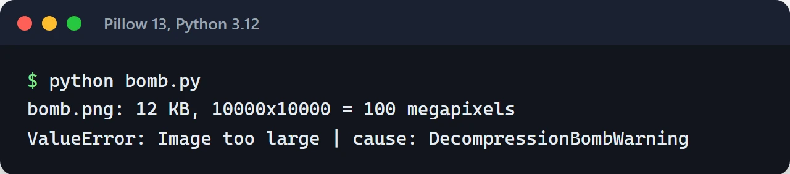

Image processing in Python usually means one of two libraries: Pillow or OpenCV. Both can open, resize and save an image, but they were built for different jobs. In a web app where users upload photos, how much you trust the uploaded file matters as much as which library you pick.

Here is where I use each one, how I make the upload path safe, and why the processing itself never runs inside the HTTP request. The examples target Pillow 11 and later and OpenCV 4.x. I also ran the upload and OCR examples on Pillow 13 and OpenCV 5.0.

## The short version

| | Pillow | OpenCV (`cv2`) |
| :--- | :--- | :--- |
| Data type | `PIL.Image.Image` object | `numpy.ndarray` |
| Channel order | RGB | BGR |
| Strong at | Format conversion, resizing, cropping, metadata | Filters, edge detection, thresholding, video, computer vision |
| Install | Small wheel | Large wheel, extra system libraries |
| Learning curve | Pythonic, quick to start | More mathematical, mirrors the C++ API |

My rule is simple. Most web work (thumbnails, WebP conversion, watermarks) is Pillow. When I need to look at what's in the image (edge detection, denoising, prep before OCR, face detection), I reach for OpenCV. The two sit happily in the same project.

## Safe uploads with Pillow

An uploaded file can be an attack. The best-known one is the decompression bomb: a PNG of a few hundred kilobytes that decodes into an image tens of thousands of pixels wide and eats all your memory.

Pillow has a guard for this, but you need to know how it behaves by default. `Image.MAX_IMAGE_PIXELS` is about 179 megapixels. Going over it only emits a `DecompressionBombWarning`. Pillow raises `DecompressionBombError` only once an image is more than twice the limit. So with default settings, a 300-megapixel image opens with nothing but a warning.

I lower the limit and turn the warning into an error:

```python
import io
import warnings

from PIL import Image, ImageOps

Image.MAX_IMAGE_PIXELS = 50_000_000  # tune for your use case
warnings.simplefilter("error", Image.DecompressionBombWarning)

MAX_BYTES = 15 * 1024 * 1024
ALLOWED = {"JPEG", "PNG", "WEBP"}


def process_upload(data: bytes) -> bytes:
    if len(data) > MAX_BYTES:
        raise ValueError("File too large")

    try:
        # 1. Check the format and integrity
        with Image.open(io.BytesIO(data)) as probe:
            if probe.format not in ALLOWED:
                raise ValueError(f"Unsupported format: {probe.format}")
            probe.verify()

        # 2. The file has to be reopened after verify()
        with Image.open(io.BytesIO(data)) as img:
            img = ImageOps.exif_transpose(img)
            img.thumbnail((1600, 1600), Image.Resampling.LANCZOS)
            out = io.BytesIO()
            img.save(out, "WEBP", quality=80, method=6)
            return out.getvalue()
    except (Image.DecompressionBombError, Image.DecompressionBombWarning) as exc:
        raise ValueError("Image too large") from exc
```

A few details in there:

- The format check uses the `format` Pillow detects from the file's content, not the file extension. A PHP script renamed to `.jpg` doesn't get through.
- `verify()` leaves the image unusable, which is why it's opened a second time.
- `Image.open()` is lazy. Pixels aren't loaded until an operation like `thumbnail()` needs them, so the size check is cheap.
- Enforce the size limit in your reverse proxy too (`client_max_body_size` in Nginx).

To test the guard I generated a black 10,000×10,000 PNG. The file is only 12 KB, but it decodes to 100 megapixels. `process_upload` lets it past the byte check and stops it at the pixel limit:



## Sideways phone photos: EXIF orientation

Phones often don't rotate the pixels. They store them as captured and write an EXIF tag saying "display this rotated 90 degrees". Browsers and photo apps honor the tag. `Image.open()` doesn't, so your thumbnail comes out sideways.

The `ImageOps.exif_transpose(img)` line above fixes it: it applies the EXIF orientation to the pixels and removes the tag. Do this once, at the very start of the pipeline. OpenCV's `imread` also applies EXIF orientation by default, but when you mix both libraries it's safer to normalize orientation at ingestion with Pillow so everything downstream agrees.

## Stripping location data

Phone photos often carry GPS coordinates in EXIF. Publish a user's profile photo as-is and you may be publishing their home address. That's also a GDPR problem.

Pillow only writes EXIF to the new file when you pass `exif=` to `save()`, so a re-encoded file like the one above has no GPS data. If you keep the original upload, restrict access to it. Checking an output file once with `exiftool` is a good habit.

## WebP (and AVIF)

By Google's own measurements, WebP files are 25 to 34 percent smaller than JPEG at equivalent quality, and every current browser supports it. In Pillow it's one line:

```python
img.save("photo.webp", "WEBP", quality=80, method=6)
```

`method=6` picks the slowest, best compression. Thumbnails are generated once and served many times, so the extra time rarely matters. Recent Pillow releases can write AVIF too; check whether your build supports it with `PIL.features.check("avif")`.

## Where I use OpenCV

OpenCV is a Python binding for a large C++ library. Images are NumPy arrays, so pixel-level work is fast and composes with the rest of NumPy.

My most common use is cleaning an image before OCR. Tesseract does much better on flat, high-contrast black-and-white input:

```python
import cv2
import numpy as np


def decode(data: bytes) -> np.ndarray:
    img = cv2.imdecode(np.frombuffer(data, dtype=np.uint8), cv2.IMREAD_COLOR)
    if img is None:
        raise ValueError("Could not decode image")
    return img


def prepare_for_ocr(img: np.ndarray) -> np.ndarray:
    gray = cv2.cvtColor(img, cv2.COLOR_BGR2GRAY)
    gray = cv2.fastNlMeansDenoising(gray, h=10)
    _, binary = cv2.threshold(gray, 0, 255, cv2.THRESH_BINARY + cv2.THRESH_OTSU)
    return binary
```

Otsu picks one threshold for the whole image. That works when the page is evenly lit. On a phone photo with one side in shadow, the dark side drowns in black. For those I switch to `adaptiveThreshold`, which computes a threshold per neighborhood:

```python
def prepare_uneven(img: np.ndarray) -> np.ndarray:
    gray = cv2.cvtColor(img, cv2.COLOR_BGR2GRAY)
    gray = cv2.fastNlMeansDenoising(gray, h=15)
    return cv2.adaptiveThreshold(gray, 255, cv2.ADAPTIVE_THRESH_GAUSSIAN_C,
                                 cv2.THRESH_BINARY, 31, 15)
```

The image below shows a noisy sample invoice with a dark left side at the top, the result of `prepare_for_ocr` (Otsu) in the middle, and `prepare_uneven` at the bottom:


I decode from memory with `imdecode` rather than reading from disk. That fits uploads naturally, and it sidesteps `cv2.imread` returning `None` for non-ASCII file paths on Windows. `imdecode` doesn't raise on failure either; it returns `None`. If you don't check, the error surfaces much later in some unrelated line.

When moving between Pillow and OpenCV, mind the channel order:

```python
from PIL import Image

bgr = cv2.cvtColor(np.asarray(pil_img.convert("RGB")), cv2.COLOR_RGB2BGR)
pil_again = Image.fromarray(cv2.cvtColor(bgr, cv2.COLOR_BGR2RGB))
```

Skip the conversion and red and blue swap places; faces turn a strange shade of blue.

## The libGL error in Docker and the headless package

OpenCV works locally, then a slim Docker image gives you:

```text
ImportError: libGL.so.1: cannot open shared object file: No such file or directory
```

The `opencv-python` package links against OpenGL for its GUI features, like opening windows. A server has no screen, so you don't need them. The fix is to install the headless package, not to add `libgl1` to the image:

```text
opencv-python-headless>=4.10
```

Install only one of `opencv-python`, `opencv-python-headless` and `opencv-contrib-python` in an environment. They all provide the same `cv2` module and overwrite each other's files when installed together. If another dependency pulls in `opencv-python` behind your back, `pip list | grep opencv` will show it.

## Move processing out of the request

Resizing a 5 MB photo can take hundreds of milliseconds. Pillow and OpenCV release the GIL during most of these operations, so threads can overlap a bit, but the work still burns CPU. Run it inside your API server's request handler and every endpoint slows down at peak.

This is the flow I build:

1. The API accepts the file, checks size and format, and writes it to storage unchanged.
2. It enqueues a job and responds to the user right away.
3. A worker processes the image, writes the result to a separate prefix and updates the database.
4. Users only ever see processed files, served through a CDN. Raw uploads stay private.

[Celery or ARQ](/en/posts/celery-arq-async-task-queue/) work for the queue, and [MinIO](/en/posts/minio-object-storage/) for storage. If you run several worker processes, call `cv2.setNumThreads(1)` to switch off OpenCV's internal thread pool. Otherwise every process spawns a thread per core and they all fight over the same CPUs.

## Catching re-uploads: perceptual hashing

Users upload the same picture under different names and sizes. MD5 won't catch that, since changing one pixel changes the whole hash. A perceptual hash from the `imagehash` library fingerprints the overall structure of the image, so resizing or light recompression barely moves it:

```python
import imagehash
from PIL import Image

with Image.open("cat.jpg") as a, Image.open("cat-small.png") as b:
    distance = imagehash.phash(a) - imagehash.phash(b)

if distance <= 5:
    print("Most likely the same image")
```

The difference between two hashes is a Hamming distance. Pick the threshold by testing on your own data. Too low and you miss duplicates; too high and you merge photos that only look similar.

## Before going live

- Is `MAX_IMAGE_PIXELS` set, and is `DecompressionBombWarning` turned into an error?
- Is the format checked from content rather than the extension?
- Is EXIF orientation applied and GPS data dropped from the output?
- Does the Docker image use `opencv-python-headless`?
- Does processing happen in a queue, with the API only accepting the file?
- Are raw files private and processed files behind a CDN?

## Try this next

Send your own upload endpoint a huge PNG and a phone photo with a rotated EXIF tag and see what happens. Those two tests surface most of the problems above. If you're heading toward OCR, I cover OCRmyPDF in the [Python PDF processing post](/en/posts/python-pdf-processing/).

Docs: [Pillow](https://pillow.readthedocs.io/), [OpenCV Python packages](https://github.com/opencv/opencv-python), [imagehash](https://github.com/JohannesBuchner/imagehash).
