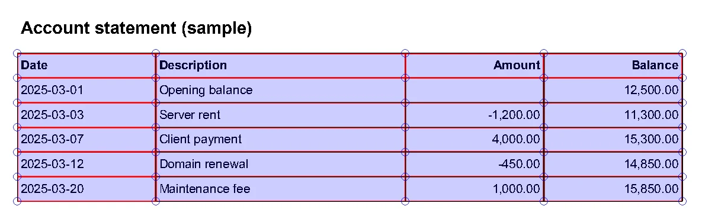

PDF processing in Python splits into two jobs: getting data out of a PDF someone gave you, or producing a PDF from your own data. I do both in automation work: pulling tables out of bank statements, stitching reports together, rendering invoices from a template. There is a different library for each job, and picking the wrong one costs hours.

This is the toolkit I use today: `pypdf` for reading and editing, `pdfplumber` for tables and positioned text, `WeasyPrint` for generating PDFs, `OCRmyPDF` for scanned documents, and `pyHanko` for signatures.

## Which library for which job

The job decides the library. This is the mapping I use: pypdf to read text, merge, split and encrypt; pdfplumber for tables and positioned text; OCRmyPDF for scans without a text layer; WeasyPrint to render from an HTML/CSS template; pyHanko to add a digital signature.

Old tutorials and Stack Overflow answers still use `PyPDF2`. PyPDF2 is no longer developed; the project lives on as `pypdf`, and the old names like `PdfFileReader` and `PdfFileMerger` are gone. Use `pypdf` in new code:

```bash
pip install "pypdf[crypto]" pdfplumber
```

The `[crypto]` extra pulls in `cryptography`, which AES encryption needs.

PyMuPDF (`fitz`) is fast and capable too, but it is AGPL-licensed. If you ship closed-source software you may need a commercial license, so I start with the MIT/BSD-licensed tools above by default.

## Reading a PDF and extracting text with pypdf

```python
from pypdf import PdfReader

reader = PdfReader("report.pdf")
print("Pages:", len(reader.pages))
print("Title:", reader.metadata.title if reader.metadata else None)

for number, page in enumerate(reader.pages, start=1):
    text = page.extract_text(extraction_mode="layout")
    print(f"--- page {number} ---")
    print(text)
```

`extraction_mode="layout"` keeps the text close to how it sits on the page, which reads much better on multi-column documents than the default mode. If you get an empty string back, the PDF is most likely a scanned image with no text layer. Skip ahead to the OCR section.

To open an encrypted file:

```python
reader = PdfReader("statement.pdf")
if reader.is_encrypted:
    reader.decrypt("password")
```

## Merging, splitting and rotating

`PdfMerger` has been removed. Everything goes through `PdfWriter` now:

```python
from pypdf import PdfReader, PdfWriter

# Merge
writer = PdfWriter()
writer.append("cover.pdf")
writer.append("report.pdf", pages=(0, 3))  # first three pages only
writer.add_metadata({"/Title": "Monthly report", "/Author": "Furkan Köykıran"})
writer.write("merged.pdf")

# Split every page into its own file
reader = PdfReader("merged.pdf")
for number, page in enumerate(reader.pages, start=1):
    single = PdfWriter()
    single.add_page(page)
    single.write(f"page-{number:03}.pdf")
```

Rotation is a method on the page: `page.rotate(90)`. The angle must be a multiple of 90.

## Watermarks and smaller files

The cleanest way to watermark is to keep the watermark as a separate one-page PDF and merge it under every page:

```python
from pypdf import PdfReader, PdfWriter

stamp = PdfReader("watermark.pdf").pages[0]
writer = PdfWriter(clone_from="report.pdf")

for page in writer.pages:
    page.merge_page(stamp, over=False)  # place it under the content
    page.compress_content_streams()

writer.compress_identical_objects()
writer.write("report-watermarked.pdf")
```

`over=False` puts the watermark behind the text so the content stays readable. `compress_content_streams()` and `compress_identical_objects()` shrink files a lot, especially long documents with a logo repeated on every page.

## Encryption

Statements and payslips often need an open password:

```python
from pypdf import PdfWriter

writer = PdfWriter(clone_from="payslip.pdf")
writer.encrypt(
    user_password="1234",
    owner_password="a-long-owner-secret",
    algorithm="AES-256",
)
writer.write("payslip-encrypted.pdf")
```

`user_password` opens the file; `owner_password` controls permissions. Using something guessable as the password, like the last digits of a national ID or phone number, is common practice and weak. A short password falls to brute force in minutes. If the content is truly sensitive, send an authenticated download link instead of an attachment.

## Extracting tables with pdfplumber

pypdf gives you text but not where each word sits. For tables and form-like layouts I use `pdfplumber`. It knows the coordinates of every character and can rebuild table structure from ruling lines:

```python
import pdfplumber

with pdfplumber.open("statement.pdf") as pdf:
    rows = []
    for page in pdf.pages:
        for table in page.extract_tables():
            header, *body = table
            rows.extend(dict(zip(header, row)) for row in body)

print(rows[:3])
```

Tables without ruling lines come back empty with the default settings. Switch the strategy to text alignment:

```python
settings = {"vertical_strategy": "text", "horizontal_strategy": "text"}
table = page.extract_table(table_settings=settings)
```

Finding the right settings is trial and error, and pdfplumber's visual debugger shortens that a lot:

```python
im = page.to_image(resolution=150)
im.debug_tablefinder(settings)
im.save("debug.png")
```

Here is `debug.png` for a sample statement with a ruled table, using the default settings. Red lines are the detected edges, blue circles the intersections, and the light blue areas the table cells:



If you only need one region of the page, crop it first. The box is `(x0, top, x1, bottom)` in PDF points:

```python
header_text = page.crop((0, 0, page.width, 120)).extract_text()
```

## Scanned documents: OCRmyPDF

A scanned or photographed PDF has no text layer. You can run `pytesseract` on each page image, but for whole PDFs `OCRmyPDF` does far less work for you to maintain. It straightens pages, runs Tesseract, and adds a searchable text layer on top of the original image:

```bash
sudo apt install ocrmypdf tesseract-ocr-eng
ocrmypdf -l eng --deskew --rotate-pages scanned.pdf searchable.pdf
```

It also has a Python API:

```python
import ocrmypdf

ocrmypdf.ocr("scanned.pdf", "searchable.pdf", language=["eng"], deskew=True)
```

The output is PDF/A by default, and from there you can read it with pdfplumber like any other PDF. Tesseract's accuracy depends heavily on image quality. On poor scans, converting to grayscale and thresholding first helps; that preprocessing is covered in the [Pillow and OpenCV post](/en/posts/python-image-processing-pillow-opencv/).

## Generating PDFs from HTML and CSS: WeasyPrint

You can draw an invoice with ReportLab by calling `canvas.drawString(100, 700, ...)`, but every design change turns into coordinate arithmetic. WeasyPrint takes HTML and CSS and renders a PDF. You fill the template with Jinja2 and control page layout with CSS `@page` rules.

```python
from pathlib import Path

from jinja2 import Environment, FileSystemLoader, select_autoescape
from weasyprint import HTML

TEMPLATES = Path(__file__).parent / "templates"
env = Environment(loader=FileSystemLoader(TEMPLATES), autoescape=select_autoescape())

html = env.get_template("invoice.html").render(
    customer="Example Ltd.",
    items=[{"name": "Server", "amount": 4000}, {"name": "Support", "amount": 1000}],
)

HTML(string=html, base_url=str(TEMPLATES)).write_pdf("invoice.pdf")
```

Don't drop `base_url`. When you pass HTML as a string, WeasyPrint has no way to resolve relative paths like `logo.png` or `style.css`, and you get a PDF with no images and no styles.

Put the shared header, footer and page numbers in one base template and extend it:

```html
<!-- templates/base.html -->
<!DOCTYPE html>
<html lang="en">
<head>
  <meta charset="utf-8">
  <link rel="stylesheet" href="style.css">
  <style>
    @page {
      size: A4;
      margin: 2cm;
      @bottom-center { content: "Page " counter(page) " of " counter(pages); }
    }
  </style>
</head>
<body>
  <header></header>
  <main></main>
</body>
</html>
```

```html
<!-- templates/invoice.html -->


  <h1>Invoice</h1>
  <p>Customer: {{ customer }}</p>
  <ul>
    <li>{{ item.name }}: {{ item.amount }}</li>
  </ul>

```

When the logo changes, you edit one file.

### Long-term archiving: PDF/A

For documents that have to be archived for years, you may need PDF/A. It requires fonts to be embedded and forbids references to external resources. WeasyPrint produces it with one parameter:

```python
HTML(string=html, base_url=str(TEMPLATES)).write_pdf("archive.pdf", pdf_variant="pdf/a-3b")
```

If compliance matters, run the output through a validator such as [veraPDF](https://verapdf.org/). Passing the parameter doesn't guarantee every validator will accept the file.

## Fonts and system libraries in Docker

WeasyPrint works fine on your laptop and then breaks in a slim Docker image in two ways. The Pango libraries are missing, so the import fails. And without suitable fonts, non-ASCII characters render as empty boxes.

```dockerfile
FROM python:3.13-slim

RUN apt-get update \
 && apt-get install -y --no-install-recommends \
      libpango-1.0-0 libpangoft2-1.0-0 libharfbuzz-subset0 fontconfig \
 && rm -rf /var/lib/apt/lists/*

# Ship the fonts you use with the project
COPY fonts/ /usr/share/fonts/truetype/app/
RUN fc-cache -f
```

Don't rely on system fonts. Keep the fonts you design with in the repo and copy them into the image. Other ways to keep Python images small are in the [Docker post](/en/posts/docker-python-app-containerization/).

## Digital signatures with pyHanko

Pasting a picture of a signature into a PDF does not sign it. To prove a document hasn't been changed after signing you need a cryptographic (PAdES) signature, and in Python that means `pyHanko`:

```python
import os

from pyhanko.pdf_utils.incremental_writer import IncrementalPdfFileWriter
from pyhanko.sign import signers

signer = signers.SimpleSigner.load_pkcs12(
    pfx_file="certificate.p12",
    passphrase=os.environ["P12_PASSPHRASE"].encode(),
)

with open("contract.pdf", "rb") as inf, open("contract-signed.pdf", "wb") as outf:
    writer = IncrementalPdfFileWriter(inf)
    signers.sign_pdf(
        writer,
        signers.PdfSignatureMetadata(field_name="Signature1"),
        signer=signer,
        output=outf,
    )
```

If the signature field doesn't exist, pyHanko creates an invisible one. Keep the certificate passphrase out of the code; read it from an environment variable or a secrets manager.

One caveat: the green "signature is valid" check in Adobe Reader depends on the certificate chaining to a trusted root. A document signed with a self-generated certificate is technically signed, but the reader can't verify who signed it. Signatures with legal weight usually require a qualified certificate from an accredited provider, and the rules differ by country.

## Keep PDF generation out of the request

Rendering a long report can take seconds of CPU. Do it inside the HTTP request and that worker can't serve anyone else in the meantime. The flow I use:

1. The user asks for a report; the API enqueues a job and returns `202 Accepted` right away.
2. A background worker renders the PDF and uploads it to object storage.
3. The user gets a time-limited download link.

For the queue side see the [Celery and ARQ post](/en/posts/celery-arq-async-task-queue/); for storage, the [MinIO post](/en/posts/minio-object-storage/).

## Where to start

If you have a PDF to parse, open it with `pdfplumber` and look at `page.to_image().debug_tablefinder()` first. You'll understand the document's structure in a minute. For generation, start with one Jinja2 base template and WeasyPrint, and put the fonts into your Docker image on day one.

Docs: [pypdf](https://pypdf.readthedocs.io/), [pdfplumber](https://github.com/jsvine/pdfplumber), [WeasyPrint](https://doc.courtbouillon.org/weasyprint/stable/), [OCRmyPDF](https://ocrmypdf.readthedocs.io/), [pyHanko](https://pyhanko.readthedocs.io/).
