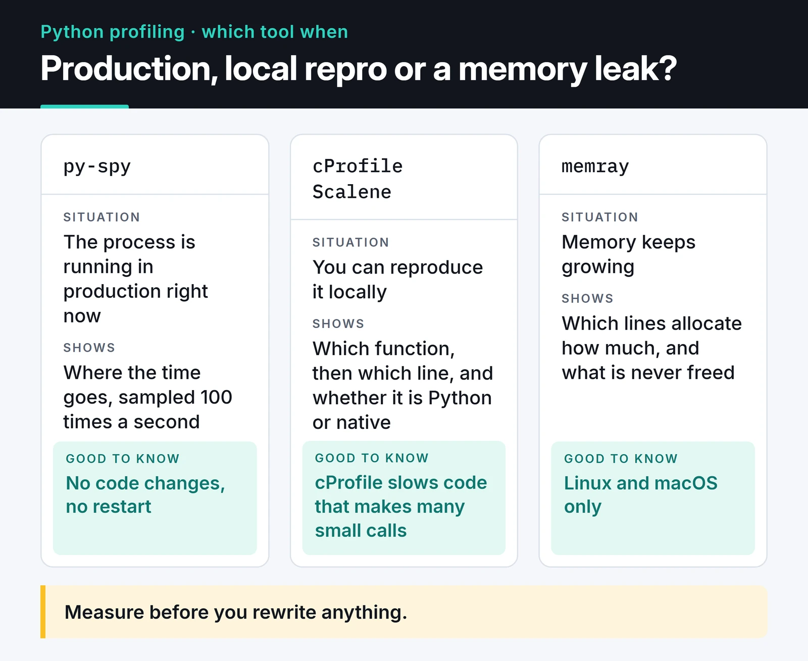

The most expensive mistake with slow Python code is guessing instead of measuring. You decide "this part must be slow", rewrite a function, and nothing changes, because the time goes somewhere else. Python performance profiling replaces the guess with a measurement. This post covers the three tools I reach for and when: cProfile during development, py-spy on a running process, and Scalene for line-level analysis including memory. At the end, I show how I prove a fix actually helped.

## Which tool when

Which tool to start with depends on two questions: is the process running in production right now, and is the problem CPU or memory? The card below sums it up.



## Example: a slow report function

To show the tools on real output, I wrote a small script. It parses JSON log lines and, for requests slower than 500 ms, counts unique users per endpoint:

```python
# slow_report.py
import json
import random
import re


def make_lines(n: int) -> list[str]:
    rnd = random.Random(42)
    return [
        json.dumps(
            {
                "user": f"u{rnd.randint(1, 5000)}",
                "ms": rnd.randint(1, 900),
                "path": f"/api/items/{rnd.randint(1, 50)}",
            }
        )
        for _ in range(n)
    ]


def slow_endpoints(lines: list[str]) -> dict[str, int]:
    users_by_path: dict[str, list[str]] = {}
    for line in lines:
        rec = json.loads(line)
        if re.match(r"^/api/items/\d+$", rec["path"]) and rec["ms"] > 500:
            users = users_by_path.setdefault(rec["path"], [])
            if rec["user"] not in users:  # membership test on a list: O(n)
                users.append(rec["user"])
    return {path: len(users) for path, users in users_by_path.items()}


if __name__ == "__main__":
    lines = make_lines(300_000)
    result = slow_endpoints(lines)
    print(len(result), sum(result.values()))
```

The comment gives the bug away. In real code it's rarely this obvious.

## cProfile: which function?

`cProfile` ships with Python and is deterministic: it counts every function call and times it. You can run it without touching the code:

```bash
python -m cProfile -s tottime slow_report.py
```

On my machine (Python 3.12) the top of the output looked like this (trimmed):

```text
         13758639 function calls (13758494 primitive calls) in 40.434 seconds

   Ordered by: internal time

   ncalls  tottime  percall  cumtime  percall filename:lineno(function)
        1   20.674   20.674   28.907   28.907 slow_report.py:21(slow_endpoints)
   300000    2.176    0.000    2.176    0.000 encoder.py:205(iterencode)
   900000    2.004    0.000    5.139    0.000 random.py:291(randrange)
   900000    1.610    0.000    1.610    0.000 {method 'match' of 're.Pattern' objects}
        1    1.489    1.489   11.443   11.443 slow_report.py:7(make_lines)
   300000    0.941    0.000    5.686    0.000 __init__.py:299(loads)
```

Know the two columns apart. `tottime` is time spent inside the function itself; `cumtime` includes everything it calls. `slow_endpoints` spends about 21 of its 29 seconds in its own body. Most of the rest is JSON parsing (`loads`, 5.7 seconds) and regex matching (1.6 seconds). So the culprit is neither `json` nor `re`; it's something in the function body. cProfile doesn't show lines, but it told me where to look.

You can also save the profile and inspect it later or visually:

```bash
python -m cProfile -o profile.prof slow_report.py
python -c "import pstats; pstats.Stats('profile.prof').sort_stats('cumulative').print_stats(15)"
uvx snakeviz profile.prof   # interactive view in the browser
```

cProfile has a cost. Because it instruments every call, it noticeably slows down code that makes many small calls and can inflate the share of tiny functions. It's great for local analysis and a bad fit for attaching to production.

Python 3.15 added a `profiling` package to the standard library. `cProfile` stays (it's also available as `profiling.tracing`), and a sampling profiler joined it; more on that below.

## py-spy: profile a running process without touching it

py-spy is a sampling profiler. It reads the target process's memory from the outside and, by default, looks at the stack 100 times a second. No code changes, no restart, and very low overhead. That's why it's what I attach to a FastAPI or Django process in production.

```bash
# top-like live view: which functions take the most time right now
py-spy top --pid 12345

# sample for 60 seconds and save a flame graph
py-spy record -o profile.svg --pid 12345 --duration 60

# speedscope format (open at https://www.speedscope.app)
py-spy record -o profile.json --format speedscope -- python slow_report.py

# where is every thread of a stuck process right now?
py-spy dump --pid 12345
```

`dump` is the least known and, to me, the most useful. When a worker stops responding, it shows within seconds which line it's waiting on: a lock, a socket read, an infinite loop.

When reading a flame graph, look at width: the wider a box, the more samples landed in that function. The Y axis is call depth and the colors mean nothing. By default py-spy hides idle threads; add `--idle` to see I/O waits too. `--native` shows what happens inside C extensions like NumPy.

I recorded a flame graph for the example with `py-spy record -o flame.svg -- python slow_report.py`. py-spy records line numbers too: the widest box is `slow_endpoints (slow_report.py:27)`, the line with the `not in` check on the list.

A few practical notes:

- On Linux, reading another process's memory needs privileges, usually `sudo`. Inside a container you need the `SYS_PTRACE` capability (`docker run --cap-add SYS_PTRACE`, or `securityContext.capabilities.add` in Kubernetes).
- py-spy has to understand each new Python version's internals. After upgrading Python, check the [release notes](https://github.com/benfred/py-spy/releases) to confirm py-spy supports it.
- For multi-process setups like Gunicorn or Celery, attach to the parent with `--subprocesses`.

On Python 3.15 you also get a similar tool in the standard library:

```bash
python -m profiling.sampling attach --flamegraph -d 30 -o profile.html 12345
```

The profiler and the target have to run the same Python minor version. Not needing an extra package helps in locked-down production environments.

## Scalene: which line, and is it Python or native?

cProfile pointed me at `slow_endpoints` but not at a line. Scalene fills that gap: per line, it splits CPU time into Python code, native code (C extensions) and system time (I/O), and shows memory allocations on the same lines.

```bash
pip install scalene
scalene run slow_report.py      # saves the profile to scalene-profile.json
scalene view                    # opens it in the browser
scalene view --cli              # or in the terminal
scalene run --cpu-only slow_report.py   # CPU only, faster
```

In this example the line to look at is `if rec["user"] not in users`: the 21 seconds of `tottime` that cProfile reported for `slow_endpoints` are spent there, in pure Python. The fact that this time disappears after the fix below confirms it. Here's why the per-line split matters: if time piles up in the native column (NumPy, the regex engine, a JSON parser), micro-optimizing your Python is pointless; you need a different algorithm or library. If system time is high, the problem is I/O, not CPU.

If memory keeps growing until the process is OOM-killed, Bloomberg's [memray](https://github.com/bloomberg/memray) goes deeper: it shows which lines allocate how much and what never gets freed.

```bash
memray run -o memory.bin slow_report.py
memray flamegraph memory.bin    # HTML report
```

memray runs on Linux and macOS, not Windows.

## The fix, and the proof

The problem in the example is an `in` check on a growing list. Every check scans the whole list, and once an endpoint has a couple of thousand users, that line eats everything. A set brings lookups down to constant time on average:

```python
def slow_endpoints(lines: list[str]) -> dict[str, int]:
    users_by_path: dict[str, set[str]] = {}
    for line in lines:
        rec = json.loads(line)
        if re.match(r"^/api/items/\d+$", rec["path"]) and rec["ms"] > 500:
            users_by_path.setdefault(rec["path"], set()).add(rec["user"])
    return {path: len(users) for path, users in users_by_path.items()}
```

With the same 300,000 lines, timed without the profiler, the function went from 21.3 seconds to 2.3 seconds on my machine. Exact numbers depend on the machine; what matters is the roughly ninefold difference. Most of the remaining time is now in `json.loads`; if it had to get faster still, a faster parser like `orjson` would be next. Again, profile first.

"It feels faster" isn't proof. Tie the measurement to a test with [pytest-benchmark](https://pytest-benchmark.readthedocs.io/):

```python
# test_report.py
from slow_report import make_lines, slow_endpoints

LINES = make_lines(50_000)


def test_slow_endpoints_speed(benchmark):
    result = benchmark(slow_endpoints, LINES)
    assert len(result) == 50
```

```bash
pytest test_report.py --benchmark-autosave
# after your change, compare against the last saved run
pytest test_report.py --benchmark-compare
```

It reports min, max, mean and standard deviation. If the mean dropped but the deviation exploded, the measurement is noisy; close other work on the machine and run it again.

## Fixes that keep coming up

Once a profile tells you what's slow, these are the fixes I use most:

- The right data structure: `set` or `dict` for membership checks, `collections.deque` for queues. One line, as in the example above, can make a big difference.
- Not repeating work: `functools.lru_cache` or `functools.cache` for expensive functions that return the same result for the same input. Watch for unbounded growth and unhashable arguments, and remember that on methods the cache keeps `self` alive.
- Batching I/O: one bulk query instead of a query per loop iteration, or concurrent requests with asyncio. My [asyncio post](/en/posts/python-asyncio-concurrent-processing/) covers that.
- Vectorizing: NumPy or pandas operations instead of Python loops for numeric work.
- Lots of small objects eating memory: `@dataclass(slots=True)` or `__slots__` removes the per-object `__dict__`.

Micro-optimizations like list comprehensions beating loops are real but usually small. If the profile doesn't point at that line, it's not worth hurting readability; when in doubt, measure with `python -m timeit`.

Profiling is only meaningful if the environment is reproducible, so pin your dependencies first; my [Poetry vs uv post](/en/posts/poetry-python-project-management/) covers that.

## Continuous profiling

Instead of profiling only during an incident, you can collect low-frequency profiles all the time. Tools like Grafana Pyroscope show changes such as "the login service uses more CPU since yesterday's deploy", release by release. A small project doesn't need it; with several services and regular deploys it's worth a look. How I put logs and metrics next to it is in my [Python logging post](/en/posts/python-logging-best-practices/).

## What's next

Next time someone reports something slow, take a profile before changing any code: `python -m cProfile -s tottime` locally, `py-spy top --pid` in production. The first ten lines usually tell you where to look.

If the bottleneck turns out to be I/O rather than CPU, my [asyncio post](/en/posts/python-asyncio-concurrent-processing/) is the next step.
