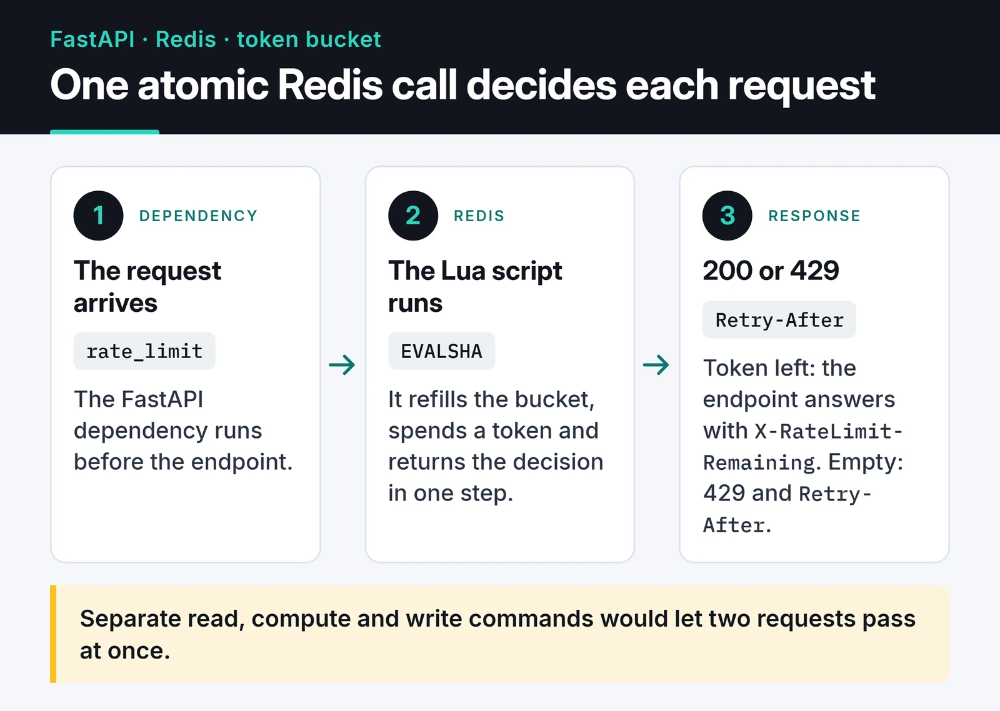

The day you expose an API, someone will call it faster than you planned. Sometimes it's a hostile scraper; more often it's your own client stuck in a retry loop. This post builds API rate limiting in Python from the ground up: the algorithms, an atomic token bucket in Redis with Lua, a FastAPI dependency, and what a client should do when it gets a 429. I also run the code and show the output.

An application-level rate limiter won't stop a DDoS. In a real attack the traffic saturates your network and proxy before it ever reaches Python, and that's a job for a CDN or the edge. An in-app limiter gives you fair use, cost control and slower brute-force attempts.

## Algorithms and their trade-offs

| Algorithm | How it works | Pro | Con |
|---|---|---|---|
| Fixed window | A counter that resets every minute | One `INCR`, very cheap | Up to 2x bursts at window edges |
| Sliding window log | Store every request timestamp in a sorted set | Exact | Memory per request |
| Sliding window counter | Weighted sum of previous and current window | Cheap, accurate enough | Approximate |
| Token bucket | Bucket refills at a fixed rate, each request spends a token | Allows controlled bursts | Slightly more state |

The fixed window breaks at its edges. With a limit of 100 per minute, a client can send 100 requests at 12:00:59 and 100 more at 12:01:00, which is 200 in two seconds.

```text
limit: 5 requests per minute

      previous minute (5 requests)    current minute (3 so far)
  |  x   x   x   x   x           |  x   x   x                      |
           |<---------- last 60 seconds ---------->|
           70% of the previous minute  + 30% elapsed  ^ now

  estimate = current + previous x 0.70
           = 3 + 5 x 0.70 = 6.5   > 5   -> reject
```

The sliding window counter fixes that with a cheap estimate. If 30% of the current minute has passed, you add 70% of the previous minute's count to the current count and compare with the limit. For most APIs I use a token bucket instead. It lets a client that has been quiet send a short burst while keeping the long-run average fixed. Stripe describes its own token-bucket limiters in its [post on rate limiters](https://stripe.com/blog/rate-limiters).

## An atomic token bucket with Redis and Lua

With more than one server or worker, the counter can't live in process memory and has to be shared. Redis works well. But if you read, compute and write with separate commands, two requests can read at the same time and both decide they're under the limit. Lua scripts run atomically inside Redis, which removes the race.

Here's the path of one request: the FastAPI dependency calls the script, the script updates the bucket and returns the decision.



Three details in the script matter:

1. It reads the clock from Redis's `TIME` command instead of the app server's `time.time()`. Clocks on different app servers drift by hundreds of milliseconds, which skews the refill math.
2. It keeps state in one hash instead of two separate keys.
3. It sets an expiry. Without one, every IP leaves a key behind forever and Redis memory slowly fills up.

```python {title="limiter.py"}
import hashlib
import logging

import redis.asyncio as redis
from fastapi import Depends, FastAPI, HTTPException, Request, Response

log = logging.getLogger(__name__)

TOKEN_BUCKET_LUA = """
-- KEYS[1]: bucket key
-- ARGV[1]: capacity, ARGV[2]: refill rate (tokens/second), ARGV[3]: cost
local capacity = tonumber(ARGV[1])
local rate = tonumber(ARGV[2])
local cost = tonumber(ARGV[3])

local t = redis.call("TIME")
local now = tonumber(t[1]) + tonumber(t[2]) / 1000000

local bucket = redis.call("HMGET", KEYS[1], "tokens", "ts")
local tokens = tonumber(bucket[1]) or capacity
local ts = tonumber(bucket[2]) or now

tokens = math.min(capacity, tokens + math.max(0, now - ts) * rate)

local allowed = 0
local retry_after = 0
if tokens >= cost then
  tokens = tokens - cost
  allowed = 1
else
  retry_after = math.ceil((cost - tokens) / rate)
end

redis.call("HSET", KEYS[1], "tokens", tokens, "ts", now)
redis.call("EXPIRE", KEYS[1], math.ceil(capacity / rate) + 1)
return {allowed, math.floor(tokens), retry_after}
"""

r = redis.Redis.from_url("redis://localhost:6379/0")
token_bucket = r.register_script(TOKEN_BUCKET_LUA)
```

`register_script` calls the script through `EVALSHA`, and redis-py reloads it automatically if Redis has flushed its script cache. Once a bucket would be full again, the key can safely disappear, because a missing key means "full bucket". The `EXPIRE` value is based on exactly that.

## The FastAPI dependency

I write the check as a dependency. Endpoint bodies stay clean, and you can see from the signature which endpoints are limited:

```python
# tier -> (capacity, tokens per second)
TIERS = {"anonymous": (20, 0.2), "free": (60, 1.0), "pro": (600, 10.0)}


async def lookup_tier(api_key: str) -> str:
    return "free"  # in a real app: database or cache lookup


async def rate_limit(request: Request, response: Response) -> None:
    api_key = request.headers.get("X-API-Key")
    if api_key:
        identity = "key:" + hashlib.sha256(api_key.encode()).hexdigest()[:32]
        tier = await lookup_tier(api_key)
    else:
        identity = f"ip:{request.client.host}"
        tier = "anonymous"

    capacity, rate = TIERS[tier]
    try:
        allowed, remaining, retry_after = await token_bucket(
            keys=[f"rl:{identity}"], args=[capacity, rate, 1]
        )
    except redis.RedisError:
        log.warning("rate limiter unavailable, allowing request")
        return  # fail open

    headers = {"X-RateLimit-Limit": str(capacity), "X-RateLimit-Remaining": str(remaining)}
    if not allowed:
        # HTTPException builds a new response, so pass the headers along
        headers["Retry-After"] = str(retry_after)
        raise HTTPException(status_code=429, detail="Too many requests", headers=headers)
    response.headers.update(headers)


app = FastAPI()


@app.get("/api/reports", dependencies=[Depends(rate_limit)])
async def reports():
    return {"ok": True}
```

I ran this as `limiter.py` with a small `demo.py` that sends 22 requests from one IP through `httpx.ASGITransport`. Redis was replaced by `fakeredis` with Lua support, running the same script. The anonymous tier starts with 20 tokens, so the first 20 requests pass and the 21st gets a 429 with `Retry-After: 5`. At 0.2 tokens per second, one token takes exactly five seconds to refill.

The run also caught a detail. Headers written only to the injected `response` vanish from the 429, because `HTTPException` builds its own response. That's why the code above passes them to the exception too.

A few decisions in there deserve a sentence each.

I key limits on the API key or user ID whenever possible, not the IP. Hundreds of people on a university or office network share one public IP, so IP limits punish innocent users, while an attacker can rotate IPs cheaply. I only fall back to IP for unauthenticated endpoints like login. The API key is hashed so it never sits in Redis in plain text.

Behind a reverse proxy, `request.client.host` is the proxy's IP and everyone shares one bucket. Set `FORWARDED_ALLOW_IPS` to the proxy's address and Uvicorn uses the real client IP from `X-Forwarded-For`. Don't trust that header from everywhere, or clients can write it themselves and walk past the limit.

What happens when Redis is down is a product decision. For most APIs I fail open: limits pause and the service keeps working. For security limits like login attempts, failing closed can be the better call.

Tiers live in a table rather than in `if` statements. In a real app, cache the `lookup_tier` result briefly or you've added a database query to every request.

## Clients should honor Retry-After on a 429

`429 Too Many Requests` and the `Retry-After` header are standard ([RFC 6585](https://www.rfc-editor.org/rfc/rfc6585#section-4)). `X-RateLimit-*` headers are a widespread convention, and there's an IETF draft standardizing `RateLimit` headers. The worst client behavior is retrying immediately. If thousands of clients do that together, the server never recovers. I honor `Retry-After` first and otherwise use exponential backoff with full jitter:

```python
import asyncio
import random

import httpx


async def get_with_backoff(client: httpx.AsyncClient, url: str, max_attempts: int = 6) -> httpx.Response:
    for attempt in range(max_attempts):
        resp = await client.get(url)
        if resp.status_code != 429 and resp.status_code < 500:
            return resp
        retry_after = resp.headers.get("Retry-After", "")
        if retry_after.isdigit():
            delay = int(retry_after)
        else:
            delay = random.uniform(0, min(30, 2**attempt))  # full jitter
        await asyncio.sleep(delay)
    resp.raise_for_status()
    return resp
```

With full jitter the delay is random between zero and the cap. Fixed delays of 1, 2 and 4 seconds make every client retry at the same moments, and randomness spreads them out.

## Defense in layers, and libraries

I don't put the limit in just one place. At the edge, Nginx's `limit_req` applies a coarse per-IP limit and cheaply drops traffic that should never reach the app. Inside, FastAPI and Redis enforce fine-grained limits per user and plan.

If you'd rather not write this yourself, the [`limits`](https://github.com/alisaifee/limits) library ships Redis-backed fixed and sliding window strategies, and [`slowapi`](https://github.com/laurentS/slowapi) wires it into FastAPI and Starlette. I wrote my own here because I wanted full control over per-plan capacity and the `Retry-After` math.

Finally, watch your limits. Counting 429s per identity and endpoint (a Prometheus counter works) shows both attacks and real users you've throttled by mistake.

## What's next

Start by adding this dependency to your most expensive endpoint and watching the 429 count for a week. The atomic counter idea behind the Lua script, along with Redis's other data structures, is in [Redis caching and session management](/en/posts/redis-caching-session-management/). To combine limits with authentication, see [API authentication strategies](/en/posts/api-authentication-strategies/). On the Redis side, the [Redis scripting docs](https://redis.io/docs/latest/develop/programmability/eval-intro/) are the best reference.
