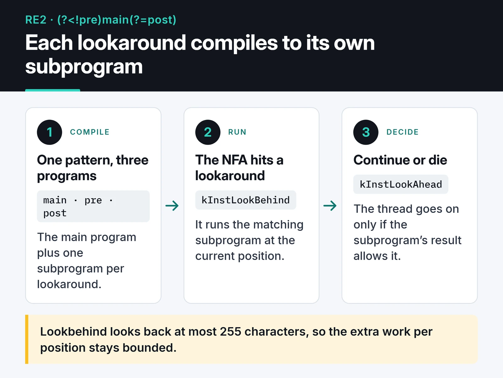

Google RE2 is a regex library that guarantees matching in time linear in the input length. To keep that guarantee it leaves some features out, and lookaround (`(?=...)`, `(?!...)`, `(?<=...)`, `(?<!...)`) is one of them. In November 2025 I added bounded lookaround to RE2 in my own fork and shared it as a proof of concept in issue [#585](https://github.com/google/re2/issues/585). This post covers the design, a flaw I later found in my own complexity claim, and what a comment from EPFL taught me. I never opened a PR against RE2 and nothing landed upstream: what exists is a fork, one commit and an open discussion.

## Why RE2 has no lookaround

Backtracking engines such as PCRE, Python's `re` and the JavaScript engines can take exponential time on some patterns. The textbook case is `(a+)+$` against `aaaaaaaaaaaaaaaaaaaaaaaaaaaaX`: before the match fails, the engine tries every way of splitting the `a`s between the two groups.

This has taken down real sites. Stack Overflow was unreachable for about half an hour in 2016 because of a regex that trimmed trailing whitespace ([postmortem](https://stackstatus.tumblr.com/post/147710624694/outage-postmortem-july-20-2016)), and Cloudflare's July 2019 outage came from a WAF rule regex that pegged CPUs ([Cloudflare's write-up](https://blog.cloudflare.com/details-of-the-cloudflare-outage-on-july-2-2019/)). Any system that feeds user-controlled patterns or input into a backtracking engine carries this risk, known as ReDoS.

RE2 avoids it with automata theory. It compiles the pattern into an automaton and reads the input once, tracking all possible states at the same time. With no backtracking, run time stays linear. Google Sheets' `REGEXMATCH` uses RE2, and Go's `regexp` package follows the same design, which is why regexes in Prometheus queries are safe to run.

Backreferences (`\1`) and lookaround don't fit that model directly. A 2017 request for negative lookahead, [#156](https://github.com/google/re2/issues/156), was closed the same day with a short answer: RE2 doesn't support constructs that require backtracking. It still collected 61 thumbs-up reactions after being closed.

## What lookaround buys you

Lookaround checks whether something is present at a position without consuming it. The cases I see most:

```text
(?<!old_)password    matches "password" in "new_password" but not in "old_password"
test(?!\d)           matches "test" when no digit follows
(?=.*\d)(?=.*[a-z]).{8,}   8+ characters with at least one digit and one lowercase letter
```

The last one is the classic password rule. On RE2 you can't express it as a single regex and need two or three separate checks. That's usually fine, but porting patterns from another engine to RE2 means rewriting all of them.

## My approach: bounded subprograms

I had read a 2024 paper from EPFL showing that JavaScript regexes, lookarounds included, can be matched in linear time ([Barrière and Pit-Claudel, PLDI 2024](https://doi.org/10.1145/3656431)). The idea I took from it was that lookaround doesn't inherently need backtracking. I then tried a simpler, cruder approach than theirs.

Each lookaround compiles to its own subprogram. While the main program runs on the NFA, a lookaround instruction runs the matching subprogram at the current position, and the thread continues or dies depending on the result. The card shows this for the pattern `(?<!pre)main(?=post)`.



Lookbehind is capped at 255 characters. The subprogram looks back at most 255 characters at each position, so the extra work per position has a constant upper bound. A small cap is also cheap to store, and real-world lookbehinds are almost always a few characters long.

The change is one commit, 569 added lines across 14 files:

- `re2/parse.cc`: parsing the four lookaround forms
- `re2/regexp.h`: four new `RegexpOp` values
- `re2/prog.h` and `re2/prog.cc`: the `kInstLookBehind` and `kInstLookAhead` instructions and subprogram storage
- `re2/compile.cc`: compiling the subprograms
- `re2/nfa.cc`: running a subprogram when the NFA hits one of those instructions
- `re2/testing/lookbehind_test.cc`: tests

This compiles and passes against the fork:

```cpp
#include <re2/re2.h>
#include <cassert>

int main() {
  RE2 not_after_digit("(?<!\\d)test");
  assert(RE2::PartialMatch("hello test", not_after_digit));
  assert(!RE2::PartialMatch("123test", not_after_digit));

  RE2 after_hello("(?<=hello )world");
  assert(RE2::PartialMatch("hello world", after_hello));
  assert(!RE2::PartialMatch("goodbye world", after_hello));

  RE2 not_before_digit("test(?!\\d)");
  assert(RE2::PartialMatch("test hello", not_before_digit));
  assert(!RE2::PartialMatch("test123", not_before_digit));
}
```

Against upstream RE2 the same file compiles, but the patterns are rejected at runtime and the first `assert` fails.

I listed the limits in the issue. Any pattern with lookaround always falls back to the NFA, with no DFA or OnePass, which means much larger constant factors.

## The flaw I found later

In the issue I gave the complexity as O(n × m × k), with n the input length, m the number of lookarounds and k the subpattern cost bounded by 255. That holds for lookbehind. It doesn't hold for lookahead.

I left lookahead unbounded and called it "naturally bounded by the remaining text." The remaining text can be n characters long. A lookahead like `(?=.*\d)` can scan to the end of the input from every position, which is O(n²) in the worst case. So with lookahead, my prototype breaks the one promise RE2 exists to keep. Fixing it means either bounding lookahead too, or sharing results across positions instead of rerunning the same subprogram everywhere.

## The comment from EPFL

About two weeks after I opened the issue, on December 9, 2025, Aurèle Barrière replied. Barrière is one of the authors of the paper I had read, and the comment pointed out that unbounded lookbehinds can also be supported in linear time. A year earlier, Erik Giorgis from their group had implemented their algorithm in a fork of RE2. The code is at [epfl-systemf/re2-lookbehinds](https://github.com/epfl-systemf/re2-lookbehinds), it's explained in [a post on the EPFL blog](https://systemf.epfl.ch/blog/re2-lookbehinds/), and they had shared it on the RE2 mailing list. Their approach avoids redundant work when the same lookbehind is tried at different positions and supports all unbounded lookbehinds that have no capture groups.


So this wasn't two teams racing on the same problem. EPFL had done it a year before me, on stronger theory, and I hadn't found it before opening my issue. Side by side:

| | My fork | EPFL fork |
|---|---|---|
| Lookbehind | Capped at 255 characters | Unbounded (no captures) |
| Lookahead | Supported, but not linear in the worst case | Focused on lookbehind |
| Repeated work | Subprogram reruns at every position | Shared across positions |
| Basis | Engineering shortcut | Published algorithm |

The one thing on my side is that I attempted lookahead, and the flaw above makes that half a point.

## What I'd do differently

Search the literature and the mailing list before writing code. I had read the paper but never looked for the same group's RE2 fork. One search would have saved me weeks of duplicated work and a false sense of being first.

Check a complexity claim for every construct separately. Bounding lookbehind and waving lookahead through as "naturally bounded" looked reasonable on paper and left exactly the kind of hole RE2 is designed to avoid.

It also makes sense that none of this went upstream. RE2 runs underneath Google's own services, and staying small and predictable is a deliberate choice. A change like this has to be mature enough that the maintainers would want to own it for years, and my prototype isn't.

Still, reading a production C++ regex engine from the parser down to the NFA taught me a lot.

## Where the code is

My next step is to study the EPFL fork and try their idea for lookahead. The code and notes on the experimental features are in [furkankoykiran/re2](https://github.com/furkankoykiran/re2), and the discussion is in issue [#585](https://github.com/google/re2/issues/585). More from this series: [my two PRs to github-mcp-server](/en/posts/github-mcp-server-contribution/) and [my Go contributions to Keploy](/en/posts/my-open-source-contribution-keploy/).
