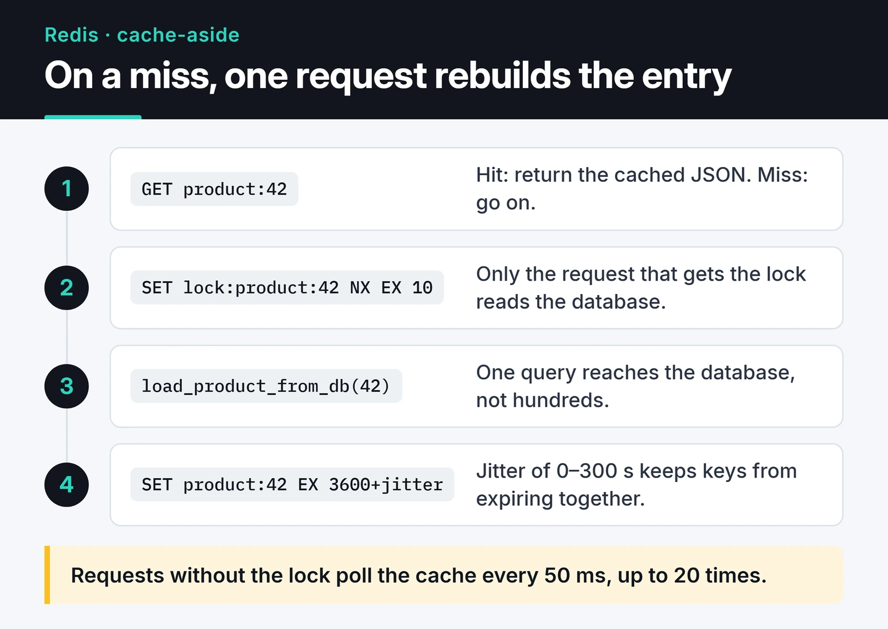
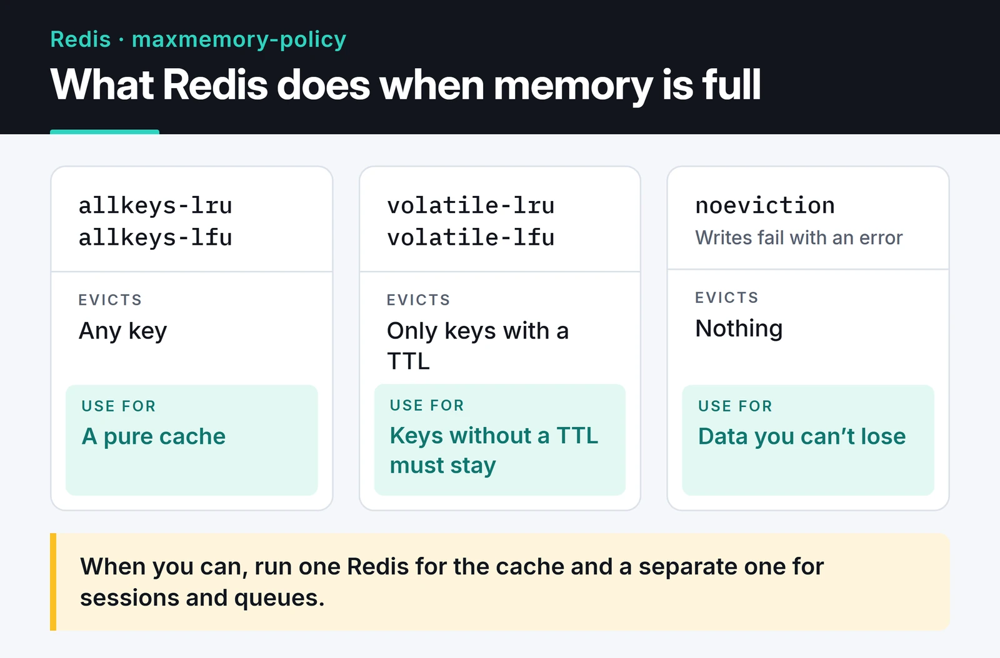

In most of my projects Redis shows up as a cache first. A few months later it also holds sessions, queues and rate-limit counters. This post covers Redis caching and session management in Python: cache-aside with stampede protection, server-side sessions you can revoke instantly, and the eviction setting that decides what survives when memory runs out. All examples use the `redis.asyncio` client from redis-py 5 and later, so they drop straight into FastAPI or any other async app.

## Which data structure for which job

A single key can hold any of these structures:

| Type | Example value | Typical use |
|---|---|---|
| String | `"42"`, a JSON blob | Cache entries, counters with `INCR` |
| Hash | `{name: "Ada", plan: "pro"}` | Sessions, objects with fields |
| List | `[job3, job2, job1]` | Simple queues |
| Set | `{python, redis}` | Unique tags, membership checks |
| Sorted set | `{alice: 120, bob: 95}` | Leaderboards, sliding-window rate limits |
| Bitmap | `0110 1001` | One flag per user or per day |
| HyperLogLog | 12 KB sketch | Approximate unique counts |
| Geo | `(28.97, 41.01)` | "Nearest to me" queries |
| Stream | `1700000000000-0 -> {event: "login"}` | Event logs with consumer groups |

On licensing: Redis moved to a source-available license with 7.4, the Linux Foundation forked it as Valkey, and Redis 8 added AGPLv3 as an option. Every command here works the same on Valkey, and redis-py talks to both.

## Create the client once

```python
import redis.asyncio as redis

r = redis.Redis.from_url("redis://localhost:6379/0", decode_responses=True)

# On shutdown:
# await r.aclose()
```

`decode_responses=True` returns `str` instead of bytes. The client keeps its own connection pool, so create it once (in FastAPI's `lifespan`, for example) and call `aclose()` on shutdown rather than opening a client per request.

## Cache-aside with stampede protection

With cache-aside, the app checks Redis first. On a miss it reads the database, writes the result to Redis with a TTL and returns it. Two things go wrong with the naive version.

One is a stampede: a hot key expires and hundreds of requests hit the database at once. The other is synchronized expiry, where thousands of keys created together all expire in the same second. A short lock handles the first, and random jitter on the TTL handles the second:

```python
import asyncio
import json
import random


async def load_product_from_db(product_id: int) -> dict:
    await asyncio.sleep(0.1)  # stand-in for a real query
    return {"id": product_id, "name": "Mechanical keyboard", "price": 79}


async def get_product(product_id: int) -> dict:
    key = f"product:{product_id}"
    if (cached := await r.get(key)) is not None:
        return json.loads(cached)

    lock_key = f"lock:{key}"
    if await r.set(lock_key, "1", nx=True, ex=10):
        try:
            product = await load_product_from_db(product_id)
            ttl = 3600 + random.randint(0, 300)  # jitter
            await r.set(key, json.dumps(product), ex=ttl)
            return product
        finally:
            await r.delete(lock_key)

    # Someone else is rebuilding the entry; poll the cache briefly.
    for _ in range(20):
        await asyncio.sleep(0.05)
        if (cached := await r.get(key)) is not None:
            return json.loads(cached)
    return await load_product_from_db(product_id)
```

The steps below show both paths. On a hit Redis answers alone. On a miss the request that wins the lock reads the database and writes the value back with a jittered TTL.



### Invalidation: delete on write

When data changes I delete the cached copy instead of updating it, and the next read loads fresh data.

```python
async def update_product(product_id: int, data: dict) -> None:
    await save_product_to_db(product_id, data)  # database first
    await r.delete(f"product:{product_id}")       # then the cache
```

Deleting wins under concurrency. If two writers race and both update the cache, the cached value can end up disagreeing with the database. A delete costs at most one extra miss.

Write-through (updating the cache on every write) makes sense for small, very read-heavy data. It also fills memory with data nobody reads, so it isn't my default.

## Server-side sessions in Redis

The main reason to keep sessions on the server is instant revocation. With JWTs that's awkward, while in Redis it's one `DEL`. I store each session as a hash and keep a set of session IDs per user so "log out of all devices" works.

The code:

```python
import secrets

SESSION_TTL = 60 * 60 * 24 * 7  # 7 days


async def create_session(user_id: int, user_agent: str) -> str:
    sid = secrets.token_urlsafe(32)
    async with r.pipeline(transaction=True) as pipe:
        pipe.hset(f"session:{sid}", mapping={"user_id": user_id, "ua": user_agent})
        pipe.expire(f"session:{sid}", SESSION_TTL)
        pipe.sadd(f"user_sessions:{user_id}", sid)
        await pipe.execute()
    return sid


async def get_session(sid: str) -> dict | None:
    data = await r.hgetall(f"session:{sid}")
    if not data:
        return None
    await r.expire(f"session:{sid}", SESSION_TTL)  # sliding expiration
    return data


async def logout_everywhere(user_id: int) -> None:
    sids = await r.smembers(f"user_sessions:{user_id}")
    if sids:
        await r.delete(*(f"session:{sid}" for sid in sids))
    await r.delete(f"user_sessions:{user_id}")
```

Put the session ID in a cookie with `HttpOnly`, `Secure` and `SameSite=Lax`. Expired IDs pile up in `user_sessions`. Pruning them at login with `EXISTS`, or giving the set its own TTL, keeps it small.

Sessions are data you can't afford to lose. If the same Redis also works as a cache with an evicting memory policy, sessions get evicted along with cache entries. More on that below.

## Data structures worth knowing

A leaderboard is a sorted set and a few lines of code, with O(log N) inserts and rank lookups:

```python
await r.zadd("leaderboard", {"ahmet": 500, "ayse": 720})
await r.zincrby("leaderboard", 50, "ahmet")
top10 = await r.zrange("leaderboard", 0, 9, desc=True, withscores=True)
```

`ZREVRANGE` still works, but it has been deprecated since Redis 6.2 in favor of `ZRANGE ... REV`, which is `desc=True` in redis-py.

HyperLogLog counts unique items in at most 12 KB per key, with a standard error of about 0.81%. If you don't need an exact number, it fits daily unique visitors well.

```python
await r.pfadd("visitors:2024-12-10", "user:42")
count = await r.pfcount("visitors:2024-12-10")
```

For geo queries, `GEORADIUS` is deprecated in favor of `GEOSEARCH`:

```python
await r.geoadd("restaurants", [28.9784, 41.0082, "kofteci"])
nearby = await r.geosearch(
    "restaurants", longitude=28.98, latitude=41.01, radius=2, unit="km", sort="ASC", count=5
)
```

## Pub/Sub or Streams?

Pub/Sub is fire and forget: if nobody is subscribed at that moment, the message is gone. That's fine for live notifications. For events that must be processed I use Streams. Consumer groups spread messages across workers, and anything not acknowledged stays in the pending list.

```python
from redis.exceptions import ResponseError


async def consume(consumer: str) -> None:
    try:
        await r.xgroup_create("orders", "billing", id="0", mkstream=True)
    except ResponseError as e:
        if "BUSYGROUP" not in str(e):
            raise

    while True:
        resp = await r.xreadgroup("billing", consumer, {"orders": ">"}, count=10, block=5000)
        for _stream, messages in resp or []:
            for msg_id, fields in messages:
                await handle_order(fields)
                await r.xack("orders", "billing", msg_id)


# Producer side:
# await r.xadd("orders", {"order_id": "1001", "total": "249.90"}, maxlen=100_000, approximate=True)
```

You'll often read that Streams "write to disk and never lose messages". That's incomplete. A stream lives in Redis memory like everything else, and durability depends on your AOF or RDB settings. With `appendfsync everysec` you can lose the last second. Use `XAUTOCLAIM` to hand a crashed consumer's pending messages to another worker. If you need a long-retention, loss-intolerant event log, Kafka or RabbitMQ fit better.

## Use Redis locks for efficiency only

redis-py's `lock()` gives you a lock on a single Redis instance using `SET NX PX`. That is not Redlock. Redlock is a separate multi-instance algorithm, and its safety guarantees are disputed.

```python
async with r.lock("daily-report", timeout=60, blocking_timeout=1):
    await build_daily_report()
```

This is fine for efficiency, like keeping two servers from running the same cron job. I don't rely on it for correctness, like never charging a payment twice. A GC pause or a slow network can let the lock expire while the work is still running. For those cases I use a unique constraint or an idempotency key in the database.

## Eviction policy decides what survives a full memory

`maxmemory-policy` decides what Redis does when it reaches the `maxmemory` limit. The [official docs](https://redis.io/docs/latest/develop/reference/eviction/) list every option. In practice, three groups matter:



- `allkeys-lru` / `allkeys-lfu` evict any key, which is right for a pure cache.
- `volatile-lru` / `volatile-lfu` evict only keys that have a TTL.
- `noeviction` rejects writes with an error, which is right for sessions, queues and counters.

The LRM variants in that list are newer and look at the last write instead of the last read. Mixing cache entries and must-keep data in one instance puts these needs in conflict. When I can, I run one Redis for caching and a separate one for sessions and queues.

## Security and high availability

Never leave Redis reachable from the internet. This is my baseline on every install:

1. `bind` to the private interface and keep `protected-mode yes`.
2. One ACL user per service: `ACL SETUSER cache on >long-random-password ~cache:* +@read +@write -@dangerous`. That user can only touch keys starting with `cache:` and can't run `FLUSHALL` or `KEYS`. People used `rename-command` for this before ACLs existed; ACLs are cleaner.
3. TLS when the network isn't trusted. In redis-py, switch the URL scheme to `rediss://`.

For availability, Sentinel watches a primary and its replicas and promotes a replica on failure. Cluster shards keys across several primaries and scales writes. If your data fits in one machine's memory, Sentinel is far less operational work.

## What's next

Start by running `CONFIG GET maxmemory-policy` on your own Redis and check whether one instance holds both cache entries and sessions. I turn the atomic counter idea into a Lua token bucket in [API rate limiting in Python](/en/posts/python-rate-limiting-api-throttling/). To wire Redis into a service, use the `lifespan` pattern from [building a REST API with FastAPI](/en/posts/python-fastapi-rest-api/). For the sessions-versus-tokens question, see [API authentication strategies](/en/posts/api-authentication-strategies/).

The [Redis command reference](https://redis.io/docs/latest/commands/) and the [redis-py docs](https://redis.readthedocs.io/en/stable/) have the details.
