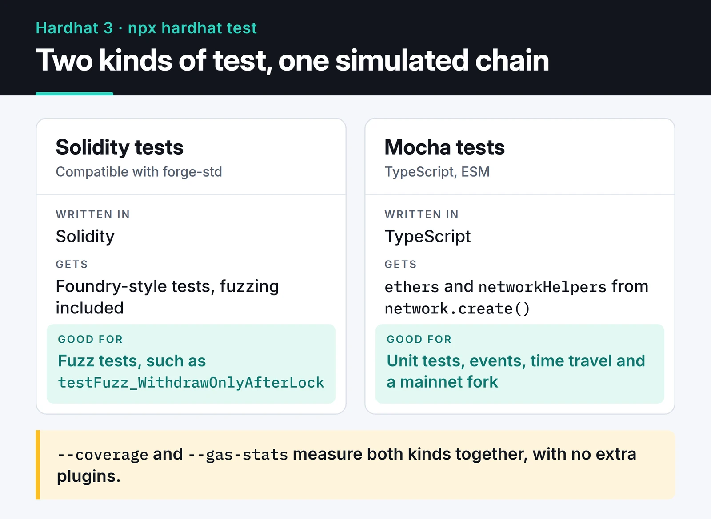

The clearest lesson from my time with smart contracts is that the tests matter as much as the contract. In a normal backend you find the bug and ship a fix. A deployed contract (without a proxy) never changes, and the bill for a bug usually lands on your users.

This post tests a small time-locked vault contract end to end with Hardhat 3: unit tests with Mocha and ethers v6, a Solidity fuzz test, coverage, gas stats, a mainnet fork and CI. I set everything up from scratch on Hardhat 3.21, ethers 6.17 and Solidity 0.8.28 and ran it, so you can copy the code as is.

## What changed if you're coming from Hardhat 2

- Projects are ESM and TypeScript. `npx hardhat init` is gone; use `npx hardhat --init`.
- The config uses `defineConfig`, and plugins are imported and listed explicitly in a `plugins` array. Importing alone no longer activates them.
- There's no global `hre.ethers`. A test opens a network connection with `network.create()` and takes `ethers` and `networkHelpers` from it, which also lets one test file talk to several networks, say a local simulation and a mainnet fork.
- Balance matchers such as `changeEtherBalance` take the `ethers` object as their first argument.
- Coverage and gas reporting are built in (`--coverage`, `--gas-stats`); no extra plugins.
- You can write tests in Solidity, compatible with Foundry's `forge-std`, including fuzz tests.

The card below shows what a single `npx hardhat test` runs. Both kinds of test execute on the same simulated chain, and coverage and gas stats measure them together.



## Setup

```bash
mkdir vault-tests && cd vault-tests
npx hardhat --init
```

In the wizard I pick Hardhat 3 and the template that uses Mocha with ethers.js. To set it up by hand, install `@nomicfoundation/hardhat-toolbox-mocha-ethers` plus the peer dependencies it asks for (`ethers`, `chai`, `mocha` and the `@nomicfoundation/hardhat-*` plugins). The config is short:

```typescript {title="hardhat.config.ts"}
import { configVariable, defineConfig } from "hardhat/config";
import hardhatToolboxMochaEthers from "@nomicfoundation/hardhat-toolbox-mocha-ethers";

export default defineConfig({
  plugins: [hardhatToolboxMochaEthers],
  solidity: {
    version: "0.8.28",
    settings: { optimizer: { enabled: true, runs: 200 } },
  },
  networks: {
    mainnetFork: {
      type: "edr-simulated",
      forking: {
        url: configVariable("MAINNET_RPC_URL"),
        blockNumber: 23_000_000,
      },
    },
  },
});
```

`configVariable` reads the RPC URL from an environment variable or Hardhat's keystore instead of the file. Only tests that connect to the fork need it; everything else runs without it.

## The contract under test

A simple vault: deposit ETH, withdraw it after seven days.

```solidity {title="contracts/TimeLockVault.sol"}
// SPDX-License-Identifier: MIT
pragma solidity ^0.8.28;

contract TimeLockVault {
    uint256 public constant LOCK_TIME = 7 days;

    mapping(address => uint256) public balanceOf;
    mapping(address => uint256) public unlockAt;

    event Deposited(address indexed user, uint256 amount, uint256 unlockAt);
    event Withdrawn(address indexed user, uint256 amount);

    error ZeroDeposit();
    error NothingToWithdraw();
    error StillLocked(uint256 unlockAt);
    error TransferFailed();

    function deposit() external payable {
        if (msg.value == 0) revert ZeroDeposit();
        balanceOf[msg.sender] += msg.value;
        unlockAt[msg.sender] = block.timestamp + LOCK_TIME;
        emit Deposited(msg.sender, msg.value, unlockAt[msg.sender]);
    }

    function withdraw() external {
        uint256 amount = balanceOf[msg.sender];
        if (amount == 0) revert NothingToWithdraw();
        if (block.timestamp < unlockAt[msg.sender]) revert StillLocked(unlockAt[msg.sender]);

        balanceOf[msg.sender] = 0; // state first, external call last
        (bool ok, ) = msg.sender.call{value: amount}("");
        if (!ok) revert TransferFailed();
        emit Withdrawn(msg.sender, amount);
    }
}
```

I use custom errors instead of `require(..., "still locked")` strings. They're cheaper in gas, and tests can assert on the error type and its arguments. Zeroing the balance before sending ETH is the basic reentrancy guard (checks-effects-interactions).

## Tests with Mocha and ethers v6

```typescript {title="test/TimeLockVault.ts"}
import { expect } from "chai";
import { network } from "hardhat";
import { anyValue } from "@nomicfoundation/hardhat-ethers-chai-matchers/withArgs";

const { ethers, networkHelpers } = await network.create();
const { time, loadFixture } = networkHelpers;

describe("TimeLockVault", function () {
  async function deployVaultFixture() {
    const [owner, alice] = await ethers.getSigners();
    const vault = await ethers.deployContract("TimeLockVault");
    return { vault, owner, alice };
  }

  it("records the deposit and emits an event", async function () {
    const { vault, alice } = await loadFixture(deployVaultFixture);
    const amount = ethers.parseEther("1");

    await expect(vault.connect(alice).deposit({ value: amount }))
      .to.emit(vault, "Deposited")
      .withArgs(alice.address, amount, anyValue);

    expect(await vault.balanceOf(alice.address)).to.equal(amount);
  });

  it("rejects zero deposits", async function () {
    const { vault } = await loadFixture(deployVaultFixture);
    await expect(vault.deposit({ value: 0n })).to.be.revertedWithCustomError(vault, "ZeroDeposit");
  });

  it("blocks withdrawals before the lock expires", async function () {
    const { vault, alice } = await loadFixture(deployVaultFixture);
    await vault.connect(alice).deposit({ value: ethers.parseEther("1") });
    const unlockAt = await vault.unlockAt(alice.address);

    await expect(vault.connect(alice).withdraw())
      .to.be.revertedWithCustomError(vault, "StillLocked")
      .withArgs(unlockAt);
  });

  it("pays out after seven days", async function () {
    const { vault, alice } = await loadFixture(deployVaultFixture);
    const amount = ethers.parseEther("1");
    await vault.connect(alice).deposit({ value: amount });

    await time.increase(7 * 24 * 60 * 60);

    await expect(vault.connect(alice).withdraw()).to.changeEtherBalances(
      ethers,
      [alice, vault],
      [amount, -amount],
    );
    expect(await vault.balanceOf(alice.address)).to.equal(0n);
  });
});
```

A few things worth noticing:

- `loadFixture` deploys on first use and snapshots the chain. Later tests revert to that snapshot instead of redeploying, which is faster than deploying in `beforeEach` and keeps state from leaking between tests.
- ethers v6 uses native `bigint`, not `BigNumber`, so comparisons use literals like `0n`. `ethers.utils.parseEther` is now just `ethers.parseEther`.
- `time.increase` moves the next block's timestamp forward and mines it. Seven days in one line.
- `changeEtherBalances` ignores gas fees by default, so Alice's balance changes by exactly `amount`.

`npx hardhat test` runs everything; `npx hardhat test mocha` runs only the Mocha suite.

## Fuzzing in Solidity

Hand-written tests only cover the cases I thought of. A fuzz test throws hundreds of random inputs at the same property. Hardhat 3 runs Solidity tests natively; after adding `forge-std` with `npm install --save-dev "github:foundry-rs/forge-std#v1.9.7"`:

```solidity {title="contracts/TimeLockVault.t.sol"}
// SPDX-License-Identifier: MIT
pragma solidity ^0.8.28;

import {Test} from "forge-std/Test.sol";
import {TimeLockVault} from "./TimeLockVault.sol";

contract TimeLockVaultTest is Test {
    TimeLockVault vault;
    address alice = makeAddr("alice");

    function setUp() public {
        vault = new TimeLockVault();
    }

    // Fuzz: random amount and random wait time
    function testFuzz_WithdrawOnlyAfterLock(uint96 amount, uint32 wait) public {
        vm.assume(amount > 0);
        vm.deal(alice, amount);

        vm.prank(alice);
        vault.deposit{value: amount}();

        uint256 lockTime = vault.LOCK_TIME(); // read before vm.prank
        vm.warp(block.timestamp + wait);

        vm.prank(alice);
        if (wait < lockTime) {
            vm.expectRevert();
            vault.withdraw();
        } else {
            vault.withdraw();
            assertEq(alice.balance, amount);
            assertEq(address(vault).balance, 0);
        }
    }
}
```

The first time I ran this test it failed, and the bug was in the test. `vm.prank(alice)` only applies to the very next call. I originally had `vault.LOCK_TIME()` between the prank and `vault.withdraw()`, so the prank was spent on that view call, `withdraw` came from the test contract's address, and it reverted with `NothingToWithdraw`. The fuzzer found a counterexample right away. Reading `LOCK_TIME` before the prank fixed it.

The same file runs under Foundry with `forge test`. Plenty of teams prefer Foundry for heavy fuzzing and invariant testing, and Hardhat 3 makes it easy to mix both in one project.

## Coverage and gas stats

```bash
npx hardhat test --coverage
npx hardhat test mocha --gas-stats
```

For this contract, coverage reports 81.82% of lines and 86.67% of statements. In my own run all five tests pass, and lines 27 and 32 are uncovered.

The two uncovered lines are the instructive part: `NothingToWithdraw` needs a withdrawal attempt from an account with no balance, and `TransferFailed` needs a contract that refuses ETH to withdraw. The second one means adding a small attacker contract whose `receive` function reverts. This is what the coverage report is for: it points at failure paths nobody has exercised.

`--gas-stats` prints min, average and max gas per function. Here `deposit` costs 67,524 gas and `withdraw` 32,108, and that table is enough to catch a refactor that made `deposit` more expensive.


## Integration tests on a mainnet fork

If your contract talks to live protocols like Uniswap, Aave or Chainlink, testing against a copy of mainnet at a fixed block is far more realistic than mocking them:

```typescript {title="test/fork.ts"}
import { expect } from "chai";
import { network } from "hardhat";

const { ethers } = await network.create("mainnetFork");

const USDC = "0xA0b86991c6218b36c1d19D4a2e9Eb0cE3606eB48";

describe("mainnet fork", function () {
  it("reads real USDC state", async function () {
    const usdc = await ethers.getContractAt(
      ["function decimals() view returns (uint8)", "function totalSupply() view returns (uint256)"],
      USDC,
    );
    expect(await usdc.decimals()).to.equal(6n);
    expect(await usdc.totalSupply()).to.be.greaterThan(0n);
  });
});
```

Pin `blockNumber`. Without it every run tests against a different chain state, and your RPC provider can't cache, so tests get slow. When you need to act as a large holder, `networkHelpers.impersonateAccount(...)` lets you send transactions from an address without its private key.

## Running tests in CI

A short GitHub Actions workflow runs the suite on every pull request:

```yaml {title=".github/workflows/test.yml"}
name: test
on: [push, pull_request]

jobs:
  test:
    runs-on: ubuntu-latest
    steps:
      - uses: actions/checkout@v6
      - uses: actions/setup-node@v6
        with:
          node-version: 24
          cache: npm
      - run: npm ci
      - run: npx hardhat test --coverage
```

For fork tests, store `MAINNET_RPC_URL` as a repository secret and pass it in as an environment variable. I cover secrets and caching in more depth in my [GitHub Actions CI/CD post](/en/posts/github-actions-ci-cd-pipeline/).

## What tests don't prove

Tests show that the scenarios you thought of work. They say nothing about the ones you didn't. Fuzzing narrows that gap, and static analyzers such as Slither catch known bug patterns, but a contract that will hold real money still needs an independent audit. I collected the most common vulnerabilities in my post on [Ethereum smart contract security](/en/posts/solidity-security-gas-optimization/). For the same testing discipline on the Rust side, see [Solana program development with Anchor](/en/posts/solana-program-development-rust/).

Set up the example project, run `npx hardhat test`, then try writing the test that covers the `TransferFailed` line yourself. The [Hardhat 3 docs](https://hardhat.org/docs) are the reference for the current API.
