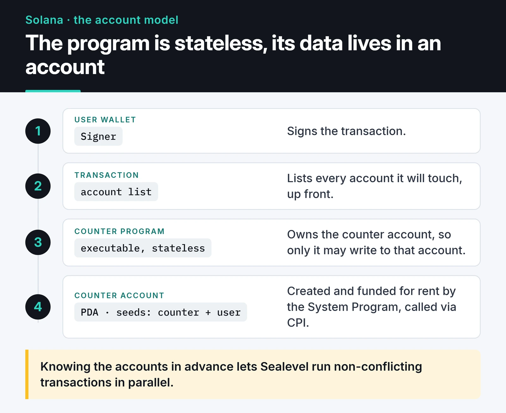

If you come from Ethereum, the hard part of Solana isn't Rust. It's the account model. In Solidity a contract keeps its own storage. On Solana a program is stateless: data lives in separate accounts, and every transaction must declare up front which accounts it will touch. Once that clicks, Solana program development starts to make a lot more sense.

This post builds a small per-user counter program with Rust and Anchor 1.x, then tests and deploys it. My most recent hands-on time with Solana was in [Quorum](https://furkankoykiran.com.tr/en/projects/quorum/), my SWARM Hackathon project, where I ran vault transactions through a Squads V4 multisig on devnet.

## The account model

On Solana everything is an account: a program's compiled code, user wallets, token balances, your program's data. Every account has an owner, and only the owning program may modify its data.



This design has two consequences. The first is parallelism: the runtime (Sealevel) can execute transactions that don't write to the same accounts at the same time, because it knows in advance which accounts each one touches. The second is a security burden: you have to verify that every account passed into your program is actually the account you expect. A large share of Solana exploits come down to missing checks of exactly that kind.

## PDAs: addresses without private keys

A Program Derived Address (PDA) is an address derived from a program ID plus seeds you choose, deliberately off the ed25519 curve. It has no private key, so only the program that derives it can sign for it.

In practice I use a PDA like a database key. Seeds `["counter", user_address]` always produce the same address for a given user, so the client can compute where the account lives without storing it anywhere.

## Proof of History, then and now

Solana's original idea was a fix for the clock problem in distributed systems. Proof of History (PoH) is a chain of SHA-256 hashes where each hash takes the previous output as input. You can't parallelize it, so the length of the chain is evidence that time has passed. Mix a transaction into the chain and you know exactly which hash came before it and which came after.

A tiny simulation shows the idea:

```python {title="poh_sim.py"}
import hashlib
import time


def simulate_poh(iterations: int) -> str:
    current = hashlib.sha256(b"genesis").digest()
    start = time.perf_counter()
    for _ in range(iterations):
        current = hashlib.sha256(current).digest()  # previous output is the next input
    elapsed = time.perf_counter() - start
    print(f"{iterations} hashes in {elapsed:.3f}s")
    return current.hex()


simulate_poh(1_000_000)
```

It pins one CPU core, and adding cores won't speed it up. PoH's "proof of elapsed time" rested on that sequential property.

PoH was never a consensus algorithm by itself. Solana was a Proof of Stake network that voted on forks with Tower BFT, and PoH gave that voting a shared clock.

Anza's [Alpenglow consensus protocol](https://solana.com/upgrades/alpenglow) (SIMD-0326) changes that picture. Its new voting component, Votor, replaces Tower BFT, and it targets finality of about 150 milliseconds instead of roughly 12.8 seconds. In the Alpenglow design PoH is no longer part of consensus. The good news for program developers: the runtime, transactions, programs and fees stay the same, so not a single line of the code in this post changes. What changed is how quickly your transaction becomes irreversible.

## Setup and what changed in Anchor 1.x

The easiest way to install Rust, the Solana CLI and Anchor in one go is Solana's official install script:

```bash
curl --proto '=https' --tlsv1.2 -sSfL https://solana-install.solana.workers.dev | bash
anchor --version
```

I switch Anchor versions with `avm` (Anchor Version Manager). Version mismatches are one of the biggest time sinks in Solana development.

Changes in Anchor 1.0 that break older tutorials:

- The TypeScript client moved from `@coral-xyz/anchor` to `@anchor-lang/core`.
- `anchor init` now scaffolds a Rust LiteSVM test by default. Pass `--test-template mocha` for TypeScript and Mocha.
- `anchor test` uses Surfpool instead of `solana-test-validator` by default; `--validator legacy` restores the old behavior.
- Passing the same account twice as `mut` is rejected unless you opt in with the `dup` constraint.
- Only one `#[error_code]` block is allowed per program.
- Anchor 1.x targets Solana 3.x.

Create the project:

```bash
anchor init counter --test-template mocha
cd counter
anchor build
```

## The program: a per-user counter

A small program where each user has a counter in their own PDA. It's close to Anchor's own template counter, but per user and with authorization enforced by constraints:

```rust {title="programs/counter/src/lib.rs"}
use anchor_lang::prelude::*;

// anchor init / anchor keys sync fills this with your own program ID
declare_id!("3ynNB373Q3VAzKp7m4x238po36hjAGFXFJB4ybN2iTyg");

#[program]
pub mod counter {
    use super::*;

    pub fn initialize(ctx: Context<Initialize>) -> Result<()> {
        let counter = &mut ctx.accounts.counter;
        counter.authority = ctx.accounts.authority.key();
        counter.count = 0;
        counter.bump = ctx.bumps.counter;
        Ok(())
    }

    pub fn increment(ctx: Context<Increment>) -> Result<()> {
        let counter = &mut ctx.accounts.counter;
        counter.count = counter.count.checked_add(1).ok_or(CounterError::Overflow)?;
        Ok(())
    }
}

#[derive(Accounts)]
pub struct Initialize<'info> {
    #[account(mut)]
    pub authority: Signer<'info>,
    #[account(
        init,
        payer = authority,
        space = 8 + Counter::INIT_SPACE,
        seeds = [b"counter", authority.key().as_ref()],
        bump
    )]
    pub counter: Account<'info, Counter>,
    pub system_program: Program<'info, System>,
}

#[derive(Accounts)]
pub struct Increment<'info> {
    #[account(
        mut,
        seeds = [b"counter", authority.key().as_ref()],
        bump = counter.bump,
        has_one = authority,
    )]
    pub counter: Account<'info, Counter>,
    pub authority: Signer<'info>,
}

#[account]
#[derive(InitSpace)]
pub struct Counter {
    pub authority: Pubkey,
    pub count: u64,
    pub bump: u8,
}

#[error_code]
pub enum CounterError {
    #[msg("Counter overflow")]
    Overflow,
}
```

Anchor 1.x fails `anchor build` if the ID in source doesn't match the program keypair, which is why `anchor keys sync` exists.

The lines that matter:

- `space = 8 + Counter::INIT_SPACE`: the first 8 bytes are the discriminator Anchor uses to tell account types apart. The `InitSpace` derive computes the size of the rest; counting bytes by hand is a reliable source of bugs.
- `ctx.bumps.counter`: I store the bump found during `init`. In `Increment`, `bump = counter.bump` reuses the stored value instead of searching for it again, which saves compute units.
- `has_one = authority`: forces the counter's `authority` field to equal the signing `authority` account. Because the seeds already include the user, this is a double check here; on an account whose seeds aren't tied to the user, `has_one` would be the only guard.
- `checked_add`: Anchor's workspace template enables `overflow-checks` in the release profile, so an overflow would panic and fail the transaction. I'd still rather check explicitly and return a meaningful error than rely on a profile setting that someone might turn off one day.

## Tests

With `--test-template mocha`, the test file is TypeScript:

```typescript {title="tests/counter.ts"}
import * as anchor from "@anchor-lang/core";
import { Program } from "@anchor-lang/core";
import { assert } from "chai";
import { Counter } from "../target/types/counter";

describe("counter", () => {
  const provider = anchor.AnchorProvider.env();
  anchor.setProvider(provider);

  const program = anchor.workspace.counter as Program<Counter>;
  const authority = provider.wallet.publicKey;
  const [counterPda] = anchor.web3.PublicKey.findProgramAddressSync(
    [Buffer.from("counter"), authority.toBuffer()],
    program.programId,
  );

  it("initializes and increments", async () => {
    await program.methods.initialize().accountsPartial({ counter: counterPda }).rpc();
    await program.methods.increment().accountsPartial({ counter: counterPda }).rpc();

    const state = await program.account.counter.fetch(counterPda);
    assert.equal(state.count.toNumber(), 1);
    assert.ok(state.authority.equals(authority));
  });

  it("rejects another signer", async () => {
    const other = anchor.web3.Keypair.generate();
    try {
      await program.methods
        .increment()
        .accountsPartial({ counter: counterPda, authority: other.publicKey })
        .signers([other])
        .rpc();
      assert.fail("increment should have been rejected");
    } catch (err) {
      assert.match(String(err), /ConstraintSeeds|ConstraintHasOne/);
    }
  });
});
```

`anchor test` builds the program, deploys it to a local network and runs the suite. To me the second test matters more than the first. Testing the happy path is easy; what you really want to see is an unauthorized signer getting rejected.

The default LiteSVM template runs tests in Rust instead, loading the program into a lightweight in-process Solana VM. With no validator to start, it's much faster, which pays off once you have a lot of tests.

## My security checklist

Typical Solana bugs differ from Ethereum's: reentrancy comes up less, account validation far more. What I check:

- Anywhere I see `AccountInfo` or `UncheckedAccount`, where are owner and type actually verified? `Account<'info, T>` makes Anchor do it.
- Does every privileged instruction have a `Signer` and a constraint that ties it to the data (`has_one`, seeds, or `constraint`)?
- For CPIs, is the target program's address verified with `Program<'info, T>`? Invoking whatever program ID the caller passed in is a classic mistake.
- Is arithmetic done with `checked_*`?
- Are accounts closed with Anchor's `close` constraint? Draining lamports by hand can let an account be revived within the same transaction.

## Compute, rent and deployment

Every transaction has a compute unit (CU) budget. `msg!` logs are great while developing, but each one costs CUs, so I strip unnecessary logs from hot instructions. Storing the bump serves the same goal.

An account stays alive only if it holds enough SOL to be rent-exempt, and `init` charges that to the `payer`. Decide early what users will pay for each new account.

Deploy to devnet first:

```bash
solana config set --url devnet
solana airdrop 2
anchor deploy --provider.cluster devnet
```

Solana programs are upgradeable by default. Leaving the upgrade authority on one personal key is a real risk for users. Hand it to a multisig such as Squads, or remove it once the program has matured. That's the same reason Quorum's vault required 3 of 5 operators to approve through Squads V4.

## The client side

Anchor's generated IDL gives you typed calls like `program.methods.increment()` in TypeScript. For non-Anchor client code, Solana's newer JavaScript SDK is `@solana/kit`; I'd pick it over the legacy `@solana/web3.js` 1.x API for new projects. Know the difference between the `processed`, `confirmed` and `finalized` commitment levels. With Alpenglow, waiting for `finalized` is far shorter than it used to be, but showing "sent" and "finalized" as separate states in the UI is still good practice.

## Try this next

Run the counter with `anchor test`, then delete the `has_one` constraint from `Increment` and see whether the second test still passes. It will, because the seeds are tied to the user. Then change the seeds in both structs to `[b"counter"]` and try again without `has_one`: this time the unauthorized signer can increment the counter. That experiment explains constraints better than any paragraph.

For the same testing discipline on the EVM side, see [smart contract testing with Hardhat 3](/en/posts/smart-contract-testing-hardhat-ethers/); common vulnerabilities are in my post on [Ethereum smart contract security](/en/posts/solidity-security-gas-optimization/). My experiment with LLM agents executing on Solana is in [AI-powered trading strategies](/en/posts/ai-powered-trading-strategies/). The [Anchor docs](https://www.anchor-lang.com/docs) are the reference for the current API.
