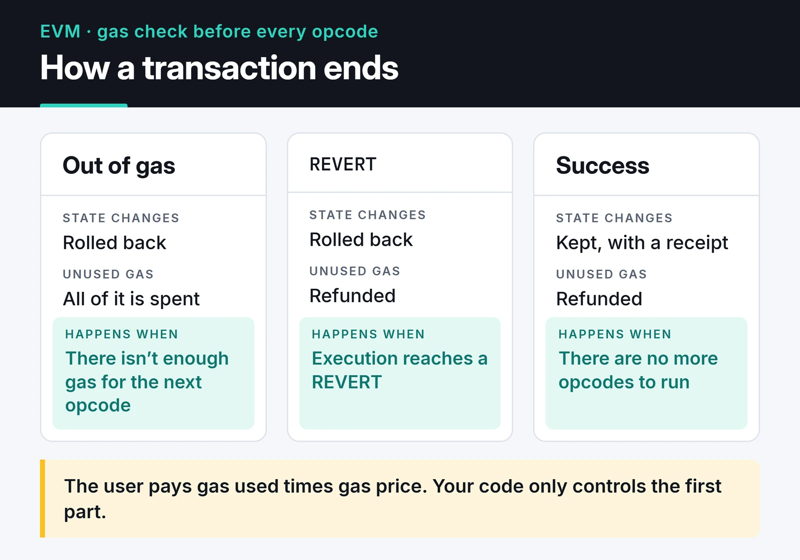

Smart contract security is the part of Web3 that takes the longest to sink in if you come from backend work. On a server, a bad deploy gets rolled back. On Ethereum the code stays where you put it, and it decides who can move the money inside it.

These are the notes I kept while doing Web3 work, cleaned up. Security and gas optimization share one post because they touch the same code. A contract too expensive to use is as useless as a cheap one that can be drained. The examples compile with Solidity 0.8.x and OpenZeppelin Contracts 5, and the tests use forge-std and pass.

## Reentrancy

Reentrancy drained The DAO in 2016 and still shows up in audit reports. Whenever a contract sends ETH or calls another contract, it hands control to the other side. If that side is a contract, it can call back into the same function before the first call finishes.

The broken pattern:

```solidity
contract VulnerableVault {
    mapping(address => uint256) public balances;

    function deposit() external payable {
        balances[msg.sender] += msg.value;
    }

    function withdraw() external {
        uint256 amount = balances[msg.sender];
        require(amount > 0, "nothing to withdraw");

        // Bug: ETH goes out before the balance is cleared
        (bool ok, ) = msg.sender.call{value: amount}("");
        require(ok, "transfer failed");

        balances[msg.sender] = 0;
    }
}
```

The attacker's `receive()` calls `withdraw()` again. The balance hasn't been zeroed yet, so the vault pays the same amount over and over.

The fix has two layers. First, Checks-Effects-Interactions: validate, update state, and only then make the external call. The Solidity docs recommend the same pattern in their reentrancy section:


The second layer is OpenZeppelin's `ReentrancyGuard`:

```solidity
import {ReentrancyGuard} from "@openzeppelin/contracts/utils/ReentrancyGuard.sol";

contract SafeVault is ReentrancyGuard {
    mapping(address => uint256) public balances;

    error NothingToWithdraw();
    error TransferFailed();

    function deposit() external payable {
        balances[msg.sender] += msg.value;
    }

    function withdraw() external nonReentrant {
        uint256 amount = balances[msg.sender];
        if (amount == 0) revert NothingToWithdraw();   // Checks

        balances[msg.sender] = 0;                       // Effects

        (bool ok, ) = msg.sender.call{value: amount}(""); // Interactions
        if (!ok) revert TransferFailed();
    }
}
```

On post-Cancun chains there's also `ReentrancyGuardTransient`, which keeps the lock in transient storage (EIP-1153) and costs less. Check that your target chain supports the Cancun opcodes before you switch.

A test makes the point better than prose. This attacker deposits 1 ETH, withdraws, and keeps re-entering while the vault still has money:

```solidity {title="test/Reentrancy.t.sol"}
// SPDX-License-Identifier: MIT
pragma solidity ^0.8.24;

import {Test} from "forge-std/Test.sol";
import {VulnerableVault, SafeVault} from "../src/Vaults.sol";

interface IVault {
    function deposit() external payable;
    function withdraw() external;
}

contract Attacker {
    IVault public immutable vault;

    constructor(IVault vault_) {
        vault = vault_;
    }

    function attack() external payable {
        vault.deposit{value: msg.value}();
        vault.withdraw();
    }

    receive() external payable {
        if (address(vault).balance >= 1 ether) {
            vault.withdraw();
        }
    }
}

contract ReentrancyTest is Test {
    function _fund(IVault vault) internal {
        address victim = makeAddr("victim");
        vm.deal(victim, 10 ether);
        vm.prank(victim);
        vault.deposit{value: 10 ether}();
    }

    function test_VulnerableVaultGetsDrained() public {
        VulnerableVault vault = new VulnerableVault();
        _fund(IVault(address(vault)));

        Attacker attacker = new Attacker(IVault(address(vault)));
        attacker.attack{value: 1 ether}();

        assertEq(address(vault).balance, 0);
        assertEq(address(attacker).balance, 11 ether);
    }

    function test_SafeVaultBlocksReentrancy() public {
        SafeVault vault = new SafeVault();
        _fund(IVault(address(vault)));

        Attacker attacker = new Attacker(IVault(address(vault)));
        vm.expectRevert(SafeVault.TransferFailed.selector);
        attacker.attack{value: 1 ether}();

        assertEq(address(vault).balance, 10 ether);
    }

    function testFuzz_DepositThenWithdraw(uint96 amount) public {
        vm.assume(amount > 0);
        SafeVault vault = new SafeVault();
        address user = makeAddr("user");
        vm.deal(user, amount);

        vm.startPrank(user);
        vault.deposit{value: amount}();
        vault.withdraw();
        vm.stopPrank();

        assertEq(user.balance, amount);
        assertEq(vault.balances(user), 0);
    }
}
```

In the first test the attacker walks in with 1 ETH and out with 11. In the second, the inner call reverts because of `nonReentrant`, the outer `call` fails, and the vault keeps its 10 ETH. The last one is a fuzz test; Foundry tries 256 values for `amount`.

ETH transfers aren't the only entry point. ERC-777 hooks, `onERC721Received` triggered by `safeTransferFrom`, and read-only reentrancy (another contract reading your view functions while your state is half updated) belong to the same family.

## Access control

`onlyOwner` is fine for small contracts, but it means one stolen key loses the whole protocol. I prefer separate roles, with the critical ones held by a Safe multisig:

```solidity
import {AccessControl} from "@openzeppelin/contracts/access/AccessControl.sol";
import {ERC20} from "@openzeppelin/contracts/token/ERC20/ERC20.sol";
import {Pausable} from "@openzeppelin/contracts/utils/Pausable.sol";

contract GameToken is ERC20, AccessControl, Pausable {
    bytes32 public constant MINTER_ROLE = keccak256("MINTER_ROLE");
    bytes32 public constant PAUSER_ROLE = keccak256("PAUSER_ROLE");

    constructor(address admin, address minter, address pauser) ERC20("Game", "GAME") {
        _grantRole(DEFAULT_ADMIN_ROLE, admin);
        _grantRole(MINTER_ROLE, minter);
        _grantRole(PAUSER_ROLE, pauser);
    }

    function mint(address to, uint256 amount) external onlyRole(MINTER_ROLE) {
        _mint(to, amount);
    }

    function pause() external onlyRole(PAUSER_ROLE) {
        _pause();
    }

    function unpause() external onlyRole(DEFAULT_ADMIN_ROLE) {
        _unpause();
    }

    // OpenZeppelin 5: transfers, mints and burns all go through _update
    function _update(address from, address to, uint256 value) internal override whenNotPaused {
        super._update(from, to, value);
    }
}
```

Two things tripped me up moving to OpenZeppelin 5. `Pausable` moved from `security/` to `utils/`. And ERC20's `_beforeTokenTransfer` hook is gone, replaced by `_update`, which every balance change passes through. Code copied from an older tutorial often won't compile because of this.

Give the pause role to an address that can react quickly and the unpause role to the slower, safer admin multisig. Putting admin actions behind a `TimelockController` gives users time to exit before a bad upgrade lands.

## Arithmetic after 0.8

Before Solidity 0.8.0, `uint8(255) + 1` silently became `0` unless you used `SafeMath`. Since 0.8, overflow and underflow checks are built in and that operation reverts. You can opt out with `unchecked`:

```solidity
unchecked {
    uint256 i = 0;
    i--; // does not revert, wraps to 2**256 - 1
}
```

Only use `unchecked` where you can prove overflow is impossible. The `unchecked { ++i; }` loop-counter trick you still see recommended is no longer needed: since Solidity 0.8.22 the compiler already skips the check for simple `for` loops.

What still bites: dividing before multiplying (precision loss), mixing tokens with different decimals (USDC has 6, most ERC-20s have 18) in one formula, and narrowing casts. An explicit `uint128(x)` doesn't revert on overflow; it truncates. OpenZeppelin's `SafeCast` exists for this.

## Randomness

Numbers derived from `block.timestamp`, `blockhash` or `block.prevrandao` are not safe randomness. Block producers can influence them to some degree, and a contract in the same block can compute the outcome first and only play when it wins.

```solidity
// Don't: an attacker in the same block can compute this value
uint256 random = uint256(keccak256(abi.encodePacked(block.timestamp, msg.sender)));
```

For anything that pays out, use verifiable randomness such as Chainlink VRF, or a commit-reveal scheme.

## Proxies, delegatecall and storage collisions

Upgradeable contracts rely on `delegatecall`: the proxy runs the logic contract's code against its own storage. If the two contracts disagree on variable order, the logic contract writes to the wrong slot and can overwrite, say, the proxy's admin.

Current practice:

- Don't hand-roll proxies. Use OpenZeppelin's UUPS or Transparent proxies, which keep the implementation and admin addresses in fixed ERC-1967 slots.
- OpenZeppelin 5's upgradeable contracts keep their state in ERC-7201 namespaced storage structs, which avoids most collisions when the inheritance order changes.
- Call `_disableInitializers()` in the logic contract's constructor. Otherwise anyone can initialize the implementation directly and become its owner.
- Validate storage layout before each upgrade with `@openzeppelin/upgrades-core` or the Foundry plugin.

## Oracle manipulation and flash loans

One of the most expensive DeFi bugs is reading a price from a DEX pool's spot reserves. An attacker can flash-borrow millions in the same transaction, skew the pool, and let your contract value collateral at the fake price.

Use off-chain price feeds such as Chainlink (and check `updatedAt` for staleness), time-weighted averages such as a Uniswap v3 TWAP, and never rely on a single source. I cover the arbitrage side of flash loans in the [flash loan arbitrage bot post](/en/posts/flash-loan-arbitrage-bot-python/).

## Signatures and replay

Any contract that accepts off-chain signatures (permits, meta-transactions, bridge messages) has to stop the same signature from being used twice. The signed payload needs a nonce, the chain ID and the contract address. EIP-712 plus OpenZeppelin's `EIP712` and `Nonces` helpers make this standard. In the Ronin bridge hack, attackers held 5 of the 9 validator keys, which shows that correct signature checks don't help when key management is weak.

## Gas optimization: measure first

Every EVM opcode has a gas cost. The user pays gas used times gas price, and your code only controls the first part.

The EVM runs a transaction opcode by opcode and checks the gas before each one. The card shows how the transaction ends when gas runs out or a REVERT comes.



[evm.codes](https://www.evm.codes/) is the reference I keep open for opcode costs. The ones that matter most in this post:

| Opcode | What it does | Gas |
|---|---|---|
| `ADD`, `SUB` | Arithmetic | 3 |
| `MUL`, `DIV` | Arithmetic | 5 |
| `MLOAD`, `MSTORE` | Memory read and write | 3, plus memory expansion |
| `KECCAK256` | Hash | 30 + 6 per 32-byte word |
| `SLOAD` | Storage read | 2,100 cold, 100 warm |
| `SSTORE` | Storage write | 20,000 zero to non-zero, 2,900 non-zero to another value, +2,100 if the slot is cold |
| `LOG1` | Event with one topic | 750 + 8 per data byte |

Roughly: arithmetic costs a few gas, memory is cheap until it grows, and storage is by far the most expensive. Since EIP-2929, the first read of a storage slot in a transaction (cold `SLOAD`) costs 2,100 gas and later reads cost 100. Writing a non-zero value into a zero slot costs around 20,000.

Measure before you optimize. `forge test --gas-report` gives per-function numbers, `forge snapshot` records per-test gas, and `forge snapshot --diff` shows what a change actually saved.

### Storage packing

Each storage slot holds 32 bytes. Small types declared next to each other get packed into one slot:

```solidity
// Bad: 3 slots
struct Bad {
    uint128 a;
    uint256 b;
    uint128 c;
}

// Good: 2 slots (a and c share one)
struct Good {
    uint128 a;
    uint128 c;
    uint256 b;
}
```

Packing only pays off when the packed values are read and written together. In memory and on the stack everything takes 32 bytes, and small types can even cost a little more because of masking.

### constant and immutable

Values that never change after deployment don't belong in storage:

```solidity
contract Fees {
    uint256 public constant FEE_BPS = 30;   // baked into bytecode
    address public immutable treasury;      // written once in the constructor

    constructor(address treasury_) {
        treasury = treasury_;
    }
}
```

Both are read from bytecode, which is far cheaper than an `SLOAD`.

### calldata, custom errors and short-circuiting

- Take array and struct parameters you don't modify as `calldata` instead of `memory`. That skips the copy.
- Replace `require(cond, "long message")` with `error InsufficientBalance(uint256 have, uint256 want)` and `revert`. Bytecode shrinks and the error can carry parameters. Since 0.8.27, `require(cond, CustomError())` works in both compiler pipelines.
- `&&` and `||` short-circuit, so put the cheap check that fails most often first.

### Loops and caching storage

Accumulate in a local variable and write storage once at the end:

```solidity
contract Airdrop {
    mapping(address => uint256) public credits;
    uint256 public totalCredits;

    error LengthMismatch();

    function grant(address[] calldata users, uint256[] calldata amounts) external {
        uint256 len = users.length;
        if (len != amounts.length) revert LengthMismatch();

        uint256 sum;                         // local instead of storage
        for (uint256 i; i < len; ++i) {      // 0.8.22+: increment is already unchecked
            credits[users[i]] += amounts[i];
            sum += amounts[i];
        }
        totalCredits += sum;                 // a single SSTORE
    }
}
```

Looping over an array that can grow without limit is also a security problem: once it's large enough, the function hits the block gas limit and can never be called again. For large distributions, a pull model where each user claims their share, for example a Merkle-based claim, is safer.

### Leave assembly for last

Inline assembly (Yul) skips the checks the compiler would add, and nothing replaces them. The `extcodesize` "is this a contract?" check is a good example: during a constructor `extcodesize` returns zero, so the check can be bypassed. That's why OpenZeppelin removed `Address.isContract` in version 5. I only reach for assembly on a measured hot path, with tests already in place.

## Pre-deployment checklist

Before deploying my own contracts I go through this:

1. Unit tests, fuzz tests and invariant tests for key properties (for example "sum of balances equals the vault balance") in Foundry.
2. Static analysis with [Slither](https://github.com/crytic/slither). High and medium findings either get fixed or get a written reason why they're false positives. It's easy to add to CI.
3. Integration tests on a mainnet fork (`forge test --fork-url`), which you need for any code that talks to real Uniswap or Aave contracts.
4. At least a few days of real use on Sepolia. Goerli is gone; Ethereum's current testnets are Sepolia and Hoodi.
5. An independent audit for anything that holds user funds. An audit doesn't prove there are no bugs, it only lowers the odds.

Deployment isn't the end. I wouldn't run a protocol of any size without alerting on suspicious transactions, a multisig that can `pause`, and an incident plan written in advance: who decides, and where users hear about it.

## Where to go next

You can see these patterns applied to an NFT contract in the [ERC721A and Merkle allowlist post](/en/posts/nft-minting-ethereum-guide/). For the risks of a contract that routes user funds, read the [DEX aggregator post](/en/posts/dex-aggregator-web3-routing/). If you work from Python, the [web3.py v7 guide](/en/posts/web3py-ethereum-interaction/) shows how to call and test these contracts from scripts.
