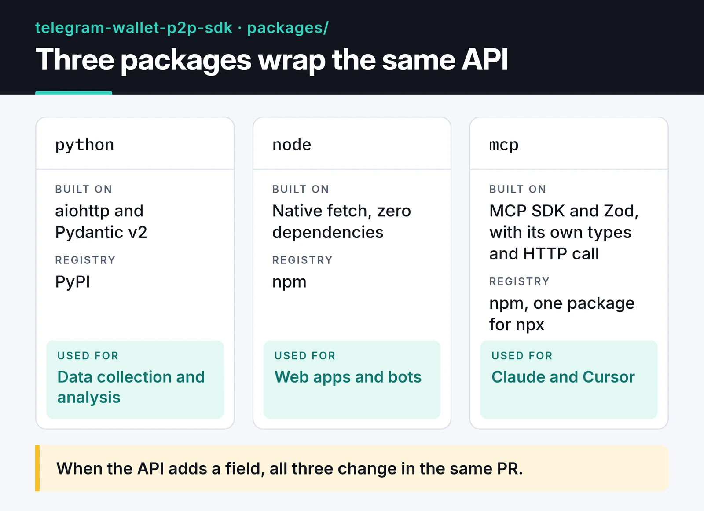

Wallet, the crypto wallet built into Telegram, opened its P2P market to an API. You can pull active ads, buy and sell prices, fiat and crypto currencies, maker details and payment methods without opening the app. I wrote two unofficial SDKs for that API, one for Python and one for Node.js, plus an MCP server so assistants like Claude can query it. All three live in one MIT-licensed monorepo.

Project page: [telegram-wallet-p2p-sdk](https://furkankoykiran.com.tr/en/projects/telegram-wallet-p2p-sdk/) · Source: [GitHub](https://github.com/furkankoykiran/telegram-wallet-p2p-sdk)

The project isn't affiliated with Telegram or Wallet. And the API is strictly read-only: you can list ads, but you can't post ads or trade. This is a market data and analytics toolkit, not a trading bot.

## What the API looks like

There's a single endpoint. You POST to `https://p2p.walletbot.me/p2p/integration-api/v1/item/online` with an `X-API-Key` header:

```json
{
  "cryptoCurrency": "USDT",
  "fiatCurrency": "EUR",
  "side": "SELL",
  "page": 1,
  "pageSize": 50
}
```

The response is `{"status": "SUCCESS", "data": [...]}`. Each ad carries the price, remaining quantity, min and max order amounts, payment methods, the maker's completed order count and completion rate, merchant level (regular user, merchant, trusted merchant) and whether auto-accept is on. Pages hold at most 50 ads.

You create an API key inside Telegram under Wallet → P2P Market → your profile → API Keys. The key doesn't come from browser DevTools; you create it in that menu.

## Why a monorepo

All three packages wrap the same API, and their models are coupled. When the API adds a field, the Python model, the TypeScript types and the MCP server should change in the same PR. Across separate repos that sync drifts quickly. The card shows the three packages and where each one is used.



The published packages:

- PyPI: `telegram-wallet-p2p`
- npm: `@furkankoykiran/telegram-wallet-p2p`
- npm: `@furkankoykiran/telegram-wallet-p2p-mcp`

All three live in the repo's `packages` folder.

As the card shows, the MCP server doesn't depend on the Node SDK; it keeps its own types and HTTP call. That was deliberate: `npx` downloads a single package, and there's no workspace dependency to complicate publish order. The cost is the same types living in two places.

## Why prices are strings

The API returns prices, quantities and rates as strings, and both SDKs keep them that way:

```ts
export interface OnlineItem {
  id: string;
  price: string;          // price per unit
  lastQuantity: string;   // remaining quantity
  minAmount: string;
  maxAmount: string | null;
  executeRate: string;    // completion rate, 0-1
  payments: string[];
  merchantLevel: MerchantLevel;
  isAutoAccept: boolean;
  // ...
}
```

Everyone knows `0.1 + 0.2` is `0.30000000000000004` in JavaScript. Convert a price to `number` once and that error leaks into sums and comparisons. Store strings and do the math with a decimal type.

The Python analytics helpers actually do this; every calculation uses `decimal.Decimal`. The Node side has an inconsistency: helpers like `priceSpread` and `bestPrice` convert prices with `parseFloat`. That's acceptable for statistics like mean and median, which get rounded to four decimals anyway, but don't use their output for accounting or order sizing. Moving the Node helpers to a decimal library is on my list.

The Node SDK doesn't validate API responses with Zod. It doesn't use Zod at all; the types are plain TypeScript interfaces with no runtime validation. Zod is only in the MCP server, for tool arguments. On the Python side, Pydantic v2 models do validate responses and map camelCase fields to snake_case.

## The Node.js SDK

The Node SDK has no runtime dependencies. It uses the `fetch` built into Node since 18:

```ts
import { WalletP2PClient, TradeSide, bestPrice, priceSpread } from "@furkankoykiran/telegram-wallet-p2p";

const client = new WalletP2PClient({ apiKey: process.env.WALLET_P2P_API_KEY! });

const { data } = await client.getOnlineItems({
  cryptoCurrency: "USDT",
  fiatCurrency: "EUR",
  side: TradeSide.SELL,
  pageSize: 50,
});

console.log(priceSpread(data));
console.log(bestPrice(data, TradeSide.SELL)?.price);
```

Top-level `await` needs an ES module (`.mjs`, `.mts`, or `"type": "module"` in `package.json`).

The client retries 429 and 5xx responses on its own: 3 attempts by default with exponential backoff of 1, 2 and 4 seconds. Other failures arrive as typed errors: `AuthenticationError` for a bad key, `BadRequestError` for an unsupported currency, `RateLimitError` once retries run out. Requests time out after 30 seconds via `AbortController`.

## The Python SDK

The Python SDK is built on `aiohttp` and used as an async context manager. Scanning several currencies at once is a job for `asyncio.gather`:

```python
import asyncio
import os

from telegram_wallet_p2p import TradeSide, WalletP2PClient
from telegram_wallet_p2p.analytics import price_spread


async def scan(client: WalletP2PClient, fiat: str):
    resp = await client.get_online_items("USDT", fiat, TradeSide.SELL, page_size=50)
    return fiat, price_spread(resp.data)


async def main() -> None:
    async with WalletP2PClient(api_key=os.environ["WALLET_P2P_API_KEY"]) as client:
        results = await asyncio.gather(*(scan(client, f) for f in ["EUR", "USD", "TRY"]))

    for fiat, stats in results:
        print(fiat, stats)


if __name__ == "__main__":
    asyncio.run(main())
```

The client shares one `aiohttp.ClientSession` and closes it when the `async with` block exits. Opening a session per request wastes the connection pool, so create the client once and reuse it.

This isn't "high-frequency data collection." You're sending a handful of parallel requests and you have to respect the API's rate limit. Polling every minute, or every few minutes, and writing the results to a time-series database is plenty to see how P2P spreads move during the day.

## Pagination and rate limits

To walk the whole order book at 50 ads per page you request pages in sequence. You don't need your own 429 handling because the client already retries; a short pause between pages keeps you well clear of the limit. Here's the loop:


```ts
import { WalletP2PClient, TradeSide, type OnlineItem } from "@furkankoykiran/telegram-wallet-p2p";

const client = new WalletP2PClient({ apiKey: process.env.WALLET_P2P_API_KEY! });
const sleep = (ms: number) => new Promise((resolve) => setTimeout(resolve, ms));

async function fetchAll(crypto: string, fiat: string, side: TradeSide): Promise<OnlineItem[]> {
  const all: OnlineItem[] = [];
  for (let page = 1; ; page++) {
    const { data } = await client.getOnlineItems({
      cryptoCurrency: crypto,
      fiatCurrency: fiat,
      side,
      page,
      pageSize: 50,
    });
    all.push(...data);
    if (data.length < 50) break; // last page
    await sleep(500);
  }
  return all;
}
```

Don't try to catch 429s with `error.message.includes('429')`. This SDK's error messages don't include the status code, so that branch never fires; use `error instanceof RateLimitError` if you need it. Using `push` instead of rebuilding the array with `[...all, ...page]` on every page also avoids needless copying on deep books.

## The MCP server

The MCP server exposes three tools:

- `get_p2p_ads` lists ads by crypto, fiat and side.
- `get_market_summary` returns price statistics, payment method and merchant level breakdowns, and the average completion rate.
- `get_best_price` returns the best-priced ad for a side.

Claude Desktop config:

```json
{
  "mcpServers": {
    "telegram-wallet-p2p": {
      "command": "npx",
      "args": ["-y", "@furkankoykiran/telegram-wallet-p2p-mcp"],
      "env": {
        "WALLET_P2P_API_KEY": "your-key"
      }
    }
  }
}
```

Then you can ask things like "What's the cheapest USDT I can buy with EUR right now?" or "Summarize the TON/USD market. How many sellers are merchants?" The assistant fetches the data and does the filtering itself.

The meaning of `side` isn't documented consistently across the packages. The MCP tool describes it from the ad maker's perspective, while the analytics docs describe it from the taker's. `bestPrice` picks the lowest price for BUY and the highest for SELL. Before trusting "best" from these helpers, compare a few ads against what the app shows to confirm which side means what. Pinning down one definition and applying it to all three packages is my next task.

## What's next

Short term, the two fixes above: one definition of `side`, and decimal math in the Node helpers. The Python package's `__version__` also disagrees with `pyproject.toml`, which needs fixing.

If Wallet ever adds write access to the API, order creation would be the obvious addition, but no such endpoint exists today and I'm not writing code against an API that isn't there. A short-lived cache for frequently queried pairs is an easy way to stay further under the rate limit.

I cover parallel requests, timeouts and concurrency limits in more depth in my [Python asyncio guide](/en/posts/python-asyncio-concurrent-processing/). Other MCP servers in this series: [freqtrade-mcp](/en/posts/freqtrade-mcp-server/) and [DevTo-MCP](/en/posts/devto-mcp-server/).
