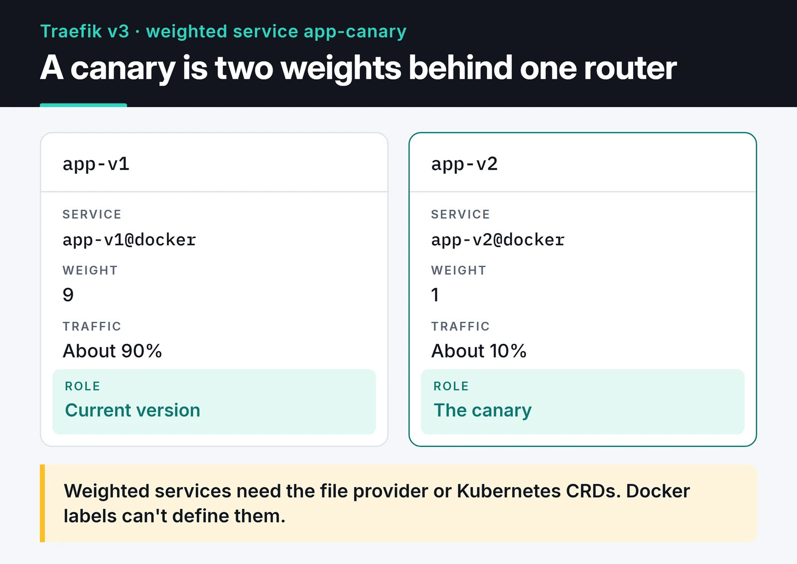

When I run a handful of Docker services on one server, I put Traefik in front of them. Traefik v3 is a reverse proxy that watches Docker: when a container starts, it reads the container's labels, builds the routing rule and requests a Let's Encrypt certificate on its own. Adding a service doesn't mean editing a proxy config and reloading it. A few labels in the service's `compose.yaml` are enough.

This post covers the setup I use, the middlewares I reach for, canary releases, and the things that trip people up when moving from v2. Everything here targets Traefik v3.7.

## Traefik or nginx?

I use both. Traefik wins when containers come and go often, each service has its own domain, and I don't want to think about certificates. nginx is more comfortable for static files, fine-grained caching and complex rewrites; I cover that side in my [nginx load balancing and caching post](/en/posts/nginx-load-balancing-caching/).

## The four building blocks

A request goes through four pieces:

1. EntryPoint: a port Traefik listens on, usually `web` (80) and `websecure` (443).
2. Router: matches the request against a rule such as `Host(`api.example.com`)`.
3. Middleware: steps that run before the request reaches the backend, like auth, rate limiting or header changes.
4. Service: the container or containers that handle the request. Load balancing happens here.

Configuration is split in two. Static config is read at startup: entrypoints, providers, certificate resolvers. Changing it needs a restart. Dynamic config is routers, middlewares and services. It comes from Docker labels or watched files, and Traefik reloads it while running.

## Static config: traefik.yml

```yaml {title="traefik.yml"}
entryPoints:
  web:
    address: ":80"
    http:
      redirections:
        entryPoint:
          to: websecure
          scheme: https
  websecure:
    address: ":443"
    http:
      tls:
        certResolver: le

api:
  dashboard: true

providers:
  docker:
    exposedByDefault: false
    network: proxy
  file:
    directory: /etc/traefik/dynamic
    watch: true

certificatesResolvers:
  le:
    acme:
      email: ops@example.com
      storage: /letsencrypt/acme.json
      httpChallenge:
        entryPoint: web

log:
  level: INFO
accessLog: {}
```

A few decisions are baked in. The `web` entrypoint redirects all HTTP to HTTPS. Because `websecure` has a default certificate resolver, routers don't each need a `tls.certresolver` label. `exposedByDefault: false` means only containers labeled `traefik.enable=true` get routed; leave it on and every container on the host, your database included, gets an automatic router. `network: proxy` tells Traefik which IP to use when a container sits on more than one Docker network.

## Docker Compose setup

```yaml {title="compose.yaml"}
services:
  traefik:
    image: traefik:v3.7
    restart: unless-stopped
    ports:
      - "80:80"
      - "443:443"
    volumes:
      - /var/run/docker.sock:/var/run/docker.sock:ro
      - ./traefik.yml:/etc/traefik/traefik.yml:ro
      - ./dynamic:/etc/traefik/dynamic:ro
      - ./letsencrypt:/letsencrypt
    networks:
      - proxy
    labels:
      - "traefik.enable=true"
      - "traefik.http.routers.dashboard.rule=Host(`traefik.example.com`)"
      - "traefik.http.routers.dashboard.entrypoints=websecure"
      - "traefik.http.routers.dashboard.service=api@internal"
      - "traefik.http.routers.dashboard.middlewares=dashboard-auth"
      - "traefik.http.middlewares.dashboard-auth.basicauth.users=admin:$$2y$$05$$REPLACE_WITH_HTPASSWD_HASH"

  api:
    image: ghcr.io/example/api:1a2b3c4
    restart: unless-stopped
    networks:
      - proxy
    labels:
      - "traefik.enable=true"
      - "traefik.http.routers.api.rule=Host(`api.example.com`)"
      - "traefik.http.routers.api.entrypoints=websecure"
      - "traefik.http.services.api.loadbalancer.server.port=8000"

networks:
  proxy:
    name: proxy
```

I don't expose the dashboard with `--api.insecure=true` on port 8080. It gets a router pointing at `api@internal`, plus basic auth. Generate the hash with `htpasswd -nB admin`. Compose treats `$` as variable interpolation, so every `$` in the hash must be written as `$$`. This is the most common mistake with this label.

Mounting the Docker socket with `:ro` makes the socket file read-only, but it doesn't limit what can be done through the Docker API. Anything with that socket can, in principle, start and stop containers. For a tighter setup, put a socket proxy between Traefik and Docker that only allows read requests.

The API service needs one port and one domain. As soon as the container joins the `proxy` network, Traefik reads the labels, creates the router and requests the certificate. The API doesn't publish port 8000 on the host; traffic only arrives through Traefik.

## Let's Encrypt: HTTP challenge or DNS challenge

The config above uses the HTTP-01 challenge. Let's Encrypt calls your domain on port 80, Traefik answers, and the certificate is issued. Port 80 must be reachable from the internet.

For a wildcard certificate (`*.example.com`) or a server that isn't publicly reachable, use DNS-01. Traefik creates a temporary TXT record through your DNS provider's API:

```yaml
certificatesResolvers:
  le-dns:
    acme:
      email: ops@example.com
      storage: /letsencrypt/acme.json
      dnsChallenge:
        provider: cloudflare
```

For Cloudflare, pass the API token as `CF_DNS_API_TOKEN` and scope it to DNS edit on the one zone.

Three practical notes:

- While experimenting, set `caServer: https://acme-staging-v02.api.letsencrypt.org/directory`. Hit the production rate limits and you can be locked out of new certificates for that domain for a while.
- Persist the folder that holds `acme.json`. Re-requesting every certificate each time the container is recreated is the fastest way to those rate limits.
- Traefik renews certificates before they expire. Let's Encrypt [no longer sends expiration reminder emails](https://letsencrypt.org/docs/expiration-emails/), so if renewal breaks, nobody tells you. I watch certificate expiry with [Uptime Kuma](/en/posts/uptime-kuma-service-monitoring/).

## Middlewares

I define middlewares once as labels and attach them to whichever routers need them:

```yaml
labels:
  # Only allow requests from the VPN subnet
  - "traefik.http.middlewares.vpn-only.ipallowlist.sourcerange=10.8.0.0/24"
  # 50 req/s per client IP on average, bursts up to 100
  - "traefik.http.middlewares.api-ratelimit.ratelimit.average=50"
  - "traefik.http.middlewares.api-ratelimit.ratelimit.burst=100"
  # Security headers
  - "traefik.http.middlewares.secure-headers.headers.stsSeconds=31536000"
  - "traefik.http.middlewares.secure-headers.headers.contentTypeNosniff=true"
  - "traefik.http.middlewares.secure-headers.headers.frameDeny=true"
  # Attach in order
  - "traefik.http.routers.api.middlewares=secure-headers,api-ratelimit"
```

Middlewares run in the order listed. The rate limiter counts by source IP, so if Cloudflare or another proxy sits in front of Traefik, every request seems to come from a few IPs. In that case, set `ratelimit.sourcecriterion.ipstrategy.depth` so Traefik picks the real client IP from `X-Forwarded-For`.

## Load balancing, sticky sessions and canary releases

Run several containers of the same service (`docker compose up --scale api=3`) and Traefik groups them under one service and spreads requests with weighted round robin. Scaling up or down needs no Traefik change.

If the app keeps sessions in memory, users need to stick to one container. Cookie-based sticky sessions handle that:

```yaml
labels:
  - "traefik.http.services.api.loadbalancer.sticky.cookie=true"
  - "traefik.http.services.api.loadbalancer.sticky.cookie.name=api_affinity"
  - "traefik.http.services.api.loadbalancer.sticky.cookie.secure=true"
  - "traefik.http.services.api.loadbalancer.sticky.cookie.httponly=true"
```

Shared session storage such as Redis is still the better design. With sticky sessions, users on a container that dies lose their session.

For canary releases I use Traefik's `weighted` service type. In the example below, requests split 9 to 1 between two versions.



You will find examples online that try to do this with Docker labels, and they don't work: weighted services can only be defined with the file provider or Kubernetes CRDs. I keep the containers on labels and define the weighted service in a file:

```yaml {title="dynamic/canary.yml"}
http:
  routers:
    app:
      rule: Host(`app.example.com`)
      entryPoints:
        - websecure
      service: app-canary
  services:
    app-canary:
      weighted:
        services:
          - name: app-v1@docker
            weight: 9
          - name: app-v2@docker
            weight: 1
```

The `app-v1` and `app-v2` containers only need `traefik.enable=true` and a service label such as `traefik.http.services.app-v1.loadbalancer.server.port=8000`. The `@docker` suffix says the service comes from the Docker provider. Change the weights, save the file, and Traefik applies the new split right away.

## Migrating from v2 to v3

Most v2 labels still work in v3, but a few things changed:

- The `ipWhiteList` middleware is now `ipAllowList`.
- Rule syntax changed. `HostRegexp` takes a plain Go regex, as in `HostRegexp(`^.+\.example\.com$`)`, and the `Headers` matcher is now `Header`.
- Instead of listing several domains in one matcher, write `Host(`a.example.com`) || Host(`b.example.com`)`.

To migrate gradually, set `core.defaultRuleSyntax: v2` in the static config and switch routers one by one with `ruleSyntax`. The official [v2 to v3 migration guide](https://doc.traefik.io/traefik/migrate/v2-to-v3/) has the full list.

## Troubleshooting

A 404 means no router matched. I open the dashboard first: is the router listed, does it show an error? If it's missing, the `traefik.enable=true` label is usually forgotten or the `Host` rule has the wrong domain (`www` versus bare domain is a classic).

A 502 or 504 means the router matched but Traefik can't reach the container. Is the container on the `proxy` network? Is `loadbalancer.server.port` the port the app really listens on? Is the app bound to `0.0.0.0` and not `127.0.0.1`? Those three questions solve most cases.

If the browser shows Traefik's default self-signed certificate, issuance failed. Look for the ACME error in `docker logs traefik`. A DNS record that doesn't point at the server and a closed port 80 are the usual causes.

## Where to go next

Add `metrics: prometheus: {}` to the static config to get request counts, error rates and latency per router, then graph them with [Prometheus and Grafana](/en/posts/prometheus-grafana-monitoring/). For the Python service behind Traefik, my post on [dockerizing a Python app with uv](/en/posts/docker-python-app-containerization/) shows how I build the image.
