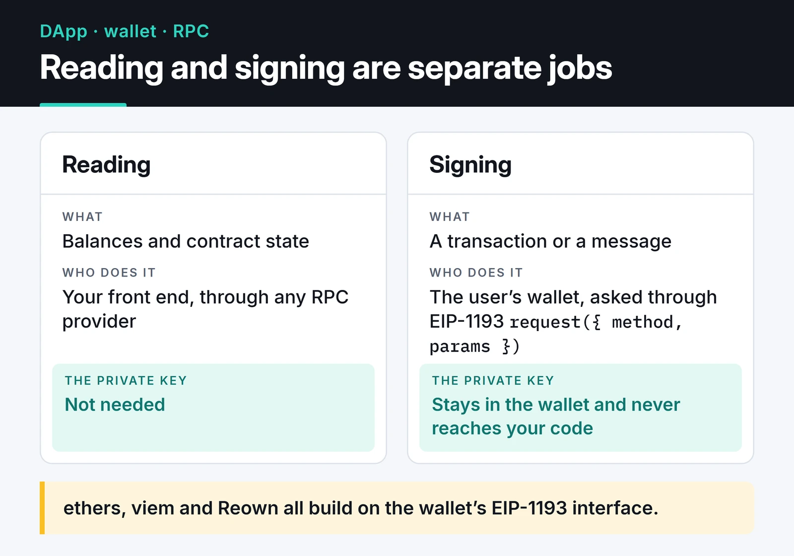
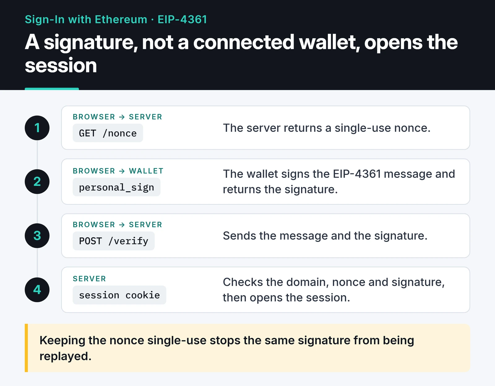

Web3 wallet integration is a DApp's first contact with its user. Most of the connection code I wrote during my Web3 work was built on `window.ethereum`. That still works, but it's no longer the right starting point. With several wallet extensions installed, nobody knows which one wins `window.ethereum`, and WalletConnect has become Reown with a new API.

Here's how I'd build a wallet connection from scratch: EIP-6963 for wallet discovery, ethers v6 for the connection, network handling, Reown AppKit for mobile wallets, and Sign-In with Ethereum for authentication.

## How the pieces fit

Reading and signing are separate jobs, and the card below shows that split.



Your front end can read balances and contract state from any RPC provider. Signing a transaction or a message only happens inside the user's wallet, and the private key never reaches your code. Wallets expose an EIP-1193 `request({ method, params })` interface to the page, and ethers, viem and Reown all build on top of it.

## EIP-6963: discover wallets instead of grabbing window.ethereum

The old way, every wallet extension tried to write `window.ethereum`. For a user with two wallets, the winner depended on extension load order. EIP-6963 fixes this with event-based discovery: the page asks who's there, and each wallet announces itself with a name, an icon and its provider.

```javascript {title="wallets.js"}
import { BrowserProvider, getAddress } from "ethers";

const wallets = new Map();

window.addEventListener("eip6963:announceProvider", (event) => {
  const { info, provider } = event.detail; // info: { uuid, name, icon, rdns }
  wallets.set(info.uuid, { info, provider });
  renderWalletButtons([...wallets.values()]);
});

// Ask installed wallets to announce themselves
window.dispatchEvent(new Event("eip6963:requestProvider"));

export async function connect(uuid) {
  const { provider: eip1193 } = wallets.get(uuid);
  const accounts = await eip1193.request({ method: "eth_requestAccounts" });

  const provider = new BrowserProvider(eip1193);
  const signer = await provider.getSigner();
  const { chainId } = await provider.getNetwork(); // bigint

  return { eip1193, provider, signer, address: getAddress(accounts[0]), chainId };
}

function renderWalletButtons(list) {
  const container = document.querySelector("#wallets");
  container.replaceChildren(
    ...list.map(({ info }) => {
      const button = document.createElement("button");
      button.textContent = info.name;
      button.onclick = () => connect(info.uuid);
      return button;
    }),
  );
}
```

The user picks the wallet, and you work with that wallet's provider. `info.rdns` (for example `io.metamask`) is a handy key for remembering the last wallet used.

What separates ethers v6 from older snippets: `BrowserProvider` replaces `providers.Web3Provider`, `getSigner()` is async, and amounts and `chainId` are native `bigint` rather than `BigNumber`. `ethers.utils.parseEther` is now just `ethers.parseEther`.

## Account and network changes

Users can switch accounts or networks while connected. My old code reloaded the page on every change. In ethers v6, `BrowserProvider` caches the network it connected to, so the clean approach on a network change is to build a fresh provider:

```javascript
export function watch(session, onChange) {
  const { eip1193 } = session;

  eip1193.on("accountsChanged", (accounts) => {
    if (accounts.length === 0) return onChange(null); // the user disconnected
    onChange({ ...session, address: getAddress(accounts[0]) });
  });

  eip1193.on("chainChanged", async () => {
    const provider = new BrowserProvider(eip1193); // don't reuse the old provider
    const signer = await provider.getSigner();
    const { chainId } = await provider.getNetwork();
    onChange({ ...session, provider, signer, chainId });
  });
}
```

If the user is on the wrong network, you can request a switch yourself. When the wallet doesn't know the network it returns error 4902, and you offer to add it:

```javascript
const BASE_SEPOLIA = {
  chainId: "0x14a34", // 84532
  chainName: "Base Sepolia",
  nativeCurrency: { name: "Ether", symbol: "ETH", decimals: 18 },
  rpcUrls: ["https://sepolia.base.org"],
  blockExplorerUrls: ["https://sepolia.basescan.org"],
};

export async function ensureChain(eip1193, chain = BASE_SEPOLIA) {
  try {
    await eip1193.request({
      method: "wallet_switchEthereumChain",
      params: [{ chainId: chain.chainId }],
    });
  } catch (err) {
    if (err.code !== 4902) throw err; // 4001: the user said no
    await eip1193.request({ method: "wallet_addEthereumChain", params: [chain] });
  }
}
```

Translating error codes into plain messages makes a big difference to how the app feels. The ones I see most: `4001`, the user rejected the request (a normal choice, not an error); `-32002`, a request is already pending in the wallet (the user clicked twice without closing the first popup); `4902`, unknown network.

## Mobile wallets: Reown AppKit

EIP-6963 only finds browser extensions. Users who want to connect the wallet on their phone need the WalletConnect protocol. The company behind WalletConnect renamed itself Reown in 2024, and the old Web3Modal now ships as Reown AppKit: a ready-made modal with QR-code mobile connections, browser extensions (EIP-6963 included) and network selection in one package.

```bash
npm install @reown/appkit @reown/appkit-adapter-ethers ethers
```

```javascript {title="appkit.js"}
import { createAppKit } from "@reown/appkit";
import { EthersAdapter } from "@reown/appkit-adapter-ethers";
import { base, baseSepolia } from "@reown/appkit/networks";
import { BrowserProvider } from "ethers";

const modal = createAppKit({
  adapters: [new EthersAdapter()],
  networks: [base, baseSepolia],
  projectId: import.meta.env.VITE_REOWN_PROJECT_ID, // dashboard.reown.com
  metadata: {
    name: "Example DApp",
    description: "Wallet integration example",
    url: "https://app.example.com", // must match your real domain exactly
    icons: ["https://app.example.com/icon.png"],
  },
});

let walletProvider = null;
modal.subscribeProviders((state) => {
  walletProvider = state["eip155"];
});

document.querySelector("#connect").addEventListener("click", () => modal.open());

export async function signHello() {
  if (!walletProvider) throw new Error("Connect a wallet first");
  const signer = await new BrowserProvider(walletProvider).getSigner();
  return signer.signMessage("Hello");
}
```

The project ID is free from the Reown Dashboard. Wallets use `metadata.url` to verify your domain, so a typo there shows users a warning in their wallet. In React, the wagmi adapter and its hooks are more comfortable, but the underlying flow is the same.

My rule of thumb: if the audience is desktop extension users only, I write my own small EIP-6963 list. If mobile wallets matter, I use AppKit rather than reinventing it.

## Authentication: Sign-In with Ethereum

Connecting a wallet doesn't prove the user owns the address; the front end can display any address it likes. To create a server-side session, the user signs a message and the server verifies the signature. EIP-4361 (Sign-In with Ethereum) standardizes that message.

The flow has four steps: the browser gets a nonce from the server, has the wallet sign the message, sends message and signature back, and the server opens a session once it has verified them.



A minimal version that builds the message and verifies it on the server:

```javascript {title="siwe.js"}
import { getAddress, hexlify, randomBytes, verifyMessage } from "ethers";

export function buildSiweMessage({ domain, uri, address, chainId, nonce, statement }) {
  return [
    `${domain} wants you to sign in with your Ethereum account:`,
    address,
    "",
    statement,
    "",
    `URI: ${uri}`,
    "Version: 1",
    `Chain ID: ${chainId}`,
    `Nonce: ${nonce}`,
    `Issued At: ${new Date().toISOString()}`,
  ].join("\n");
}

// Server side
const nonces = new Set(); // use an expiring store such as Redis in a real app

export function issueNonce() {
  const nonce = hexlify(randomBytes(16)).slice(2);
  nonces.add(nonce);
  return nonce;
}

export function verifySiwe({ message, signature }, expectedDomain) {
  const lines = message.split("\n");
  const domain = lines[0].replace(" wants you to sign in with your Ethereum account:", "");
  const claimed = getAddress(lines[1]);
  const nonce = lines.find((l) => l.startsWith("Nonce: "))?.slice(7);

  if (domain !== expectedDomain) throw new Error("wrong domain");
  if (!nonce || !nonces.delete(nonce)) throw new Error("unknown or reused nonce");
  if (verifyMessage(message, signature) !== claimed) throw new Error("bad signature");
  return claimed;
}
```

There are three checks and you need all three. The domain check stops a message signed on another site from being replayed on yours. The single-use nonce stops the same signature from being submitted twice. The signature check proves the address really signed the message.

One limitation: `verifyMessage` only verifies signatures from regular externally owned accounts. Smart contract wallets like Safe, and wallets built on account abstraction, validate signatures through the contract via ERC-1271. To support those users, use `parseSiweMessage` from viem's `viem/siwe` module together with a public client's `verifySiweMessage`, which handle those cases. I wrote the code above to show the mechanics; in production I'd use one of the standard libraries.

For structured data with several fields, such as an order or a permit, use an EIP-712 typed-data signature (`signer.signTypedData(domain, types, value)`) instead of free text. The wallet shows each field separately, so the user can actually see what they're signing.

## Security notes

- Never ask for a seed phrase or a private key. Any interface that does is phishing.
- Don't use the old `eth_sign`, which signs a raw hash the user can't read. `personal_sign` and EIP-712 cover every real need.
- Check `chainId` before sending a transaction. On the wrong network it fails at best.
- Ask for the exact token allowance you need instead of an unlimited approval.
- Simulate with `estimateGas` or `call` before sending; don't open a signing popup for a transaction that will revert.
- Trust the signature verified on your server, not the address your front end displays.

## Where to go next

Drop the EIP-6963 example into an HTML page and try it with two different wallet extensions. Seeing both listed separately explains the problem with `window.ethereum` better than any paragraph. Then wire the SIWE flow into a small Express server.

How the contract side gets tested is in [smart contract testing with Hardhat 3](/en/posts/smart-contract-testing-hardhat-ethers/), common vulnerabilities in [Ethereum smart contract security](/en/posts/solidity-security-gas-optimization/), and talking to the chain from Python in [Ethereum interaction with web3.py](/en/posts/web3py-ethereum-interaction/). For the standards themselves, see [EIP-6963](https://eips.ethereum.org/EIPS/eip-6963), [EIP-4361](https://eips.ethereum.org/EIPS/eip-4361) and the [Reown AppKit docs](https://docs.reown.com/appkit/javascript/core/installation).
