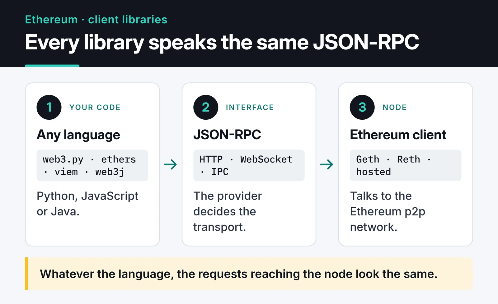

Most Ethereum tooling comes out of the JavaScript world, but most of the code I wrote against the chain was Python: trading bots, data collection scripts, Telegram alerts. All of it sat on top of web3.py. This post collects the patterns I use for Ethereum work with web3.py.

v7 changed a few important things: `geth_poa_middleware` is gone, the WebSocket provider was rewritten, and camelCase fields such as `rawTransaction` became snake_case. I ran the code below with web3.py 7.16. It also ran unchanged on 8.0, but read the official release notes before you move to 8. web3.py 8 requires Python 3.10 or newer.

```bash
pip install "web3>=7,<9" python-dotenv
```

## Picking a provider

web3.py talks to a node over JSON-RPC, and the provider decides the transport. As the diagram shows, ethers, viem and web3j speak the same interface, so the requests reaching the node look the same whatever language you use.



`HTTPProvider` covers scripts and request/response work: reading balances, calling contract functions, sending transactions.

```python {title="connect.py"}
from web3 import Web3

w3 = Web3(Web3.HTTPProvider(
    "https://ethereum-rpc.publicnode.com",
    request_kwargs={"timeout": 15},
))

print(w3.is_connected(), w3.eth.chain_id, w3.eth.block_number)

vitalik = "0xd8dA6BF26964aF9D7eEd9e03E53415D37aA96045"
print(w3.from_wei(w3.eth.get_balance(vitalik), "ether"))
```

Against a public RPC, the first line printed the connection status, the chain ID (1 for mainnet) and the latest block number, and the second the ETH balance:


Public RPC endpoints are fine for experiments, but they come with low rate limits and no guarantees. A bot that runs for weeks needs a key from a provider such as Alchemy, Infura or QuickNode, or its own node. If a Geth or Reth node runs on the same machine, `IPCProvider` gives the lowest latency. What separates a Python bot from a browser dApp is where the signing happens: the bot signs with its own local key, while in a dApp the key stays in the browser wallet.

## Async with AsyncHTTPProvider

Most of my bots read the state of dozens of addresses or pools at once. Synchronous code sends those requests one after another. With `AsyncWeb3` you fire them together and collect them with `asyncio.gather`:

```python {title="async_balances.py"}
import asyncio
from web3 import AsyncWeb3

RPC = "https://ethereum-rpc.publicnode.com"

async def main(addresses: list[str]) -> None:
    w3 = AsyncWeb3(AsyncWeb3.AsyncHTTPProvider(RPC))
    balances = await asyncio.gather(*(w3.eth.get_balance(a) for a in addresses))
    for address, wei in zip(addresses, balances):
        print(address, w3.from_wei(wei, "ether"))

asyncio.run(main([
    "0xd8dA6BF26964aF9D7eEd9e03E53415D37aA96045",
    "0xA0b86991c6218b36c1d19D4a2e9Eb0cE3606eB48",
]))
```

All of the gain comes from overlapping network waits. When you send a lot of requests, cap concurrency with an `asyncio.Semaphore` so you stay under your provider's requests-per-second limit. I go deeper into the asyncio side in my [asyncio concurrency post](/en/posts/python-asyncio-concurrent-processing/).

## Listening for new blocks over WebSocket

The `WebSocketProvider` that arrived in v7 is async only and built around subscriptions. This is how I listen for new block headers:

```python {title="new_heads.py"}
import asyncio
from web3 import AsyncWeb3, WebSocketProvider

async def main() -> None:
    async with AsyncWeb3(WebSocketProvider("wss://ethereum-rpc.publicnode.com")) as w3:
        subscription_id = await w3.eth.subscribe("newHeads")
        async for message in w3.socket.process_subscriptions():
            header = message["result"]
            print("new block:", header["number"])

asyncio.run(main())
```

`async with` opens and closes the connection. Long-lived WebSocket connections do drop. web3.py offers a reconnecting pattern, `async for w3 in AsyncWeb3(WebSocketProvider(url)):`, which opens a fresh connection every time the old one dies, but it won't backfill the blocks you missed in between. In a live bot I store the last block I processed and read the gap over HTTP after reconnecting.

## Accounts and private keys

Hardcoding a private key is the classic mistake. At a minimum read it from an environment variable, use a secret manager on servers, and give the bot its own wallet holding only what it needs:

```python
import os
from dotenv import load_dotenv
from eth_account import Account

load_dotenv()
account = Account.from_key(os.environ["PRIVATE_KEY"])
print(account.address)
```

Make sure `.env` is in `.gitignore`. Bots that scan GitHub for leaked keys are real, and they empty wallets within minutes.

## Building and sending an EIP-1559 transaction

Since the London upgrade, transactions use two fee fields instead of `gasPrice`: `maxPriorityFeePerGas` (the tip to the validator) and `maxFeePerGas` (the most you're willing to pay). You pay the base fee plus the tip, and the unused part of the cap stays with you.

```python {title="send_eth.py"}
from web3 import Web3

def build_transfer(w3: Web3, account, to: str, amount_eth: float) -> dict:
    latest = w3.eth.get_block("latest")
    priority = w3.eth.max_priority_fee
    tx = {
        "type": 2,
        "chainId": w3.eth.chain_id,
        "nonce": w3.eth.get_transaction_count(account.address, "pending"),
        "to": Web3.to_checksum_address(to),
        "value": w3.to_wei(amount_eth, "ether"),
        "maxPriorityFeePerGas": priority,
        "maxFeePerGas": 2 * latest["baseFeePerGas"] + priority,
    }
    tx["gas"] = w3.eth.estimate_gas({**tx, "from": account.address})
    return tx


w3 = Web3(Web3.HTTPProvider("https://ethereum-sepolia-rpc.publicnode.com"))
tx = build_transfer(w3, account, "0xRecipientAddress...", 0.001)
signed = account.sign_transaction(tx)
tx_hash = w3.eth.send_raw_transaction(signed.raw_transaction)
receipt = w3.eth.wait_for_transaction_receipt(tx_hash, timeout=180)
print("status:", receipt["status"], "block:", receipt["blockNumber"])
```

Some notes:

- `2 * baseFee + priority` is a common cap. It keeps the transaction from getting stuck when the base fee climbs over a few full blocks.
- I ask `estimate_gas` rather than hardcoding `21000`. A plain transfer to a contract can cost more.
- The nonce comes from `"pending"`, so it counts my own transactions still in the mempool. A bot that sends several transactions in parallel from one wallet has to track nonces itself, or it runs into "nonce too low" and "replacement transaction underpriced".
- In v7 the signed payload is `signed.raw_transaction`. The old `signed.rawTransaction` no longer exists.
- `receipt["status"] == 0` means the transaction was mined but reverted. The gas is still spent.

If you'd rather not sign every transaction by hand, add `SignAndSendRawMiddlewareBuilder.build(account)` as middleware and call `w3.eth.send_transaction({...})`. I prefer the explicit version above.

Run this on Sepolia first, with test ETH from a faucet. On mainnet, a transaction sent to the wrong address is gone.

## Reading a contract: ERC-20

To talk to a contract you need its address and ABI. You don't need the full ABI, only the functions and events you use:

```python {title="erc20.py"}
from web3 import Web3

ERC20_ABI = [
    {"name": "balanceOf", "type": "function", "stateMutability": "view",
     "inputs": [{"name": "owner", "type": "address"}],
     "outputs": [{"name": "", "type": "uint256"}]},
    {"name": "decimals", "type": "function", "stateMutability": "view",
     "inputs": [], "outputs": [{"name": "", "type": "uint8"}]},
    {"name": "symbol", "type": "function", "stateMutability": "view",
     "inputs": [], "outputs": [{"name": "", "type": "string"}]},
    {"name": "Transfer", "type": "event", "anonymous": False, "inputs": [
        {"name": "from", "type": "address", "indexed": True},
        {"name": "to", "type": "address", "indexed": True},
        {"name": "value", "type": "uint256", "indexed": False}]},
]

w3 = Web3(Web3.HTTPProvider("https://ethereum-rpc.publicnode.com"))
USDC = Web3.to_checksum_address("0xa0b86991c6218b36c1d19d4a2e9eb0ce3606eb48")
usdc = w3.eth.contract(address=USDC, abi=ERC20_ABI)

decimals = usdc.functions.decimals().call()
raw = usdc.functions.balanceOf("0xd8dA6BF26964aF9D7eEd9e03E53415D37aA96045").call()
print(usdc.functions.symbol().call(), raw / 10**decimals)
```

I normalize addresses with `to_checksum_address`. web3.py raises on an address with a bad checksum, which is the cheapest way to catch a copy-paste mistake. Always read decimals from the contract: USDC has 6, most ERC-20s have 18.

`.call()` doesn't change state and costs nothing. For state-changing functions, use `.build_transaction({...})` and sign it the same way as above.

## Reading events in chunks

Event logs are the efficient way to read history. In v7 the block range arguments became snake_case: `from_block`, `to_block`.

```python
def get_logs_chunked(event, start: int, end: int, step: int = 2_000):
    for frm in range(start, end + 1, step):
        to = min(frm + step - 1, end)
        yield from event.get_logs(from_block=frm, to_block=to)


latest = w3.eth.block_number
for log in get_logs_chunked(usdc.events.Transfer, latest - 10, latest):
    print(log["args"]["from"], log["args"]["to"], log["args"]["value"])
```

Ask for a wide range in one call and you'll hit your provider's limits; most cap either the block range or the number of logs returned. Tune the chunk size to your provider, and shrink the range and retry when a call fails. For analysis over millions of records, a small indexer that writes logs to a database works better, which I cover in the [blockchain data analysis post](/en/posts/blockchain-data-analysis-python-tools/).

## PoA chains and middleware

Some chains, such as Polygon PoS and BNB Smart Chain, put more than 32 bytes into the block header's `extraData`. web3.py raises `ExtraDataLengthError` when it reads those blocks; I got exactly that error against Polygon's public RPC. The fix is a middleware:

```python
from web3 import Web3
from web3.middleware import ExtraDataToPOAMiddleware

w3 = Web3(Web3.HTTPProvider("https://polygon-bor-rpc.publicnode.com"))
w3.middleware_onion.inject(ExtraDataToPOAMiddleware, layer=0)
print(w3.eth.chain_id, w3.eth.get_block("latest")["number"])
```

v6's `geth_poa_middleware` is called `ExtraDataToPOAMiddleware` in v7. Middleware is class-based now: to write your own, subclass `Web3Middleware` and override `request_processor` and `response_processor`.

## Handling errors

v7 also reorganized the exceptions. The ones I hit most:

```python
from web3.exceptions import ContractLogicError, TimeExhausted, Web3RPCError

try:
    tx_hash = w3.eth.send_raw_transaction(signed.raw_transaction)
    receipt = w3.eth.wait_for_transaction_receipt(tx_hash, timeout=180)
except ContractLogicError as e:
    print("contract reverted:", e)
except Web3RPCError as e:
    print("RPC error:", e)           # insufficient funds, nonce too low, ...
except TimeExhausted:
    print("not mined within 3 minutes")
```

`TimeExhausted` doesn't mean the transaction failed, only that you stopped waiting. It may still be sitting in the mempool, and you can replace it by sending another transaction with the same nonce and a higher fee.

## A local chain for testing

To experiment without touching mainnet, I start a local fork with [Anvil](https://getfoundry.sh/):

```bash
anvil --fork-url "$MAINNET_RPC_URL"
```

Then connect with `Web3(Web3.HTTPProvider("http://127.0.0.1:8545"))`. Anvil comes with funded test accounts, and you can call the real Uniswap or USDC contracts without spending anything.

## Where to go next

I take apart a real project built from these pieces in the [flash loan arbitrage bot post](/en/posts/flash-loan-arbitrage-bot-python/). To process the data you read, see [crypto market analysis with pandas](/en/posts/pandas-crypto-market-analysis/). For reference, the [web3.py documentation](https://web3py.readthedocs.io/) and its v6 to v7 migration guide are the most current source.
